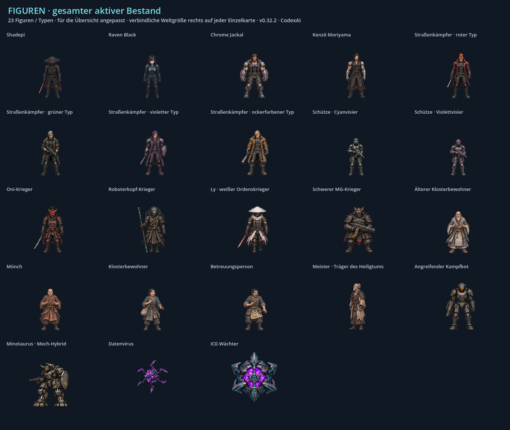

# Verbindliche Konsistenzvorlage für ShadepiRPG

**Stand v0.40.0 · CodexAI · 9. November 2026; eingeführt mit v0.32.1.** Gilt für das gesamte Spiel und alle Mitwirkenden, ob Mensch oder KI. Vor Änderungen zusammen mit [AGENTS.md](AGENTS.md) lesen und die [Arbeitsvorlage](docs/vorlagen/konsistenz-auftrag.md) verwenden. Eine neuere ausdrückliche Nutzervorgabe hat Vorrang; bestätigte Änderungen anschließend hier und in den betroffenen Referenzen nachführen.

## Bebilderter Einstieg für das gesamte Spiel

**[Vollständige Stilbibel öffnen](docs/stilbibel/README.md)** · [Alle 23 Figuren mit eigenen Bildkarten](docs/stilbibel/figuren.md) · [Art Direction](docs/stilbibel/artdirection.md) · [Alle Schauplätze](docs/stilbibel/welten.md) · [Fahrzeuge und Requisiten](docs/stilbibel/fahrzeuge-requisiten.md) · [UI, FX und Ton](docs/stilbibel/oberflaechen-effekte.md).



Die Stilbibel enthält 31 aus bestehenden Spielgrafiken gerenderte Tafeln: einzelne Figurenansichten, 20 Hintergrundquellen, Fahrzeuge, neun Objektarten in drei Zuständen, sechs UI-Themen und Effektfamilien. Sie ist der visuelle Einstieg für jede neue Arbeit. Die folgenden Regeln beschreiben den gemeinsamen Arbeits- und Prüfstandard; das Heiligtum ist ein Anwendungsfall unter mehreren.

## 1. Vor Arbeitsbeginn

1. Lokale Änderungen prüfen und erhalten. Alle GitHub-Branches abrufen:

   ```sh
   git status --short
   git fetch origin '+refs/heads/*:refs/remotes/origin/*'
   git branch -r
   ```

2. Versionen **und tatsächliche Änderungen** auf den relevanten Branches vergleichen. Den passenden aktuellen Stand ohne Verlust fremder oder lokaler Arbeit übernehmen. Ein Branchname oder ein aktueller `main` allein beweist nicht, dass alle neuen Änderungen enthalten sind.
3. Betroffene Szene, ihre aktiven Ressourcen und den bisherigen Ablauf im Code ermitteln. Referenzgrafiken tatsächlich ansehen. Vorhandene passende Assets wiederverwenden; neue Grafiken gezielt erstellen.
4. Auftrag, Ausgangscommit, Referenzpfade und unveränderte Merkmale in der Arbeitsvorlage festhalten. Fehlende oder unbestätigte Angaben kennzeichnen, statt sie als Kanon zu ergänzen.

## 2. Welche Quelle gilt?

| Frage | Maßgebliche Quelle |
| --- | --- |
| Bestätigte Figurenmerkmale, Handlung und Korrekturen | Neueste ausdrückliche Nutzervorgaben; danach die bestätigten Angaben im [Universumsarchiv](docs/universum/README.md) und die dort verzeichneten Quellenunterschiede. |
| Wie eine Figur im Gameplay aussehen soll | Aktive Helden-Sprites und tatsächlich gerenderte Nachbarfiguren bei derselben Kamera und Spielgröße. Figurenblätter sichern die Identität; eine große Konzeptzeichnung ersetzt diesen Stilabgleich nicht. |
| Welche Grafik oder welcher Ablauf aktuell verwendet wird | Ressourcenverweise und Ablauf im aktuellen Code. Ein vorhandener Dateiname beweist keine aktive Verwendung. |
| Frühere Version, verworfener Entwurf oder Vorschlag | Als historisch beziehungsweise geplant gekennzeichnete Dokumente. Sie werden erst durch eine entsprechende Änderung zur aktuellen Umsetzung. |

Die ursprünglichen zwölf Figurenbilder sind als eingebettete Chatbilder beschrieben, nicht als lokale Originaldateien archiviert. Den nicht hochgeladenen Comic oder ein fehlendes Bild niemals als gesichtete Quelle ausgeben. Originalquellen nicht überschreiben. Eine technische Umsetzung wie Spritegröße oder Kamerazoom ist keine zusätzliche Lore-Angabe.

## 3. Referenzen für neue Arbeiten

Diese Auswahl bezeichnet den Stand bei Einführung der Vorlage. Wird eine aktive Quelle später geändert, die Zeile mit Version und Begründung aktualisieren.

| Bereich | Aktive Referenz und Verwendung |
| --- | --- |
| Shadepi im Gameplay | [shadepi.png](assets/sprites/heroes/shadepi.png), Darstellung über [PixelActor](scripts/pixel_actor.gd) und [SpriteAssets](scripts/sprite_assets.gd). Vorder- und Seitenansicht vor neuen Posen vergleichen. |
| Raven im Gameplay | [raven.png](assets/sprites/heroes/raven.png), dieselbe Darstellung. Besondere Handzauberposen und ihre Handanker: [raven-hand-cast.json](assets/sprites/heroes/raven-hand-cast.json). |
| Heiligtum: Sitz-, Bett- und Kontaktposen | **[poses-game.png](assets/story/sanctuary/poses-game.png)**, [Anker und Ausschnitte](scripts/sanctuary_tableau.gd), [Herkunft](assets/story/sanctuary/README.md). `poses.png` und `poses-seated.png` sind historische Blätter und keine aktuelle Stilvorlage. |
| Wohn-/Kompensatorraum | [chamber-connected.png](assets/world/painted/chamber-connected.png) und [compensator-clear.png](assets/world/painted/compensator-clear.png). Die Tür ist Teil des Wohnraums; der Sessel ist Teil der Posen. Kein zweiter Stuhl dahinter. |
| Hauptmenü | [start-heroes-hq.png](assets/menu/start-heroes-hq.png), [Menü-Laufzeit](scripts/start_menu_backdrop.gd), [Gestaltung](docs/live-startmenue.md). Die größere Menükomposition ist keine Vorlage für die Pixeldichte kleiner Gameplay-Figuren. |
| Kulissen und Atmosphäre | [painted_world.gd](scripts/painted_world.gd), [Ortsprofile](scripts/atmosphere_profiles.gd), [Designbericht](docs/design-atmosphaere.md). Eigene Karten und Transformationen der Erinnerungen berücksichtigen. |
| Gegner und Hand-/Pistolen-FX | [Kontaktanker](assets/sprites/npcs/contact-poses.json), [Kampfvergleich](docs/raven-gegner-kampf.md). Frame-, Fuß-, Hand- und Mündungsanker gehören zur Grafik. |
| Erinnerungsfiguren | Eigene Metadaten für [Angriff](assets/memories/attack/actors.json), [Lys Opfer](assets/memories/sacrifice/actors.json) und [Vermächtnis](assets/memories/legacy/actors.json), jeweils zusammen mit den referenzierten Atlanten. |
| Oberflächen und Hacks | [Pixel-UI](docs/pixel-ui.md), [Ravens Terminals](docs/ravens-terminals.md) und [Terminal-Oberfläche](scripts/terminal_ui.gd). |
| Musik | [Verbindliche Zuordnung und Austauschpfade](assets/music/README.md), umgesetzt in [music_library.gd](scripts/music_library.gd). |

### Sichtbare Referenzen aller Bereiche

Figuren und Art-Richtung werden über den [vollständigen Bildkatalog](docs/stilbibel/figuren.md) und die [Material-/Lichtregeln](docs/stilbibel/artdirection.md) abgeglichen. Die [Weltübersicht](docs/stilbibel/bilder/welten.png), [Objektgrößen neben Raven](docs/stilbibel/fahrzeuge-requisiten.md), [Fahrzeugansichten](docs/stilbibel/bilder/fahrzeuge.png) und [UI-/FX-Tafeln](docs/stilbibel/oberflaechen-effekte.md) sichern die übrigen Bereiche. Pro Figur und Objekt die passende aktive Quelle verwenden.

[Der dokumentierte Heiligtum-Stilbruch](docs/heiligtum-figuren-v032.md) bleibt ein Fehlerbeispiel. Er ist nicht die alleinige Gestaltungsvorlage des Spiels. Bekannte Unterschiede im übrigen Altbestand stehen in der [Art Direction](docs/stilbibel/artdirection.md#bekannte-unterschiede-im-altbestand).

## 4. Feste Figurenmerkmale

Für **alle 23 Figuren beziehungsweise visuellen Typen** gelten die individuellen Merkmale und Quellen im [bebilderten Figurenkatalog](docs/stilbibel/figuren.md), einschließlich Gegnern, Kriegern, Zivilpersonen, Meister und digitalen Formen. Die beiden Hauptfiguren sind hier zusätzlich als Kurzreferenz aufgeführt.

| Figur | Bei jeder neuen Ansicht und Pose erhalten |
| --- | --- |
| **Shadepi** | Schwarzer Kasa; geschlossene, segmentierte dunkle Metallmaske mit roten Augenlinsen; schwarzer Schal; dunkle taktische Weste mit Taschen, Protektoren und Handschuhen; lange ausgefranste Stoffbahnen; dunkle Stiefel; rotes Laser-Katana, sofern die Szene es zeigt. Gesicht nicht unbegründet enthüllen. Metall bleibt dunkles Metall, Stoff bleibt Stoff. |
| **Raven Black** | **160 cm**, lange schwarze Haare mit blauen Spitzen; rote Augen; goldenes Septum; schwarzer taktischer Anzug mit schmalen Cyan-Linien und Cyan-Kragenmodulen; rote Raben-Schulterembleme; Handschuhe, Gürtel, Holster und schwarze Stiefel. Bei kleinen Sprites Merkmale durch klare Pixelgruppen lesbar halten, ohne Kopf oder Schmuck zu vergrößern. |

Ravens frühere 168-cm-Angabe ist überholt. Für Shadepi hier keine unbestätigte Zentimetergröße ergänzen. Die vorhandenen Gameplay-Proportionen dienen als visueller Maßstab. Pose, Perspektive und Entfernung dürfen sichtbare Größen ändern; Identität und Körperbau bleiben erhalten. Ausdrucksvarianten nur gemäß Quelle und Szenenkontext einsetzen.

## 5. Grafik und Maßstab

- **HQ-Pixelart im Cyberpunk-Stil:** erkennbare Pixelcluster, differenzierte Schatten und materialgerechte Textur. Keine einfachen Vektorkörper, glatten Ersatzillustrationen oder bloß vergrößerten groben Sprites. Dateiauflösung allein ist kein Qualitätsnachweis.
- Die Referenz bei **tatsächlicher Spielgröße** vergleichen. Für dunkle Helden ruhige schwarze/gunmetallene Flächen mit gezielten Lichtkanten verwenden. Körnige Bronze-, Rost- oder Weißtexturen nicht über Stoff und schwarze Rüstung verteilen. Ortslicht darf die Figur beleuchten, aber ihre Materialfarben nicht ersetzen.
- Figuren-PNGs besitzen echten transparenten Außenraum. Weißes Papier, graue Matte, ungewollte Halos und abgeschnittene Haare oder Waffen sind Fehler. Ein harter Alpha-Shader ist kein Ersatz für ein passend freigestelltes Asset.
- Kamera, Perspektive, Lichtseite und Detaildichte an die aktive Szene anpassen. Kontaktschatten, Verdeckung und Bodenbezug zusammen mit dem Sprite prüfen.
- Farbwirkung aus der jeweiligen Referenz ableiten: Cyan/Magenta in der Stadt, warme Ordens-/Wohnräume, eigene virtuelle Farbwelt. Neue exakte Farbwerte nicht nachträglich als angebliche Originalpalette ausgeben.

### Technische Ausgangswerte des bestehenden Helden-Renderers

| Eigenschaft | Aktueller HQ-Heldenvertrag |
| --- | --- |
| Blatt | 1024 × 5120 Pixel; 8 Spalten, 32 Reihen, Zelle 128 × 160. |
| Verkleinerung | `SpriteAssets.display_scale()` liefert 0,5 für dieses HQ-Format. |
| Fußbasis | Quell-Y 152; `PixelActor` berechnet daraus die Sprite-Verschiebung. |
| Sichtbarer Körper | Frontale Original-Silhouetten etwa 57–59 Weltpixel hoch bei Maßstab 0,5; die 160 Pixel Zellenhöhe sind einschließlich Freiraum. Keine Umrechnung dieser Pixelzahl in Zentimeter. |
| Abtastung | Normale Helden verwenden bei Verkleinerung lineare Abtastung. Neue benachbarte Posen darauf abstimmen. Weder „immer Nearest“ noch ein globaler Weichzeichner ist eine allgemeine Projektregel. |
| Spielbild | Gameplay-Basis 640 × 360; das HQ-Menü hat eine eigene Darstellung in Fensterauflösung. |

Sonderatlanten für Sitzen, Liegen, Gegner oder Menü folgen ihren eigenen Metadaten. **Keinen universellen Maßstabsfaktor auf alle Grafiken anwenden.** Bei Schlafposen die Körperlänge statt der geringen liegenden Höhe vergleichen; bei Sitzposen Beinwinkel und Stuhlhöhe einbeziehen. Ein Atlaswechsel muss Körpergröße, Fußbasis und Schatten erhalten. Benutzerdefinierte Sprite-Ersetzungen gemäß `SpriteAssets.resolve()` respektieren.

## 6. Animation und räumlicher Kontakt

1. Ausgangspose, Übergang, Hauptaktion und Rückkehr als Folge ansehen. Verkleidung, Gesichtsform, Körperbreite und Detaildichte dürfen zwischen Frames nicht wechseln.
2. Fuß-/Sitz-/Liegeanker in Quellpixeln dokumentieren. Stuhl, Matratze und Plattform bleiben ortsfest; Hände treffen Maske, Handgelenk, Waffe oder Gerät tatsächlich. Bei einem Wechsel vom Lauf-Sprite zur Szenenpose die Fußpositionen im Weltkoordinatensystem vergleichen.
3. Ein Sitzender braucht passende Sitz-, Rücken-, Arm- und Fußkontakte. Eine Schlafende braucht eine echte Liegepose; einen stehenden Körper zu drehen ergibt keine glaubhafte Schlafanimation. Keine doppelten Möbel oder Figuren hinter den Posen.
4. Haar- und Stoffwind bewegt freie Enden. Kopf, Maske, Hände, Waffen und Standfüße bleiben verankert. Im Hauptmenü verschiebt die Maus die Figuren und Plattform nicht; Raven steht vollständig innerhalb der Plattformkante.
5. Ravens virtuelle Blitze beginnen an der offenen Hand; ihre Pistolenschüsse an der Mündung. Blickrichtung, Projektilursprung, sichtbarer Treffer und Spielregel passen zusammen. Ladebereitschaft, Auslösen, Treffer und Erholung bleiben unterscheidbar.
6. Nach Unterbrechung, Überspringen, Kapitelwechsel und Laden alle temporären Zustände zurücksetzen: Atlas, Pose, Rotation, Schatten, Aufhellung, Lichtstrom und FX. Asynchrone Szenenschritte dürfen die folgende Szene nicht mehr verändern.

## 7. Szene, Bedienung und Ton

- Tower ab v0.33.0: Kenzō hält Raven vor Shadepis Eingreifen fest und bleibt nach der Niederlage bis zur geschützten Datenextraktion lebendig. Seine Inszenierung wird bewiesen; Motiv und Auftraggeber bleiben offen. Erst anschließend folgen Ravens endgültige Abrechnung und die sichtbare gemeinsame Flucht. [Aktuelle Reihenfolge](docs/tower-extraktion.md).

- Inszenierung ab v0.35.1 · CodexAI: Kenzō steht neben dem Sessel; Raven nähert sich vom Eingang, nach dem Griff läuft Shadepi dazu. Die Tower-Flucht beginnt **auf dem bestehenden Landeplatz**, am zuvor erspielten Abstellpunkt. Nach Abheben und Schubverlust folgt die Fassade darunter: Der Aerodyne kommt von oben am Balkon vorbei und fängt sich unterhalb ab. **Kein Start auf dem Balkon.** Im Hangar bleiben die freien Laufwege erhalten. [Kontakt-/Laufwege und Film](docs/tower-inszenierung.md).

- Handlung, Figurenwissen und Anwesenheit gegen die aktuelle Szenenquelle prüfen. Beim Heiligtum gilt: Shadepi geht zur Eindämmung **alle sechs Tage** voraus; Raven folgt nach der Aerodyne-Reparatur, schläft zwei Stunden und sucht ihn erst danach. Die Handkontaktszene führt zu den Erinnerungen.
- Erinnerung III spielt im Tempelinneren über der getarnten Hightech-Basis. Der Meister ist nach der Übertragung tot; Shadepis späterer Zusammenbruch ist keine bestätigte Todesfestlegung. Weitere Szenen nach den aktuellen Archivquellen behandeln.
- Dialoge natürlich und sprechbar halten; Aktionen durch vorhandene In-Engine-Szenen, Bewegung und passende Sprechblasen zeigen. Eine neue Bildertafel ersetzt nicht ungefragt eine Spielszenen-Inszenierung.
- Für neue oder geänderte Interaktionen Tastatur **und Controller** prüfen: Fokus, Navigation, Bestätigen, Zurück, Hilfe und Pause. Hilfetexte erklären Ziel, Eingabe und Erfolgs-/Fehlerreaktion. Belegung ist kontextabhängig; keine globale Umbelegung aus einer einzelnen Szene ableiten.
- FX kommen aus nachvollziehbaren Quellen: Fensterregen auf Glas, Dampf am Austritt, Glut am Feuer. Figuren, Hindernisse, Hinweise und Angriffssignale bleiben lesbar. Bestehende Qualitätsstufen und Pausenregeln erhalten; keine unbegrenzten Partikelspawner.
- Musikpfade und Groß-/Kleinschreibung nach der aktiven Zuordnung erhalten. **Musikkorrektur v0.37.0 · CodexAI:** Hauptmenü weiterhin `Level.mp3`, beide Kapitel-7-Abschnitte ausdrücklich `menu.mp3`; normale Kämpfe und Bosse ihre jeweiligen Kampfstücke. Ton-Aus und Pausenverhalten auch für neue Klänge beachten.

- See-Finale ab v0.36.0 · CodexAI: Der Aerodyne landet auf trockenem Uferboden; beide steigen aus der seitlichen Kabine aus. Nach Ravens freiwilliger Ordensaufnahme nimmt **sie** Shadepis Maske ab. **Handkorrektur v0.36.1 · CodexAI: Ravens eigene rechte Hand hebt die Maske, ihre eigene linke berührt und verdeckt sein Gesicht; auch im Kuss.** **Sein Gesicht bleibt durch Ravens Hand, Kasa und Kopfhaltung verdeckt; kein vollständiges Porträt.** Ein kurzer Drachenschatten und mystisches Leuchten bleiben auf die Wasserfläche beschnitten. Der Comic liegt nicht lokal vor; maßgeblich ist die Nutzerbeschreibung. [Aktive Quellen und Belege](docs/see-finale.md).

- Eisbad ab v0.38.0 · CodexAI: eigene Posen und Kontaktanker aus `ice_bath_sequence.gd` verwenden; vollständiger Zeichenrahmen für zurückgelehnte Haare und Kopf. Wasser-/Wannenverdeckung aus aktiver Raumquelle, keine doppelte Wanne. Sprayholen bleibt spielbar; Inventar und Szenenfortsetzung beim Laden erhalten. Normale Körper inklusive gezeichnetem Kontaktschatten vollständig ausblenden und zurücksetzen. [Aktive Quelle und Belege](docs/eisbad.md).

- Hangar ab v0.39.0 · CodexAI: Schalterfinger und Werkbanksymbol haben denselben Kontaktpunkt. Figuren und Motorrad stehen innerhalb der Plattform; tatsächliche Garagenprojektion beim Andocken übernehmen, danach weich in die Halle fahren. Tatsächliche Figuren beim Abbruch vor dem Freigeben der Filmansicht zurückhängen. Gleicher Aerodyne-Atlas in Erkundung/Abflug/Flug, unterirdisches Dach bis zum Abflug geschlossen; KOBAN-TEC-Schicht zuletzt. Cargo hält die Ausstiegsroute frei. [Quelle und Spielbelege](docs/hangar-entdeckung.md).

- Fahrzeugbewegung ab v0.40.0 · CodexAI: Banklage und Heading sind getrennte Werte. Für neue Ansichten Rumpfanker und Düsenzentren gemeinsam registrieren; Kabinenöffnung schaltet beide sofort zur geraden Mechanikquelle zurück. Motorrad-Reifenkontakt aus `motorcycle_art.gd` erhalten. Tatsächliche 418er-Zellen verwenden, unbenutzten Schussentwurf nicht als fertige Schussanimation ausgeben. [Quellen und Belege](docs/fahrzeugbewegung.md).

## 8. Verbindliche Fertigprüfung

Für jeden betroffenen Bereich im [Arbeitsnachweis](docs/vorlagen/konsistenz-auftrag.md) Ergebnis und Beleg festhalten. Unbetroffene Punkte mit Grund als „nicht betroffen“ kennzeichnen.

- [ ] Aktueller Repository-Stand und tatsächlich aktive Referenzen geprüft.
- [ ] Figurenmerkmale und bestätigte Handlung erhalten; keine fehlenden Quellen erfunden.
- [ ] Grafik bei normaler Spielkamera **neben dem bestehenden Sprite** verglichen, zusätzlich Nahansicht für Kanten und Materialdetails.
- [ ] Ganze Animation geprüft: Anfang, Kontakt/Auslösen, Ende und Rückkehr. Füße, Hände, Möbel, Haare und Waffen weder abgeschnitten noch springend.
- [ ] Vergleichbare Vorher-/Nachher-Bilder oder ein kurzer tatsächlicher Godot-Film vorhanden. Kamera, Licht und Qualität für den Vergleich gleich; Herkunft und Version angeben.
- [ ] Für den Umfang relevante Funktionen geprüft: Controller, Pause, Bildstil, Überspringen, Laden und Abbruch. Speicherstände für Tests isolieren.
- [ ] Relevante vorhandene Tests bestanden. Neue Tests nur für tatsächlich neue Fehlerfälle; keine Prüfzahlen aus früheren Versionen als aktuelle Ergebnisse übernehmen.
- [ ] Neue Ressourcen, Ankerdateien und Shader auch im Export geprüft, wenn sie geändert wurden.
- [ ] Aktuelle Version und Änderungsinfos konsistent; Änderungen überprüfbar gespeichert und gemäß bestehender Autorisierung auf GitHub gesichert.

**Eine bestandene automatisierte Prüfung bewertet keinen Grafikstil.** Eine Sichtprüfung im tatsächlichen Renderer bleibt bei Grafik-/Animationsänderungen Teil der Arbeit. Ein offener Stilbruch wird als offen dokumentiert und korrigiert; ein neuer Dateiname, eine große PNG oder ein grüner Build reicht nicht als Abschlussbeleg. Bei reinen Dokumentationsänderungen genügen Inhalts-, Link- und Versionsprüfung; keine Grafikgenerierung oder vollständige Gameplay-Prüfung dafür starten.

### Vorhandene gezielte Prüfmittel

| Betroffener Bereich | Passende bestehende Prüfungen / Bildbelege |
| --- | --- |
| Gesamtspiel, Karten und Szenenfolge | [Gameplay/Speichern](tests/run.gd), [Story](tests/story_audit.gd), [Weltübersicht](docs/stilbibel/welten.md). |
| Kampf, Gegner und Hand-/Mündungsanker | [Kampfbewegungen](tests/combat_moves.gd), [Gegner/Raven](tests/raven_enemy_combat.gd), [Wellen](tests/arcade_waves.gd), [Figurenkarten](docs/stilbibel/figuren.md). |
| Controller und Hacks | [Terminalregeln](tests/terminal_puzzles.gd), [Controller](tests/terminal_controller.gd), [fünf UI-Familien von Rätseln](docs/stilbibel/oberflaechen-effekte.md). |
| Fahrzeuge und Flug | [Fahraktion](tests/drive_action.gd), [Aerodyne](tests/aerodyne_flight.gd), [Fahrzeugreferenzen](docs/stilbibel/fahrzeuge-requisiten.md). |
| Kloster, Bewohner, Krieger und Mechs | [Klosterfiguren](tests/monastery_memory.gd), [Bots/Schutzopfer](tests/monastery_battle.gd), [Ly](tests/sacrifice_memory.gd), [Vermächtnis](tests/legacy_memory.gd). |
| Heiligtum-Gegenwart | [Posen](tests/sanctuary_art.gd), [Ablauf](tests/sanctuary_story.gd), [Fehlerbericht 8](tests/report8.gd). |
| Tower, Extraktion und Abflug | [Treffer-/Kontrollpunkt-/Phasenprüfung](tests/tower_sequence.gd), [Ablauf und Bilder](docs/tower-extraktion.md), [Galerie](tools/tower_gallery.gd). |
| Atmosphäre und Darstellung | [Ortsprofile/Pause](tests/scene_atmosphere.gd), [digitale Gegner](tests/npc_dive_visuals.gd), [Art Direction](docs/stilbibel/artdirection.md). |

```sh
godot --headless --editor --import --quit
# Nur die für die Änderung relevanten Prüfreihen aus der Tabelle ausführen.
# Referenztafeln bei geänderten Quellen mit echtem Renderer erneuern:
godot --audio-driver Dummy --script res://tools/style_bible_gallery.gd
```

Die vollständigen bestehenden Aufrufe stehen im [GitHub-Workflow](.github/workflows/build.yml). Godot muss lokal als `godot` verfügbar sein; Bildtafeln benötigen einen echten Renderer, z. B. Desktop oder Xvfb/Mesa. Sie ersetzen weder die Prüfung einer neuen Animation in der Zielszene noch die relevanten Funktionstests.

## 9. Referenzen und Versionen pflegen

Aktive Referenzänderungen mit Grund, Versionsnummer und Bildbeleg dokumentieren; historische Dateien eindeutig markieren. Eine gezielte Verbesserung gilt nicht automatisch als Austauschfreigabe für alle Kulissen oder Figuren. Die neue Arbeitsvorlage benötigt keine zusätzliche Nutzerfreigabe für bereits beauftragte Arbeit.

Versionsfelder zusammen aktualisieren: [project.godot](project.godot), Windows-Felder in [export_presets.cfg](export_presets.cfg), aktuelle Angaben in [README](README.md) und [Spieleranleitung](Spiel-README.md), neuer Eintrag in [CHANGELOG](CHANGELOG.md). Bearbeiter nachvollziehbar nennen: **CodexAI** für Codex, **ClaudeHelper** für Claude; historische Zuordnungen nicht ändern. Commit-Titel enthalten Version und Bearbeiter. Git-Push und Cloud-Veröffentlichung bleiben unterschiedliche Aktionen; die geltende Autorisierung steht in `AGENTS.md`.
