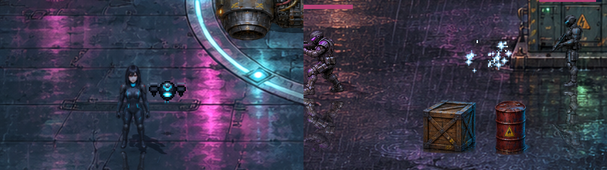
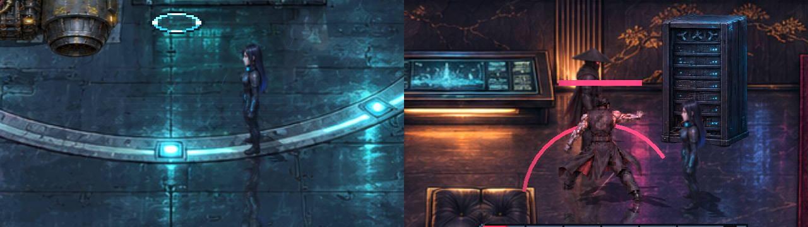
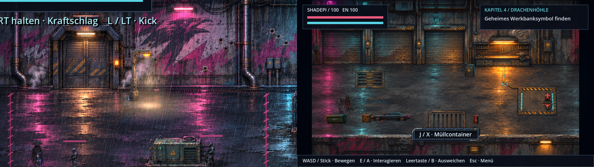

# Shadepi · Echos in Neon

**2D-Action-RPG · v0.60.1 · ClaudeHelper · Godot 4.7.2 · Windows / Linux · Einzelspieler und Lokal-Koop**

Ein spielbares Cyberpunk-Abenteuer nach **„Shadepi – Im Schatten des Raben“** mit sieben Kapiteln, gemalten Spielwelten, illustrierten Sprites für Raven, Shadepi und die Gegner sowie zerstörbarer Umgebung.

[**Spiel herunterladen (neuestes Release)**](https://github.com/Inrouder/ShadepiRPG/releases/latest) · [**Quellcode als ZIP**](https://github.com/Inrouder/ShadepiRPG/archive/refs/heads/main.zip) · [**Versionen**](CHANGELOG.md) · [**Spieleranleitung**](Spiel-README.md) · [**Bildgalerie & Doku**](docs/README.md)

## Bilder aus dem Spiel

| Begleiter für Spieler 2 · v0.53.0 · ClaudeHelper |
| --- |
| [](docs/begleiter.md) |
| [Drohne und Nanitenschwarm: Steuerung und Regeln](docs/begleiter.md) |

| Spiegelungen · v0.52.0 · ClaudeHelper | Türen frei, Laternenlicht |
| --- | --- |
| [](docs/szenenpolitur-v052.md) | [](docs/szenenpolitur-v052.md) |
| [Szenenpolitur v0.52.0](docs/szenenpolitur-v052.md) | Kalibrierte Sprites, Ringe unter den Figuren, Kino-Vignette |

| Dropdown-Korrektur · v0.51.1 · CodexAI | Auswahllisten auch in Ravens Hacks |
| --- | --- |
| [](docs/dropdowns-v0511.md) | [](docs/dropdowns-v0511.md) |
| [Korrektur und Bildprüfung](docs/dropdowns-v0511.md) | [Dropdown-Film](docs/previews/dropdowns-v0511.webp) |

| HQ-Anzeige · v0.51.0 · CodexAI | Darstellung im Haupt- und Pausenmenü wählen |
| --- | --- |
| [](docs/hq-anzeige-v051.md) | [](docs/hq-anzeige-v051.md) |
| [Full-HD- und 4K-Nachweis](docs/hq-anzeige-v051.md) | [HQ-Animationsfilm](docs/previews/hq-netz-v051.webp) |

| Anzeigeanalyse · v0.50.2 · CodexAI: aktuelle 640×360-Darstellung | Vergleichsprototyp direkt in Full HD |
| --- | --- |
| [](docs/anzeigequalitaet-v0502.md) | [](docs/anzeigequalitaet-v0502.md) |
| [Befund und Messungen](docs/anzeigequalitaet-v0502.md) | [Wechselvergleich](docs/previews/anzeige-vergleich-v0502.webp) · Testdarstellung, noch kein neuer Spielmodus |

| Raven als Netz-Gittersilhouette · v0.50.1 · CodexAI | Lauf- und Handposen bleiben erkennbar |
| --- | --- |
| [](docs/netzavatar-v0501.md) | [](docs/netzavatar-v0501.md) |
| [Spielansicht und Quellen](docs/netzavatar-v0501.md) | [Animationsfilm](docs/previews/netzavatar-v0501.webp) |

| ICE-Bosskampf · v0.50.0 · CodexAI | Offener Kern: vorstoßen und treffen |
| --- | --- |
| [](docs/ice-kampf-v050.md) | [](docs/ice-kampf-v050.md) |
| [Größere Arena, Ablauf und Bedienung](docs/ice-kampf-v050.md) | [Kampffilm](docs/previews/ice-kampf-v050.webp) |

| Mondsee und animierter Drachenschatten · v0.49.0 · CodexAI | Kompakte Menüs mit passenden Kapitelaktionen |
| --- | --- |
| [](docs/mondsee-v049.md) | [](docs/mondsee-v049.md) |
| [Kussanimation, Quellen und Vorher/Nachher](docs/mondsee-v049.md) · [Szenenfilm](docs/previews/mondsee-v049.webp) | [640p-Basis und Full-HD-Ansichten](docs/mondsee-v049.md#menüs-innerhalb-ihres-rahmens) |

**[Bebilderte Dokumentation mit Szenenfilmen öffnen →](docs/README.md)** · Ein Klick auf eine Vorschau öffnet den zugehörigen Bericht.

| Towerplan in Kapitel 3 · v0.48.0 · ClaudeHelper | Alarmlicht und Umgebungsmenü |
| --- | --- |
| [](docs/verbesserungen-v048.md) | [](docs/verbesserungen-v048.md) |
| [Alle Verbesserungen v0.48.0](docs/verbesserungen-v048.md) · [Story-Durchsicht](docs/story-durchsicht.md) | Pixelmarker, Umgebungsgeräusche, Aerodyne-Düsen |

| Originalhelden wieder aktiv · v0.46.1 · CodexAI |
| --- |
| [](docs/original-helden.md) |
| [Rückkehr zu den Originalen](docs/original-helden.md) · [Geh-/Richtungsfilm](docs/previews/original-helden-v0461.webp) |

| Blutspritzer · v0.46.0 · CodexAI | Bodenflecken und Lachen |
| --- | --- |
| [](docs/bluteffekte.md) | [](docs/bluteffekte.md) |
| [Verhalten und Bildvergleich](docs/bluteffekte.md) | [Treffer-/Bodenfilm](docs/previews/blut-v046.webp) |

| Menü mit Bodenkontakt und Test-Kontrollpunkten | Verfolgung und Frachtdrohnen |
| --- | --- |
| [](docs/menue-kontrollpunkte.md) | [](docs/verfolger-animationen.md) |
| [Menüoptionen, 40 Test-Einstiege und Film](docs/menue-kontrollpunkte.md) | [Neun Wagenphasen, Rotoren und Szenenfilm](docs/verfolger-animationen.md) |

| Fahrt zum geheimen Hangar | Abschluss am See |
| --- | --- |
| [](docs/hangar-entdeckung.md) | [](docs/see-finale.md) |
| [Plattformfahrt und Hangarenthüllung](docs/hangar-entdeckung.md) | [Anflug, Maskenmoment und Drachenschatten](docs/see-finale.md) |

Die Vorschauen sind vorhandene Aufnahmen aus dem Spielrenderer. Die verlinkten Berichte nennen ihren jeweiligen Aufnahmestand und enthalten weitere Bilder und animierte WebP-Clips.

## Spielen

1. Das [**neueste Release**](https://github.com/Inrouder/ShadepiRPG/releases/latest) öffnen; eine GitHub-Anmeldung ist nicht nötig.
2. **ShadepiRPG-Windows.zip** oder **ShadepiRPG-Linux.zip** herunterladen und vollständig entpacken. Entwicklungsstände zwischen zwei Releases liegen als Artefakte unter [Actions → Test and build Shadepi](https://github.com/Inrouder/ShadepiRPG/actions/workflows/build.yml) (dort ist eine Anmeldung nötig).
3. Unter Windows `Shadepi-Echos-in-Neon.exe` bzw. unter Linux `Shadepi-Echos-in-Neon.x86_64` starten. Eine Godot-Installation ist dafür nicht erforderlich.

Im Spiel gibt es ein Startmenü mit Einzelspieler und Lokal-Koop, eine gemeinsame Kamera und getrennte Kapitel-Kontrollpunkte. Details zu Tastatur, Controllern, Kampf, Speicherständen und Kapiteln stehen in der [Spieleranleitung](Spiel-README.md).

**Arcade-Kampfabschnitte:** Ravens Jagd, Shadepis Rettungsweg, der Hinterhalt und die Aufzugwachen bieten mehrere Gegnerwellen mit gesperrten Ausgängen, kurzen Pausen und Abschnitts-Kontrollpunkten. [Ablauf, Umfang und Entwicklung](docs/arcade-wellen.md).

**Neue Kampfbewegungen:** Aufladbarer Katana-Schlag mit Energiewelle, Kick und Ravens aufgeladener Pistolenschuss. [Steuerung und animierte Vorschau](docs/kampfbewegungen.md).

**Ravens Terminal-Aufgaben:** Matrix-Hacks, Passwort-Decoder, Schaltungsnetz mit Active ICE, Wellen-Synchronisation und Jumper-Reparatur ersetzen einfache Zugriffe an acht Storypunkten. [Steuerung, Vorschau und Aufgaben](docs/ravens-terminals.md).

**Kartenkorrekturen:** Das Versteck hat passende Möbelproportionen; Bingo Street geht mit durchgehender Bodenkante in die Gasse über. [Vergleich im Spiel](docs/karten-proportionen.md).

Das Startmenü zeigt die detailliert gemalten HQ-Figuren Shadepi in Bereitschaftshaltung und Raven mit Tablet nach den aktuellen Figurenreferenzen vor einer Neonstadt mit weißem Drachen. Figuren und Dach bleiben fest verankert; die Maus verschiebt oder verformt sie nicht. Ravens Haarspitzen und Shadepis Umhangränder wehen sanft im Wind. Passende Größe, Tiefenstaffelung und Kontaktschatten verankern beide auf der vorderen Plattform. Regen, Flugverkehr, Wasserreflexe und Neonlicht beleben die Szene. Die Menüknöpfe reagieren auf Maus und Controller-Fokus. Dazu läuft die Musik des Finales am See. [Vorschau und technische Hinweise](docs/live-startmenue.md).

## Geschichte und Spielumfang

- **Kapitel 1:** Ravens Jagd auf Chrome Jackal, Shadepis Eingreifen und gemeinsamer Kampf.
- **Kapitel 2:** Industriegebiet, Ravens Versteck, Kühlsystem, Deep Dive und ICE-Abwehr.
- **Kapitel 3–5:** Pakt, Hinterhalt, Fahrzeugverfolgung, Hangar, Heiligtum und Erinnerungssequenzen.
- **Kapitel 6–7:** Anflug, Tower, Konfrontation mit Kenzō, Aufzugwachen, Flucht und Abschluss am See.

Die Spielwelt nutzt gemalte HQ-Pixelkulissen aus `assets/world/painted/`, ergänzt um eigene Erinnerungs- und Szenenkulissen. Wände und verdeckende Bildteile sind in `scripts/painted_world.gd` abgestimmt. Zerstörbare Objekte, die sechs zugeordneten Musikstücke, HQ-Sprites und die Original-Keyframes sind im Repository enthalten.

Die Musik wechselt passend zwischen Hauptmenü, Erkundung, normalen Kämpfen und Bosskämpfen. Die vollständige Zuordnung und Hinweise zum Austauschen der MP3-Dateien stehen unter [Musik austauschen](assets/music/README.md).

## Repository und Mitarbeit

Für Menschen und KI: **[Bebilderte Stilbibel des gesamten Spiels](docs/stilbibel/README.md)** · [Alle 23 Figuren mit Einzelkarten](docs/stilbibel/figuren.md) · [Konsistenzregeln](KONSISTENZ.md) · [Mitarbeit](CONTRIBUTING.md) · [Kopierbarer Auftrag und Arbeitsnachweis](docs/vorlagen/konsistenz-auftrag.md). Die Projektregeln in [AGENTS.md](AGENTS.md), der Einstieg für [Claude](CLAUDE.md) und die Pull-Request-Vorlage verweisen auf denselben Standard.


[**Aktiv, historische Referenz oder Backup? → Repository-Status**](docs/repository-status.md). Die [Versionschronik der alten Startseite](docs/archiv/readme-bis-v0461.md) liegt im Archiv; Änderungen stehen in [CHANGELOG.md](CHANGELOG.md).

## Projekt entwickeln

Godot **4.7.2 Standard**, Compatibility-Renderer, kein C#. `project.godot` öffnen, Import abwarten und F5 drücken. Vorgefertigte Grafiken und Klänge sind enthalten; kein Asset-Generator gehört zum normalen Start.

| Bereich | Einstieg |
| --- | --- |
| Kapitel und Laufzeit | [Architektur](docs/architecture.md), `scenes/`, `scripts/` |
| Aktive Grafikquellen | [Asset-Status](assets/README.md), [bebilderte Stilbibel](docs/stilbibel/README.md) |
| Eigene Figuren | [Custom-Ordner](assets/custom/README.md), [Bearbeitung](docs/figuren-bearbeiten.md) |
| Entwicklerwerkzeuge | [Werkzeugkatalog](tools/README.md); Quell-Compiler verändern vorhandene Assets |
| Historie und verworfene Varianten | [Archiv](docs/archiv/README.md); getrennt vom verbindlichen [Universumsarchiv](docs/universum/README.md) |
| Prüfungen und Export | [Mitwirken](CONTRIBUTING.md), `.github/workflows/build.yml` |

```bash
python3 tools/audit_repository.py
godot --headless --editor --import --quit
# Tests erzeugen Kontrollpunkte: von persönlichen Spielständen trennen.
XDG_DATA_HOME="$(mktemp -d /tmp/shadepi-tests.XXXXXX)" godot --headless --script res://tests/run.gd
```

Die GitHub Action prüft und exportiert Windows/Linux. Eigene Exporte benötigen die offiziellen Exportvorlagen derselben Godot-Version. Archive, Entwicklungswerkzeuge, Dokumentation und Backups werden nicht als Spielinhalt ausgeliefert. Ein Windows-Export unter Linux ist keine manuelle Windows-Abnahme.

## Hintergrund und Lizenzhinweise

Die Quellen wurden ursprünglich aus einer Windows-Fassung rekonstruiert und mit Original-Keyframes ergänzt. Die [Wiederherstellungsnotiz](docs/v0.12.0-wiederherstellung.md) erklärt Herkunft und Grenzen der Medien. Hinweise zu Godot-Lizenzen stehen in `docs/GODOT-LICENSE.txt` und `docs/GODOT-COPYRIGHT.txt`.
