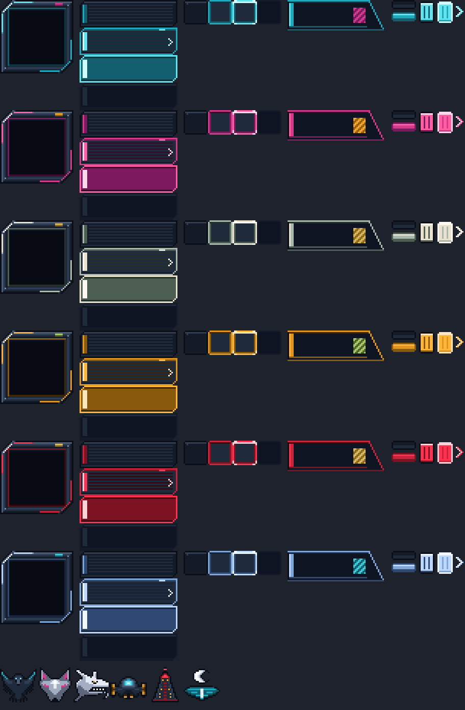
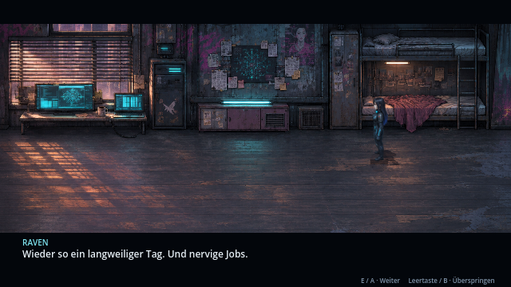

# Shadepi · Echos in Neon

**2D-Action-RPG · v0.36.1 · Godot 4.7.2 · Windows / Linux · Einzelspieler und Lokal-Koop**

Ein spielbares Cyberpunk-Abenteuer nach **„Shadepi – Im Schatten des Raben“** mit sieben Kapiteln, gemalten Spielwelten, illustrierten Sprites für Raven, Shadepi und die Gegner sowie zerstörbarer Umgebung.

[**Spiel herunterladen (neuestes Release)**](https://github.com/Inrouder/ShadepiRPG/releases/latest) · [**Quellcode als ZIP**](https://github.com/Inrouder/ShadepiRPG/archive/refs/heads/main.zip) · [**Versionen**](CHANGELOG.md) · [**Spieleranleitung**](Spiel-README.md)

## Spielen

1. Das [**neueste Release**](https://github.com/Inrouder/ShadepiRPG/releases/latest) öffnen; eine GitHub-Anmeldung ist nicht nötig.
2. **ShadepiRPG-Windows.zip** oder **ShadepiRPG-Linux.zip** herunterladen und vollständig entpacken. Entwicklungsstände zwischen zwei Releases liegen als Artefakte unter [Actions → Test and build Shadepi](https://github.com/Inrouder/ShadepiRPG/actions/workflows/build.yml) (dort ist eine Anmeldung nötig).
3. Unter Windows `Shadepi-Echos-in-Neon.exe` bzw. unter Linux `Shadepi-Echos-in-Neon.x86_64` starten. Eine Godot-Installation ist dafür nicht erforderlich.

Im Spiel gibt es ein Startmenü mit Einzelspieler und Lokal-Koop, eine gemeinsame Kamera und getrennte Kapitel-Kontrollpunkte. Details zu Tastatur, Controllern, Kampf, Speicherständen und Kapiteln stehen in der [Spieleranleitung](Spiel-README.md).

**Arcade-Kampfabschnitte:** Ravens Jagd, Shadepis Rettungsweg, der Hinterhalt und die Aufzugwachen bieten mehrere Gegnerwellen mit gesperrten Ausgängen, kurzen Pausen und Abschnitts-Kontrollpunkten. [Ablauf, Umfang und Entwicklung](docs/arcade-wellen.md).

**Neue Kampfbewegungen:** Aufladbarer Katana-Schlag mit Energiewelle, Kick und Ravens aufgeladener Pistolenschuss. [Steuerung und animierte Vorschau](docs/kampfbewegungen.md).

**Ravens Terminal-Aufgaben:** Matrix-Hacks, Passwort-Decoder, Schaltungsnetz mit Active ICE, Wellen-Synchronisation und Jumper-Reparatur ersetzen einfache Zugriffe an acht Storypunkten. [Steuerung, Vorschau und Aufgaben](docs/ravens-terminals.md).

**Kartenkorrekturen:** Das Versteck hat passende Möbelproportionen; Bingo Street geht mit durchgehender Bodenkante in die Gasse über. [Vergleich im Spiel](docs/karten-proportionen.md).

Das Startmenü zeigt die detailliert gemalten HQ-Figuren Shadepi in Bereitschaftshaltung und Raven mit Tablet nach den aktuellen Figurenreferenzen vor einer Neonstadt mit weißem Drachen. Figuren und Dach bleiben fest verankert; die Maus verschiebt oder verformt sie nicht. Ravens Haarspitzen und Shadepis Umhangränder wehen sanft im Wind. Passende Größe, Tiefenstaffelung und Kontaktschatten verankern beide auf der vorderen Plattform. Regen, Flugverkehr, Wasserreflexe und Neonlicht beleben die Szene. Die Menüknöpfe reagieren auf Maus und Controller-Fokus. Dazu läuft die Musik des Finales am See. [Vorschau und technische Hinweise](docs/live-startmenue.md).

## Geschichte und Spielumfang

- **Kapitel 1:** Ravens Jagd auf Chrome Jackal, Shadepis Eingreifen und gemeinsamer Kampf.
- **Kapitel 2:** Industriegebiet, Ravens Versteck, Kühlsystem, Deep Dive und ICE-Abwehr.
- **Kapitel 3–5:** Pakt, Hinterhalt, Fahrzeugverfolgung, Hangar, Heiligtum und Erinnerungssequenzen.
- **Kapitel 6–7:** Anflug, Tower, Konfrontation mit Kenzō, Aufzugwachen, Flucht und Abschluss am See.

Die Spielwelt nutzt gemalte HQ-Pixelkulissen aus `assets/world/painted/`, ergänzt um eigene Erinnerungs- und Szenenkulissen. Wände und verdeckende Bildteile sind in `scripts/painted_world.gd` abgestimmt. Zerstörbare Objekte, die sechs zugeordneten Musikstücke, HQ-Sprites und die Original-Keyframes sind im Repository enthalten.

Die Musik wechselt passend zwischen Hauptmenü, Erkundung, normalen Kämpfen und Bosskämpfen. Die vollständige Zuordnung und Hinweise zum Austauschen der MP3-Dateien stehen unter [Musik austauschen](assets/music/README.md).

## Mitarbeit und verbindliche Konsistenz

Für Menschen und KI: **[Bebilderte Stilbibel des gesamten Spiels](docs/stilbibel/README.md)** · [Alle 23 Figuren mit Einzelkarten](docs/stilbibel/figuren.md) · [Konsistenzregeln](KONSISTENZ.md) · [Mitarbeit](CONTRIBUTING.md) · [Kopierbarer Auftrag und Arbeitsnachweis](docs/vorlagen/konsistenz-auftrag.md). Die Projektregeln in [AGENTS.md](AGENTS.md), der Einstieg für [Claude](CLAUDE.md) und die Pull-Request-Vorlage verweisen auf denselben Standard.

## Neu in v0.36.1 · CodexAI · 9. November 2026

- Ravens Handführung im See-Finale korrigiert: Ihre **rechte Hand hebt die Maske**, ihre **linke berührt und verdeckt Shadepis Gesicht**. Die Zuordnung bleibt in Maskenabnahme und Kuss konsistent.
- Kontaktposen im tatsächlichen Spiel geprüft; [aktuelle Bilder und Film](docs/see-finale.md), [Arbeitsnachweis](docs/arbeiten/see-haende-v0361.md).

## Neu in v0.36.0 · 9. November 2026 · CodexAI

- **Landeanflug zum See:** Weite Mondlichtaufnahme, sichtbarer Anflug, Abfangen über der freien Uferfläche und weiches Aufsetzen. Raven und Shadepi steigen nacheinander seitlich aus der Kabine und gehen ans Wasser.
- **Romantisches Finale:** Nach der freiwilligen Ordensaufnahme nimmt Raven Shadepis Maske ab und küsst ihn. Neue HQ-Pixelposen zeigen Handkontakt und Umarmung; Hand und Kasa verdecken sein Gesicht. Ein kurzer Drachenschatten gleitet über den mystisch leuchtenden See.
- Neue Szenen lassen sich pausieren, überspringen und nach unterbrochenem Speichern/Laden erneut beginnen. Ältere Kapitel-7-Anfangs-/Endspielstände erhalten die neue Szene einmalig. [Spielaufnahmen und technische Hinweise](docs/see-finale.md).

## v0.35.1 · 9. November 2026 · CodexAI

- **Räumlich korrigierte Tower-Flucht:** Beide laufen auf dem vorhandenen Dach-Landeplatz zum dort geparkten Aerodyne und steigen ein. Nach Abheben und Schubverlust folgt die Fassade darunter: Das Schiff kommt von oben, fällt am Balkon vorbei und fängt sich darunter. Der Start vom Balkon in v0.35.0 ist ersetzt.
- Der beim Anflug erspielte Abstellpunkt wird jetzt gespeichert und beim Abflug wiederverwendet. [Aktuelle Bilder und Film](docs/tower-inszenierung.md).

## v0.35.0 · 9. November 2026 · CodexAI (Abflugfassung durch v0.35.1 ersetzt)

- **Penthouse:** Kenzō wartet sichtbar neben dem Sessel. Raven läuft vom Eingang durch den Raum auf ihn zu. Nach seinem Griff kommt Shadepi erst sichtbar vom Eingang herangelaufen und greift ein.
- **Tower-Flucht:** Rennen, Einsteigen, Kippen, Fall und Abfangen bleiben in derselben Außenansicht. Durchgehende Fluggeschwindigkeit, passende Ausrichtung, fest an den Düsen sitzende texturierte Triebwerksstrahlen und eine einmalige Explosion ersetzen den harten Wechsel mitten im Fall.
- **Hangar:** Beide starten auf freiem Boden, laufen um die Geräte herum und steigen nacheinander ein. [Spielaufnahmen, Film und Prüfungen](docs/tower-inszenierung.md).

## v0.34.0 · 9. November 2026 · CodexAI

- Start im **Fenstervollbild**; unter **Anzeige** im Haupt- und Pausenmenü zwischen Fenster, Fenstervollbild und Vollbild wechseln. **F11 / Alt+Enter** schaltet jederzeit um. Die Auswahl wird für den nächsten Start gespeichert.
- Das Spielbild wächst jetzt mit dem Fenster. **16:9-Ausgabe in 1080p, 1440p und 4K**; andere Bildschirmformate erhalten passende Ränder. Optional bleiben ganze Pixelstufen wählbar. Fenstergrößen werden an den verfügbaren Bildschirm angepasst.
- [Bedienung, Pixelauflösung und echte Bildschirmaufnahmen](docs/bildschirm.md).

## v0.33.0 · 8. November 2026 · CodexAI

- **Tower mit geschützter Datenextraktion:** Kenzō packt Raven, erst danach greift Shadepi ein. Nach dem Bosskampf kniet Kenzō schwer verletzt und gelähmt am Boden. Raven extrahiert seine Daten, während Shadepi drei Wachwellen abfängt; drei Treffer auf Raven starten die Extraktion neu.
- Die Daten bestätigen Kenzōs Inszenierung des Massakers. Motiv und Auftraggeber bleiben unbekannt. Erst nach gesicherter Extraktion vernichtet Raven seine Implantate endgültig; beide setzen die Suche gemeinsam fort.
- Sichtbare kurze Flucht: zum Aerodyne rennen, einsteigen, über die Kante kippen, im Fallen zünden und der Penthouse-Explosion entkommen. KOBAN-TEC ersetzt das bisherige fremde Zeichen im Hangar und beim Hangar-Abflug.
- Eigene Figurenposen und Außenkulisse nach den aktiven Spielgrafiken; phasenbezogene Kontrollpunkte erhalten alte Spielstände.
- **1.628 Prüfungen ohne Fehler** in zehn relevanten Prüfreihen; [Ablauf, Film und Bilder](docs/tower-extraktion.md).

## v0.32.2 · 8. November 2026 · CodexAI

- **Bebilderte Stilbibel für das gesamte Spiel:** 23 einzelne Figuren-/Gegnerkarten mit vorhandenen Ansichten, Aktion und Weltgröße; Hauptfiguren, Bosse, Straßengegner, Ordenskrieger, Zivilpersonen, Meister, Bots und digitale Gegner.
- 31 Godot-Referenztafeln insgesamt: zusätzlich Figurenübersicht, 20 Kulissen, Fahrzeuge, neun Requisitentypen in drei Zuständen neben Raven, sechs UI-Themen und Effektfamilien. Originale Spielgrafiken unverändert wiederverwendet.
- Eigene Kapitel zu Art Direction, Material-/Lichtfamilien, Welten, Fahrzeugen, Requisiten, Menü/HUD, fünf Hackarten, Animationen, FX und Ton. Aktive Quellen, bestätigte Merkmale und noch offene Bestandsunterschiede klar gekennzeichnet.
- Projektregeln, Arbeitsvorlage, Claude-/Mitarbeitseinstieg und PR-Vorlage auf den Gesamtspiel-Katalog ausgerichtet. Referenzrenderer, Bildausgaben, lokale Links, Quellen und Versionsfelder geprüft; keine Änderung an Spielgrafiken oder Gameplay.
- [Stilbibel öffnen](docs/stilbibel/README.md).

## v0.32.1 · 8. November 2026 · CodexAI

- **Gemeinsamer Konsistenzstandard für Menschen und KI:** aktive und historische Grafikquellen, feste Figurenmerkmale, Pixel-/Materialstil, Spielgröße, Abtastung, Kontaktanker, Szenenfolge, Controller und Ton.
- Kopierbare Arbeitsvorlage mit Grafikbriefing und konkretem Prüfnachweis. Grafikänderungen brauchen Vergleiche im echten Godot-Renderer; ein grüner Build allein bestätigt keine Stiltreue.
- Verankert in Projektregeln, Mitarbeitseinstieg und Pull-Request-Vorlage. Dokumentationsänderung mit Inhalts-, Link- und Versionsprüfung; Grafik und Spielablauf bleiben unverändert.

## v0.32.0 · 8. November 2026 · CodexAI

- **Stimmigere Heiligtum-Figuren:** Alle sechs Sitz-, Schlaf-, Aufwach- und Handkontaktposen an den tatsächlichen Spielfiguren abgeglichen. Dunkle Rüstung, ruhigere Pixeltexturen, Shadepis geschlossene segmentierte Maske und Ravens schwarz-blaue Haare mit Cyan-Akzenten.
- Echte Transparenz und dieselbe verkleinerte Abtastung wie bei den normalen Helden beseitigen die harten Freistellkanten. Körpergröße, Stuhlverankerung und Ravens Standpunkt beim Maskengriff abgestimmt; Übertragungslicht setzt sich beim Posenwechsel vollständig zurück.
- **789 Prüfungen ohne Fehler** in sechs relevanten Prüfreihen; alle sechs Posen und die vollständigen Schlaf-/Kontaktabläufe im Godot-Renderer kontrolliert.
- [Vorher/Nachher, alle Posen und Prüfdetails](docs/heiligtum-figuren-v032.md).

## v0.31.0 · 8. November 2026 · CodexAI

- **Atmosphäre passend zum Schauplatz:** Fensterregen, Staub im Licht, texturierter Anlagendampf, bewegte Neonreflexe, Diagnoseanzeigen und Datenimpulse. Die Kloster-Erinnerungen erhalten aufsteigende Glut und Asche; am See bewegen sich Wasserreflexe, dünner Ufernebel und Glühwürmchen.
- 18 Ortsprofile berücksichtigen die tatsächlichen Raumgrößen. Die neuen Wasserbewegungen bleiben auf die Wasserfläche begrenzt und liegen hinter den Figuren. Innenräume erhalten wärmere Abstimmung und zurückhaltenderes Bloom für lesbare Texturen.
- Pause und offene Terminals frieren die Umgebungsbewegung ein; Hintergrundeffekte der Gegenwart pausieren auch während der Erinnerungen. Der Bildstil regelt die zusätzliche Dichte. Vorhandene Pixel-FX wiederverwendet, Figuren und Spielabläufe bleiben konsistent.
- **Projektweiter Designcheck:** 27 gerenderte Ansichten aus allen sieben Kapiteln, Hauptmenü, Hack-Oberfläche und drei Erinnerungen. Konkrete Vorschläge zu Aerodyne-Silhouette, Sprite-Schärfe und Interaktionsanzeigen stehen im Bericht.
- **2.277 Prüfungen ohne Fehler** in 17 Prüfreihen; alle sieben Kapitel, Menü, Hack-Oberfläche und Erinnerungen im Renderer gesichtet.
- [Animierte Spielvorschau, Vorher/Nachher und Designvorschläge](docs/design-atmosphaere.md).

## v0.30.0 · 8. November 2026 · CodexAI

- **Fehlerbericht 8 vollständig bearbeitet:** Die drei Hangarkonsolen haben echte Kollisionen und Verdeckungen; Bedienpunkte liegen davor. Wohnraumtür direkt in die Wand eingepasst, Shadepis Ruf mit Sprechblase an der Tür.
- **Raven schläft sichtbar ein:** automatischer Übergang nach der Ankunft, auf das Bett steigen, hinsetzen, hinlegen, längere Nahaufnahme und sichtbares Aufwachen nach zwei Stunden. Shadepis Sitz-/Kontaktposen enthalten jetzt den dazu passenden Kompensatorstuhl.
- **Erinnerung III:** Tempeltür folgt der vorhandenen schrägen Öffnung. Shadepi taumelt nach dem Sieg, hält sich aufrecht, knickt ein und liegt länger reglos; die Aura erlischt schrittweise.
- **Abflug aus dem Hangar:** Beide steigen ein, ARTOS stottert, Shadepi schlägt auf die Armatur, die Anzeigen springen an. Erst nach dem sichtbaren Abheben durch die Dachschleuse beginnt die Flugsteuerung. Ravens spätere Triebwerksreparatur bleibt erhalten.
- **2.143 Prüfungen ohne Fehler** in 16 Prüfreihen; reale Godot-Szenenbilder und vollständigen Exportinhalt kontrolliert.
- [Alle acht Korrekturen, Originalbericht und Godot-Bilder](docs/fehlerbericht-8.md).

## v0.29.0 · 8. November 2026 · CodexAI

- **Heiligtum mit richtiger Reihenfolge:** Shadepi geht zum Kompensator vor; Raven repariert den Aerodyne und kommt allein ins Versteck. Erst nach zwei Stunden Schlaf sucht sie ihn hinter der Tür.
- Eigener HQ-Pixel-Kompensatorraum, sitzender Shadepi, Ravens Schlafpose und zwei Handkontaktposen. Der Griff nach der Maske, Shadepis ruhiges Abfangen und der weiße Lichtstrom lösen die Erinnerungen aus. Das bisherige vorgeschaltete Timing-Spiel entfällt.
- Nach den drei Erinnerungen torkelt Raven am Sessel zurück. Shadepi erklärt die notwendige Eindämmung **alle sechs Tage** und wahrt weiter die Geheimnisse des Ordens.
- Speicherpunkte nach dem Schlafen, im Kompensatorraum und an den bisherigen Erinnerungsankern; Bedienung mit E / Controller A. Alte Erinnerungsabschlüsse bleiben erhalten.
- **1.133 Prüfungen ohne Fehler** in sieben Prüfreihen; tatsächliche Godot-Szenenbilder und Exportpaket geprüft.
- [Ablauf, Bilder und Herkunft der Raumgestaltung](docs/heiligtum-kompensator.md).

## v0.28.0 · 7. November 2026 · CodexAI

- **Meister stirbt nach der Übergabe:** Neue Erschlaffungs-, Ablege- und Leichenposen ersetzen die bisherige ruhende Darstellung. Sein Tod ist jetzt ausdrücklich Teil der Szene und im Archiv gesichert.
- **Shadepis Energieaura:** Acht Flammen- und acht Blitzphasen bauen sich während der weißen Übertragung auf. Die goldweiße Aura folgt Shadepi durch den Kampf, verstärkt ihre Vordergrundakzente beim Angriff und erlischt beim Zusammenbruch. Maske, Körper und Füße werden nicht verschoben.
- Erinnerungseffekte geprüft: Trümmer, Rauch und Schockeffekte laufen in Zwischensequenzen weiter und enden sauber; Einschläge blenden aus. Pause friert Aura und Effektfortschritt ein. Der Bildstil „Reduziert“ reduziert Blitzakzente; die Tonoption gilt für den neuen leisen Energieklang.
- **1.104 Prüfungen ohne Fehler** in sechs Prüfreihen; Szenenlauf und neue Inhalte im Exportpaket geprüft.
- [Aktuelle Bilder und Animation](docs/das-vermaechtnis.md).

## v0.27.0 · 7. November 2026 · CodexAI

- **Erinnerung III im Tempelinneren:** Übergabe und letzter Kampf finden jetzt in einer eigenen Tempelhalle statt. Hinter der traditionellen Verkleidung sind Technik, ein großer Schacht und mehrere Ebenen der unterirdischen Ordensbasis sichtbar.
- **Minotauren brechen ein:** Der Zugang ist während des Meistergesprächs geschlossen. Erst nach der Übertragung bricht das Tor in vier Pixelphasen auf; beide Mechs kommen nacheinander durch dieselbe Öffnung in die Halle.
- Eigene Innenraum-Kollisionen, gesperrter Basisschacht, passierbarer Durchbruch und passende Verdeckungen ersetzen die Außenhof-Geometrie. Figuren, Nanitenstrom, spielbarer Zweibosskampf und gespeicherte Abschlüsse werden weiterverwendet.
- **1.078 Prüfungen ohne Fehler** in sechs Prüfreihen; vollständigen Szenenlauf und Exportpaket kontrolliert.
- [Aktuelle Bilder und Szenenvorschau](docs/das-vermaechtnis.md).

## v0.26.0 · 7. November 2026 · CodexAI

- **Erinnerung III – Das Vermächtnis:** Shadepi hält seinen Meister, verspricht den Schutz des Heiligtums und empfängt dessen weißen Nanitenstrom. Danach folgt ein spielbarer Kampf gegen zwei unabhängig besiegbare Minotauren. Nach dem Sieg bricht Shadepi reglos zusammen; Raven kehrt aus der Erinnerung zurück.
- Neue HQ-Pixel-Ruinenstufe, Meister-/Halte-/Zusammenbruchposen und animierte weiße Übertragung; vorhandene Minotaurus-Grafiken und Kampfsteuerung wiederverwendet. J / X schlägt zu, Leertaste / B weicht aus. Beide Gegner müssen besiegt werden; es gibt keinen automatischen Sieg durch Zeitablauf.
- Pause, Controller, Wiederholungsversuch und bewusstes Überspringen über das Pausenmenü. Dritter Knoten mit eigenem kompatiblem Abschlussfeld; die beiden früheren Erinnerungen bleiben gespeichert.
- **1.068 Prüfungen ohne Fehler** in sechs Prüfreihen; tatsächlicher Szenenlauf und Exportpaket kontrolliert.
- [Bilder, Ablauf und Steuerung](docs/das-vermaechtnis.md). Damit sind alle drei angeforderten Erinnerungen eingebunden.

## v0.25.0 · 7. November 2026 · CodexAI

- **Spielbarer Minotaurus-Kampf vor Lys Opfer:** Shadepi muss am zweiten Erinnerungsknoten 45 Sekunden durchhalten. Drei Stufen steigern das markierte Sperrfeuer bis zur Übermacht.
- Bewegen, Katana-Schläge und Ausweichsprints mit kurzer Unverwundbarkeit. Die Panzerung bleibt intakt; wiederholte Treffer bringen den Minotaurus kurz ins Taumeln.
- Eigene Lebensanzeige, Countdown und direkter Wiederholungsversuch bei Niederlage. Bei Timerende folgt Lys bestehende Opferszene; Pause und Abbruch erhalten Ravens Zustand und den Kontrollpunkt.
- [Steuerung und Ablauf](docs/lys-opfer.md). Im Kampf ist Leertaste / B **Ausweichen**; bewusstes Überspringen erfolgt im Pausenmenü.

## v0.24.0 · 7. November 2026 · CodexAI

- **Erinnerung II – Lys Opfer:** Am zweiten Erinnerungsknoten erlebt Raven den Abwehrkampf gegen einen Minotaurus. Ly greift mit einer Sprengladung den Servoschacht an; sein Opfer zerstört den Panzer. Shadepi und der Roboterkopf-Krieger überleben.
- Neue HQ-Pixel-Kulissenvariante, animierter Minotaurus mit dauerhaftem Wrack und passende weiße Ly-Posen für Ladung, Anlauf und Sprung. Die bestätigten Dialoge sind Teil der inszenierten Szene.
- Boss.mp3 für diesen Kampf, Pause und Controllerbedienung, Abbruch ohne Fortschritt, Überspringen mit sicherem Abschluss und kompatible Speicherfelder. Ältere Erinnerungskammer-Stände ohne neuen Abschluss starten am zweiten Knoten weiter.
- **1.003 Prüfungen ohne Fehler** in fünf Prüfreihen; Szene im Renderer und neue Inhalte direkt aus dem Exportpaket geprüft.
- [Bilder, Szenenvorschau und Umfang](docs/lys-opfer.md). Erinnerung III bleibt das nächste Produktionspaket.

## v0.23.0 · 7. November 2026 · CodexAI

- **Erinnerung I erweitert:** drei inszenierte Bot-Wellen mit Ausholen, Angriffen, Treffern und Fallbewegungen. Oni schützt Shadepi, der MG-Krieger deckt den Rückzug; Ly und der Roboterkopf-Krieger überleben.
- **Mönche gehen sichtbar:** vier echte Schrittbilder in jeder der vier Laufrichtungen, auch für die übrigen Bewohner. Versetzte Schrittphasen, schwingende Gewänder und konstante Körpergröße ersetzen den bisherigen Zweibild-Lauf.
- Zwei zusätzliche HQ-Pixel-Atlanten mit insgesamt 104 neuen Posen. Pause, Controller-Überspringen und Abbruch gelten auch mitten in den Wellen.
- **953 Prüfungen ohne Fehler** in vier Prüfreihen; Szenenlauf im Renderer und neue Inhalte direkt aus dem Exportpaket geprüft.
- [Bilder, Geh-Animation und Umfang](docs/kloster-kampf.md). Erinnerungen 2 und 3 folgen anschließend; die erste Rückblende ist als Szene inszeniert.

## v0.22.0 · 7. November 2026 · CodexAI

- **Erinnerung I – Der Angriff:** Am ersten Erinnerungsknoten erlebt Raven den Angriff auf Shadepis Kloster als inszenierte Szene: fliehende Bewohner, Einschläge, Feuer, Shadepis Gegenstoß mit vier Ordenskriegern und erste Feindberührung mit Bots.
- Neue detaillierte HQ-Pixel-Kulissen, getrennte Feuer-/Rauch-/Trümmerebenen, Richtungs- und Laufsprites für Oni (Katana), Roboterkopf-Krieger (Stab), Ly und MG-Krieger sowie vier Bewohnerfiguren und Bots. Shadepi verwendet seine vorhandenen Original-Sprites.
- Pause, Controllerbedienung, bewusstes Überspringen und sichere Rückkehr zu Raven mit gespeichertem Fortschritt. Die parallel hinzugekommenen Aerodyne-Änderungen aus v0.21.3 sind übernommen.
- Elf Prüfreihen: **1.716 Prüfungen ohne Fehler**, zusätzliche Kontrolle im Godot-Renderer und Laden der neuen Szene aus dem Exportpaket.
- [Bilder, animierte Vorschau und Umfang](docs/kloster-angriff.md) · [Roadmap](docs/erinnerungen-roadmap.md). Vollständige Bot-Wellen und die Schutzopfer von Oni und MG-Krieger folgen im nächsten Ausbau; Erinnerungen 2 und 3 sind noch geplant.

## v0.21.3 · 7. November 2026 · ClaudeHelper

- **Aerodyne-Flug als eigenes Level (Kapitel 6):** Häuserschluchten mit Frachtdrohnen, Stahlbrücken und engen Lücken; frei steuern, Schub/Bremse und **Ausweichrolle** (Leertaste / B); knappes Ausweichen zählt als Stunt. Danach Triebwerksausfall, Turmabwehr mit angekündigten Laserdrohnen.
- **Sequenzkalibrierung:** Der Scannerstrahl des Towers ist sichtbar. Liegt er auf dem Aerodyne („JETZT“), rastet Raven mit der angezeigten Richtung Kenzōs Gleiterkennung Stück für Stück ein. Abweichungen lösen Alarm und einen neuen Scan aus statt eines Absturzes.
- **Landung wie im Comic:** Driftkurve, dann Landung auf Kenzōs Tower-Plattform mit Ausrichten und Bremsdüsen; der Aerodyne bleibt auf dem Landeplatz stehen.
- Neue Pixelart-Requisiten und selbst synthetisierte Flugsounds. [Ablauf und Bilder](docs/aerodyne-flug.md)


## v0.21.2 · 7. November 2026 · CodexAI

- [Roadmap für drei Kloster-Erinnerungen](docs/erinnerungen-roadmap.md): Angriff auf das Kloster, Lys Opfer und die Übergabe des Heiligtums. Produktionsreihenfolge, neue Figuren, Dialoge und Arbeitspakete vor der Assetproduktion festgehalten.
- Nutzerbriefing und bestätigte Schutzopfer in [Archiv Teil 5](docs/universum/teil-5/README.md) gesichert.
- Planungs-/Dokumentationsstand; in dieser Änderung wurden keine neuen Grafiken oder Rückblenden ins Spiel eingebaut.

## v0.21.1 · 7. November 2026 · ClaudeHelper

- Download-Links zeigen auf das neueste GitHub-Release (Windows, Linux, Godot-Projekt; ohne Anmeldung). Spieleranleitung mit Kopfzeile wieder an erster Stelle.

## v0.21.0 · 7. November 2026 · CodexAI

- Raven: verzweigte Pixelblitze aus einer eigenen offenen Handpose im Deep Dive; Pistolenschüsse mit Mündungsfeuer, warmem Geschoss und eigenem Sound außerhalb des Netzes. Austrittspunkte folgen den acht Richtungen und Sprite-Transformationen.
- Alle acht menschlichen Gegnertypen erhalten neue HQ-Pixel-Kontaktposen in acht Richtungen; Ausholen, Treffer, Erholung und Unterbrechungen sind sichtbar getrennt.
- Eigene synthetisierte Kampflaute: Anstrengung, Schmerzstöhnen und längere Sterbelaute, mit Varianten und eigenem Stimmenpool.
- [Bilder, Animationsvorschau und Hörprobe](docs/raven-gegner-kampf.md). Die während der Arbeit veröffentlichten Änderungen v0.20.5 (Pixelart-UI) und v0.20.6 (Release-Workflow) sind enthalten.
- Neun Prüfreihen mit 1.517 erfolgreichen Prüfungen; Kampfansichten gerendert und neue Ressourcen direkt aus einem Exportpaket geladen.

## v0.20.6 · 7. November 2026 · ClaudeHelper

- Releases mit Windows- und Linux-Paket lassen sich unter **Actions → Test and build Shadepi → Run workflow** mit einem Versions-Tag veröffentlichen.

## v0.20.5 · 7. November 2026 · ClaudeHelper

- **Pixelart-Menüs und Hack-Oberflächen:** Rahmen, Titelleisten, Buttons, Codezellen, Regler und sechs Ziel-Embleme (Rabe, Schakal, Weißer Drache, ARToS, Moriyama-Tower, See) im Pixelwright-Studio gezeichnet, 1:1 im 640×360-Raster. Gebürsteter Stahl mit Plattennähten und Nieten, Neonkanten, Status-LEDs; keine Vektorgrafik mehr.
- **Passend zur Szene:** Terminals übernehmen Farbe und Emblem des Zielsystems; das Pausenmenü wechselt mit Kapitel und Ort. Der Szenenhintergrund bleibt verpixelt und eingefärbt sichtbar.
- **Pixelschriften:** „Shadepi Pixel“ (aus Jersey 10, OFL) mit ergänzten Pixel-Pfeilen und -Symbolen, dazu Silkscreen für Titel und Codes.
- Fußleiste der Terminals ohne Überlappung; Garagen-Terminal heißt korrekt „Zugangscode des Ordens“. [Übersicht und Quellen](docs/pixel-ui.md).



## v0.20.4 · 7. November 2026 · CodexAI

- Verbindliche Grafikvorgabe in den Projektregeln gesichert: neue Grafiken als detailreiche HQ-Pixelart mit Materialtexturen, Tiefenwirkung und abgestimmter Pixeldichte. Keine einfachen Vektorgrafiken als Ersatz.
- Dokumentations- und Versionspflege; bestehende Grafiken und Spielmechaniken wurden dabei nicht verändert.

## v0.20.3 · 7. November 2026 · CodexAI

- HQ-Figuren-PNG im gemalten Spielstil: dieselben charakteristischen Merkmale, jetzt mit detaillierten Materialien, Regentropfen und Cyan-/Magenta-Kantenlicht.
- Hauptscreen rendert PNGs und Menüschrift in Fensterauflösung, auch in Full HD. Beim Spielen und Pausieren gilt wieder das ursprüngliche Spielraster.
- Mehrschichtiger Regen, Sprühnebel, animierte Wasserreflexe, Lichtstrahlen und sanftes Drachenlicht. Technische Menükonturen und Lichtakzente passen zum Nightwing-Design.
- Figuren und Füße bleiben fest verankert; keine Maus-Parallax. „Reduziert“ deaktiviert die zusätzlichen Shader, Wind und Menülichtanimation.
- [Full-HD-Vorschau und animierter Eindruck](docs/live-startmenue.md).
- Geprüft: 372 Gameplay-, 67 Terminal-/Integrations- und 154 Controller-Prüfungen ohne Fehler. Full-HD-Rendering, skalierter Mausklick, UI-Fokus sowie Haupt-/Pausenmenü im OpenGL-Renderer kontrolliert.

## v0.20.2 · 7. November 2026 · ClaudeHelper

- Gemeinsamen Stand von CodexAI (Menü, Nightwing-Hacks, Controller-Hilfe) und ClaudeHelper (Zwischensequenzen, Kampfgefühl, Verfolgungsjagd, Garageneinfahrt) gegengeprüft: alle acht Prüfreihen mit 1.188 Prüfungen fehlerfrei, Menü, Terminals, Zwischensequenzen, Kampf und Verfolgung zusätzlich gerendert und angesehen.
- Ältere Entwicklungsbranches (v0.13.1 bis v0.14.0) sind vollständig in `main` aufgegangen; es fehlt keine Arbeit.
- Kennzeichnungsregel für beide Bearbeiter in `AGENTS.md` ergänzt.

## v0.20.1 · 7. November 2026 · CodexAI

- GitHub-Entwicklungsstand `claudehelper/v0.20.0` übernommen: Kampfgefühl, Deep-Dive-Korrekturen, Apartmentmaßstab, Verfolgungsjagd und Garageneinfahrt.
- Menüverbesserungen und Controller-bedienbare Nightwing-Hacks mit den neueren Änderungen zusammengeführt.
- Vor Arbeitsbeginn werden sämtliche Remote-Branches geprüft, bevor der passende Stand übernommen wird.
- Zusammengeführten Stand mit allen acht automatisierten Prüfreihen kontrolliert: 1.188 Prüfungen, keine Fehler.

## v0.20.0 · 7. November 2026 · ClaudeHelper

- **Actionreichere Motorrad-Verfolgung:** freies Lenken und **Gas/Bremse (W/S)** – nach vorn fahren für Tempo und Abstand, zurückfallen für Hack und Granaten. Kampfdrohnen werfen Minen und lassen sich kapern und in den Verfolger steuern.
- **Straßenobjekte im Spielstil:** Betonbarrieren mit Warnlichtern, brennende Wracks, Ölspuren, Neon-Turbostreifen und Drohnenminen statt Holzkisten.
- **Einfahrt in die Garage:** Das Rolltor fährt hoch, das Motorrad rollt herein und **bleibt auf der Plattform stehen**; danach beginnt das Level. [Details](docs/verfolgungsjagd.md)

## v0.19.0 · 7. November 2026 · ClaudeHelper

- **Kampfgefühl:** Trefferstopp, Rückstoß und Zucken, Kamerastoß, gerichtete Funken, aufspringende Schadenszahlen, Kombozähler, K.O.-Animation, Ausfallschritt und Zielhilfe für Shadepi, Zielhilfe für Ravens Pistole, roter Blitz bei eigenen Treffern. [Details](docs/kampf-feedback.md)
- **Deep Dive:** ICE fliegt nicht mehr durch Wände, Schüsse rasten ein, ein Treffer knackt die Schale, der nächste löscht das ICE.
- **Ravens Apartment** im richtigen Maßstab: Das Bild wird nicht mehr auf 640 × 640 gestaucht, Möbel passen zu den Figuren. 
- **Kapitel 2:** Shadepi springt im Storyverlauf nicht mehr zum Eingang zurück.

## v0.18.3 · 7. November 2026 · CodexAI

- Ravens Hacks mit einheitlicher Nightwing-Ansicht, Cyan-/Gold-Akzenten und deutlich sichtbarer Auswahl überarbeitet.
- Controller: Steuerkreuz und linker Stick navigieren; A betätigt Felder und Knöpfe. Links/Rechts ändern Regler und Steckplätze, LB/RB erreichen alle verfügbaren Bedienelemente.
- Jede Aufgabe erklärt Ziel und nächste Schritte. Y / F1 öffnet ein pausierendes Handbuch; Start pausiert, B schließt Hilfe oder Terminal. Erfolgreiche Hacks werden weiterhin mit Übernehmen bestätigt.

- Prüfung: 154 Controller-, 67 Terminal-/Integrations- und 351 Gameplay-Prüfungen bestanden; Darstellung im Godot-Renderer geprüft.

## v0.18.2 · 7. November 2026 · CodexAI

- Menüfiguren proportional in die vordere Plattform eingepasst; Raven etwas zurückversetzt, beide Fußpaare mit Kontaktschatten innerhalb der Dachkante.
- Sanfter Wind an Ravens Haarspitzen und Shadepis freien Umhangrändern. Gesichter, Körper, Hände, Waffen und Füße bleiben ruhig; keine Mausverschiebung.
- „Reduziert“ schaltet den Figurenwind ab. Bestehende Figurenreferenzen und Menüillustration bleiben die Grundlage.
- 351 Gameplay-/Menüprüfungen bestanden; zwei gerenderte Windphasen bestätigen bewegte Haar-/Stoffenden bei pixelgleichen Gesichtern und Füßen.

## v0.18.1 · 7. November 2026 · CodexAI

- Menüfiguren nach den neuen Nutzerreferenzen: Shadepi in Bereitschaftshaltung mit segmentierter Maske und Raven mit Tablet.
- Mausverschiebung und Figurenverformung entfernt; Regen, Flugverkehr und Licht bleiben animiert.
- Hauptmenü spielt dieselbe Musik wie das See-Finale (`Level.mp3`). Tower und Story bleiben unverändert.
- 329 Gameplay-/Menüprüfungen bestanden; Darstellung im Godot-Renderer kontrolliert. Versionsangaben einschließlich Windows-Export und Spieleranleitung vereinheitlicht.

## v0.18.0 · 6. November 2026 · ClaudeHelper

- **Echte Zwischensequenzen statt Comic-Einblendungen:** Alle Storydialoge der Kapitel 1–7 laufen jetzt im Spiel – mit Kamerafahrten, laufenden Figuren, Kinobalken, Kapitel-Titelkarten und Untertiteln. Die unpassenden Comicbilder sind entfernt.
- **Texte nach der Romanfassung** „Shadepi im Schatten des Raben“ aus dem Archiv, inklusive der Enthüllung, dass Kenzō das Massaker am Orden mit Militechs Minotauren inszeniert hat.
- **Neu inszeniert u. a.:** Ravens Morgen, Shadepis Ankunft im Industriegebiet und die drei Schläge, Fragment und Deep Dive, der Schwur, der Pakt, der Hinterhalt, die Garage und der Abstieg ins Sanktuarium, der Landeanflug, das Penthouse nach dem Roman, Explosion und See.
- **Fehler behoben:** Kampfhinweise nur noch in Kampfphasen, Hinweise verschwinden beim Szenenwechsel, Zielmarker während Szenen ausgeblendet, Kapitel-1-Titel „Echos in Neon und Schatten“.
- **Archiv Teil 4:** Heiligtum-Dossier, Raven-Akte und Romanfassung als PDF und Text.

## v0.17.0 · 6. November 2026 · ClaudeHelper

- **Storyfix Kapitel 6:** Die Aufzugwachen kommen jetzt erst **nach** dem Kampf gegen Kenzō – sein Totmannschalter ruft sie ins Penthouse. Der Fluchttimer startet erst nach der letzten Welle. Alte Spielstände bleiben ladbar.
- **Gescriptete Zwischensequenzen im Spiel:** Kinobalken, Kamerafahrten, laufende Figuren, Untertitel und Überspringen mit Leertaste/B. Neu inszeniert: Jackals Auftritt, Shadepis Sprung vom Dach, Ravens Konfrontation mit Kenzō samt Shadepis Auftauchen aus dem Tarnfeld, Kenzōs Ende, das Ritual am See und das Finale.
- **Boss-Anzeige für Kenzō** mit Hinweis auf das Hackfenster am Schulterservo.
- **Lore-Korrektur:** „Orden des Weißen Drachen“ einheitlich geschrieben.

[Zwischensequenzen](docs/zwischensequenzen.md)

## v0.16.0 · 6. November 2026

- **Ravens Terminal-Minigames:** Fünf unterschiedliche Rätselmechaniken an acht Storypunkten, darunter Matrix-Hacking, Passwort-Decoder, Leitungsnetz mit ICE, Signalabgleich und Jumper-Reparatur.
- **Erweiterte Kämpfe:** Aufladbare Katana-Energiewelle, Kick und Ravens aufgeladener Pistolenschuss mit passenden HQ-Kampfposen.
- **Längere Arcade-Abschnitte:** Zusätzliche Gegnerwellen, Abschnittssperren und Kontrollpunkte bei Jagd, Rettungsweg, Hinterhalt und Aufzugwachen.
- **Interaktives Hauptmenü:** Neonstadt mit Parallax-Bewegung, Wind in Haaren und Schal, Regen und Reflexionen sowie Maus-/Controller-Fokus.
- **Levelkorrekturen:** Ravens Position an der Dachkante, maßstabsgerechtes Versteck und verbesserter Übergang von Bingo Street zur Gasse.
- **Prüfungen:** Neue automatisierte Tests für Terminal-Regeln, Kampfbewegungen und Arcade-Wellen im bestehenden GitHub-Build. Ein erfolgreicher Build von v0.16.0 ist noch nicht bestätigt.

[Terminal-Rätsel](docs/ravens-terminals.md) · [Kampfbewegungen](docs/kampfbewegungen.md) · [Arcade-Wellen](docs/arcade-wellen.md) · [Startmenü](docs/live-startmenue.md)

## Änderungen in v0.15.0

- Alle neun zerstörbaren Requisitentypen in gemaltem HQ-Stil, jeweils intakt, beschädigt und zerstört; auch die festen Demo-Requisiten nutzen die neuen Grafiken.
- HQ-Aerodyne, Motorrad mit beiden Figuren, Verfolgerwagen und Drohnen.
- Tower-Anflug: rechtes Triebwerk fällt aus, Rauch und Schräglage. Raven repariert es jetzt über das **Jumper-Wartungsdeck**; **J / X** öffnet das Deck nach Abbruch erneut. Danach **Q / RB** für die Gleiterkennung.
- Verfolgungsjagd mit träger Lenkung, Einschlagfunken, Mündungsfeuer, Granatenexplosionen, fliegenden Trümmern, Rückstoß und Verfolgerrauch.

[Grafiken, Ablauf und Testhinweise](docs/hq-welt-und-fahrzeuge.md).

## Godot-Projekt entwickeln

`project.godot` mit **Godot 4.7.2 Standard** öffnen, Ressourcenimport abwarten und mit **F5** starten (Compatibility-Renderer; kein C#).

| Bereich | Verzeichnis / Datei |
| --- | --- |
| Einstieg und Kapitel | `scenes/`, `scripts/chapter_one.gd`, `scripts/chapter_two.gd`, `scripts/campaign.gd` |
| Gemalte Level | `assets/world/painted/`, `scripts/painted_world.gd` |
| Requisiten und Sound | `assets/world/`, `assets/audio/`, `assets/music/`, `scripts/world_dressing.gd` |
| Charaktere und Gegner | `assets/sprites/heroes/`, `assets/sprites/npcs/` |
| Editierbare Originalposen | `tools/hero_sources/`, `tools/npc_sources/` |
| Animationen zusammensetzen | `tools/compile_heroes.py`, `tools/compile_npcs.py` |
| Eigene Charaktergrafiken | `assets/custom/` |
| Tests und Export | `tests/`, `.github/workflows/build.yml`, `export_presets.cfg` |

**Verstecktes Testmenü:** Im Hauptmenü **Strg+Umschalt+F10** drücken oder fünfmal auf den Menütitel klicken. Dort können alle Kapitel freigeschaltet, Unsterblichkeit, One-Hit-K.O., unendliche Energie und weitere Testhilfen aktiviert werden. Eine Test-Sitzung speichert in separaten Kontrollpunktdateien. [Anleitung zum Testmenü](docs/admin-testmodus.md).

Zum Bearbeiten von Figuren siehe [Figuren bearbeiten](docs/figuren-bearbeiten.md), [Helden-Sprites](docs/helden-sprites.md) und [NPC-Sprites](docs/npc-sprites.md). Weitere technische Hinweise: [Architektur](docs/architecture.md).

**Bereinigte Sprite-Struktur (v0.13.2):** Alle Szenen laden die HQ-Atlanten direkt aus `assets/sprites/heroes/` und `assets/sprites/npcs/`. Die alten Pixel-Zwischendateien sind entfernt. `scripts/sprite_assets.gd` bietet weiterhin eigene Grafiken unter `assets/custom/` an und unterstützt dabei auch ältere selbst erstellte Pixelraster. `npm run assets` erzeugt nur noch Licht und Basissounds – keine Figuren, Hintergründe oder App-Symbole.

## Qualitätssicherung und Builds

Der Workflow importiert die Assets, führt Gameplay-, Story- und NPC-Tests durch und exportiert Windows und Linux. Bei einem **Versionstag** wird zusätzlich ein Release mit Windows- und Projekt-ZIP erzeugt.

Lokale Testbefehle (aus dem Projektordner):

```bash
godot --headless --editor --import --quit
godot --headless --script res://tests/run.gd
godot --headless --script res://tests/drive_action.gd
godot --headless --script res://tests/story_audit.gd
godot --headless --script res://tests/arcade_waves.gd
godot --headless --script res://tests/combat_moves.gd
godot --headless --script res://tests/npc_dive_visuals.gd
```

Für **v0.13.1** sind 501 automatisierte Prüfungen ohne Fehler dokumentiert. Für die direkte HQ-Einbindung von **v0.13.2** laufen dieselben Gameplay-, Story- und NPC-Tests im GitHub-Workflow; ein vollständiger manueller Spieldurchlauf wird dadurch nicht ersetzt. [Prüfbericht und Einschränkungen](docs/v0.13.1-fehlerpruefung.md). Der [GitHub-Build des Standes v0.13.1](https://github.com/Inrouder/ShadepiRPG/actions/runs/42095527700) wurde erfolgreich abgeschlossen.

## Hintergrund und Lizenzhinweise

Die Quellen wurden ursprünglich aus einer Windows-Fassung rekonstruiert und mit Original-Keyframes ergänzt. Die [Wiederherstellungsnotiz](docs/v0.12.0-wiederherstellung.md) erklärt Herkunft und Grenzen der Medien. Hinweise zu Godot-Lizenzen stehen in `docs/GODOT-LICENSE.txt` und `docs/GODOT-COPYRIGHT.txt`.
