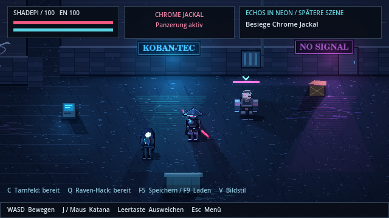

# Shadepi · Echos in Neon

**Spielbare Pixel-Testszene zu „Shadepi – Im Schatten des Raben“.**



Shadepi und Raven treffen in einer regennassen Gasse auf Chrome Jackal. Sprich mit Raven, öffne die Sicherheitssperre, kombiniere Katana und Netrunning und sichere die Daten am Ausgang.

Diese Version **0.1.0** ist eine kleine, frei arrangierte Stil- und Gameplayprobe. Sie prüft Steuerung, Pixelanimationen, Atmosphäre und Zusammenarbeit. Die vollständige Adaption der Buchkapitel folgt in weiteren Versionen; die Dialoge dieser Szene sind eigens für den Test geschrieben.

## Spielen

1. Unter [Actions](https://github.com/Inrouder/ShadepiRPG/actions/workflows/build.yml) den letzten erfolgreichen Lauf öffnen.
2. **ShadepiRPG-Windows** herunterladen, ZIP vollständig entpacken und `Shadepi-Echos-in-Neon.exe` starten. Eine Godot-Installation wird zum Spielen nicht benötigt.
3. Im Startmenü **Testszene starten** wählen. Das Missionsziel steht oben rechts.

Ein Linux-Build und das vollständige Godot-Projekt werden ebenfalls als Artefakte erzeugt. Bei späteren Versions-Tags veröffentlicht der Workflow zusätzlich Windows-ZIP und Projekt-ZIP im Bereich [Releases](https://github.com/Inrouder/ShadepiRPG/releases).

## Steuerung

| Taste | Aktion |
| --- | --- |
| WASD / Pfeiltasten | Bewegen; Bewegungsrichtung bestimmt die Blickrichtung |
| J | Katana in Blickrichtung |
| Linke Maustaste | Katana in Richtung des Mauszeigers |
| Leertaste / Umschalt | Ausweichen mit kurzem Schutzfenster |
| E / Enter | Sprechen, Terminal bedienen, Dialog weiterführen |
| C | Tarnfeld aktivieren oder beenden |
| Q | Raven stört Chrome Jackals Implantate |
| F5 / F9 | Speichern / Laden |
| Esc / H | Pause und Hilfe |
| M | Musik und Effekte umschalten |

**Kampftipp:** Der rote Bogen kündigt Jackals Vorstoß an. Seitlich ausweichen, dann zuschlagen. Ravens Hack unterbricht den Angriff und schwächt die Panzerung für sechs Sekunden. Angreifen beendet die Tarnung. Energie regeneriert sich automatisch, während das Tarnfeld ausgeschaltet ist.

## Was enthalten ist

- Eigene PNG-Spritesheets mit acht Bildern je Zyklus: Stand, Laufbewegung, Katanahieb und Trefferpose; Blickrichtungsvarianten für Shadepi, Raven und Jackal.
- Begehbare Gasse mit Gebäudekollisionen, Hindernissen, Sicherheitssperre und einer überprüften Route zum Ausgang.
- Gegner mit angekündigtem Angriff, Vorstoß, Erholungsphase und hackbarer Panzerung.
- Katana-Kombination, Energie, Ausweichen, zehn Sekunden maximales Tarnfenster und Fähigkeitencooldowns.
- Dialoge, fünf Missionszustände, Kontrollpunkte und manuelles Speichern/Laden.
- Regen, Dampfwolken, Neonbeleuchtung, Trefferpartikel, Klingenschweif und kleine Kamerastöße.
- Eigens synthetisierte elektronische Hintergrundmusik und Kampf-/Hackeffekte.

## Godot-Projekt öffnen

Verwendete und geprüfte Version: **Godot 4.7.2 Standard**, Renderer **Compatibility**, kein C# erforderlich.

Repository herunterladen oder klonen, `project.godot` importieren, Ressourcenimport abwarten und **F5** drücken. Die Darstellung rechnet mit 640 × 360 Pixeln und ganzzahliger Skalierung; das Fenster startet mit 1280 × 720 Pixeln.

## Tests und eigene Builds

```bash
godot --headless --editor --import --quit
godot --headless --script res://tests/run.gd
mkdir -p build/windows build/linux
godot --headless --export-release "Windows Desktop" build/windows/Shadepi-Echos-in-Neon.exe
godot --headless --export-release Linux build/linux/Shadepi-Echos-in-Neon.x86_64
```

Zum Export müssen die offiziellen Exportvorlagen derselben Godot-Version installiert sein. Die GitHub Action richtet dies automatisch ein. Die Windows-EXE wird unter Linux exportiert; ihre Ausführung auf einem tatsächlichen Windows-PC ist ein gesonderter manueller Prüfschritt.

Die **40 automatisierten Prüfungen** behandeln unter anderem Bewegung und Gebäudekollision, Erreichbarkeit und gesperrte Umgehungen, Missionsfortschritt, Trefferkegel, Hack-/Angriffscooldowns, Tarnung, Szenen-Neustart sowie ungültige und beschädigte Spielstände einschließlich Backup-Wiederherstellung.

Speicherort: Godots `user://shadepi-test-save.json` (unter Windows normalerweise `%APPDATA%/Godot/app_userdata/Shadepi - Echos in Neon/`). Bei beschädigter Hauptdatei wird ein validiertes Backup versucht. Beim Laden werden laufende Fähigkeiten zurückgesetzt und Jackal an seine Startposition gesetzt; sein gespeicherter Lebensstand bleibt erhalten.

## Grafiken und Audio weiterbearbeiten

Alle benötigten PNG- und WAV-Dateien sind enthalten. Node.js wird nur für eine erneute Asset-Erzeugung benötigt:

```bash
npm ci
npm run assets
```

`tools/generate_assets.cjs` enthält die Rasterzeichner und den Synthesizer. Es werden keine SVG-Figuren und keine extern geladenen Bilder verwendet. Die Szene läuft vollständig lokal, ohne Konten, KI-Dienste oder Onlinepflicht.

## Nächster Ausbau

Die nächste Ausbaustufe ist eine genaue Umsetzung des ersten Kapitels: Dachwege, Beobachtung der Gasse, Shadepis Eingreifen und die anschließende Begegnung mit Raven. Die aktuelle Probe entscheidet zuerst über Bildsprache und Spielgefühl.
