# Shadepi · Bilder, Filme und Dokumentation

**Stand v0.51.1 · CodexAI · 10. November 2026.** [Zur Repository-Startseite](../README.md) · [Spieleranleitung](../Spiel-README.md) · [Versionshinweise](../CHANGELOG.md).

Die Bilder öffnen den jeweiligen Bericht. Dort findest du größere Spielaufnahmen, animierte Szenenfilme, Bedienung und technische Hinweise. Die PNG-Vorschauen sind direkt in GitHub sichtbar; die Filme bleiben zusätzlich als verlinkte WebP-Dateien erreichbar.

## Dropdowns wieder sichtbar · v0.51.1 · CodexAI

| Kapitel / Kontrollpunkte im HQ-Modus | Energie- und Reparatur-Hacks |
| --- | --- |
| [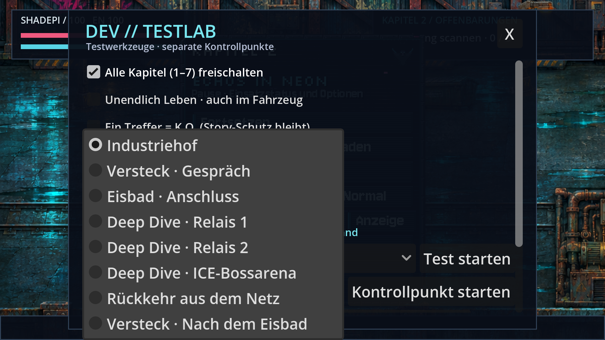](dropdowns-v0511.md) | [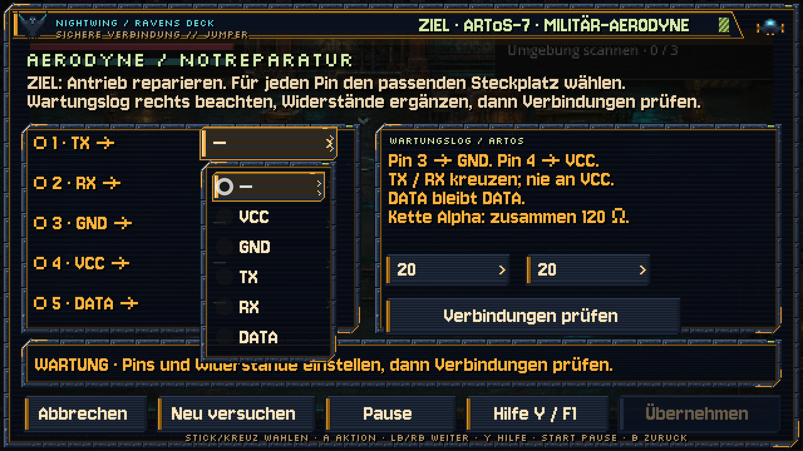](dropdowns-v0511.md) |

[Bilder, Ursache und Prüfung](dropdowns-v0511.md) · [Film](previews/dropdowns-v0511.webp).

## HQ-Anzeige bis Full HD · v0.51.0 · CodexAI

| Originalgrafiken in nativer Full-HD-Darstellung | HQ oder klassisch direkt auswählen |
| --- | --- |
| [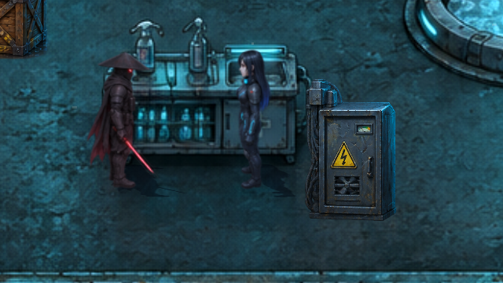](hq-anzeige-v051.md) | [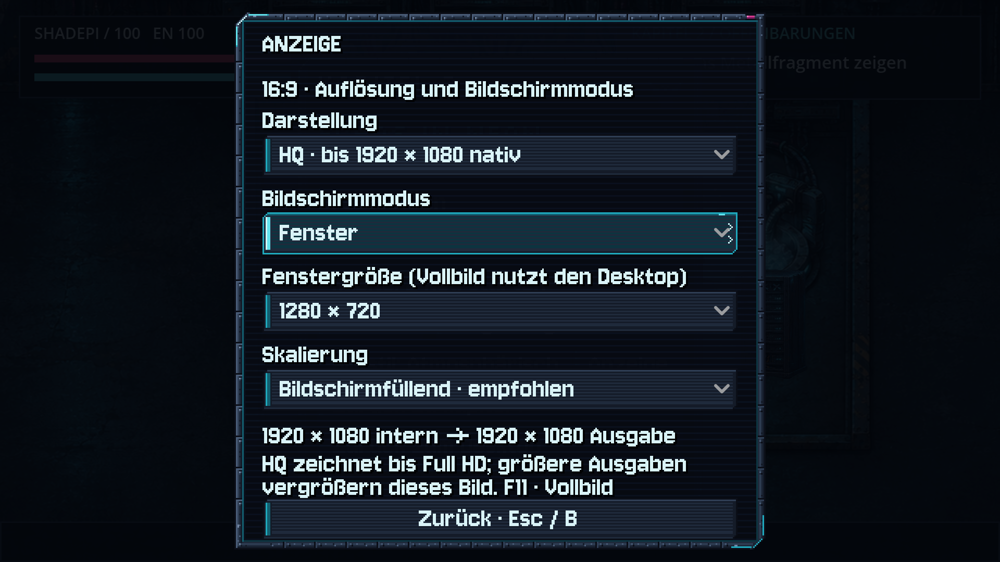](hq-anzeige-v051.md) |

[Bilder, Full-HD-/4K-Messung und Bedienung](hq-anzeige-v051.md) · [Animationsfilm](previews/hq-netz-v051.webp).

## Anzeigequalität: Analyse und Vergleich · v0.50.2 · CodexAI

| Aktuelles Gameplay: intern 640×360 | Prototyp: direkt in Full HD |
| --- | --- |
| [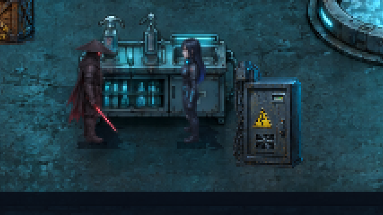](anzeigequalitaet-v0502.md) | [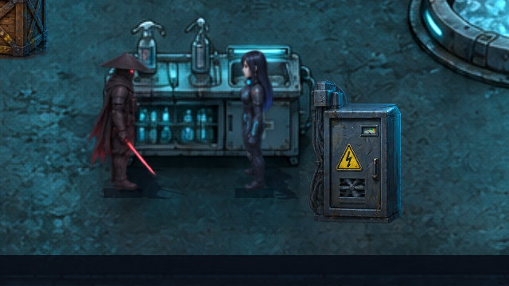](anzeigequalitaet-v0502.md) |

[Analyse, Originalauflösungen und Empfehlung](anzeigequalitaet-v0502.md) · [Wechselvergleich](previews/anzeige-vergleich-v0502.webp). Vergleichsprototyp; Produktionsdarstellung unverändert.

## Ravens Netzavatar · v0.50.1 · CodexAI

| Gitter folgt der Originalsilhouette | Auch der Handangriff wird projiziert |
| --- | --- |
| [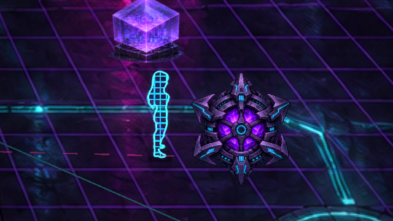](netzavatar-v0501.md) | [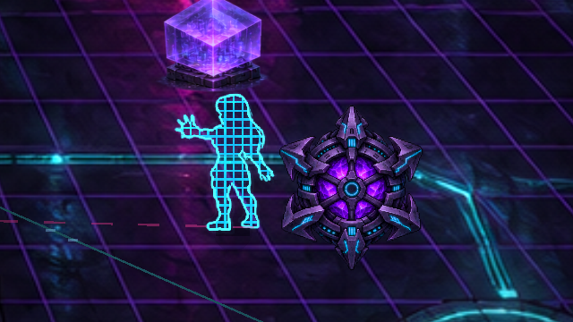](netzavatar-v0501.md) |

[Bilder und Umsetzung](netzavatar-v0501.md) · [Animationsfilm](previews/netzavatar-v0501.webp).

## ICE-Wächter · v0.50.0 · CodexAI

| Kugelsalven und Deckung | Vorstoß zum cyanfarbenen Kern |
| --- | --- |
| [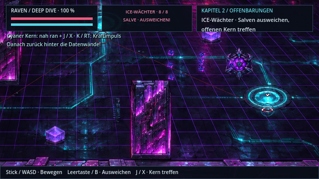](ice-kampf-v050.md) | [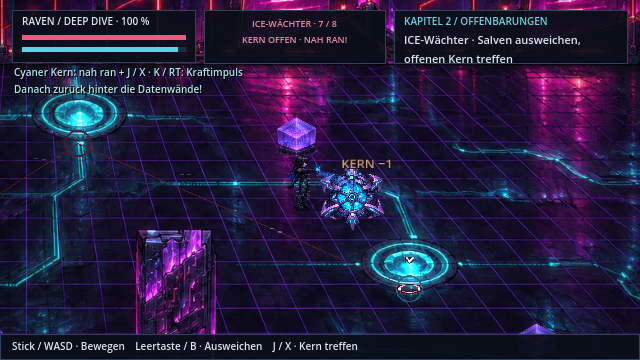](ice-kampf-v050.md) |

[**Ablauf, Steuerung und Quellen**](ice-kampf-v050.md) · [Kampffilm](previews/ice-kampf-v050.webp) · [Arbeitsnachweis](arbeiten/ice-v050.md).

## Mondsee und Menüs · v0.49.0 · CodexAI

| Vollständiger Mond über dem bewegten See | Menüs mit innenliegender Hilfe |
| --- | --- |
| [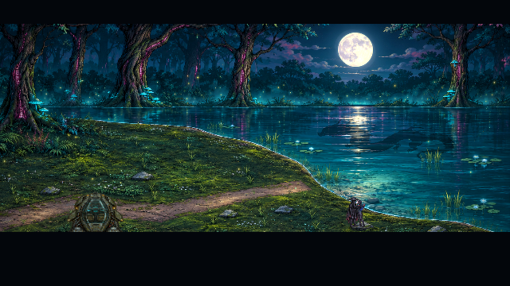](mondsee-v049.md) | [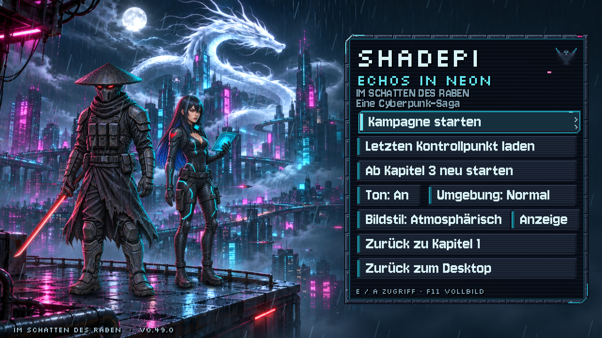](mondsee-v049.md) |
| [Kussanimation und Quellenvergleich](mondsee-v049.md) · [Finalefilm](previews/mondsee-v049.webp) | [Auflösungen und Prüfung](mondsee-v049.md) · [Arbeitsnachweis](arbeiten/mondsee-v049.md) |

## Verbesserungen · v0.48.0 · ClaudeHelper

| Ravens Towerplan in Kapitel 3 | Pixelmarker und kompakte Aktionszeile |
| --- | --- |
| [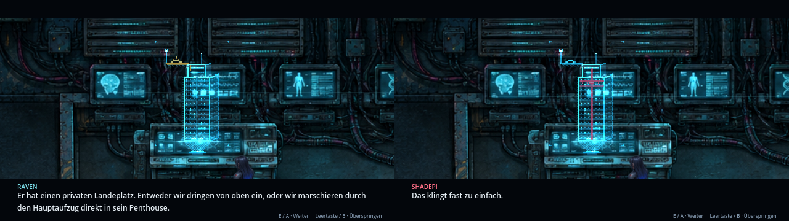](verbesserungen-v048.md) | [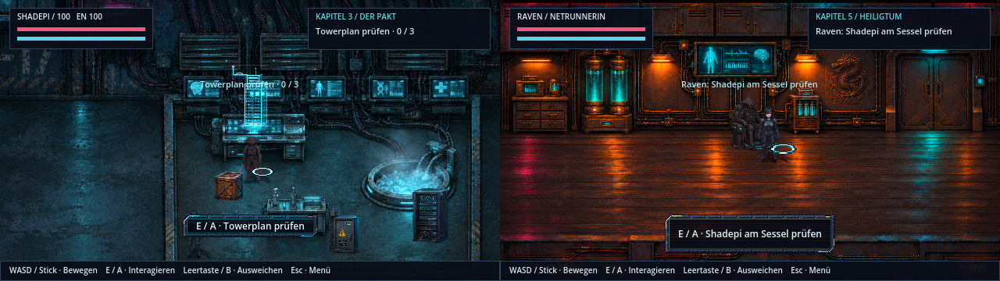](verbesserungen-v048.md) |
| [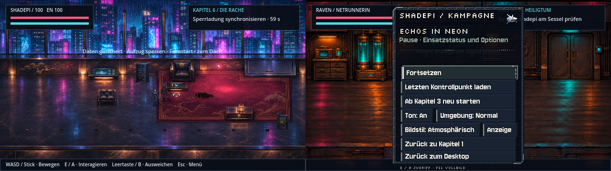](verbesserungen-v048.md) | [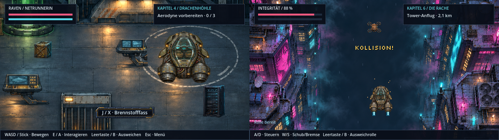](verbesserungen-v048.md) |

[Alle Änderungen und Bildbelege](verbesserungen-v048.md) · Aufnahmestand v0.48.0.

## Story-Durchsicht · v0.47.0 · ClaudeHelper

[**Kapitel 1–7: behobene Logikfehler und verdichtete Szenen**](story-durchsicht.md). Nur Dialoge, Ziele und Hinweise wurden geändert, keine Grafik. Die Vorschauen darunter bleiben auf ihrem jeweiligen Aufnahmestand.

## Orientierung und historischer Bestand · v0.46.2 · CodexAI

[**Repository-Status: Was ist aktiv?**](repository-status.md) · [Asset-Katalog](../assets/README.md) · [Werkzeuge](../tools/README.md) · [Entwicklungsarchiv](archiv/README.md) · [Versionsnachweise](arbeiten/README.md).

Die folgende Galerie behält ihre tatsächlichen Aufnahmeversionen. Die Spielgrafik wurde durch die Repository-Aufräumung nicht neu gestaltet; aktuelle Originalhelden im nächsten Abschnitt. Veraltete Bedien- und Entwicklungsbeschreibungen sind im Archiv gekennzeichnet.

## Originalhelden wieder aktiv · v0.46.1 · CodexAI

[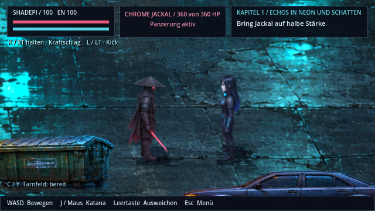](original-helden.md)

[Rückkehr zu den Originalen](original-helden.md) · [Lauf-/Richtungsfilm](previews/original-helden-v0461.webp). Die übrigen Korrekturen und Bluteffekte bleiben erhalten. Ältere Aufnahmen darunter zeigen ihren damaligen Stand.

## Blutspritzer und Lachen · v0.46.0 · CodexAI

| Gerichteter Gegnertreffer | Bodenlage unter der Figur |
| --- | --- |
| [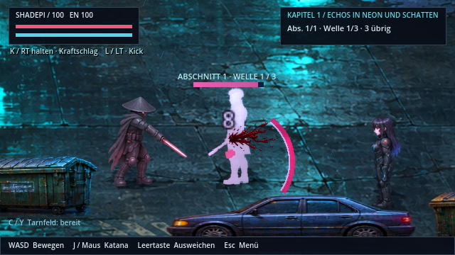](bluteffekte.md) | [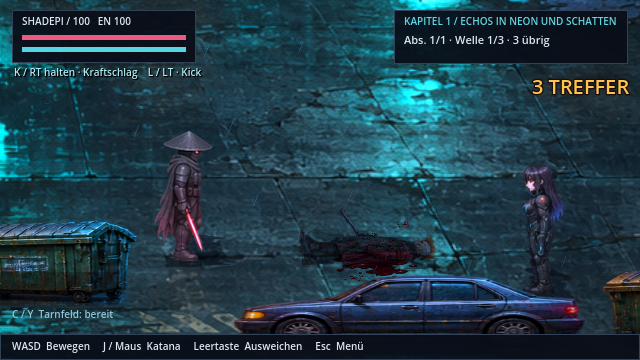](bluteffekte.md) |
| [Bilder, Regeln und Pixelquelle](bluteffekte.md) | [Film](previews/blut-v046.webp) · [Prüfnachweis](arbeiten/blut-v046.md) |

## Fehlerbericht und Heldenqualität · v0.45.0 · CodexAI

| Originalfiguren wieder aktiv · v0.46.1 | Figurenreaktionen und korrigierte Szenen |
| --- | --- |
|  | [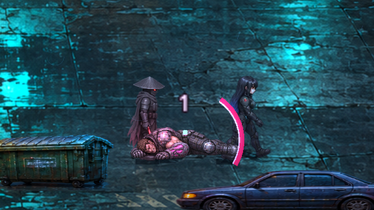](fehlerbericht-v045.md) |
| [Zwölf Berichtspunkte, Größen und Vorher/Nachher](fehlerbericht-v045.md) | [Szenenfilm](previews/fehlerbericht-szenen-v045.webp) · [Prüf-/Exportnachweis](arbeiten/fehlerbericht-v045.md) |

## Menü und Test-Kontrollpunkte · v0.44.1

| Fußkontakt und Menüaktionen | Direkt zum gewünschten Testabschnitt |
| --- | --- |
| [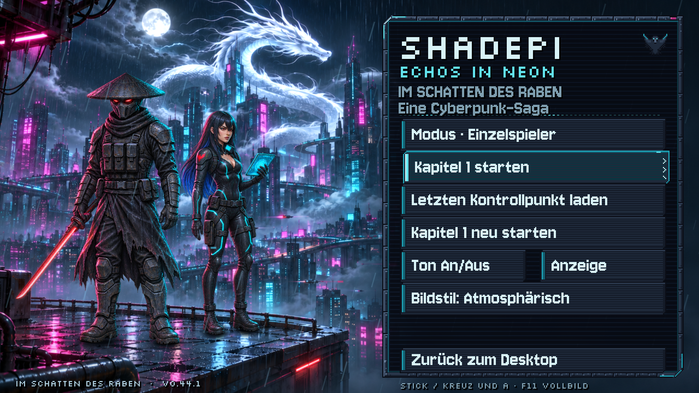](menue-kontrollpunkte.md) | [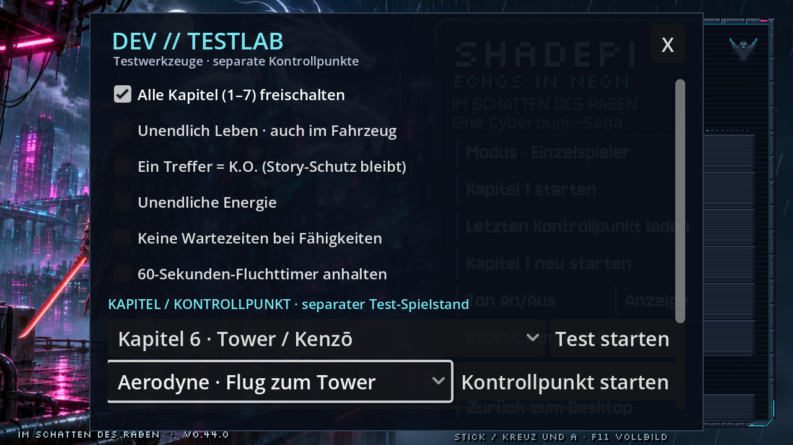](menue-kontrollpunkte.md) |
| [Menü, Vergleich und Speicherverhalten](menue-kontrollpunkte.md) | [Film mit direktem Tower-Einstieg](previews/menue-testpunkte-v044.webp) |

## Kapitel 1: Der Auftrag · v0.43.0

| Raven übernimmt und prüft die Ausrüstung | Shadepi über den Dächern |
| --- | --- |
| [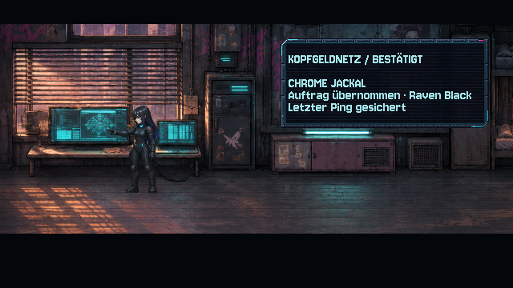](kapitel1-auftakt.md) | [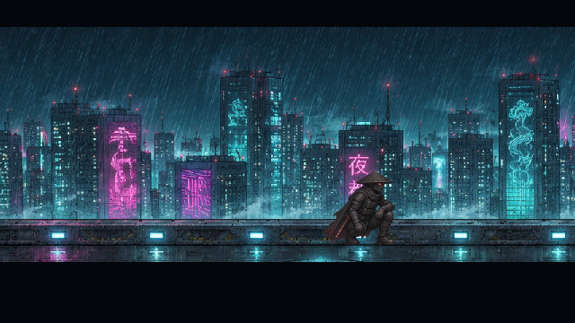](kapitel1-auftakt.md) |
| [Auftaktfilm öffnen](previews/kapitel1-auftrag-v043.webp) | [Bedrohung, Dachzwischenschnitt und Landefilm](previews/kapitel1-rettung-v043.webp) |

## Belebte Technik · v0.42.0

| Im Betrieb | Rückmeldung nach dem Zugriff |
| --- | --- |
| [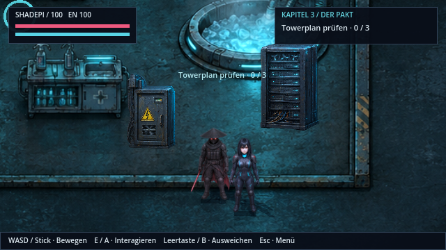](technik-gegenstaende.md) | [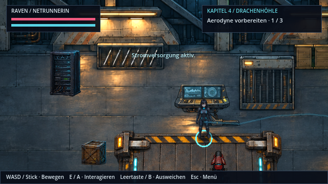](technik-gegenstaende.md) |
| [Mechanische Bildphasen und Schadenszustände](technik-gegenstaende.md) | [Zugriffsfilm öffnen](previews/technik-zugriff-v042.webp) |

## Verfolgung und Fahrzeugbewegung

| Verfolger und Frachtdrohnen · v0.41.0 | Motorrad und Aerodyne · v0.40.0 |
| --- | --- |
| [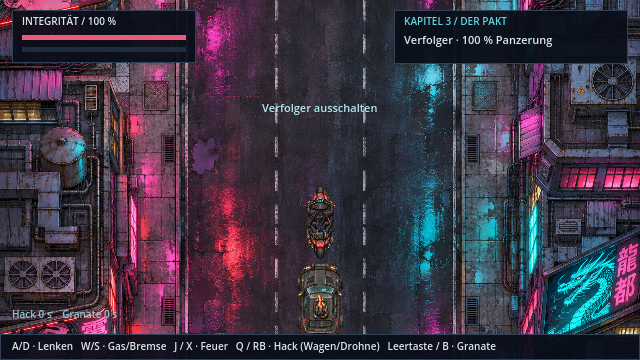](verfolger-animationen.md) | [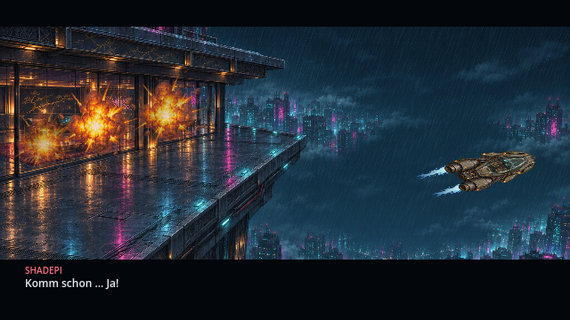](fahrzeugbewegung.md) |
| [Neun Wagenbilder, vier Rotorphasen und Kontakte](verfolger-animationen.md) · [Film öffnen](previews/verfolger-bewegung-v041.webp) | [Fahrposen, Schräglagen und Luftbremse](fahrzeugbewegung.md) · [Motorradfilm](previews/motorrad-bewegung-v040.webp) · [Flugfilm](previews/aerodyne-bewegung-v040.webp) |

## Szenen im Spiel

| Geheimer Hangar · v0.39.0 | Eisbad und Rettung · v0.38.0 |
| --- | --- |
| [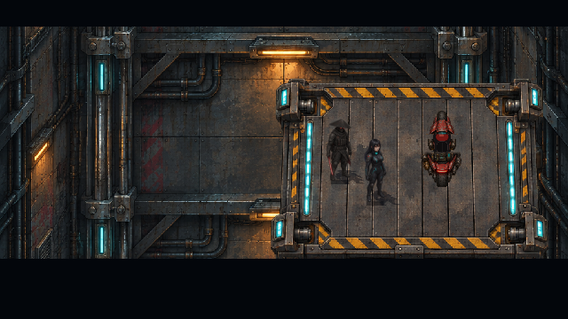](hangar-entdeckung.md) | [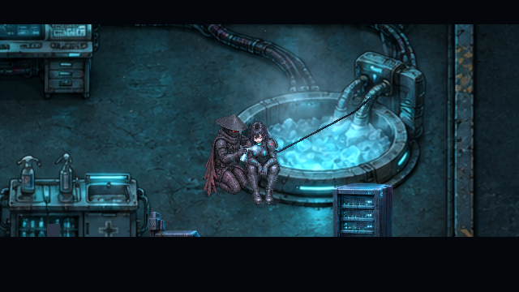](eisbad.md) |
| [Schalter, Plattformfahrt und Enthüllung](hangar-entdeckung.md) · [Szenenfilm](previews/hangar-entdeckung-v039.webp) | [Einstieg, Rückkehr und spielbare Rettung](eisbad.md) · [Rettungsfilm](previews/eisbad-rettung-v038.webp) |

| See-Finale · v0.36.1 | HQ-Hauptmenü |
| --- | --- |
| [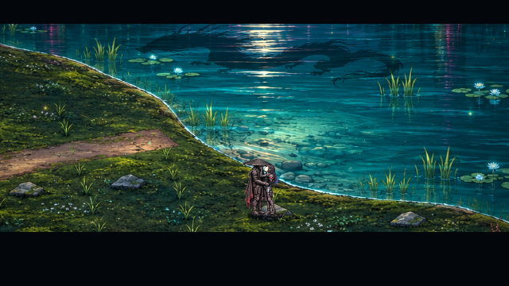](see-finale.md) | [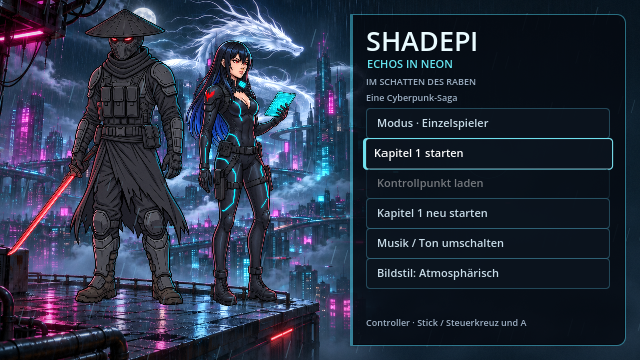](live-startmenue.md) |
| [Anflug, Aufnahme und privater Maskenmoment](see-finale.md) · [Finalfilm](previews/see-finale-v0361.webp) | [Bildaufbau und Menübewegung](live-startmenue.md) · [Animierte Vorschau](previews/startmenue-live.webp) |

Die Versionsangaben bezeichnen den dokumentierten Aufnahmestand. Es sind tatsächliche Renderer-Aufnahmen; ältere Bilder werden beim Aktualisieren der Übersicht nicht als neu gerenderte Aufnahmen ausgegeben. Auch historische Berichte bleiben mit ihrer ursprünglichen Version erhalten.

## Weitere Spiel- und Entwicklungsthemen

| Thema | Dokumentation |
| --- | --- |
| Spielen und Bedienung | [Spieleranleitung](../Spiel-README.md), [Vollbild und Auflösung](bildschirm.md) |
| Kämpfe und Eingaben | [Arcade-Wellen](arcade-wellen.md), [Kampfbewegungen](kampfbewegungen.md), [Ravens Terminals](ravens-terminals.md) |
| Tower | [Extraktion und Verteidigung](tower-extraktion.md), [Landeplatz und Flucht](tower-inszenierung.md) |
| Heiligtum und Erinnerungen | [Kompensator](heiligtum-kompensator.md), [Erinnerungs-Roadmap](erinnerungen-roadmap.md), [Angriff](kloster-kampf.md), [Lys Opfer](lys-opfer.md), [Vermächtnis](das-vermaechtnis.md) |
| Gestaltung für Menschen und KI | [Bebilderte Stilbibel](stilbibel/README.md), [alle Figuren](stilbibel/figuren.md), [verbindliche Konsistenzregeln](../KONSISTENZ.md) |
| Atmosphäre und weiterer Ausbau | [Design und Atmosphäre](design-atmosphaere.md), [Cinema-Roadmap](cinema-roadmap.md) |
| Quellen und Musik | [Universumsarchiv](universum/README.md), [Musik austauschen](../assets/music/README.md) |

[Arbeitsnachweis zur Galerie-Wiederherstellung](arbeiten/doku-galerie-v0411.md).
