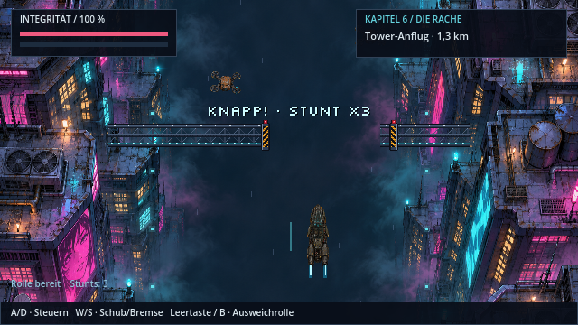
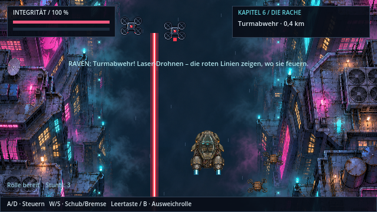
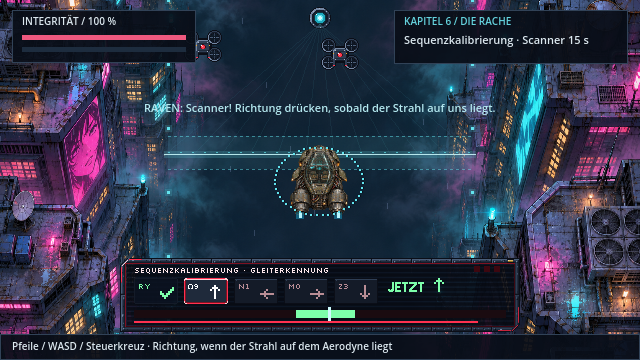
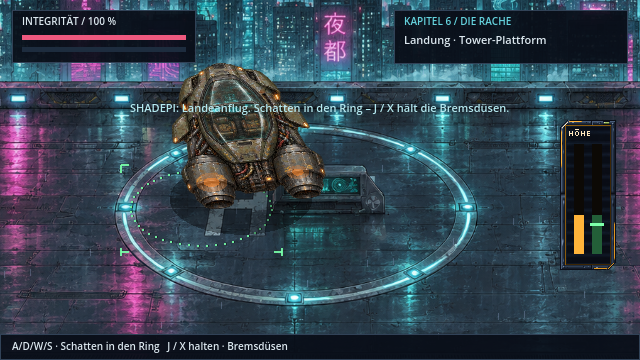
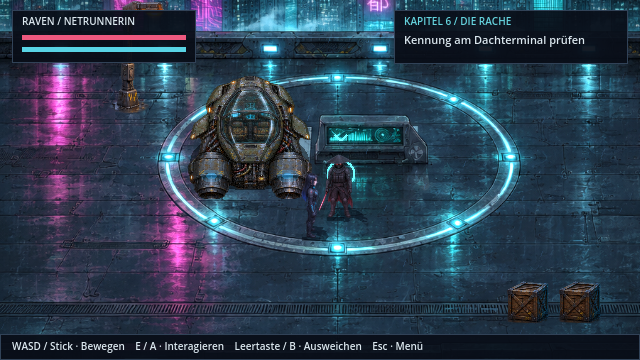

# Aerodyne-Flug zum Tower · v0.21.3 · ClaudeHelper

In Kapitel 6 („Die Rache“) fliegen Shadepi und Raven mit dem ramponierten Aerodyne zu Kenzōs Tower, wie in der Romanfassung beschrieben:
- Flug durch die hell erleuchteten Häuserschluchten,
- „Dreckmühle“-Ausfall des Triebwerks,
- Tower-Scanner, der jeden Gleiter vor der Landung prüft,
- scharfe Driftkurve und harte Landung auf dem privaten Landeplatz.

Der Ablauf dauert ohne Fehler etwa 45 Sekunden.

## 1 · Häuserschluchten

| Eingabe | Wirkung |
|---|---|
| A / D, Stick | frei steuern (mit Trägheit) |
| W / S | Schub (schneller, Aerodyne rückt vor) / Bremse |
| Leertaste / B | **Ausweichrolle**: Seitensprung, schmales Profil, kurz unverwundbar gegen Drohnen und Laser |

**Hindernisse:**
- **Frachtdrohnen** treiben quer durch die Schlucht.
- **Stahlbrücken** spannen sich über die ganze Breite. Man fliegt durch die Lücke zwischen den Warnpylonen.
- **Enge Lücken** blinken gelb und sind nur mit einer Rolle zu schaffen.
- Wer gegen eine **Fassade** fliegt, schrammt Funken und verliert Integrität.

**Knappes Ausweichen** zählt als **Stunt**: Es erscheint „KNAPP! · STUNT xN“ mit eigenem Sound, und der Rumpf erhält 2 % Integrität zurück.

## 2 · Triebwerksausfall

Nach wenigen Sekunden fällt ein Triebwerk aus, und Raven repariert es über die bekannte Jumper-Platine (ARToS-Terminal). Stürzt der Aerodyne später ab, startet der Flug am Kontrollpunkt ohne zweiten Ausfall.

## 3 · Turmabwehr

Zwei Abwehrdrohnen aus Kenzōs Tower erscheinen über der Schlucht:
- Vor jedem Schuss zeigt eine **blinkende rote Linie**, wo der Laser treffen wird, und ein Ladeton warnt.
- Danach feuert der Strahl kurz. Man weicht seitlich aus oder **rollt durch den Strahl**.

## 4 · Sequenzkalibrierung

Der Scannerkopf des Towers erscheint oben in der Bildmitte. Sein Strahl läuft sichtbar über die Schlucht auf und ab. ARTOS hält den Kurs, und die Drohnen stellen das Feuer ein.

So funktioniert die Kalibrierung:
- **Wann drücken:** wenn der Strahl auf dem Aerodyne liegt. Dann leuchtet ein Ring um den Rumpf, im Kalibrierdeck steht „JETZT“, und der grüne Bereich der Spur ist aktiv. Dazu tickt ein Metronom.
- **Was drücken:** die angezeigte Richtung (Pfeile, WASD, Steuerkreuz). Jede richtige Eingabe rastet einen Codeteil von Kenzōs Gleiterkennung ein, zum Beispiel „RY ✓“. Danach wird der Strahl etwas schneller.
- **Fehler:** Falsche Richtung oder eine Eingabe außerhalb des Fensters zählt als Abweichung (drei LEDs oben rechts).
- **Verpasst:** Ein verpasstes Fenster kostet nur Zeit. Der rote Balken zeigt die Restzeit des Scanner-Durchlaufs.

**Kennung abgelehnt**, also drei Abweichungen oder die Zeit ist abgelaufen:
- Alarm, und drei Drohnen feuern 8 Sekunden lang schneller.
- Danach folgt ein neuer Scannerdurchlauf mit neuer Codefolge.
- Der Flug endet dabei nicht, nur bei 0 % Integrität.

**Kennung akzeptiert:** Die Drohnen drehen ab („Gleiter Moriyama-01 erkannt“).

## 5 · Driftkurve und Landung

- **Driftkurve:** Kurz vor dem Tower erscheint „DRIFTKURVE · LEERTASTE / B“. Wer im Fenster rollt, fliegt Shadepis kontrollierten Drift und gleitet seitlich auf die Plattform zu.
- **Landeansicht:** Sie zeigt das Tower-Dach aus der Kamera der folgenden Szene.
- **Ausrichten:** Den Schatten mit A/D/W/S in den Landering von ARTOS bringen, gegen den Wind. Grün heißt im Ring, blinkendes Amber heißt außerhalb.
- **Bremsdüsen:** J / X halten. Rechts zeigt die Anzeige Höhe und Sinkrate, Grün bedeutet sauberes Aufsetzen.
- **Ergebnis beim Aufsetzen:**

  | Aufsetzen | Folge |
  |---|---|
  | präzise | keine Kosten |
  | hart | −6 % Integrität |
  | sehr hart | −14 % Integrität |
  | außerhalb des Rings | Durchstarten |

## 6 · Auf dem Dach

Der Aerodyne bleibt an der Aufsetzstelle auf dem Landeplatz stehen. Er dampft nach, ist ein festes Hindernis und wird korrekt hinter und vor den Figuren gezeichnet. Shadepi und Raven steigen neben der Luke aus, die Dachszene beginnt im selben Bildausschnitt.

## Technik

| Bereich | Datei |
|---|---|
| Flug-Level | `scripts/aerodyne_flight.gd` |
| Minispiel-Logik | `scripts/sequence_calibration.gd` |
| geparkter Aerodyne | `scripts/parked_aerodyne.gd` |
| Pixelart-Requisiten | `assets/world/hq/flight-props.png` (Abwehrdrohne in zwei Rotorbildern, Brückensegment, Warnpylon, Scannerkopf), erzeugt mit `tools/flight/build_flight_props.py` |
| Sounds | Rolle, Beinahe-Treffer, Laser-Warnung, Laser, Bremsdüsen, Aufsetzen, Metronom, Einrasten, Abweichung, Alarm, Akzeptiert. Selbst synthetisiert mit `tools/flight/generate_flight_audio.py` |
| Tests | `tests/aerodyne_flight.gd` (im CI) |
| Bildergalerie | `tools/flight_gallery.gd` |
