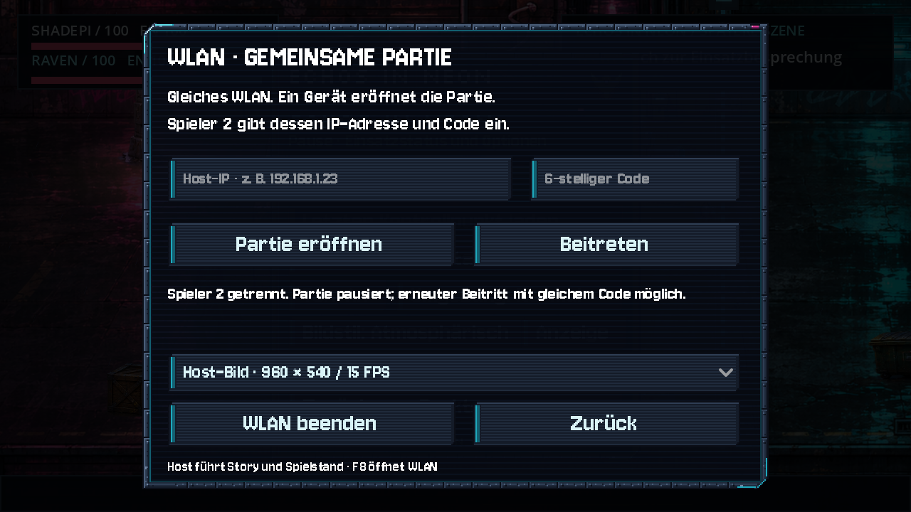
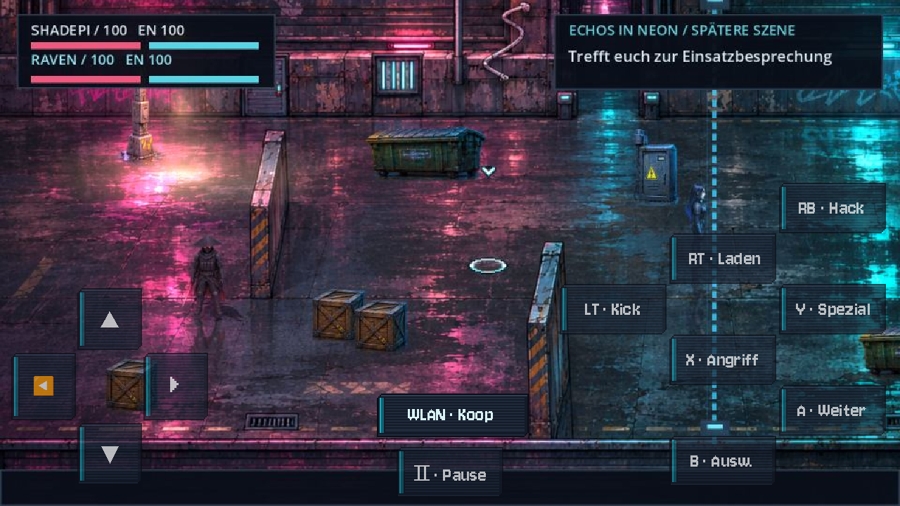

# Android und WLAN-Koop · v0.62.0 · CodexAI

**15. November 2026.** Eine native Android-Testfassung ergänzt Windows und Linux. Auf dem Handy gibt es Multitouch-Steuerung; im WLAN teilen zwei Geräte dieselbe Partie und Kamera. Spielgrafiken, Originalhelden und die verlängerten Kapitel bleiben erhalten.

## Gemeinsam spielen

1. Auf beiden Geräten **dieselbe Spielversion** starten und mit demselben WLAN verbinden. Kein Gastnetz mit Geräteisolation verwenden.
2. Am leistungsfähigeren Gerät im Menü **WLAN · Koop** wählen; am PC öffnet auch **F8** das Verbindungsfenster. **Partie eröffnen** drücken.
3. Das zweite Gerät öffnet ebenfalls WLAN. Die angezeigte **IP-Adresse des Hosts** und dessen **sechsstelligen Code** eingeben, dann **Beitreten**. Im Betriebssystem des Hosts gegebenenfalls UDP-Port **26562** für das lokale Netzwerk freigeben.
4. Der Host schließt das Verbindungsfenster mit **Zurück**, startet oder setzt seine Partie fort. Er steuert Spieler 1; das zweite Gerät übernimmt Spieler 2. Es gelten die vorhandenen Koop-Rollen: Raven, andernfalls Drohne oder Nanitenschwarm. Filmsequenzen behalten ihre bisherigen Regeln.
5. Bei Verbindungsverlust pausiert der Host und lässt alle gehaltenen Eingaben los. Er kann mit demselben Code erneut beitreten lassen. **WLAN beenden** stellt den vorherigen lokalen Koop-Modus wieder her; der Spielstand bleibt beim Host.

Der Host wählt im WLAN-Fenster sein Bildprofil: **960×540 mit maximal 15 Bildern/s** oder **640×360 mit maximal 12 Bildern/s**. Das betrifft nur die Übertragung, nicht seine lokale Desktop-HQ-Auflösung. Langsame Geräte oder Netze liefern weniger Bilder. Ein Android-Host verwendet zunächst das sparsame Profil. IP und Code ersetzen keine Internet-Lobby; es gibt keine automatische Gerätesuche oder zentrale Server.



## Handy-Steuerung

Links bewegt der virtuelle Stick, rechts liegen die Aktionen. Mehrere Finger funktionieren gleichzeitig. RT kann gehalten werden; beim Loslassen wird der aufgeladene Angriff ausgelöst. Beim Wechsel in den Hintergrund werden alle gehaltenen Tasten und Achsen freigegeben.

| Taste | Vorhandene Spielaktion |
| --- | --- |
| X | Angriff / Schuss |
| A | Interaktion, Weiter, Bestätigung |
| B | Ausweichen / Zurück |
| Y | Figuren-Spezialaktion |
| RB | Hack |
| RT halten | Aufladen; loslassen zum Auslösen |
| LT | Kick, soweit die Figur ihn besitzt |
| Pause | Pausenmenü |

Lokale Menüs und Hacks lassen sich direkt berühren; bei einem entfernten Host bedient man dessen Oberfläche mit Stick und A/B. Dort steuert der Client keine Maus. In lokalen Menüs und Hackfenstern verdecken die Spieltasten keine Einträge. Touch-Maus-Emulation bleibt für die Oberfläche aktiv; die mobilen Waffenbindungen verwenden ausschließlich die Spieltasten, damit Stickberührungen keine Schüsse auslösen. Ein Bluetooth-Controller nutzt weiterhin den vorhandenen Controllerpfad. Das Android-System-Zurück öffnet die Pause.



[Kurzer Film der tatsächlich übertragenen Spielbilder](previews/wlan-touch-v062.webp). Die Touch-Aufnahme oben stammt aus einer nativen Linux-Clientinstanz im Handy-Bedienmodus, **nicht aus einem physischen Telefon**.

## Was diese erste Fassung leistet

Der WLAN-Modus ist **Remote-Koop**: Der Host simuliert die einzige Spielwelt, führt Story und Speicherstand und überträgt sein Spielbild samt Ton. Der Client pausiert seine lokale Welt, zeigt den Stream und schickt Gamepadzustände für Spieler 2 zurück. Es gibt weder zwei unabhängig simulierte Welten noch eine eigene Clientkamera. Durch JPEG-Kompression und die begrenzte Bildrate sieht das entfernte Bild weicher aus als lokales HQ. Gerade schnelle Arcade-Kämpfe profitieren von einer späteren schnelleren Übertragung.

Bild, Ton und Eingabe benutzen getrennte ENet-Kanäle. Bilddaten werden in kleine Pakete zerlegt; höchstens ein Bild wartet auf Bestätigung, damit sich bei langsamen Clients kein langer Bildrückstand aufbaut. Eingaben besitzen Sequenznummern und einen Ausfallzeitgeber. Spielversion und Sitzungscode müssen übereinstimmen. Der Client lädt beim Trennen keine fremden Speicherstände und schreibt keinen Host-Spielstand auf sein Gerät.

## Android installieren und bauen

Die **signierte Test-APK** entsteht als `Shadepi-Echos-in-Neon.apk` im GitHub-Actions-Artefakt **ShadepiRPG-Android-Test**. [Builds und Downloads](https://github.com/Inrouder/ShadepiRPG/actions/workflows/build.yml). Der Git-Push erzeugt einen Build; er veröffentlicht noch kein Release und keine Cloud-Umgebung.

Voraussetzungen: Android **7.0 / API 24 oder neuer**, 64-Bit-ARM-Gerät mit OpenGL ES 3; zusätzlich enthält die APK x86_64 für Emulatoren. Querformat, Vollbild und Internet-/Netzwerkstatusberechtigung sind eingerichtet. Es handelt sich um eine Debug-signierte Testfassung, nicht um eine Play-Store-Veröffentlichung. Einen dauerhaften privaten Veröffentlichungsschlüssel später außerhalb des Repositorys verwalten. Beim Wechsel des Signierschlüssels können Test-APKs nicht direkt übereinander installiert werden.

Android rendert HQ höchstens in **1280×720**; höhere Handydisplays vergrößern dieses Bild. Die logische Welt bleibt 640×360, dadurch ändern sich weder Kamerabild noch Kollisionsmaße. Der klassische Bildmodus bleibt wählbar. Desktop behält die bisherige Full-HD-HQ-Grenze.

Eigener Build mit Godot **4.7.2**, dessen `android_debug.apk`-Exporttemplate, Java **21**, Android-SDK mit `platform-tools` und `build-tools;36.0.0`:

```sh
ANDROID_HOME=/pfad/zum/android-sdk \
JAVA_HOME=/pfad/zum/jdk-21 \
GODOT_BIN=/pfad/zu/godot \
tools/android/build.sh
```

Das Werkzeug erzeugt eine temporäre Editor-Konfiguration, importiert Ressourcen, exportiert und prüft die APK-Signatur. Lokale SDK-Pfade, Schlüssel und Builddateien werden nicht ins Git geschrieben. Fertige APK: `build/android/Shadepi-Echos-in-Neon.apk`.

## Prüfung und Grenzen

**Android-Abnahme noch offen:** Die APK wurde exportiert, signaturgeprüft und im API-35-Emulator installiert. Der Software-Emulator scheiterte zunächst an einem Shader-/Treiberlimit und später an System-ANRs; eine erfolgreich bediente Android-Spielansicht ist deshalb noch nicht belegt. Die gezeigten Bilder sind Desktop-Tests.

[Arbeits- und Prüfnachweis](arbeiten/android-wlan-v062.md). Zwei echte gerenderte Desktopprozesse prüfen Bildempfang und Fernsteuerung über Touch; getrennte headless Prozesse prüfen Codeprüfung, Rollenbindung und Trennung. Multitouch-, HQ-, Controller-, Kapitel- und Arcade-Regressionen ergänzen diese Prüfung. Das ersetzt keinen Durchlauf auf echten Android-Telefonen und unterschiedlichen WLAN-Routern. Physische Handy-Leistung, Akkulaufzeit und hörbare Tonqualität auf einem Telefon sind noch offen.
