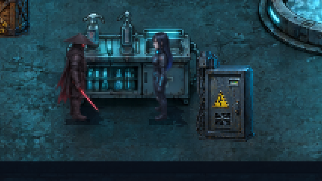
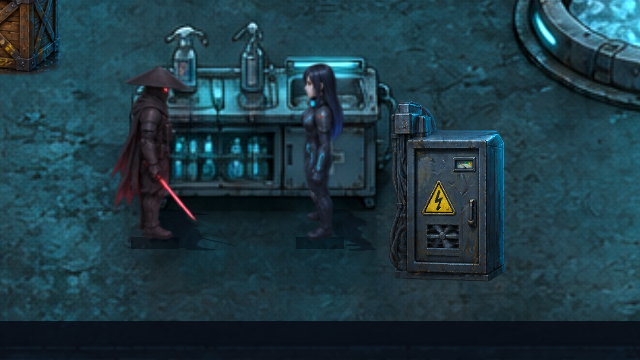
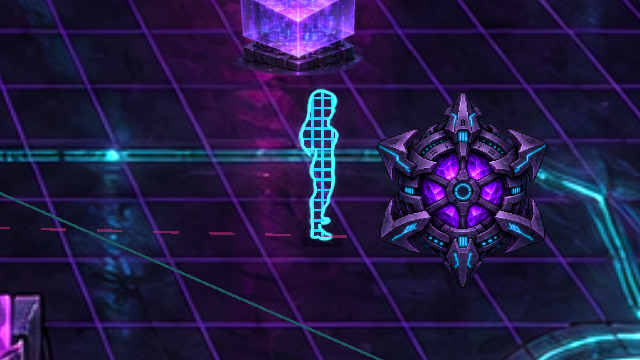
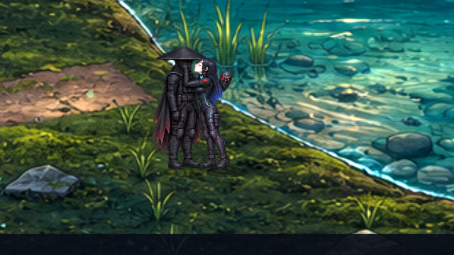

# Anzeigequalität: vorhandene Texturen besser ausgeben

**Analyse v0.50.2 · CodexAI · 10. November 2026.** [Galerie](README.md) · [Aktuelle Anzeigeoptionen](bildschirm.md) · [Arbeitsnachweis](arbeiten/anzeigeanalyse-v0502.md).

**Fortsetzung v0.51.0 · CodexAI:** Der hier untersuchte Vorschlag ist inzwischen als [wählbarer HQ-Modus mit Full-HD-Grenze](hq-anzeige-v051.md) umgesetzt. Der folgende Bericht dokumentiert weiterhin die damalige Analyse.

**Der Eindruck stimmt:** Die vorhandenen Grafiken enthalten deutlich mehr Details, als das aktuelle Gameplay zeigt. Der wichtigste Engpass ist das interne **640×360-Renderbild**, das anschließend auf die Fenster-/Monitorgröße vergrößert wird. Ein direkter Full-HD-Vergleich zeigt sichtbar mehr Rüstungs-, Kleidungs- und Metallstruktur. Diese Arbeit ist eine Analyse mit Vergleichsprototyp; ein neuer HQ-Modus wurde noch nicht in die Spieloptionen eingebaut.

## Direkter Vergleich bei derselben Spielgröße

Beide Spalten zeigen **unvergrößerte 640×360-Ausschnitte echter 1920×1080-Fensteraufnahmen**. Gleiche Originale, Figurenpositionen, Kamera und Komposition. Rechts wurde direkt in Full HD gezeichnet; kein kleines Screenshotbild nachträglich geschärft oder hochgerechnet.

| Aktuelles Gameplay: erst 640×360, dann Full HD | Vergleichsprototyp: direkt in Full HD |
| --- | --- |
|  |  |
|  |  |
|  |  |

[**Verlustfreier Wechselvergleich**](previews/anzeige-vergleich-v0502.webp): Versteck, ICE, See; je Szene zuerst die aktuelle Ausgabe, danach der native Prototyp, jeweils ungefähr zwei Sekunden. Unter 5 MB. Für den sichersten Vergleich die beiden PNGs in Originalgröße öffnen.

Vollständige physische Fensteraufnahmen: [aktuell, 1920×1080](previews/anzeige-vollbild-aktuell-v0502.png) · [nativer Test, 1920×1080](previews/anzeige-vollbild-hq-test-v0502.png).

## Was die Qualität derzeit begrenzt

| Stelle | Festgestellter Stand | Wirkung |
| --- | --- | --- |
| Gameplay-Renderziel | 640×360, `CONTENT_SCALE_MODE_VIEWPORT` | Details werden zuerst auf das kleine Bild reduziert. Die spätere Vergrößerung kann sie nicht zurückholen. |
| Hauptmenü | `CONTENT_SCALE_MODE_CANVAS_ITEMS` | Zeichnet bereits direkt in Ausgabeauflösung; deshalb wirkt es oft detailreicher. |
| Ausgabeoption „1920×1080“ | Fenster-/Desktopauflösung | Größeres Ausgabefenster, weiterhin kleines internes Gameplaybild. |
| Helden | Originalatlas 1024×5120, acht Spalten und 32 Reihen: **128×160 je Animationsbild**, Maßstab 0,5 | Im kleinen Renderbild entspricht die vollständige Zelle nur 64×80 Pixeln. Die große Atlasdatei ist nicht die Auflösung einer einzelnen Figur. |
| Welten | beispielsweise 1586×992, gezeichnet auf 1024×640 Weltkoordinaten | Im sichtbaren Ausschnitt liegen mehr Quellpixel vor, als 640×360 anzeigen kann. Native Ausgabe erhält mehr davon. |
| Requisiten und Boss | große Atlasregionen, deutliche Verkleinerung in der Welt | Metallkanten und kleine Oberflächenmerkmale profitieren besonders. |
| Texturfilter | Welt/Originalhelden teilweise linear, Bildschirmausgabe des kleinen Bildes pixelorientiert | Die erste Verkleinerung mittelt Quelldetails; nachträgliches „Nearest“ kann diese nicht wiederherstellen. |
| PNG-Import | alle **130** untersuchten PNG-Importdateien: `compress/mode=0`, `process/size_limit=0` | Verlustfrei, kein Import-Größenlimit. Werte wie `lossy_quality=0.7` wirken bei diesem verlustfreien Modus nicht als JPEG-Qualitätsverlust. |

Quellen: [Projekt](../project.godot), [Anzeigeverwaltung](../scripts/display_settings.gd), [Spritevertrag](../scripts/sprite_assets.gd), [Original-Raven](../assets/sprites/heroes/raven.png.import), [Kulissenimport](../assets/world/painted/dive.png.import).

Beispiel Full HD: Der bisherige Grafikpfad zeichnet zuerst **230.400 Pixel** und vergrößert jeden davon ungefähr auf 3×3 Ausgabepixel. Der native Test zeichnet **2.073.600 Pixel** und kann beim Zeichnen auf die größeren Originaltexturen zugreifen. Die logische 640×360-Komposition bleibt dabei gleich; es wird kein größerer Kartenausschnitt gezeigt.

## Gemessene Renderziele

| Physische Ausgabe | Bisheriger Gameplaypfad | Nativer Testpfad | Gleiche Position / gleicher Zoom |
| --- | --- | --- | --- |
| 1280×720, Versteck | 640×360 | 1280×720 | bestätigt |
| 1920×1080, Versteck | 640×360 | 1920×1080 | bestätigt |
| 1920×1080, ICE | 640×360 | 1920×1080 | bestätigt; Zoom 0,85 |
| 1920×1080, See | 640×360 | 1920×1080 | bestätigt |

40 Prüfpunkte ohne Fehler im nativen Vergleichswerkzeug. [Messdaten](analysen/anzeige-v0502.json). Gemessen wurde die tatsächlich auslesbare Renderzielgröße über `get_texture().get_image().get_size()`, zusätzlich die echte Fensteraufnahme. `get_texture().get_size()` meldet beim Canvas-Scaling in dieser Godot-Version eine nochmals multiplizierte Größe; sie entspricht hier nicht der Größe des ausgelesenen Renderbilds.

## Empfehlung

**Einen zusätzlichen Modus „HQ – native Darstellung“ anbieten und den bisherigen Pixelmodus weiter auswählbar lassen.** Als erster Zielpunkt eignet sich Full HD. Dafür bleibt die logische Welt-/HUD-Größe 640×360; nur die Rasterung erhält die Ausgabeauflösung. Die Originalhelden, Quellbilder, Kameradistanzen, Handanker und Kollisionen müssen dafür nicht ersetzt oder vergrößert werden.

Vor einer allgemeinen Umstellung sollten vier Punkte umgesetzt beziehungsweise geprüft werden:

1. **Bloom-Radius an die Renderauflösung anpassen.** Der Atmosphärenshader rechnet aktuell mit `SCREEN_PIXEL_SIZE * 2`. In Full HD entspricht das im nativen Pfad einem kleineren Leuchtradius als bisher. Ein sauberer HQ-Modus sollte die gewünschte Lichtwirkung gezielt erhalten. Die Vergleichsbilder zeigen den unbearbeiteten Testpfad einschließlich dieses Unterschieds.
2. **Kontakt-/Schlagschatten prüfen.** Höhere Ausgabeauflösung macht vorhandene harte Rechteckanteile unter den Füßen deutlicher sichtbar. Diese sollten mit den vorhandenen Texturschatten abgestimmt werden; das ist ein separater sichtbarer Befund, keine neue Texturschärfe.
3. **Bewegung und Abtastung abstimmen.** Originalhelden benötigen bei ihrer jeweiligen Skalierung passende Filter. Ein pauschaler Wechsel aller Texturen auf Nearest kann schräge Kanten oder Bewegungsflimmern verstärken. Kamera, Figurenanker, Netzgitter, Partikel und Sonderposen sollten bei Bewegung überprüft werden.
4. **GPU-Kosten begrenzen und messen.** Native 720p-Rasterung verarbeitet viermal, 1080p neunmal und 4K 36-mal so viele Bildpixel wie 640×360. Das ist keine entsprechende FPS-Prognose; Füllrate, Bildschirmshader, Licht und Hardware entscheiden. Auf Spielerhardware insbesondere 1440p/4K testen und bei Bedarf einen begrenzten HQ-Renderpfad vorsehen. Der hier verfügbare Mesa-Softwaretreiber ist kein Maßstab für eine typische Spieler-GPU.

Die bestehenden weicheren Quellstellen werden durch native Rasterung nicht neu gezeichnet. Sie zeigt die bereits vorhandenen Details besser; zusätzliche Details über die Originalauflösung hinaus entstehen dadurch nicht.

## Umfang dieser Arbeit

Analyse, echte Vergleichsaufnahmen, Messdaten und reproduzierbares Werkzeug. Produktions-Renderer, Filter, Grafikdateien, Anzeigepräferenzen und Gameplay bleiben unverändert; nur Versions-/Dokumentationsinformationen wurden ergänzt. Damit ist nachvollziehbar, was ein folgender HQ-Modus verbessern kann und welche Begleitarbeiten er benötigt.
