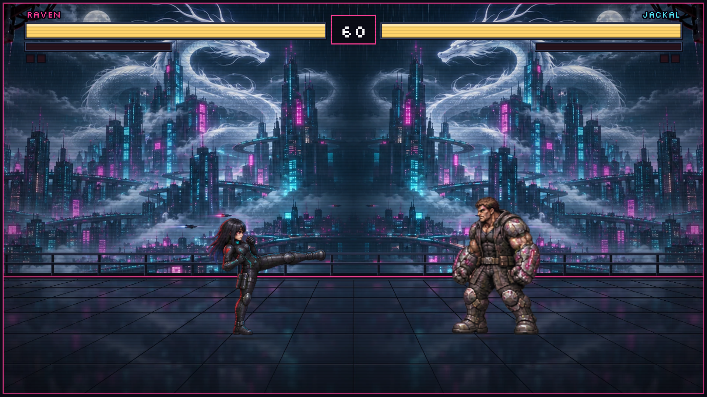
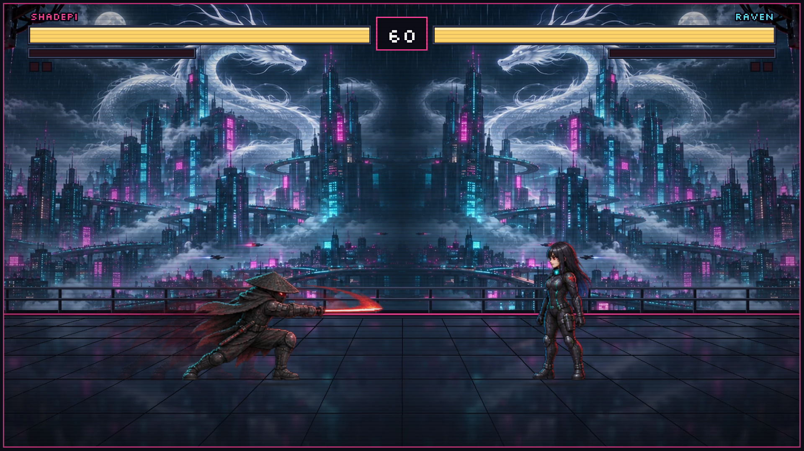
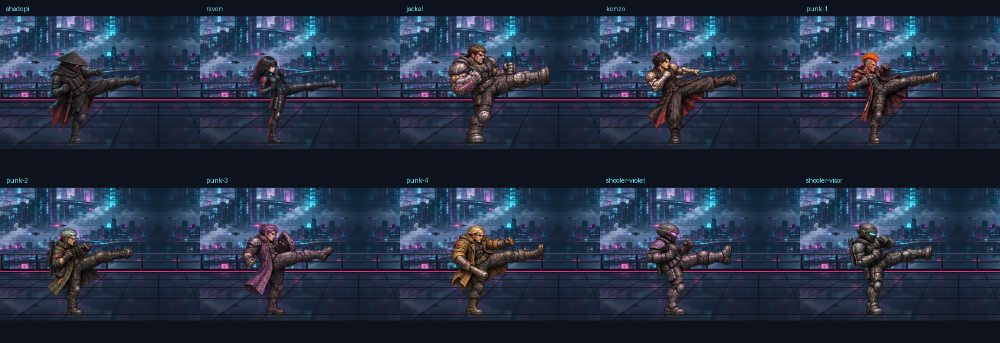
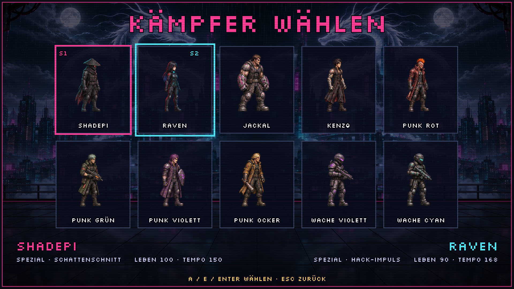
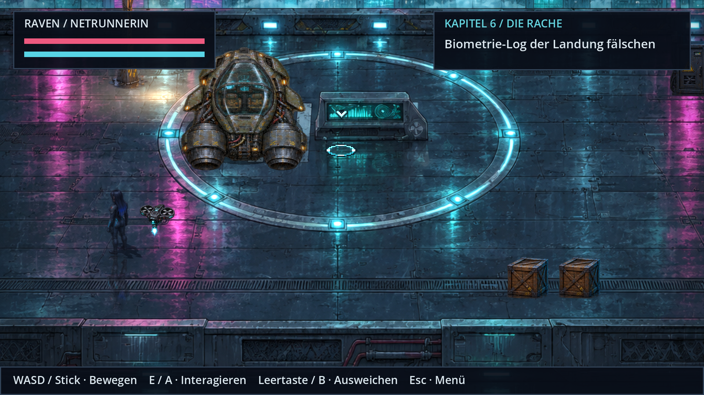
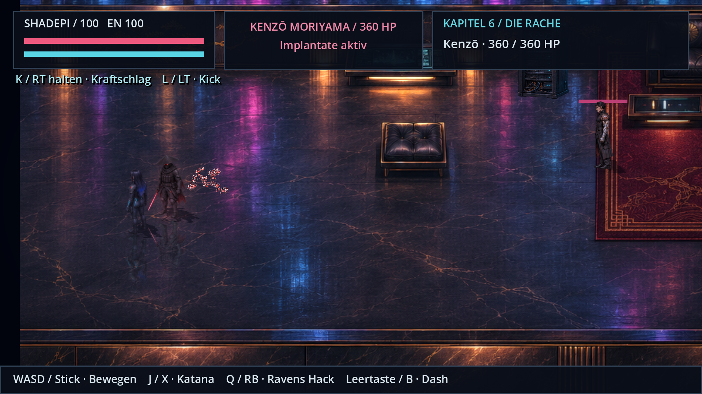
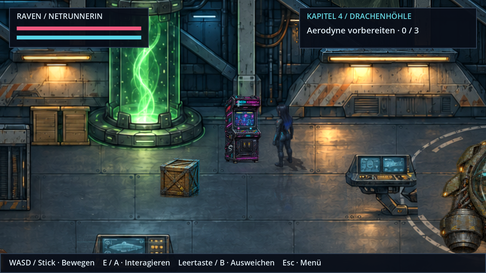
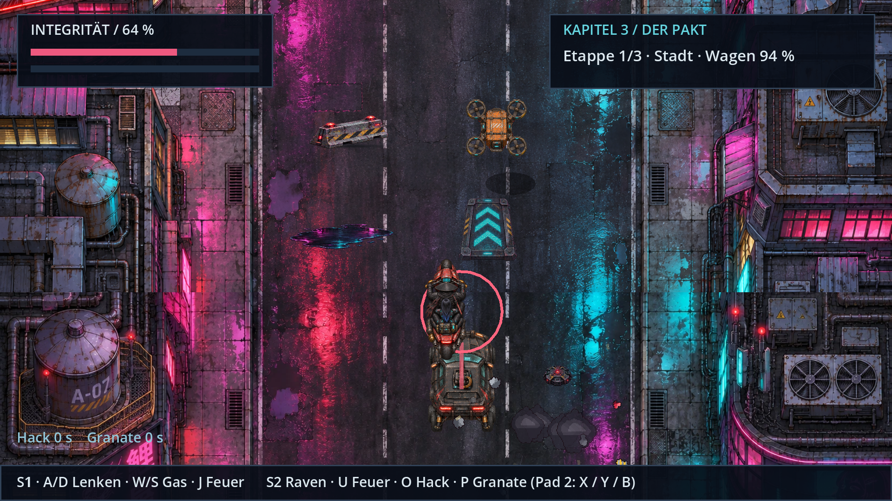

# Eigene Arcade-Kampfposen und HQ-Begleiter · v0.61.0 · CodexAI

**15. November 2026.** [Galerie](README.md) · [Arcade-Steuerung](arcade.md) · [Begleiter](begleiter.md) · [Arbeitsnachweis](arbeiten/arcade-begleiter-v061.md).

Der aktuelle verlängerte Spielstand v0.60.3 bleibt erhalten. Neu sind **160 eigene Arcade-Posen für alle zehn wählbaren Kämpfer**, detailliertere Koop-Begleiter und generierte Pixelgrafiken für die einfachen Automaten-, Geschoss- und Fahrrequisiten. Die normalen Helden-Sprites bleiben unverändert.

| Ravens Kick | Shadepis Schattenschnitt |
| --- | --- |
|  |  |

[**Kampffilm ansehen**](previews/arcade-kampf-v061.webp) · 18 Sekunden echte native Kampfsimulation, sechs Paarungen, unter 5 MB. Keine Konzeptbilder als angebliches Gameplay.

## Zehn Kämpfer, eigene Bewegungen

Jede Figur erhält Bereitschaft/Atmen, Gehen, Sprung, einen echten Block, Trefferreaktion, liegenden K.O., Faust ausholen/treffen, Kick anziehen/treffen, Spezial ausholen/auslösen, Sieg und Landung. Es gibt keine gekippte Standfigur mehr als Ersatz für einen liegenden Körper.

| Figur | Individueller Spezialangriff |
| --- | --- |
| Shadepi | Rotes Katana mit durchdringendem Schattenschnitt |
| Raven | Cyanblitz aus der offenen Hand |
| Chrome Jackal | Schwerer Chromfaust-Bodenschlag |
| Kenzō | Goldene Cyberfaust-Schlagserie |
| Punk Rot | Baton-Schlagserie, orange Spuren |
| Punk Grün | Gewehr-Feuerstoß |
| Punk Violett | Violetter Unterarm-Plasmaimpuls |
| Punk Ocker | Schwerer Keulen-Bodenschlag |
| Wache Violett / Cyan | Schuss aus der jeweiligen Gewehrmündung |

**Spielen:** J/U beziehungsweise **X** schlägt, K/I beziehungsweise **Y** kickt, L/O beziehungsweise **B** löst den individuellen Spezialangriff aus. Spezial kostet eine halbe Leiste. Oben springt, Unten blockt. Die Belegung gilt nur im Automaten; die Kampagne behält ihre eigenen Tasten.

**Kombo:** Faust treffen lassen und anschließend Kick oder Spezial eingeben. Nach bestätigtem Kontakt kann die Folgeaktion einsetzen; ein 180-ms-Puffer fängt etwas früh gedrückte Eingaben auf. Fehlschläge und Blocks lassen sich nicht so abbrechen. Vorstoß, Rückstoß, Lufttreffer, Hitstop, Spezialleiste, zwei Rundensiege und CPU bleiben Teil des vorhandenen Kampfsystems.

## Begleiter in der Kampagne

| Raven: Aufklärungsdrohne | Shadepi: angreifende Naniten |
| --- | --- |
|  |  |

Die Drohne besitzt strukturierte Metallplatten, Sensorkern, Rotorphasen und eine eigene Feuerfolge. Ihr Schuss startet am Unterlauf einschließlich der Schwebebewegung. Der Nanitenschwarm besteht aus metallischen Mikroformen mit weißen Kernen und roten Angriffsvarianten. Störimpuls und Schutz bekommen ein eigenes vierphasiges Pixelsignal. Weltgröße, Leine, Schaden, Rollenwahl, Controllerbelegung und passive Solo-Begleitung bleiben erhalten.

## Materialreiche Requisiten und Pixel-FX

| Neuer Automat in der Halle | Fahrhindernisse und Hilfen |
| --- | --- |
|  |  |

Die bisherigen einfachen Flächen wurden gezielt ersetzt: Automat mit Metall, Lüftung, CRT und Bedienelementen; beschädigter Beton und Warnstreifen auf der Bake; gepanzerte Mine; unregelmäßige Ölreflexe; physisches Boostpad. Arcade-Blitz, Plasma, Patrone, Kontakt-/Treffer- und EMP-Signale kommen aus generierten Pixelzellen. Brennende Straßenwracks verwenden die vorhandenen Pixelflammen statt einfacher Feuerkreise. HUD-Balken, Texte und notwendige Gefahrensignale bleiben funktionale Anzeigen.

## Quellen und Konsistenz

- **Neu generiert:** dreizehn unveränderte Bildausgaben, getrennt von den aktiven Originalhelden, unter [Herstellungsquellen](../tools/art-v061/README.md).
- **Aktive Atlanten:** [Arcade](../assets/arcade/README.md), [Begleiter](../assets/sprites/companions/README.md). Originale und frühere kleine Varianten bleiben erhalten; historische Begleiter-/Automatquellen sind vom Export ausgeschlossen.
- **Registrierung:** alle Kämpferzellen 512×320, Fußanker (224,288), Maßstab 0,5; eigene Mündungs-/Handanker je Fernkämpfer. Quellausschnitte und Maßstäbe in `atlas.json`. Erweiterte leere Ränder sichern ausladende Schläge und Waffen.
- **Geprüft:** echte Godot-Ansichten in Full HD, alle zehn Figuren mit Faust/Kick/Spezial/Block/K.O., native Kampffolge, Tastatur- und simulierte Controllerereignisse, Koop-Zuordnung und Rückkehr zur Mission. Atlasprüfung ohne abgeschnittene oder übergreifende Posen. Genaue Prüfergebnisse und Exportnachweis im [Arbeitsnachweis](arbeiten/arcade-begleiter-v061.md).
