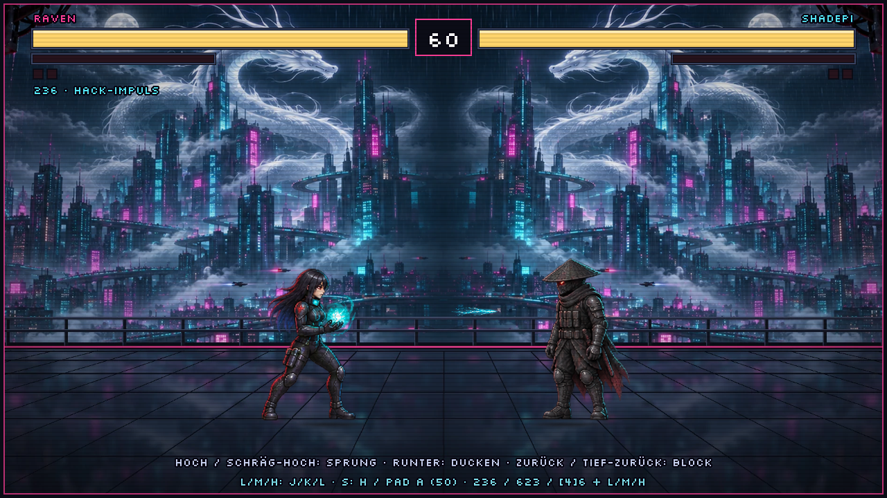
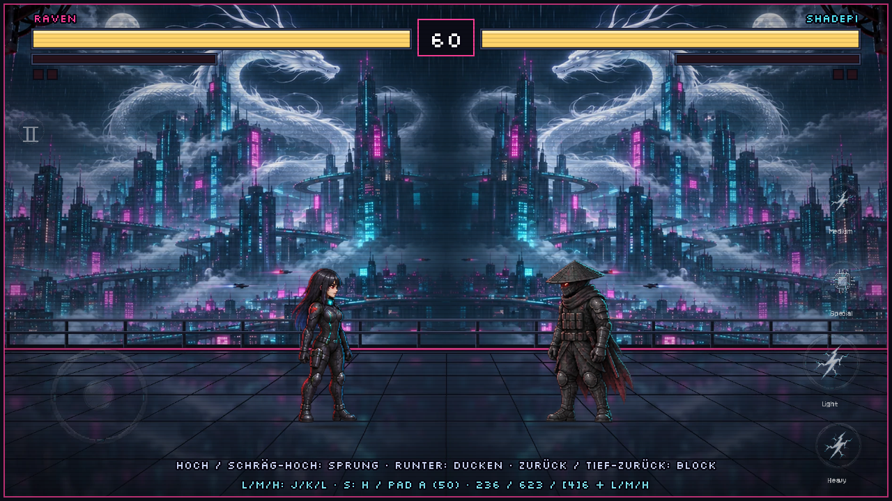
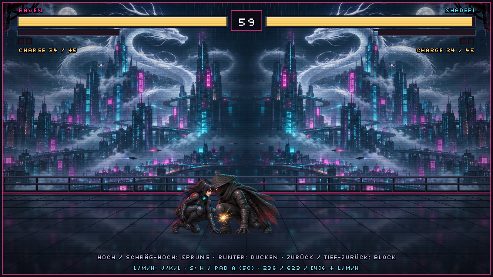
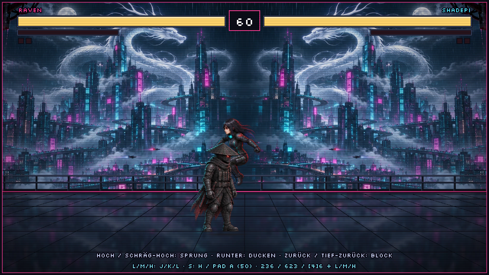
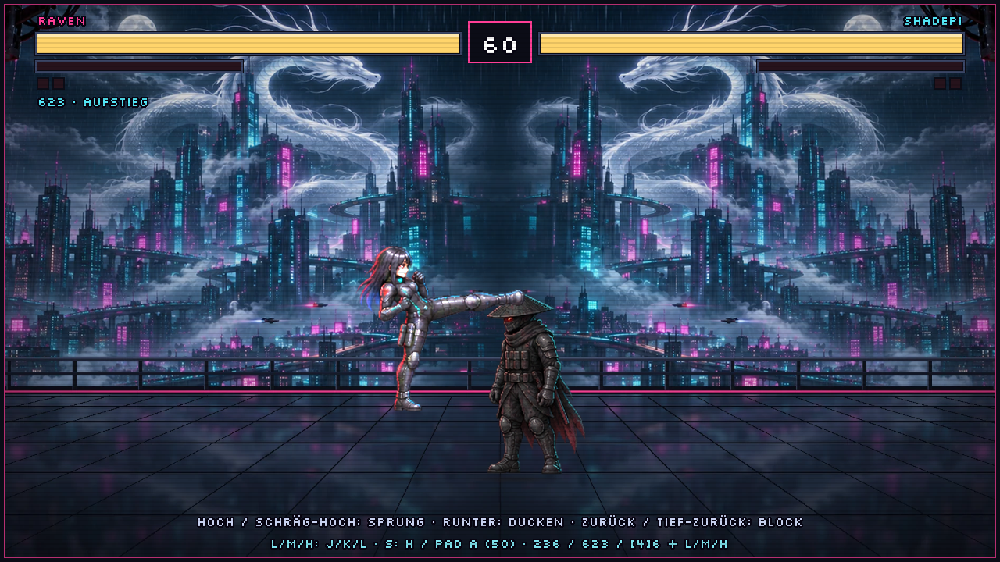

# Klassische Arcade-Steuerung · v0.67.0 · CodexAI

**17. November 2026.** [NEON KOMBAT](arcade.md) · [Anleitung](../Spiel-README.md) · [Änderungen](../CHANGELOG.md).

NEON KOMBAT erhält feste Sprünge, Richtungsblock, vier Angriffstasten und klassische Richtungsbefehle. Alle zehn Kämpfer verwenden ihre bisherigen eigenen HQ-Pixelatlanten. Die Kampagne behält ihre Steuerung.

[**Kampffilm mit Ducken/Block, Überspringen, Viertelkreis, Aufstieg, Charge und EX**](previews/arcade-inputs-v067.webp). Native Linux-Spielaufnahmen in 1280×720; geskriptete Eingaben im echten Kampfsystem, keine nachgezeichneten Bilder.

## Vier Angriffstasten

| Stärke | Spieler 1 | Spieler 2 | Gamepad / Touch |
| --- | --- | --- | --- |
| Light | J | U | X |
| Medium | K | I | Y |
| Heavy | L | O | B |
| Special EX | H | P | A |

Special benötigt **50 Energie** und verstärkt die persönliche Technik um 35 %. Ein Richtungsbefehl mit Light/Medium/Heavy benötigt keine Energie; Medium/Heavy verstärken diese Technik um 15/30 %. Normale Angriffe haben ihre eigenen abgestuften Schadenswerte und Anlaufzeiten. Bestätigte Treffer erlauben Light → Medium → Heavy oder Technik; Fehlschläge/Blocks behalten ihre Erholung.

Touch-Arcade blendet die bisherigen zusätzlichen Story-Aktionen aus. Beim Verlassen erhalten die Tasten wieder ihre Kampagnenbilder. Esc / Start öffnet weiterhin das eigene Arcade-Pausenmenü.

## Bewegen, springen, verteidigen

WASD für Spieler 1, Pfeiltasten für Spieler 2 oder Steuerkreuz/linker Stick. Hoch springt senkrecht, diagonal-hoch in einem festen Vorwärts- oder Rückwärtsbogen. Die waagerechte Geschwindigkeit steht beim Absprung fest; Gegenlenken in der Luft ändert diesen Bogen nicht. Es gibt keine Sidesteps. Unten duckt, ohne automatisch zu blockieren.

| Gehaltene Richtung relativ zum Gegner | Schutz |
| --- | --- |
| Zurück | Mittel-/hohe Angriffe |
| Unten-Zurück | Mittel-/tiefe Angriffe |
| Unten allein | Ducken, kein Block |
| In der Luft | Kein Block |

Heavy und normale Luftangriffe sind Überkopf-Angriffe gegen Tiefblock; geduckte Light/Medium sind tiefe Angriffe gegen stehenden Block. Passender Block lässt 20 % Schaden durch. Rückwärtsgehen hält die stehende Abwehr bereit; die gezeichnete Schutzpose erscheint beim Kontakt. Ducken/Tiefblock verwendet die vorhandene tiefe Pose 15, keine zusammengestauchte Figur.

Beim Überspringen drehen sich **beide** Kämpfer sofort zueinander, auch in der Luft. Vorwärts/Zurück für Eingaben und Block spiegeln mit; die alte Rückwärtsrichtung schützt danach nicht mehr. Ein gestarteter Ansturm/Schattenschnitt behält seine Reiserichtung und pendelt nicht am Gegner hin und her.

## Richtungsbefehle und Charge

Die Zahlen sind das Ziffernblockmuster **bei Blick nach rechts**:

| 7 · oben-zurück | 8 · oben | 9 · oben-vorwärts |
| --- | --- | --- |
| 4 · zurück | 5 · neutral | 6 · vorwärts |
| 1 · unten-zurück | 2 · unten | 3 · unten-vorwärts |

Bei Blick nach links wird die Eingabe horizontal gespiegelt. `L/M/H` meint hier die **Stärke**, nicht den Buchstaben L auf der Tastatur.

| Befehl, anschließend Light/Medium/Heavy | Aktion |
| --- | --- |
| `↓ ↘ →` · **236** | Persönliche Technik: z. B. Ravens Hack-Impuls oder Shadepis Schattenschnitt |
| `→ ↓ ↘` · **623** | Aufstieg als Antwort auf Luftangriffe |
| **Zurück 0,75 s halten**, dann Vorwärts | Ansturm |
| **Unten 0,75 s halten**, dann Oben | Aufstieg |

Beispiel Raven auf der linken Seite: **S → S+D → D+J** startet den energiefreien Handimpuls. Auch **S → D+J** funktioniert. Auf der rechten Seite entsprechend **S → S+A → A+J**. Beim Charge kann Unten-Zurück beide Haltezeiten gleichzeitig aufbauen; die Freigaberichtung entscheidet die Technik. Oben + Angriff gemeinsam eingeben, bevor ein normaler Sprung startet.

- Richtungsfolge innerhalb **380 ms**, kurze Neutral-Lücken bis **100 ms**; übersprungene Diagonalen wie 26 oder 626 werden toleriert. Dragon Punch hat Vorrang, wenn beide Muster passen.
- Charge ist zeitbasiert: **45 Referenzframes bei 60 Hz = 0,75 Sekunden**, unabhängig von der Bildrate. Nach dem Loslassen bleiben **200 ms** für Gegenrichtung + Angriff. Die Anzeige zählt bis 45.
- Angriffe werden **180 ms** vorgehalten, auch während kurzer Trefferpausen. Die Figur führt die Aktion erst aus, wenn sie handeln darf.
- Der Ring ist auf **64 Richtungswechsel** begrenzt. Akzeptierte Befehle werden verbraucht; ein alter Viertelkreis kann nicht durch Neutral/Vorwärts erneut ausgelöst werden.
- Ein Seitenwechsel verwirft horizontale Ladung. Pause, neue Runde, Kämpfer-/Titelauswahl leeren Historie und Ladung. Die CPU durchläuft denselben Parser.

## Prüfungen und Grenzen

[Maschinenlesbarer Prüfnachweis](pruefungen/v067/ergebnisse.json) · [Konsistenz-/Arbeitsnachweis](arbeiten/arcade-inputs-v067.md) · [Aufnahmewerkzeug](../tools/arcade-v067/README.md).

Die gezielten Prüfungen umfassen echte Tastatur-, Touch- und Godot-Gamepad-Ereignisse, beide Spieler, gespiegelte Stickbefehle, Hoch-/Tiefschutz, tatsächliches Überspringen, Sprung-Endpunkte bei 30/60/144 Hz, 44/45/50-Frame-Ladung, Befehlstoleranz/-Verbrauch sowie Hitstop und Pause. Die Desktop-Aufnahmen zeigen die tatsächlichen Pixel; ein physischer Android-Controller-Test und subjektives Feintuning des Turnier-Balancings sind damit nicht behauptet. Windows-/Linux-/Android-Builds werden ohne Release-Veröffentlichung erzeugt; Signaturverwaltung bleibt beim Nutzer.
