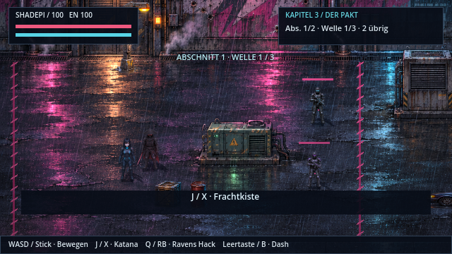

# Kampfabschnitte und Gegnerwellen

Die Bodenkämpfe nutzen einen Arcade-Ablauf: Abschnitt betreten, Gegnerwellen besiegen, weitergehen. Rote Sperren schließen den Kampfbereich. Zwischen den Wellen liegen zwei Sekunden Pause; das HUD zeigt Abschnitt, Welle und verbliebene Gegner. Nach der letzten Welle wird der Weg freigegeben und „WEITER →“ eingeblendet.

| Kampfphase | Abschnitte | Wellen je Abschnitt | Gegner insgesamt |
| --- | --- | --- | --- |
| Ravens Jagd, Kapitel 1 | 3 | 2 / 2 / 2 | 12 |
| Shadepis Rettungsweg, Kapitel 1 | 1 | 3 | 8 |
| Hinterhalt, Kapitel 3 | 2 | 3 / 3 | 13 |
| Aufzugwachen nach Kenzōs Tod, Kapitel 6 | 1 | 3 | 8 |

Nahkämpfer, Schützen und die vorhandenen Schildwachen wechseln sich ab. Gegner behalten moderate Lebenspunkte. Verstärkung sucht freie Ankunftspositionen mit Abstand zu den Figuren und hat zunächst 1,3 Sekunden Angriffs-Abklingzeit. Pro abgeschlossenem Abschnitt erhalten lebende Figuren bis zu 15 Lebenspunkte und 20 Energie zurück; die Obergrenze bleibt 100. Die am Boden liegende Raven wird dadurch nicht vorzeitig wiederbelebt.

Pausenmenü und Dialoge halten die Wellenpausen an. Das Motorrad und der nächste Storyabschnitt bleiben auch während der Wellenpause gesperrt. Die Jagd verlangt weiterhin das Verfolgen von Ravens Spur, bevor Jackals Hof aufgeht.

Beim Wechsel zum nächsten Kampfabschnitt wird automatisch gespeichert. Niederlage oder Laden starten diesen Abschnitt bei Welle 1 mit voller Gesundheit. Kapitel 1 speichert den Abschnitt getrennt für Solo und Koop. Alte Spielstände ohne Abschnittsnummer bleiben ladbar. Seit v0.17.0 kommen die Aufzugwachen erst **nach** Kenzōs Kampf: Sein Totmannschalter ruft sie ins Penthouse, der Fluchttimer startet erst nach der letzten Welle. Laden oder Niederlage während dieses Kampfes setzt ihn ohne erneute Zwischensequenz fort. Alte Spielstände am früheren Dachkampf starten direkt bei Kenzō.

Jackals Storyduell, sein gemeinsamer Bosskampf, Kenzōs Einzelkampf, die vorhandene ICE-Abwehr sowie Fahr-, Rätsel- und Storysequenzen behalten ihren Ablauf. Die inzwischen ergänzten [Kraftangriffe und der Kick](kampfbewegungen.md) sind separat dokumentiert.

## Entwicklung und Prüfung

- `scripts/arcade_waves.gd`: Abschnittsgrenzen, Einstiegspunkte, Gegnerpositionen und Varianten.
- `scripts/arcade_encounter.gd`: Sperren, Wellenpausen, HUD-Status, Ankunftspositionen und Abschnittswechsel.
- Die Kapitel erzeugen weiterhin ihre vorhandenen Gegner; Angriffe und Fähigkeiten bleiben in den bisherigen Spieler- und Kampfskripten.
- `tests/arcade_waves.gd` prüft mit echter Godot-Physik Spawnfreiheit, erreichbare Gegner, Sperren bei Dash-Bewegungen, Pausen, Fortschritt und Speicherstände. Die Gameplay- und Storytests decken den anschließenden Kapitelverlauf ab.
- `tools/arcade_gallery.gd` erzeugt mit einem Display Renderer-Aufnahmen für Kampf, Wellenpause und Freigabe unter `/tmp/shadepi-arcade-*.png`.

Die Gegnerzahlen sind eine erste spielbare Abstimmung. Automatische Ablaufprüfungen und Renderer-Aufnahmen ersetzen keinen vollständigen manuellen Spieldurchlauf zur Schwierigkeitsbewertung.

Geprüft mit Godot 4.7.2: 303 Gameplay-, 237 Wellen-, 240 Story-, 46 Fahrzeug- und 20 NPC-Prüfungen, insgesamt 846 ohne Fehler. Kampf, Wellenpause und Abschnittsfreigabe wurden zusätzlich mit OpenGL Compatibility unter Xvfb/Mesa gerendert und visuell geprüft.
