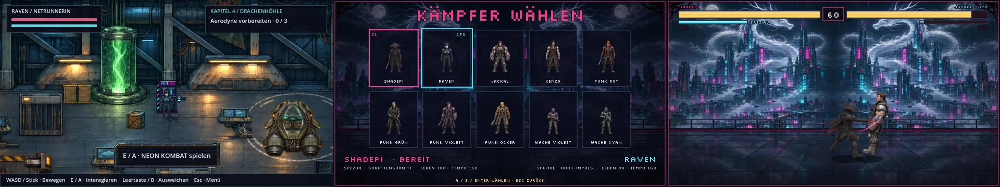

# Arcade-Automat „NEON KOMBAT“ · v0.57.0 · ClaudeHelper

**11. November 2026.** [Bildgalerie](README.md) · [Spieleranleitung](../Spiel-README.md) · [Versionshinweise](../CHANGELOG.md).

Nutzerauftrag vom 11. November 2026: In Shadepis Versteck steht ein Automat mit einem Kampfspiel im Stil klassischer Prügelspiele, mit den Figuren des Spiels und einem Zweispieler-Duell.

## Wo

- **Kapitel 4, Halle des Ordens:** an der Rückwand rechts neben dem grünen Tank. Raven tritt davor, **E / A** startet.
- **Hauptmenü:** Nach dem ersten Fund erscheint „Arcade · NEON KOMBAT“.
- **Esc / Start** führt zurück: aus dem Kampf zum Titelbild, vom Titelbild aus dem Automaten.

## Steuerung

| | Spieler 1 | Spieler 2 | Gamepad |
| --- | --- | --- | --- |
| Laufen | A / D | Pfeil links / rechts | Steuerkreuz / Stick |
| Springen | W | Pfeil hoch | hoch |
| Blocken | S halten | Pfeil runter halten | runter |
| Leichter Schlag | J | U | X |
| Schwerer Hieb | K | I | Y |
| Spezial (halbe Leiste) | L | O | B |
| Wählen | E / Leertaste | Enter | A |

Allein am Automaten gelten für Spieler 1 auch Pfeiltasten und Enter. Erstes Gamepad: Spieler 1, zweites: Spieler 2. Im Duell mit nur einem Gamepad gehört es Spieler 2.

## Regeln

- 60 Sekunden je Runde, wer zwei Runden gewinnt, gewinnt das Duell. Bei Zeitablauf zählt der höhere Lebensanteil.
- Treffer füllen die Spezialleiste. Ein Spezialangriff kostet die Hälfte.
- Block fängt vier Fünftel des Schadens ab, aber nur von vorn.

| Kämpfer | Leben | Spezial |
| --- | --- | --- |
| Shadepi | 100 | Schattenschnitt: Sturm durch den Gegner |
| Raven | 90 | Hack-Impuls: Geschoss |
| Jackal | 120 | Chromfaust: Bodenschlag im Umkreis |
| Kenzō | 105 | Drachenhagel: drei Treffer im Vorstoß |
| Punk Rot | 95 | Schlagserie |
| Punk Grün / Punk Violett | 95 | Geschoss |
| Punk Ocker | 110 | Keulenhieb: Bodenschlag |
| Wache Violett / Wache Cyan | 85 | Salve: Geschoss |

## Grenzen der vorhandenen Figurenblätter

Die Blätter enthalten Stand, Lauf, Angriff und Treffer in Seitenansicht. Eigene Bilder für Sprung, Block, Niederschlag und einen zweiten Angriff gibt es nicht. Das Spiel behilft sich: Sprung nutzt ein Laufbild, Block eine bläuliche Tönung, K.O. kippt die Figur, leichter und schwerer Angriff teilen sich die Angriffsbilder mit anderem Tempo und Vorstoß.

## Technik

- `scripts/arcade/neon_kombat.gd` (Spiel, eigenes Bild über der Welt), `scripts/arcade/arcade_cabinet.gd` (Automat in der Halle), `open_arcade()` in `scripts/main.gd`.
- Bühne, Automat und Funken: `python3 tools/arcade/build_arcade.py` → `assets/arcade/`. Die Bühne spiegelt die Skyline des Hauptmenübilds.
- Spielstand `user://shadepi-arcade.cfg`: Fund und Siege gegen die CPU.
- Prüfungen: `tests/arcade.gd`.
