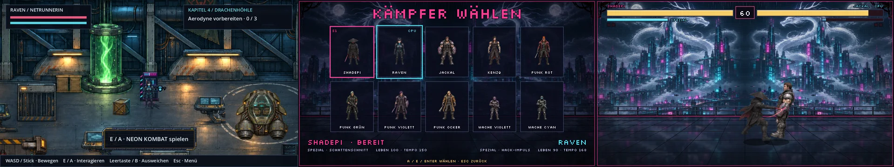

# Arcade-Automat „NEON KOMBAT“ · v0.61.0 · CodexAI

**15. November 2026.** [Bildgalerie](README.md) · [Spieleranleitung](../Spiel-README.md) · [Versionshinweise](../CHANGELOG.md).

Nutzerauftrag vom 11. November 2026: In Shadepis Versteck steht ein Automat mit einem Kampfspiel im Stil klassischer Prügelspiele, mit den Figuren des Spiels und einem Zweispieler-Duell.

## Wo

- **Kapitel 4, Halle des Ordens:** an der Rückwand rechts neben dem grünen Tank. Raven tritt davor, **E / A** startet.
- **Hauptmenü:** Nach dem ersten Fund erscheint „Arcade · NEON KOMBAT“.
- **Esc / Start** öffnet das eigene Pausenmenü. Fortsetzen erhält den Kampf; „Zur Titelauswahl“ oder „Automat verlassen“ sind bewusste Menüaktionen (v0.64.0 · CodexAI).

## Steuerung

| | Spieler 1 | Spieler 2 | Gamepad |
| --- | --- | --- | --- |
| Laufen | A / D | Pfeil links / rechts | Steuerkreuz / Stick |
| Springen | W | Pfeil hoch | hoch |
| Blocken | S halten | Pfeil runter halten | runter |
| Leichter Schlag | J | U | X |
| Schwerer Kick | K | I | Y |
| Spezial (halbe Leiste) | L | O | B |
| Wählen | E / Leertaste | Enter | A |

Allein am Automaten gelten für Spieler 1 auch Pfeiltasten und Enter. Erstes Gamepad: Spieler 1, zweites: Spieler 2. Im Duell mit nur einem Gamepad gehört es Spieler 2.

## Regeln

- 60 Sekunden je Runde, wer zwei Runden gewinnt, gewinnt das Duell. Bei Zeitablauf zählt der höhere Lebensanteil.
- Treffer füllen die Spezialleiste. Ein Spezialangriff kostet die Hälfte.
- Block fängt vier Fünftel des Schadens ab, aber nur von vorn.

| Kämpfer | Leben | Spezial |
| --- | --- | --- |
| Shadepi | 100 | Schattenschnitt: Sturm durch den Gegner |
| Raven | 90 | Hack-Impuls: Geschoss |
| Jackal | 120 | Chromfaust: Bodenschlag im Umkreis |
| Kenzō | 105 | Drachenhagel: drei Treffer im Vorstoß |
| Punk Rot | 95 | Schlagserie |
| Punk Grün / Punk Violett | 95 | Geschoss |
| Punk Ocker | 110 | Keulenhieb: Bodenschlag |
| Wache Violett / Wache Cyan | 85 | Salve: Geschoss |

## Eigene Arcade-Animationen · v0.61.0 · CodexAI

Jeder der zehn Kämpfer besitzt jetzt ein separat generiertes 16-Posen-Blatt: Bereitschaft/Atmen, Gehen, Sprung, Block, Treffer, liegender K.O., Faust ausholen/treffen, Kick anziehen/ausstrecken, Spezial ausholen/auslösen, Sieg und Landung. Körpermaß und Fußkontakt werden registriert; die normalen Kampagnenhelden bleiben unverändert.

**Kombo:** Faust treffen lassen, dann während der Treffer-/Erholungsphase **Kick oder Spezial** eingeben. Ein bestätigter Fausttreffer kann in diese Aktion übergehen. Der Eingabepuffer hält Eingaben 180 ms vor. Bei Fehlschlägen und Blocks bleibt die Erholung; Spezial braucht weiter eine halbe Leiste. Lufttreffer, Block, Rückstoß und Hitstop gehören zum Kampf, keine Änderung der globalen Kampagnenbelegung.

Ravens Hack-Impuls kommt sichtbar aus ihrer offenen Hand, Schützen feuern aus der Gewehrmündung. [Neue Bilder, Film und Quellen](arcade-begleiter-v061.md).

## Technik

- `scripts/arcade/neon_kombat.gd` (Spiel, eigenes Bild über der Welt), `scripts/arcade/arcade_cabinet.gd` (Automat in der Halle), `open_arcade()` in `scripts/main.gd`.
- Aktive [Arcade-Quellen](../assets/arcade/README.md); Bühne bleibt erhalten. `tools/art-v061/pack.py` registriert die neuen generierten Posen und Materialien. Der frühere `build_arcade.py` ist nur Hersteller des historischen kleinen Automaten/Funkenblatts und der vorhandenen Bühne; nicht zum Überschreiben aktueller Grafiken ausführen.
- Spielstand `user://shadepi-arcade.cfg`: Fund und Siege gegen die CPU.
- Prüfungen: `tests/arcade.gd`.
