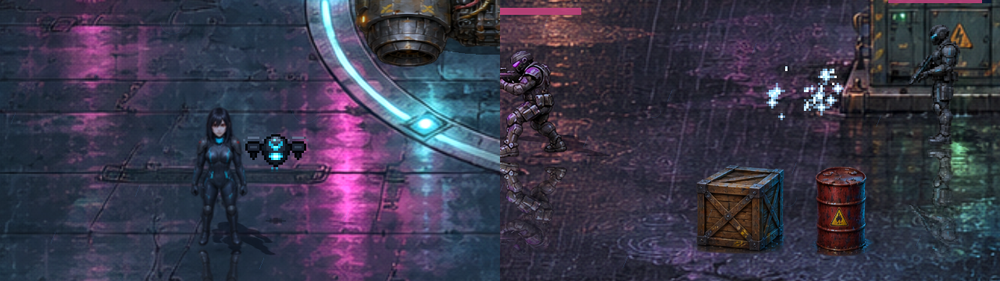

# Begleiter für Spieler 2 · v0.53.0 · ClaudeHelper

**Stand 10. November 2026.** Nutzeridee: In vielen Szenen ist nur ein Held spielbar, der zweite Spieler hatte dort nichts zu tun. Jetzt steuert er den Begleiter des Helden.

## Wer begleitet wen

| Held | Begleiter | Angriff | Spezial |
| --- | --- | --- | --- |
| **Raven** | Kleine Aufklärungsdrohne, mattschwarz mit cyanfarbenem Sensorauge wie ihr Anzug | **Schuss** auf das nächste Ziel in Flugrichtung | **Störimpuls:** unterbricht alle Gegner in der Nähe kurz |
| **Shadepi** | Schwarm weiß leuchtender Naniten aus dem Heiligtum; beim Angriff rot | **Biss** auf kurze Distanz | **Schutzschwarm:** legt sich kurz um Shadepi und fängt Treffer ab |

## Wann der Begleiter erscheint

- **Koop:** immer, wenn nur ein Held spielbar ist. Das betrifft fast alle Szenen von Kapitel 3 bis 7, zum Beispiel Hinterhalt, Garage, Hangar, Tower-Dach, Penthouse und Flucht. Spielen beide Spieler ihre Helden selbst (Kapitel 1 und 2 im Team), gibt es keinen Begleiter.
- **Solo:** nur wenn der Held wirklich allein in der Szene ist, etwa Raven auf dem Tower-Dach. Der Begleiter folgt dann von selbst und greift nicht ein. Ein zweiter Spieler kann jederzeit mit Angriffs- oder Spezialtaste einsteigen; nach 25 Sekunden ohne Eingabe folgt der Begleiter wieder allein.
- **Nie** bei Motorradfahrt, Aerodyne-Flug, den Kloster-Erinnerungen, in Filmszenen und im Abspann.

## Steuerung Spieler 2

| Aktion | Tastatur | Gamepad (zweites Pad) |
| --- | --- | --- |
| Bewegen | Pfeiltasten | linker Stick oder Steuerkreuz |
| Angriff (halten) | **U** | **X** oder **RB** |
| Spezial | **O** | **Y** |

Solange Spieler 2 den Begleiter steuert, gehören die Pfeiltasten ihm; Spieler 1 bewegt sich mit WASD oder seinem Gamepad.

## Regeln

- Der Begleiter fliegt, hat keine Kollision und kann nicht sterben.
- Er bleibt an einer Leine von 170 Pixeln beim Helden.
- Schuss 7 Schaden alle 0,42 s, Biss 9 Schaden alle 0,6 s, Spezial alle 6 s.
- Pause und offene Hack-Terminals frieren ihn ein.

## Technik

`scripts/companion.gd` · Pixelquellen `assets/sprites/companions/` aus `tools/companions/build_companions.py` · Test `tests/companion.gd` (22 Prüfungen, in CI).
