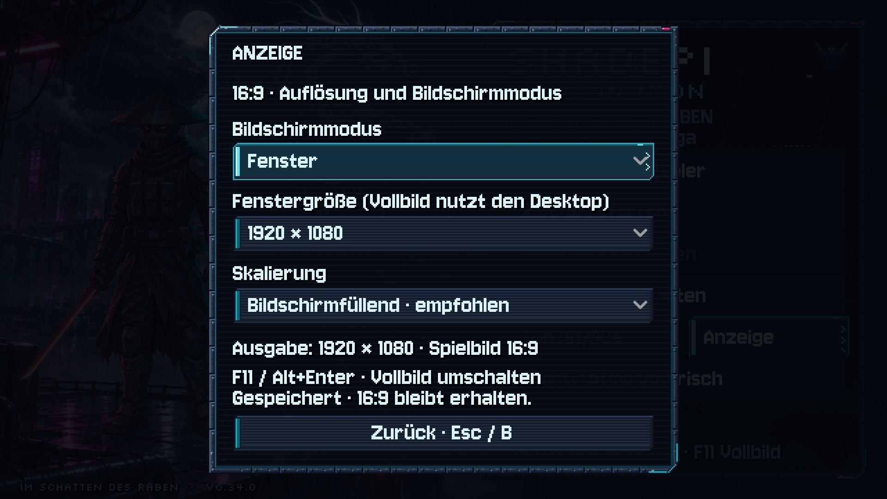
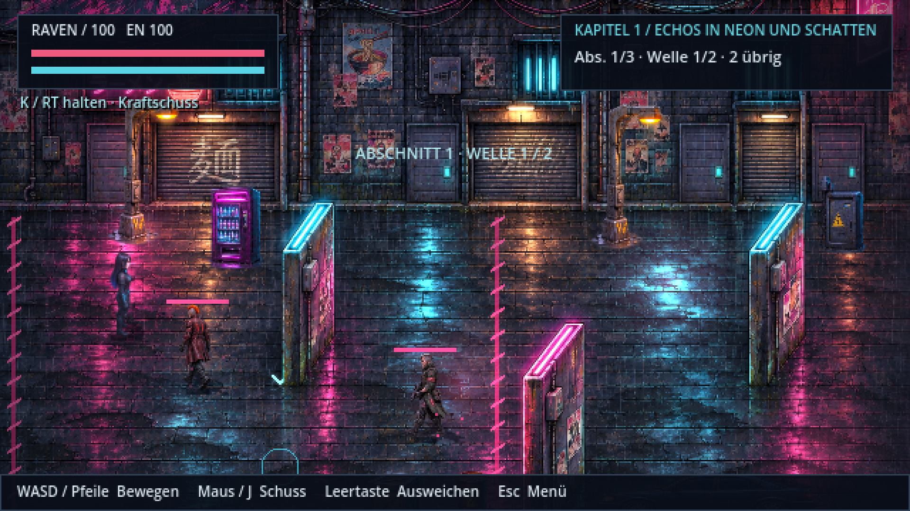

# Bildschirm, Vollbild und HQ · v0.51.0 · CodexAI

**Neu: [HQ-Anzeige mit echter Full-HD-Rasterung und 4K-Hochskalierung](hq-anzeige-v051.md).** Im Anzeige-Menü lässt sich HQ oder der klassische Pixelmodus auswählen. Die Wahl ist gespeichert, HQ standardmäßig aktiv. Die logische Welt-/HUD-Größe bleibt 640×360; das HQ-Spielbild hat bis zu 1920×1080 Renderpixel.

**Anzeigeanalyse v0.50.2 · CodexAI:** [Aktueller Renderpfad, echte Full-HD-Vergleiche und HQ-Empfehlung](anzeigequalitaet-v0502.md). Die ältere 640×360-Darstellung ist weiterhin als klassischer Modus verfügbar; HQ ist seit v0.51.0 ein regulärer Anzeigemodus.

Das Spiel startet beim ersten Mal im **Fenstervollbild** und merkt sich danach deine Wahl. **Anzeige** im Haupt- oder Pausenmenü öffnet die Optionen. **F11** oder **Alt+Enter** wechselt jederzeit zwischen Fenster und zuletzt gewähltem Vollbildmodus.

| Option | Verhalten |
| --- | --- |
| Fenster | Veränderbares Fenster mit Rahmen; Wunschgröße 1280×720, 1600×900, 1920×1080, 2560×1440 oder 3840×2160. Größere Wünsche werden auf den Monitor eingepasst. |
| Fenstervollbild | Randlos über den gesamten aktuellen Bildschirm, in dessen Desktopauflösung. |
| Vollbild | Exklusives Vollbild, soweit das Betriebssystem es unterstützt, ebenfalls in Desktopauflösung. |
| Bildschirmfüllend | Empfohlen: größtmögliches vollständiges 16:9-Bild. Andere Bildschirmformate behalten seitliche beziehungsweise obere/untere Ränder. |
| Pixelgenau | Ganze Skalierungsschritte. Kann beispielsweise im 1920×1000-Fenster nur 1280×720 nutzen und deshalb deutlich mehr Rand zeigen. |

**Controller:** Stick / Steuerkreuz wählt, A öffnet und bestätigt. B oder Esc schließt zuerst die offene Liste, danach das Anzeige-Menü; der Fokus kehrt zum Anzeige-Knopf zurück. Die im Vollbild unpassende Fenstergrößenauswahl wird übersprungen. Einstellungen gelten sofort und werden getrennt von Spielständen und Bildstil in `user://shadepi-display.cfg` gespeichert. Falls die Datei nicht beschreibbar ist, meldet der Dialog das; die aktuelle Auswahl funktioniert weiter.

## Ausgabe und Grafikauflösung

**1080p, 1440p und 4K werden bildschirmfüllend ausgegeben.** Im HQ-Modus wird bis Full HD direkt mit den vorhandenen Originaltexturen gerendert; oberhalb von 1920×1080 wird dieses fertige Full-HD-Bild vergrößert. Im klassischen Modus bleibt die interne Gameplay-Auflösung 640×360. Kamerabereich, Spielmechanik und HUD behalten dieselbe logische 16:9-Komposition. [Aktuelle Messungen](hq-anzeige-v051.md).

Bisher erzwang das Projekt ganzzahlige Skalierung: Ein 1920×1000-Fenster zeigte nur 1280×720 mit 320 Pixeln Rand links und rechts sowie 140 oben und unten. Jetzt nutzt das Spiel die ganze Höhe und rund 1778 Pixel Breite mit nur dem erforderlichen 16:9-Seitenrand. Rundung auf physische Pixel kann eine Abweichung von einem Pixel erzeugen.

## Umsetzung und Prüfung

- [`display_settings.gd`](../scripts/display_settings.gd) ist ein Autoload für alle Kapitel. Es setzt explizit 640×360, konstantes 16:9 und die gewählte Skalierung. Klassisch: Hauptmenü `CANVAS_ITEMS`, Gameplay/Pause `VIEWPORT`. HQ: begrenztes Spielbild mit Root-Präsentation; alle Szenen/Eingaben bleiben am ursprünglichen Viewport. Analyse-/Galeriewerkzeuge mit eigenem SceneTree behalten ihre Fenstersteuerung.
- [`display_panel.gd`](../scripts/display_panel.gd) verwendet die vorhandenen Pixelrahmen, Fonts und Kapitelthemen. Der Ton-/Anzeige-Bereich berücksichtigt die zusätzlichen Kapitelknöpfe. Keine neuen Figuren-, Welt- oder Effektgrafiken.
- [`tests/display_settings.gd`](../tests/display_settings.gd) prüft Einstellungen, fehlerhafte Dateien, Monitoranpassung, Pixelstufen, tatsächliche Fenstertransformationen einschließlich 1080p/1440p/4K/Ultrawide/4:3, rohe Tastatur-/Controller-/Mausereignisse, modale Listen, Fokus und Szenenwechsel. Bestandteil des GitHub-Builds.
- [`tools/display_gallery.gd`](../tools/display_gallery.gd) prüft beide Vollbildmodi auf einem echten Desktop und fotografiert die tatsächlichen Clientfenster. Auf X11 ohne Godot-Screen-Capture benötigt es ImageMagick `import`. Aufnahmen liegen unter `/tmp/shadepi-display/`; es werden keine kleinen Gameplay-Screenshots nachträglich vergrößert.

Sichtprüfung am 9. November 2026: Linux/X11 mit xfwm4 und echtem OpenGL-Renderer (Mesa-Softwaretreiber), Desktop 3840×2160. Native Windows-Anzeige wurde in dieser Umgebung nicht ausgeführt; Godots gemeinsame Window-API und der Windows-Exportpfad werden verwendet.

**Prüfstand v0.34.0 · CodexAI:** 967 automatisierte Prüfungen in Anzeige-, Gameplay-/Save-, Terminal-Controller-, Tower-, Story-, Heiligtum- und Flug-Prüfreihen sowie 16 zusätzliche Desktop-Prüfungen: **983 ohne Fehler**. [Arbeitsnachweis](arbeiten/bildschirm-v034.md).
