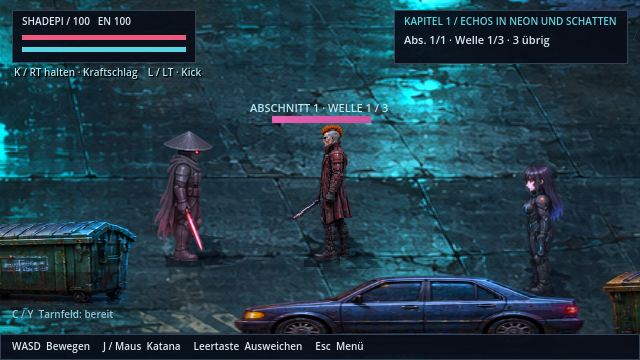
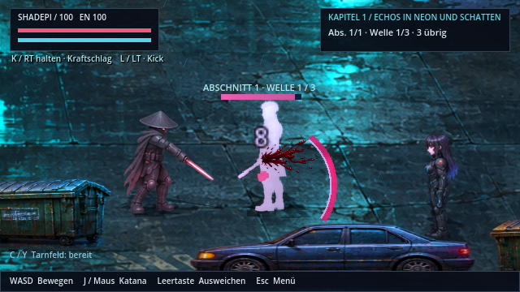
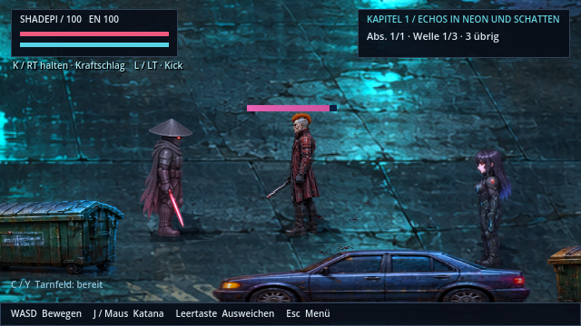
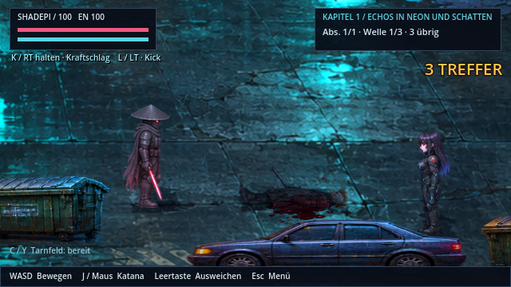
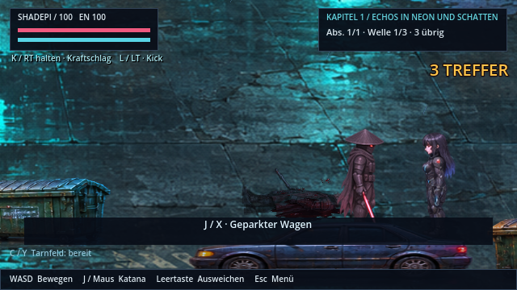

# Blutspritzer und Bodenlachen

**v0.46.0 · CodexAI · 9. November 2026.** [Bildgalerie](README.md) · [Quellen und Anker](../assets/fx/blood/README.md) · [Arbeits-/Prüfnachweis](arbeiten/blut-v046.md).

Menschliche Gegner und Cyberware-Träger verlieren bei echten Treffern Blut. Ein kurzer Spritzer beginnt auf Körperhöhe und folgt der Trefferbewegung vom Angreifer weg. Kleine Tropfen fallen auf den Boden und bleiben als Flecken liegen. Bei einem tödlichen Treffer bildet sich zusätzlich eine größere Lache, die sich ausbreitet und nach einigen Sekunden abdunkelt.

| Vor dem Treffer · gleiche Kamera | Tatsächlicher Treffer mit Spritzern |
| --- | --- |
|  |  |

Die helle Silhouette im Trefferbild ist der vorhandene kurze Trefferblitz. Figurenbilder und ihre Texturen wurden für dieses Update nicht verändert.

| Tropfen landen als kleine Flecken | Lache unter dem besiegten Gegner |
| --- | --- |
|  |  |

[**Animierten Treffer-/Bodenfilm öffnen**](previews/blut-v046.webp)

Die native Aufnahme stammt aus Godot 4.7.2 / OpenGL. Der Testaufbau platziert echte Spielfiguren im Kapitel-1-Straßenraum und löst deren tatsächliche Schadensfunktion aus. Der Film zeigt leichte/schwere Treffer, Tropfen, Tod, Lachenwachstum, das Vorbeigehen vor der Bodenlage und den reduzierten Bildstil. Kein vollständig manuell erspielter Kampf; Dummy-Audio ohne neue Klangabnahme.

## Verhalten im Spiel

- **Block und Nullschaden:** kein Blut. Ein bereits besiegter Gegner erzeugt bei weiteren Treffern keinen neuen Effekt.
- **Bodenkontakt:** Die Lache liegt über der Kulisse und unter Figuren/Gegenständen. Beim kurzen Leichenrutschen folgt sie dem Gegner, danach bleibt sie am Boden stehen. Tropfen beachten die vorhandenen Kulissenkollisionen.
- **Technische Gegner:** Digitale Wächter, Erinnerungsbots und Minotauren behalten ihre Energie-/Metall-Effekte. Dieses Update ergänzt keine Helden-Bluteffekte.
- **Pause und Terminal:** Animation, Tropfenflug und Lebenszeiten halten an. Die vorhandene Controller- und Tastaturbelegung bleibt gleich.
- **Bildstil und Leistung:** maximal 16 Spritzer, 96 Tropfen und 48 Bodenspuren; bei Reduziert entstehen höchstens 6 / 24 / 16. Nahe kleine Flecken werden zusammengeführt. Spuren verschwinden nach 90 Sekunden, die letzten zwölf Sekunden blenden sie aus. Beim Laden, Neustart oder Abschnittswechsel werden sie entfernt und nicht im Spielstand gespeichert.

Die neue transparente HQ-Pixelquelle enthält vier Spritzphasen und vier Bodenformen. Registrierte Ausschnitte statt blind gerundeter Zellen, tiefe Burgundtöne und kleine Reflexpixel statt flacher roter Kreise. Gameplay-Trefferwerte und Storyablauf bleiben erhalten.
