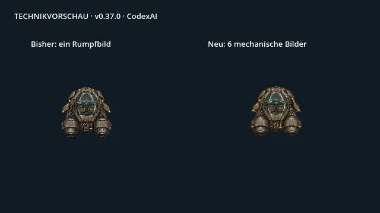
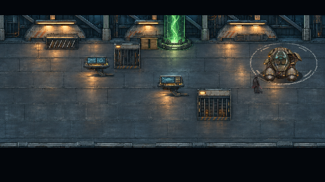
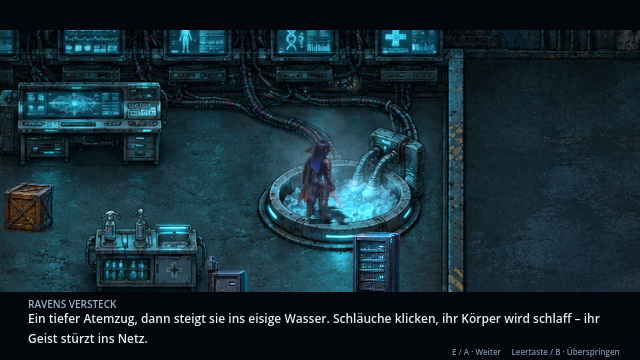
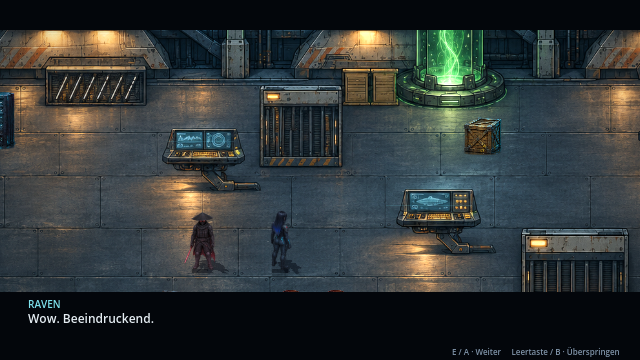

# Mehr Geschichte im Bild · v0.37.0 · CodexAI

**Prüfung vom 9. November 2026.** Die stärkste Verbesserung entsteht dort, wo eine körperliche Handlung bislang nur im Untertitel steht. Dafür zuerst die benötigten Kontakt- und Objektbilder schaffen und dann die Kamera daran ausrichten. Mehr Filter oder dauerhaftes Wackeln lösen diese Lücke nicht.

**Fortschritt v0.38.0 · CodexAI:** Der erste nächste Block ist umgesetzt: [Kapitel 2 mit Eisbad, Rückkehr, spielbarem Sprayholen und gestützter Behandlung](eisbad.md). Acht HQ-Pixelposen, tatsächliche Wannen-/Wasserverdeckung und sichere Szenen-/Inventar-Kontrollpunkte sind eingebunden. Die Tabellen darunter dokumentieren den Ausgangsbedarf der v0.37.0; der Kapitel-2-Block ist nun erledigt, zusätzliche Zwischenbilder bleiben spätere Verfeinerung. Kapitel 4 wurde anschließend mit v0.39.0 umgesetzt.

**Fortschritt v0.39.0 · CodexAI:** [Kapitel 4 mit Schalterkontakt, Entriegelungsphasen, gemeinsamer Schachtfahrt und Hangarenthüllung](hangar-entdeckung.md) ist fertig. Der normale Erkundungs-Hangar verwendet jetzt ebenfalls denselben separaten Aerodyne wie im Flug; geschlossenes unterirdisches Dach und KOBAN-TEC erhalten. Die Tabellen bleiben als ursprüngliches Briefing erhalten. Der erste Kurven-/Motorradblock wurde mit v0.40.0 ergänzt.

**Fortschritt v0.40.0 · CodexAI:** Der erste Fahrzeugblock ist umgesetzt: [vier Aerodyne-Kurvenlagen, Luftbremse und acht Motorrad-Fahrposen](fahrzeugbewegung.md), mit gemeinsamen Rumpf-/Düsenankern beziehungsweise festem hinterem Reifenkontakt. Flug, Landung, See-Anflug und Tower-Abfangen sind eingebunden. Dieser Verfolger-/Drohnenblock wurde mit v0.41.0 ergänzt. Vollständige Rollen-/Unterseitenansichten, Fahrwerk und Cockpit-Zwischenbilder bleiben offen.

**Fortschritt v0.41.0 · CodexAI:** [Verfolgerwagen mit neun Lenk-/Federungs-/Rückstoßbildern und Frachtdrohne mit vier Rotorphasen](verfolger-animationen.md) sind eingebunden. Feste Geschütz-/Abwurfkontakte, Controller und sichere Zustandsbereinigung gehören zum Block. Dieser erste Technikblock wurde mit v0.42.0 ergänzt; die Kapitel-1-/Kapitel-3-Szenen folgen nach Tabelle. Zusätzliches Aerodyne-Fahrwerk, vollständige Rollen-/Unterseiten und Cockpit-Zwischenbilder bleiben offen.

**Fortschritt v0.42.0 · CodexAI:** [Schaltkästen und Serverschränke mit je acht Betriebs-/Zugriffsphasen](technik-gegenstaende.md) sind der erste technische Prop-Block. Feste Standpunkte, explizite Rückmeldungen nach bestehenden Terminalaufgaben und erhaltene Schadens-/Speicherzustände. **Nächster Schwerpunkt:** Kapitel 1 mit sichtbarer Auftragsannahme, Ausrüstungsprüfung und motiviertem ersten Shadepi-Auftritt. Automat-/Türphasen sowie weitere Fahrzeug-/Cockpitbilder bleiben spätere gezielte Blöcke.

## Bereits in dieser Version umgesetzt

- **Kapitel 7:** `assets/music/menu.mp3` läuft bei Ankunft, Ordensaufnahme und Finale. Hauptmenü bleibt bei `Level.mp3`; Boss-/Kampfmusik behalten ihre Zuordnung. [Austauschpfade](../assets/music/README.md).
- **Aerodyne:** Aus einem Rumpfbild wurden **sechs HQ-Bilder**: geschlossen, Öffnungsbeginn, halb offen, offen und zwei laufende Triebwerksphasen. Die mechanischen Details wechseln tatsächlich; Nase, Cockpit und Düsen bleiben durch gemessene Anker fest.
- Die Kabine öffnet vor Ein-/Aussteigen und schließt danach in Hangar-Abflug, Tower-Flucht und See-Ankunft. Flug, Landung und geparktes Dachschiff verwenden dieselbe neue Quelle. Laufende Triebwerke haben eine eigene Bildfolge; abgeschaltet bleibt Bild 0 stehen. Übergeordnete Szenenuhren erhalten Pause und Skip.

Diese Vergleichsaufnahme ist ausdrücklich eine **Technikvorschau**, keine zusätzliche Spielszene. Die folgende Ansicht zeigt dagegen die tatsächliche offene Kabine während des Hangar-Einsteigens:

Sechs Bilder sind der erste Ausbau. **Echte Seiten-, Kurven- und Rollansichten sowie ein animiertes Fahrwerk fehlen weiterhin.** Eine Rotation des vorhandenen Rumpfs ist keine neu gezeichnete Ansicht. Das eingemalte Schiff im normalen Erkundungs-Hangar wurde mit v0.39.0 durch den gemeinsamen Renderer ersetzt. [Aktive Quelle und Anker](../assets/vehicles/aerodyne/README.md).

## Die nächsten Arbeiten, nach Wirkung priorisiert

| Priorität | Szene und heutige Beobachtung | Konkrete filmische Umsetzung | Benötigte neue Bilder |
| --- | --- | --- | --- |
| **1** | **Kapitel 2: Eisbad, Deep Dive und Rettung.** Einstieg und Erschlaffen stehen im Text; die Figuren bleiben normale Stand-/Trefferposen. Kryospray nutzt eine allgemeine Angriffsgeste. | Raven setzt sich an den Rand, verbindet das Kabel, senkt sich ins Wasser. Schnitt vom Monitorimpuls ins Netz. Bei Rückkehr: Atemnot, Shadepi greift das Spray und stützt sie; danach eine kurze ruhige Reaktion statt sofortigem Erklärblock. | Raven: 6–8 Einstieg-/Absenkbilder, 4 angeschlossene Ruhe-/Atembilder, 4 Rückkehrbilder. Shadepi: 4–6 Spray-/Stützphasen. Wannenrand als eigene Vordergrundmaske, Kabel mit festem Anschluss. |
| **1** | **Kapitel 4: Garage → geheimer Hangar.** Die Absenkung wird beschrieben, danach folgt eine Schwarzblende. Beim „Wow“ zeigt die Kamera überwiegend den freien Gang. | Kamera bleibt kurz auf der Werkbank, Verriegelungen lösen sich, Plattform senkt sich sichtbar in einen beleuchteten Schacht. Licht und Maschinengeräusch führen in die große Halle. Erst das Schiff zeigen, dann Ravens Reaktion. Shadepis Weg zum Kompensator bleibt erhalten. | 6–8 Verriegelungs-/Plattformphasen, getrennte feste Schacht-/Bodenkanten, 4 Werkbank-Interaktionsbilder; das normale eingemalte Hangarschiff freistellen und durch dieselbe Aerodyne-Quelle ersetzen. |
| **1** | **Fahrzeuge: Motorrad und Aerodyne in Kurven.** Das Motorrad ist weiterhin ein einziges Bild mit beiden Fahrern; Rollen/Neigen erfolgt überwiegend über Transformation. Aerodyne nun sechs mechanische Zustände, aber dieselbe Ansicht. | Richtungswechsel durch echte leichte/starke Schräglagen darstellen. Bremsen zeigt Gewichtsverlagerung; Federung reagiert auf Unebenheiten. Im Aerodyne vor dem Ausfall eine kurze Cockpit-Reaktion, ohne die Reparaturbedienung zu unterbrechen. | Motorrad: 5 Schräglagen, 4 Rad-/Federungsphasen, 3 Brems-/Absteigephasen. Aerodyne: 5 Kurven-/Rollansichten derselben Identität, 4 Fahrwerksphasen; vorhandene Cockpitbilder durch Zwischenphasen ergänzen. |
| **2** | **Kapitel 1: Auftrag und Shadepis erster Auftritt.** Die Dachgestalt wird während einer Schwarzblende beschrieben. Terminal, Tür und Tagesbeginn tragen wenig eigene Handlung. | Kopfgeld auf dem Bildschirm zeigen, Raven nimmt den Auftrag sichtbar an und prüft ihre Ausrüstung. Kurzer tatsächlicher Gegenschnitt zu Shadepi auf dem Sims; beim Landen Staub/Wasser und ein klarer Blickwechsel. | 4 Terminal-/Handbilder, 4 Ausrüstungs-/Aufstehphasen, 3–4 echte Kauer-/Aufrichtposen; kleine Sims-Kulisse nach bestehender Skyline. Kein Gesicht enthüllen. |
| **2** | **Kapitel 3: Pakt und Planung.** Mehrere biografische Informationen laufen nacheinander als lange Zeilen zwischen stehenden Figuren. | Informationen in drei Gesprächsschritte mit Reaktion und Abstand aufteilen: Ravens Grenze, gemeinsames Ziel, Plan am Terminal. Ein greifbares Detail ihrer Vergangenheit nur aus bestätigter Quelle zeigen. Towerplan als Objekt mit Landeplatz/Scanner, statt denselben Ort mehrfach zu erklären. | 4 Tablet-/Projektionszustände, 3–4 natürliche Hand-/Blickgesten pro Figur. Keine neu erfundene Rückblende über Ravens Gefangenschaft. |
| **2** | **Kapitel 6: Kenzō und Extraktion.** Griff, Einschreiten, verletztes Knien und Verteidigung sind bereits echte Szenen. Einige Kontakte sind wenige starke Schlüsselbilder. | Griff über eine kurze Zug-/Abwehrfolge führen; nach Kenzōs Sturz Gewicht und Atem zeigen. Bei Angriff auf Raven ein kurzer quellgebundener Trefferimpuls, der den Verteidigungskampf lesbar lässt. Datensicherung als sichtbarer Trennvorgang vor ihrer Abrechnung. | 3–4 Griff-/Lösezwischenbilder, 4 verletzte Knie-/Atembilder, 4 Datenverbindungs-/Trennbilder, 3–4 Rückstoßbilder für die endgültige Vernichtung. Kenzō bleibt bis zur Extraktion lebendig; Motiv und Auftraggeber bleiben offen. |
| **3** | **Kapitel 5: Kompensator und die drei Erinnerungen.** Neue Kontaktposen, Bewohner-Gang, Schutzopfer, Lys Ansturm, Meistertod und Aura sind schon vorhanden. | Bestehende Szenen erhalten. Gezielt kurze Reaktionen und mechanische Vorzeichen ergänzen: Klosteralarm, Schutzgriff beim Oni-/MG-Opfer, Blickwechsel vor Lys Ansturm, Metallspannung vor dem Tempeldurchbruch. Nach der Rückkehr Raven erst körperlich sammeln lassen. | Kleine 3–4-Phasen-Reaktions-/Schutzgesten; lokale Tor-, Monitor- und Kompensatorbewegung. Keine komplette Neuerstellung der bereits passenden Krieger oder Mönche. |
| **3** | **Kapitel 7: Ruhe und Nähe.** Anflug, Aussteigen, Aufnahme, Handführung, Kuss und Drachenschatten sind bereits inszeniert. Kontaktbilder werden überblendet. | Den neuen Moment erhalten. Optional 2–3 gezielte Zwischenposen für Heben der Maske und Annäherung; freie Haar-/Stoffspitzen bewegen, bei festen Füßen und Gesichtskontakten. Musikübergang später ohne Neustart derselben Datei beim Wechsel `LAKE → END` prüfen. | 2–3 anatomisch geprüfte Zwischenbilder. **Ravens rechte Hand hebt die Maske, linke verdeckt das Gesicht.** Kein vollständiges Porträt; kein permanenter Drachenschatten. |

## Warum die ersten beiden Szenen vor weiteren Filtern kommen

| Eisbad: Handlung wird noch beschrieben | Hangar: Reaktion vor dem eigentlichen Motiv |
| --- | --- |
|  |  |

Die Bilder stammen aus den tatsächlichen Szenenmethoden des aktuellen Spiels. Der Galerieablauf verwendet QA-Abkürzungen zwischen Spielabschnitten; eventuell anders platzierte Begleitfiguren sind kein Beweis für einen normal erspielten Fehler. Der sichere Befund ist der fehlende eigene Einstiegssatz beziehungsweise die Kamerawahl dieser Textzeile.

## Objekt-Sprites: Bestand und sinnvoller Ausbau

Die neun zerstörbaren Weltobjekte haben bereits **je drei Zustandsbilder**, aber diese ersetzen keinen Bewegungszyklus. Trefferwackeln in `WorldProp` verschiebt derzeit dasselbe Bild. Zusätzliche Bilder sollten konkrete Funktionen vermitteln:

| Objekt / Bestand | Nächster sinnvoller Sprite-Satz | Wo er hilft |
| --- | --- | --- |
| **Aerodyne: jetzt 6 mechanische Bilder** | Kurven/Rollen, Fahrwerk, Cockpit-Zwischenphasen; später ein konsistenter Reparaturdeck-Satz | Kapitel 4, 6 und 7; größter wiederkehrender Bildgewinn |
| **Motorrad, Verfolgerauto, Frachtdrohne: je ein Bild im alten Fahrzeugatlas** | Motorrad wie oben; Auto 3 Lenk-/4 Federungs-/3 Turmrückstoßbilder; Frachtdrohne 4 Rotorphasen | Verfolgung. Die separaten bewaffneten Flug-Sentries haben bereits eigene Zweibild-Bewegung; diese nicht mit der statischen Frachtdrohne verwechseln. |
| **Türen, Werkbank, Hangar-/Garagenzugang** | Je 4–6 echte Öffnungs-/Verriegelungsphasen und separate vordere/hintere Ebenen | Sichtbar verriegeln, entriegeln, durchgehen; Figuren bleiben vor korrekten Türrahmen. Das Tempeltor aus Erinnerung III hat schon eigene Bruchzustände. |
| **Schaltkasten, Server, Automat** | 4 kleine Betriebsphasen für Lüfter/Anzeigen, 3 Hack-/Relais-/Fehlerreaktionen | Spieler erkennt Zugriff, Erfolg und Defekt direkt am Objekt. Tot/zerstört bedeutet: Lüfter und Betriebslampen aus. |
| **Container, Kiste, Fass, Auto als Weltprop** | 3 kurze Treffer-/Deckel-/Blechreaktionen, 4 Zerfallsphasen, ruhendes Endtrümmerbild | Gewicht und Material beim Treffer. Statische Dekoration braucht keinen dauernden Leerlaufzyklus. Kollisionszeitpunkt muss zum Zerfall passen. |
| **Laterne, Datenkristall** | Leuchte: 3 Defekt-/Erlöschphasen; Kristall: 4 Aktiv-/Entnahmephasen | Zugehöriges Licht und gespeicherter Objektzustand folgen den sichtbaren Bildern. |
| **Kompensator, Bad, Monitor, Tablet** | Objektphasen gemeinsam mit passenden Figurenkontaktposen produzieren | Kabel, Griff, Sitz und Maske bleiben an denselben Kontaktpunkten. Ein animiertes Gerät allein behebt keine stehende Badepose. |

Für planbaren Aufwand zuerst **ein Objekt mit allen Phasen** fertigstellen und im Spiel abnehmen. Keine pauschale Neuerstellung aller neun Props und keine bloßen Kopien mit wechselnder Helligkeit als „neue Animation“ zählen. HQ-Pixelart, Materialfamilie und echte Transparenz gemäß [Stilbibel](stilbibel/README.md).

## Produktionsreihenfolge und Abnahme

1. **Fertig:** Musikzuordnung und erster Aerodyne-Satz, gemeinsame Anker und Szenenintegration.
2. **Kapitel 2 fertig in v0.38.0:** zusammenhängender Einstieg–Dive–Rückkehr–Rettung-Moment. **Kapitel 4 fertig in v0.39.0:** Plattform und Hangarenthüllung einschließlich vereinheitlichtem Erkundungsschiff.
3. **Erster Fahrzeugblock fertig in v0.40.0:** Kurvenlagen, Luftbremse und Motorrad-Fahrposen. **Zweiter Fahrzeugblock fertig in v0.41.0:** Auto-/Drohnenphasen. **Danach:** wichtige technische Props mit Zustandsreaktion; zusätzliches Fahrwerk/Cockpit und vollständige Rollenansichten bleiben weiterer Fahrzeugbedarf.
4. **Anschließend:** Kapitel 1/3 und Kenzō-Zwischenphasen; die bereits starken Erinnerungen und das See-Finale nur gezielt nachpolieren.

Pro Block: Bildbriefing → Quelle und Anker → Start/Kontakt/Ende im echten Renderer → Pause/Skip/Abbruch/Laden → Controller → Export. Neue Bilder brauchen feste Körper-/Objektpunkte. Kamera nur dann bewegen, wenn sie Handlung oder Information zeigt; kein dauerhaftes Wackeln und keine ungewollte Figurenverformung. Neue Details ändern keine bestätigte Story.

## Umfang und belastbare Grenzen dieser Durchsicht

Quellcode und Ressourcen aller sieben Kapitel einschließlich der drei Erinnerungen geprüft. Die tatsächlichen Szenenmethoden von Kapitel 1–7 wurden zusätzlich mit `tools/cinema_review.gd` durchlaufen: **119 Renderer-Stichproben**, keine neuen Comicbilder. Tower-/Hangar-Szenen separat vollständig im Renderer durchlaufen; sechs neue Fahrzeugzustände in einer Technikvorschau geprüft. Kampfübergänge der Galerie verwenden QA-Abkürzungen. Das ist **kein vollständiger manuell erspielter Durchlauf jeder Kampf-/Controllerkombination**. Die drei Erinnerungen wurden in dieser Runde anhand ihrer aktiven Abläufe, Ressourcen und vorhandenen Abnahmen geprüft, nicht nochmals vollständig manuell gespielt. Native Aufnahmen mit Dummy-Audio; keine neue akustische Qualitätsbewertung behauptet.

Diese Roadmap beschreibt bewusst **weiteren** Bedarf. Bei Erstellung in v0.37.0 waren außer Musik und sechs Aerodyne-Zuständen die vorgeschlagenen Posen und großen Szenenumbauten noch offen. Die Nachträge v0.38.0/v0.39.0 oben kennzeichnen die inzwischen umgesetzten Kapitel-2-/Kapitel-4-Blöcke. [Aktueller Arbeits- und Prüfnachweis](arbeiten/cinema-v037.md).
