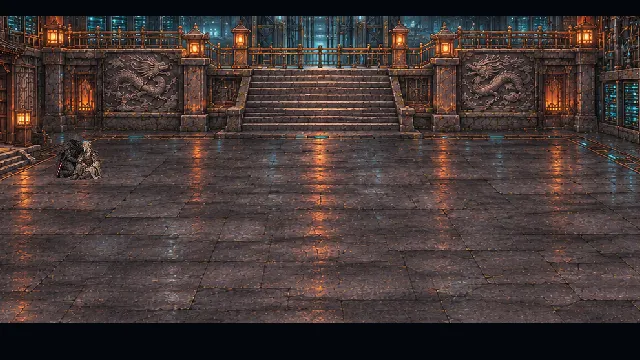
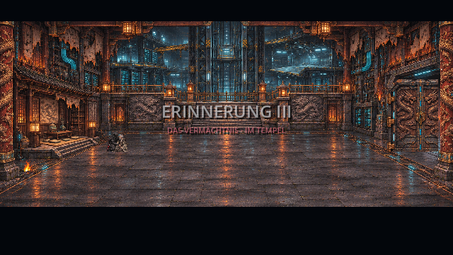
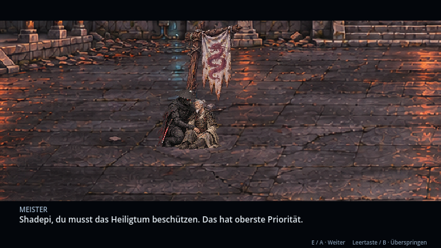
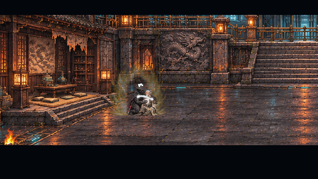
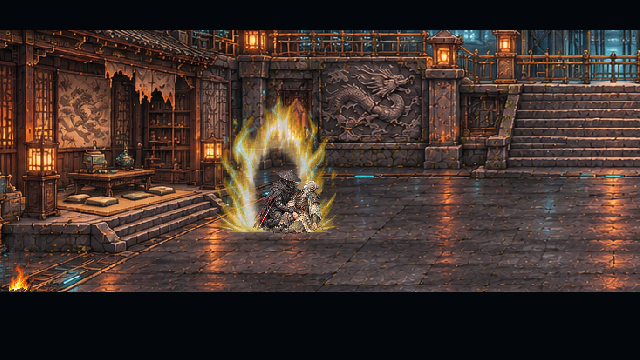
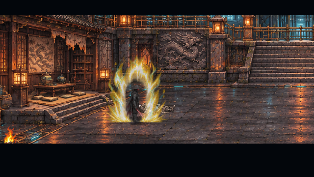
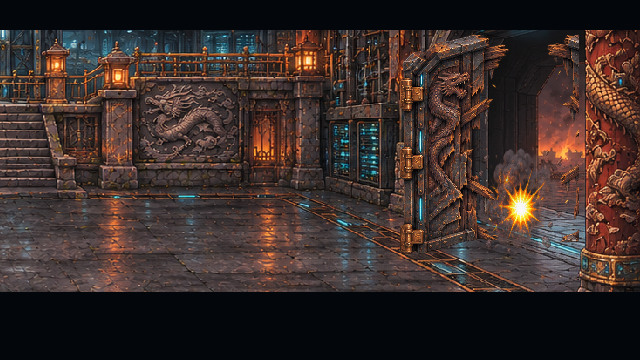
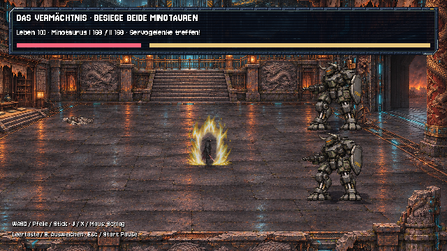
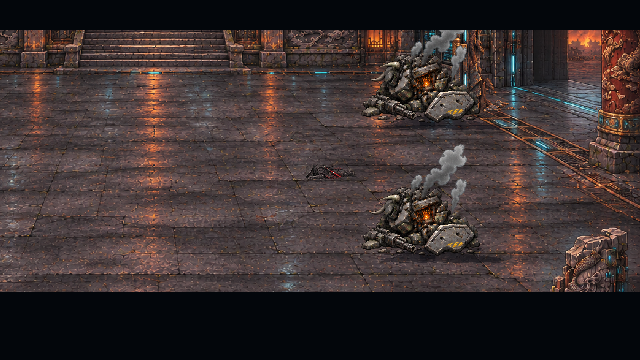

# Erinnerung III: Das Vermächtnis · v0.28.0 · CodexAI

**Aktualisierung v0.30.0 · CodexAI:** Die Tempelflügel verwenden nun die Perspektive der tatsächlichen Portalöffnung. Nach dem Sieg folgt ein langsamerer Zusammenbruch ohne schwarzen Positionssprung: Erschöpfung, letzte Schritte auf freien Boden, aufrechter Halt, Einknicken, erlöschende Aura, vier Sekunden regloses Liegen und langsame Abblende. [Aktuelle Bilder und Fehlerbericht-Abnahme](fehlerbericht-8.md). Die folgenden v0.28.0-Vorschauen bleiben zur Dokumentation erhalten.

**Erinnerung III spielt im Tempelinneren.** Der traditionelle Tempel ist die Tarnung einer riesigen unterirdischen Hightech-Basis des Ordens. Shadepi hält seinen Meister in einem geschützten Seitenbereich. Nach der vollständigen Übertragung stirbt der Meister; Shadepi richtet sich mit einer kräftigen Energieaura auf und verteidigt anschließend dieselbe Halle: Zwei Minotauren brechen durch den Zugang ein. Damit folgt der Schauplatz der Nutzerpräzisierung vom 7. November 2026.

Die Vorschau zeigt Ausschnitte des tatsächlichen Godot-Spielablaufs. Ein Testpilot bedient den Kampf durch Bewegung, Angriff und Ausweichen; er verändert weder Bossleben noch Schadenswerte. Dialoge werden für die Aufzeichnung automatisch weitergeschaltet.

## Tempel als Tarnung der Basis

Die Tempelhalle ist als eigene Innenraum-Karte aufgebaut: geschnitzte Drachenstützen, Holz- und Steinverkleidung, freigelegte Stahlkonstruktionen, Kabel und Technik. Hinter der Rückwand sind der große Aufzugsschacht, industrielle Stege, Serverbereiche und mehrere technische Ebenen sichtbar. Der spielbare Hallenboden liegt davor; Rückwand und gesicherter Bereich verhindern, dass Figuren durch den Schacht laufen.

Die Halle besitzt eigene Wand-, Säulen-, Schwellen- und Vordergrundgeometrie. Die frühere Hofsäule im Kampffeld ist entfernt. Der Meister liegt im ruhigen Seitenbereich vor den Zugängen nach unten. Der Tempel wird als Tarnhülle der Ordensbasis eingeordnet; andere heutige Versteck-Karten werden dadurch nicht automatisch umgebaut.

## Die Übergabe

Der äußere Zugang ist geschlossen, während Shadepi den Meister stützt. Dieser erklärt, dass die Schleuse zur Basis verriegelt ist, und fordert Shadepi auf, die Angreifer von den unteren Ebenen fernzuhalten. Das bestätigte Versprechen bleibt vollständig erhalten:

> **Meister:** „Shadepi, du musst das Heiligtum beschützen. Das hat oberste Priorität.“
>
> **Shadepi:** „Ich werde es mit meinem Leben beschützen. Der Orden muss leben. Danke für alles, Meister.“

Licht entsteht in der Brust des Meisters und geht als weißer Nanitenstrom auf Shadepi über. Acht Bildphasen, weiße Partikel und eigenes Knistern begleiten die Übertragung. Nach der vollständigen Übertragung erschlafft der Meister in Shadepis Armen. Shadepi legt ihn flach ab: geschlossene Augen, schlaffe Arme und kein aufgestützter Oberkörper. **Sein Tod ist durch den Nutzer bestätigt.** Der Körper bleibt anschließend leblos im Seitenbereich; eine gesperrte Leichenpose verhindert die Rückkehr zur alten Ellenbogenhaltung. Er hat keinen erfundenen Eigennamen. Der Roboterkopf-Krieger wird hier nicht gezeigt und erhält keinen zusätzlichen Tod.

## Shadepis Energieaura

Während der Übertragung wächst eine goldweiße Aura mit aufsteigenden Flammen, hellen Partikeln und cyanfarbenen Blitzen um Shadepi. Acht Hintergrundphasen und acht zugehörige Vordergrundphasen bilden einen animierten Pixel-Atlas. Die Flammen liegen hinter der Originalfigur, die sparsameren Blitzakzente davor. Maske, rote Linsen, Körperproportionen und Fußpunkte werden dadurch nicht verändert.

Die Aura bleibt beim Gehen, Ausweichen und im Kampf direkt an Shadepi gebunden. Angriffe verstärken ihre Vordergrundakzente kurz. Sie benötigt keine zusätzliche Taste. Beim erschöpften Zusammenbruch nach dem Sieg klingt sie aus und erlischt. **Der bestätigte Tod betrifft den Meister; Shadepis Schlusszustand ist weiterhin keine Todesfestlegung.**

„Bildstil → Reduziert“ behält die Aura bei geringerer Bildfrequenz und schaltet die Vordergrundblitze ab. Pause hält ihre Animation und den leisen Energieklang an; die Tonoption schaltet ihn ab. Abbruch und Szenenende entfernen beide Ebenen und den Klang.

## Der Einbruch

Erst nach der Übergabe treffen Schläge den Tempelzugang. Die Kamera zeigt den Bruch: geschlossene Paneele, gerissene Verkleidung, aufbrechende Flügel und schließlich die offene Schwelle. Holzmaskierung und verstärktes Metall werden gemeinsam beschädigt. Vorhandene Einschlagsgrafiken und Geräusche ergänzen den vierteiligen Pixel-Atlas.

Die Tür hat bis zur letzten Bruchphase einen echten Kollisionskörper. Danach öffnet sich die physische Schwelle, und die gebrochenen Paneele werden seitlich auseinandergedrückt. Der erste Minotaurus kommt durch diese Öffnung in die Halle; der zweite folgt durch denselben Zugang und nimmt die andere Kampfposition ein. Während des Bruchs pausieren Türzustand, Effekte und Fortschritt gemeinsam. Es erscheinen keine Gegner vor der geschlossenen Tür im Innenraum.

## Spielbarer Kampf gegen zwei Minotauren

Shadepi tritt allein gegen beide Gegner an. Jeder Minotaurus besitzt **168 eigene Lebenspunkte**, eigene Taumelwerte und seinen eigenen Wrackzustand. Katana-Treffer in Reichweite und Blickrichtung beschädigen die Servogelenke; vier Treffer bringen den jeweiligen Gegner kurz ins Taumeln. Beide müssen zerstört werden. Ein Zeitablauf beendet den Kampf nicht automatisch.

Die Mechs wechseln sich mit angekündigtem Sperrfeuer ab. Die Einschlagsflächen werden vor dem Schuss festgelegt und verfolgen Shadepi nicht. Mit sinkenden Boss-Lebenswerten steigen Zahl und Tempo der Einschläge. Ausweichen schützt kurz vor Treffern. Ein besiegter Gegner durchläuft den Zusammenbruch und bleibt als Wrack liegen; sein Feuer setzt aus.

| Eingabe | Im Kampf |
| --- | --- |
| WASD / Pfeile / linker Stick / Steuerkreuz | Bewegen. |
| J / X / linke Maustaste | Katana-Schlag. Nah herangehen und zum Gegner schauen. |
| Leertaste / B | Ausweichen; kurzer Schutz, danach Abklingzeit. |
| Esc / Start | Pause öffnen. |
| E / Enter / A nach Niederlage | Nur den Kampf wiederholen. Beide Gegner und lokale Lebenswerte werden zurückgesetzt. |

Im Pausenmenü wählen Pfeiltasten, Steuerkreuz, Stick oder Tab den Knopf; Enter / E / A bestätigt. **Erinnerung überspringen** löst den vollständigen Abschluss aus, **Erinnerung verlassen** kehrt ohne Abschluss zum dritten Knoten zurück. Während des Kampfs ist B Ausweichen; bewusstes Überspringen erfolgt über das Pausenmenü. Außerhalb des Kampfs gelten E / Enter / A für Weiter und Leertaste / B für Überspringen. Fokusverlust pausiert den Kampf ebenfalls.

## Zusammenbruch und Spielstände

Nach dem Sieg sinkt Shadepi auf ein Knie; dabei erlischt seine Aura. Anschließend fällt er reglos auf den Hallenboden. Beide Minotaurus-Wracks bleiben im Bild. Es gibt keinen Todesmarker für Shadepi. Die Erinnerung endet, Raven kehrt zurück und spricht über sein Versprechen. Danach geht der bestehende Ablauf in den Aerodyne-Flug über.

Historische Gesundheit und Gegenwartswerte bleiben getrennt. Das bestehende typgeprüfte Speicherfeld `memory_legacy_complete` wird beibehalten. Ältere ECHO-Stände behalten die ersten beiden Erinnerungsabschlüsse und bieten die dritte Szene am letzten Knoten an. Bereits abgeschlossene dritte Knoten wiederholen den Kampf nicht; für die neue Innenraumfassung Kapitel 5 neu beginnen oder einen Stand vor Knoten 3 laden. Andere Kapitel werden nicht zurückgesetzt.

## Grafiken, Ton und Umsetzung

| Quelle unter `assets/memories/legacy/` | Inhalt |
| --- | --- |
| `temple-interior.png` · 1585×992 | Neue Tempelhalle mit Tarnverkleidung und sichtbaren technischen Ebenen. |
| `temple-door.png` · 1536×1024 | Neuer freigestellter 2×2-Atlas für geschlossenen Zugang bis zur vollständig gebrochenen Öffnung. |
| `characters.png` · 1536×1024 | Wiederverwendete Halte-, Empfangs- und Shadepi-Zusammenbruchposen. |
| `master-death.png` · 1536×1024 | Vier neue Erschlaffungs-, Ablege- und flache Leichenposen. |
| `shadepi-aura.png` · 1254×1254 | 16 neue Flammen-/Blitzphasen als zwei getrennte Ebenen. |
| `transfer.png` · 1536×1024 | Acht wiederverwendete weiße Transferphasen. |
| `actors.json` | Vermessene Quellregionen und Bodenkontakte der Figuren. |
| `manifest.json` | Aktueller Schauplatz, Umfang und Figurenkontinuität. |

Für v0.28.0 wurden Meistertod und Aura als HQ-Pixel-PNGs mit dem Bildwerkzeug erstellt. Tempel, Tor, Nanitenstrom, Minotauren und vorhandene Kampf-/Einschlagsbilder werden weiterverwendet. Der Leichenatlas wird über seine Körperlänge vermessen; liegende Figuren werden nicht auf die Höhe stehender Personen vergrößert. Die Hofquelle `courtyard.png` bleibt als historischer Grafikstand von v0.26.0 erhalten. Die aktuelle dritte Szene lädt `temple-interior.png` über ihr eigenes `temple_map.gd`.

`temple_map.gd` teilt Atlas-/Effekthilfen mit den anderen Erinnerungen, baut aber seine eigenen Innenraum-Kollisionskörper, Torphasen und Verdeckungen auf. Alle Sprite-Atlanten werden mit Nearest-Filter dargestellt. `legacy_aura.gd` bindet die vorab angelegten Atlasregionen um den tatsächlichen Schauspieler an; es werden keine Texturen pro Bild neu erzeugt. `tools/generate_legacy_audio.py` erzeugt den eigenen leisen Aura-Loop ohne fremde Aufnahmen. Knistern und Musikzuordnung bleiben erhalten: ruhige Heiligtumsmusik vor der Schlacht, **Boss.mp3** im Kampf und Musik der Erinnerungskammer danach. Die Tonoption gilt auch für die Geräusche.

## Prüfung der Erinnerungseffekte

Die gemeinsamen Erinnerungseffekte übernehmen jetzt die gewählte Bildqualität. Trümmer, Rauch, Schockeffekte und vorhandene Ladungsringe können während einer laufenden Zwischensequenz weiterlaufen und rechtzeitig verschwinden. Beim Pausieren stehen sie still. Einschlagsbilder blenden vor ihrem Ablauf sichtbar bis auf null aus, statt mit halber Deckkraft abzubrechen. Für den übrigen Spielablauf bleibt die bisherige Steuerung der Effekte bestehen.

## Prüfung

**Sechs Prüfreihen mit insgesamt 1.104 Prüfungen ohne Fehler:** Erinnerung III 78, Erinnerung I/Einbindung 143, erster Klosterkampf 226, Erinnerung II 69, Kampagne/Speichern 382 und Story-Audit 206.

Zusätzlich geprüft sind die gesperrte Leichenpose, der Tod nach abgeschlossener Übertragung, Aura-Kontakte bei Bewegung, unveränderte Körpergrafik, Ebenenreihenfolge, reduzierte Darstellung, Pause und vollständiges Erlöschen.

Die Prüfungen kontrollieren die eigene Innenraum-Karte, die echte Türsperre, freie Hallenflächen, den gesperrten Basisschacht, Transparenz der Öffnung und die Reihenfolge **Übergabe → Torbruch → erster Eintritt → zweiter Eintritt → Kampf**. Pause wird während des eigentlichen Bruchs geprüft. Der gesamte Zweibosskampf wird mit normalen Angriffseingaben bis zu Ravens Rückkehr durchgespielt. Die bestehenden Prüfungen für Speichern/Laden, Controller, beide früheren Erinnerungen und den weiteren Kampagnenablauf laufen zusätzlich.

Ein Linux-PCK wurde erstellt. Neue Leichenposen, Aura-Atlas, Loop-Klang, der Tod des Meisters und das vollständige Erlöschen der Effekte am Schluss wurden direkt aus dem Exportpaket geladen und geprüft.

Die aktuelle Szene wurde im OpenGL-Renderer vom Tempelüberblick bis zum Zusammenbruch angesehen. `tools/legacy_gallery.gd` zeichnet den tatsächlichen Kampagneneinstieg auf. [Roadmap](erinnerungen-roadmap.md) · [Verbindliches Briefing und Schauplatzkorrektur](universum/teil-5/README.md).
