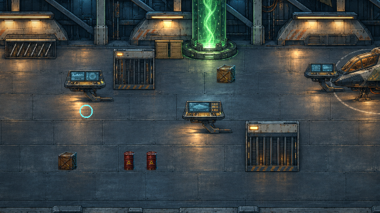
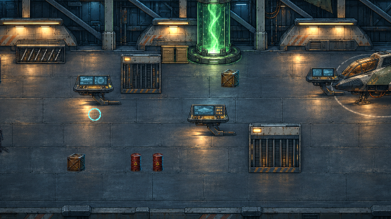
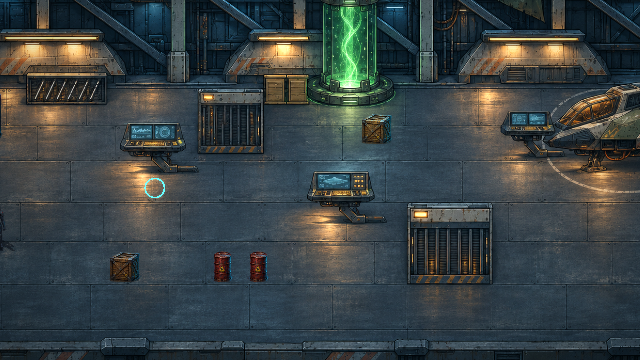
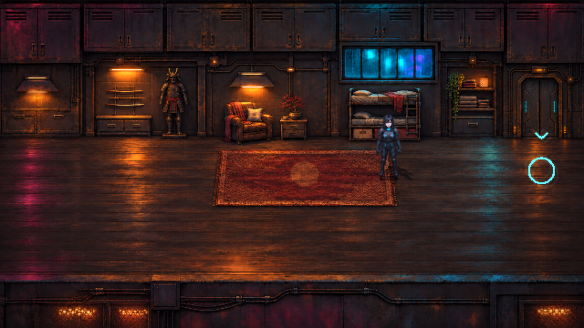
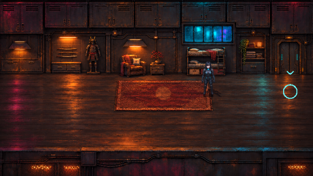
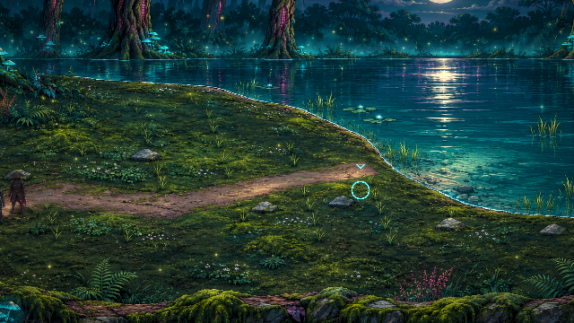
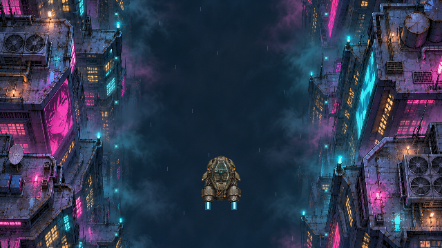
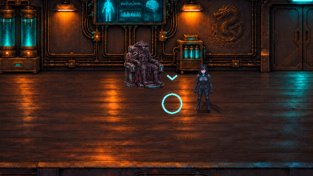

# Atmosphäre und Designprüfung · v0.31.0 · CodexAI

Alle sieben Kapitel, Hauptmenü, Hack-Oberfläche, Fahrsequenzen und die drei Erinnerungen wurden anhand des aktuellen Codes und **27 gerenderter Godot-Ansichten** verglichen. Ergebnis: Die detailreichen Kulissen und die Cyan-/Magenta-/Bernstein-Palette tragen das Spiel bereits gut. Die auffälligsten Unterschiede liegen bei der Bewegung innerhalb der Kulissen, der Figurenschärfe und den unterschiedlichen Aerodyne-Ansichten.

Die folgenden Atmosphäre-Ergänzungen sind umgesetzt. Die weiter unten aufgeführten größeren Designänderungen sind **Vorschläge für einen folgenden Arbeitsgang**.

## Vorschau in Bewegung

Der Film zeigt nacheinander Hangar, Seeufer und Klosterhof. Er besteht aus 108 unverändert gerenderten Spielbildern. Texturierter Dampf, Staub, Wasserreflexe, Glühwürmchen, Asche und Glut bewegen sich langsam; die Figuren werden durch diese Effekte nicht verschoben oder verformt.

## Was ergänzt wurde

| Schauplatz | Passende Atmosphäre |
| --- | --- |
| Ravens Wohnung | Regen nur am Fenster, schwebender Staub im Licht, zurückhaltendes Monitorleuchten und wärmere Abstimmung. |
| Markt, Gasse und Hinterhalt | Texturierter Dampf an festen Austritten und kleine bewegte Neonreflexe auf dem nassen Boden. Der vorhandene Regen bleibt erhalten. |
| Industriehof | Kühler Anlagendampf und flacher Dunst an der Bebauung; Reflexe bleiben auf dem Boden. |
| Versteck und Erholung | Kühltechnischer Dampf am Becken, dezente Diagnosebewegungen auf den Anzeigen und sparsame Schwebeteilchen. |
| Virtueller Tauchgang und Erinnerungsanker | Kleine Datenpakete auf Verbindungswegen, dezenter violetter Hintergrunddunst; eigene Sprache gegenüber der physischen Welt. |
| Garage | Staub unter warmen Leuchten und leichter Dunst im hinteren Bereich. |
| Hangar | Lüftungsdampf, Staub und bewegte Diagnosestreifen. Das Profil läuft beim Einsteigen und Abheben, nicht über den Cockpitbildern. |
| Wohnraum und Kompensator | Warme Lampen, einzelne Staubpartikel, Regen nur im Wohnraumfenster und kleine Diagnosebewegungen am Kompensator. |
| Towerdach | Flacher Dunst, nasse Neonreflexe und dezenter Lichtschein am Landeplatz. |
| Penthouse und Flucht | Bewegung hinter den Glasflächen, sparsamer Staub und zurückhaltendere Lichtüberstrahlung. |
| See | Gegen das echte Ufer beschnittene Wasserbewegung, dünner Ufernebel und langsam glimmende Glühwürmchen. Bäume, Boden und Figuren bleiben unverändert. |
| Erinnerung I | Asche, Glut an den vorhandenen Brandstellen und Rauch im Hintergrund. |
| Erinnerung II | Dichtere Asche als im ersten Angriff, passend zur weiter zerstörten Umgebung. |
| Erinnerung III | Glut an den beiden tatsächlichen Innenraumbränden und Dunst im hinteren Hallenbereich. Meister, Übertragung und Kampf bleiben lesbar. |

Hauptmenü und Fahrsequenzen besitzen bereits eigene Wetter-, Wind-, Verkehrs- und Geschwindigkeitseffekte. Diese bleiben ihre Grundlage; darüber wird kein zweiter allgemeiner Wetterfilm gelegt.

### Vergleich aus dem Spiel

| Bereich | Vorher · v0.30.0 | Nachher · v0.31.0 |
| --- | --- | --- |
| Hangar |  |  |
| Wohnraum |  |  |
| See |  |  |

Einzelbilder zeigen die Farb- und Texturwirkung; für die langsame Bewegung eignet sich der Film oben besser.

## Passt das Design zusammen?

**Stimmig sind** die detailreichen Metall-/Holz-/Steintexturen, die Stadtpalette aus Cyan und Magenta und die wärmeren Ordensräume. Shadepis Kasa, segmentierte Maske und rote Linsen sowie Ravens schwarz-blaue Haare und cyanfarbene Ausrüstung bleiben erkennbar. Der ruhigere See und die andersartige virtuelle Welt sind sinnvolle erzählerische Kontraste. Die in v0.30.0 korrigierten Türen und der passende Kompensatorstuhl werden beibehalten.

Für stärkere Einheitlichkeit empfehle ich diese nächsten Schritte, in dieser Reihenfolge:

| Priorität | Konkreter Vorschlag | Grund und sinnvoller Umfang |
| --- | --- | --- |
| 1 | **Einen gemeinsamen Aerodyne-Atlas für Hangar, Start, Flug und Landung erstellen.** | Das eingemalte Hangar-Fahrzeug ist heller und keilförmiger, die Flug-/Dachansicht verwendet ein anderes, dunkleres Fahrzeug mit deutlich sichtbaren Düsen. Vier passende HQ-Pixelansichten mit derselben Silhouette und Abnutzung würden die Kontinuität sofort verbessern. Die Flugmechanik kann bleiben. |
| 2 | **Die Figurenschärfe an einer gemeinsamen Spielgröße abstimmen.** | Spielfiguren werden teils linear verkleinert, Erinnerungsfiguren mit scharfer Pixelabtastung angezeigt. Dadurch wirken einzelne Figuren weicher als dieselben Materialdetails in den Kulissen. Zunächst gleiche Kamerabilder mit beiden Abtastungen vergleichen und die Darstellung bei etwa 64 Pixel Körperhöhe abstimmen; erst danach gezielt betroffene Sprites überarbeiten. Merkmale und Ravens verbindliche 160 cm bleiben die Grundlage. |
| 3 | **Interaktionshinweise kompakter machen.** | Kreis, Pfeil, schwebender Zieltext, HUD-Ziel und untere Aktionsleiste wiederholen teils dieselbe Information. Besonders vor dem Kompensator verdeckt das die Szene. Ein kleiner konsistenter Pixelmarker am Objekt und die vollständige Erklärung in der bestehenden unteren Leiste wären klarer. |
| 4 | **Alarmlicht stärker an Leuchten und Türen binden.** | Die Flucht nutzt derzeit eine große rote Bodenüberlagerung. Lokale Lichtkegel beziehungsweise rote Reflexe aus klaren Quellen könnten den Raum glaubhafter machen, während Timer und Gefahrenmarkierungen gut lesbar bleiben. |
| 5 | **Eigene leise Umgebungsgeräusche pro Ort ergänzen.** | Lüftung, Regen hinter Glas, ferner Stadtverkehr und Grillen am See würden die neuen sichtbaren Quellen akustisch verbinden. Dafür echte passende Klangquellen und eine getrennte Umgebungslautstärke vorsehen; die manuell austauschbare Musik beibehalten. |

Die wichtigsten Bildbelege für diese Vorschläge:

| Unterschiedliche Fahrzeugdarstellungen | Schärfe und Interaktionshinweise |
| --- | --- |
|   |  |

Die neuen Atmosphäreffekte lösen die räumliche Belebung und die Lichtabstimmung bereits. Ein kompletter Austausch der vorhandenen HQ-Kulissen wäre für diese Punkte unnötig; die nächsten Arbeiten können auf Fahrzeug, Figurendarstellung und Hinweisgestaltung begrenzt werden.

## Bildstil, Lesbarkeit und technische Grenzen

- **Atmosphärisch:** volle neue Dichte; **Ausgewogen:** weniger Partikel und schwächere Wasserbewegung; **Reduziert:** neue Zusatzpartikel und Wasser-Zusatzpass aus. Bestehende Regen- und Kampfindikatoren bleiben erhalten.
- Pause und offene Terminals halten die Umgebungsuhren an. Während einer Erinnerung steht die verdeckte Gegenwartsatmosphäre still; die Erinnerung hat ihr eigenes Profil.
- Die Wasserfläche verwendet die Originalpixel und liegt hinter den Figuren. Ufer, Baumlinie und Spielfeldkollisionen werden nicht animiert.
- Die Profile haben feste Zeichenbudgets. Es entstehen keine unbegrenzten Partikelspawner, und die Effekte verbrauchen keinen Gameplay-Zufall. Rauch und Licht stammen aus vorhandenen PNGs.
- HUD, Dialoge und Hack-Oberflächen liegen über den Umgebungs-FX. Innenräume erhalten weniger Bloom, damit Texturen und Gesichter lesbar bleiben.

Konfiguration: [Ortsprofile](../scripts/atmosphere_profiles.gd), [Darstellung und Pausenlogik](../scripts/scene_atmosphere.gd), [beschnittene Wasserbewegung](../shaders/lake_surface.gdshader). Eine veränderte Kulisse kann so gezielt neue Austrittsstellen erhalten, ohne Figuren oder Spielregeln zu verändern.

## Prüfung

**2.277 Prüfungen ohne Fehler in 17 Prüfreihen.** Die neue Prüfreihe kontrolliert 18 Profile, Dichtebegrenzung, Qualitätsstufen, kleine Raumtransformationen, Pause/Terminals, Wasserbeschnitt, unveränderte Figurenpositionen, unabhängigen Gameplay-Zufall und die drei Erinnerungsschauplätze. Dazu kommen die bisherigen Kampf-, Controller-, Hack-, Speicher-, Flug-, Heiligtums- und Storyprüfungen.

Auch das exportierte Spielpaket wurde erfolgreich gestartet: Ortsprofile, Quelltexturen, Wasser-Shader, Qualitätswechsel, unveränderte Figurenpositionen, Pause und Hangar-Abflug sind darin geprüft.
