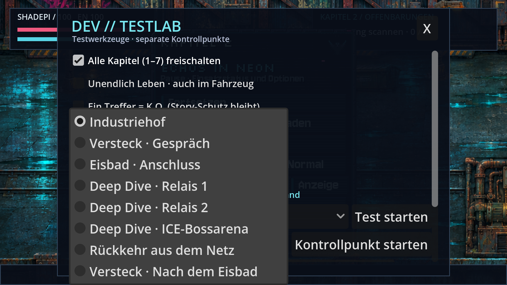
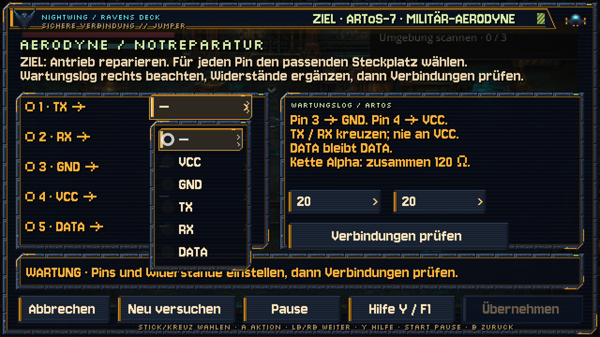

# Dropdowns im HQ-Modus wieder sichtbar

**v0.51.1 · CodexAI · 10. November 2026.** [Galerie](README.md) · [HQ-Anzeige](hq-anzeige-v051.md) · [Arbeitsnachweis](arbeiten/dropdowns-v0511.md).

Die Auswahllisten in **Anzeige**, **Kapitel-/Kontrollpunktauswahl** und den **Energie-/Reparatur-Hacks** werden wieder sichtbar über dem HQ-Spielbild angezeigt. Die Full-HD-Grenze bleibt erhalten.

| Kontrollpunkte | Pin-Auswahl im Reparatur-Hack |
| --- | --- |
|  |  |

[**Dropdown-Film**](previews/dropdowns-v0511.webp) · echte native Menüaufnahmen, unter 5 MB.

## Bedienung

- Maus: Liste anklicken und einen Eintrag wählen.
- Controller/Tastatur: **A / Enter** öffnet die fokussierte Liste, **Oben/Unten** wählt, **A / Enter** bestätigt.
- **B / Esc** schließt zunächst nur die geöffnete Liste. Im Hack bleibt die Verbindung bestehen.
- In den Hacks funktioniert **Links/Rechts** weiterhin als direkte Wertwahl ohne Liste.

Die Hack-Auswahllisten verwenden nun denselben Pixelrahmen, dieselbe Schrift und dieselben Farben wie das jeweilige Deck.

## Ursache und Korrektur

Die Dropdowns waren intern geöffnet und konnten teilweise sogar unsichtbar bedient werden. Godots eingebettete Fenster verwenden die reservierte Canvas-Ebene 1024. Der erste HQ-Renderpfad belegte dieselbe hohe Ebene für das fertige Spielbild. Dadurch fehlte die sichtbare Liste.

Der [HQ-Renderer](../scripts/hq_renderer.gd) zeichnet das fertige Spielbild jetzt auf Ebene 512 unter den eingebetteten Fenstern. Die bestehenden Sichtbarkeitsmasken werden nicht verändert. Szene, Physik und Eingabe behalten ihren bisherigen Viewport; keine doppelte Rasterung der Spielwelt in 4K.

[Terminal-Eingabe](../scripts/terminal_ui.gd) überlässt einer geöffneten Liste ihre A-/B-/Pfeiltasten. A öffnet dort jetzt eine wirkliche Liste, B bricht währenddessen nicht den gesamten Hack ab.

## Prüfung

Alle **16 Listen** sind geprüft: vier Anzeigeoptionen, Kapitel, Kontrollpunkte und zehn Auswahlfelder in Energie- und Reparatur-Hacks. Die native Regression prüft das sichtbare Ergebnis durch Pixelvergleich im Listenbereich; `PopupMenu.visible` allein reicht nicht mehr. Eine absichtlich wiederhergestellte alte Ebenenkollision muss trotz intern geöffneter Liste als verdeckt erkannt werden.

Ergebnis: 1.150 Headless-Prüfungen ohne Fehler, je 81 native Popup-Prüfungen bei 640×360, Full HD und 4K sowie 82 erfolgreiche Prüfungen direkt aus dem exportierten Spielpaket. Zusätzlich besteht die native HQ-Lebenszyklusprüfung mit 73 Prüfungen.

Die Prüfungen und der Exportnachweis stehen im [Arbeitsnachweis](arbeiten/dropdowns-v0511.md). Originalgrafiken und der HQ-Modus mit maximal 1920×1080 bleiben erhalten.
