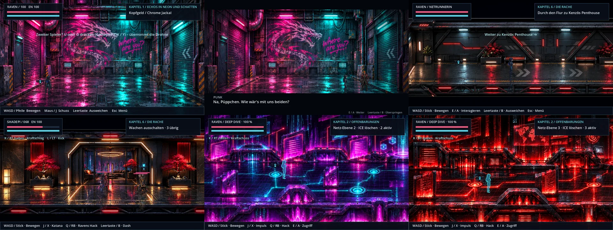

# Durchgangsräume · v0.60.0 · ClaudeHelper

**12. November 2026.** [Bildgalerie](README.md) · [Level strecken](level-strecken.md) · [Versionshinweise](../CHANGELOG.md).

Nutzerauftrag vom 12. November 2026: fünf gelieferte Level-Bilder einbauen. Die beiden Tower-Bilder sind um ihre weißen Ränder beschnitten. In der Gasse ist seit v0.60.1 die Hintertür auf Figurenmaß verkleinert (`tools/passages/fit_backalley_door.py`); die übrigen Bilder sind unverändert.

## Wo die Räume liegen

| Raum | Kapitel | Ablauf |
| --- | --- | --- |
| Gasse (`backalley.webp`) | 1, nach der Wohnung | Raven kommt aus der Tür links, kommentiert das Graffiti. Frei laufen; der Punk rechts spricht sie an, ein Hack legt ihn um. Ausgang vorn rechts zur Bingo Street. |
| Tower-Flur (`tower-corridor.webp`) | 6, nach dem Landeplatz | Hinweg von links nach rechts ohne Gegner. Rückweg von rechts nach links gegen drei Wachen, eine mit Schild. |
| Lobby (`tower-lobby.webp`) | 6, vor Kenzōs Suite | Hinweg von links zur Tür in der Mitte. Rückweg aus der Tür nach links gegen drei Wachen. |
| Datenarchiv (`dive-archive.webp`) | 2, nach Relais 1 | Zwei Wellen ICE (2, dann 3), danach öffnet sich das Portal rechts. |
| Roter Kern (`dive-core.webp`) | 2, nach Relais 2 | Zwei Wellen ICE (3, dann 4), danach folgt der Wächter. |

## Regeln

- Ein Durchgangsraum ist kein eigener Kontrollpunkt. Wer dort scheitert oder neu lädt, beginnt an der Stelle davor: Penthouse-Tür, Dachausgang der Suite oder das jeweilige Relais.
- Auf dem Rückweg im Tower ruht der Flucht-Countdown, solange die Helden in Lobby und Flur sind.
- Ausgänge sind gesperrt, solange im Raum Gegner leben oder der Punk Raven noch nicht angesprochen hat.

## Grenzen der Bilder

- Die Bilder zeigen die Räume von vorn mit einem Bodenstreifen, nicht schräg von oben wie die übrigen Karten. Der begehbare Boden ist deshalb schmal: im Tower etwa eine Figurenhöhe tief.
- Die Gasse läuft perspektivisch nach hinten zu. Figuren behalten überall dieselbe Größe; am hinteren Rand wirken sie dadurch etwas groß.
- Säulen und Datenwände in den Netz-Ebenen: Seit v0.60.2 ist nur der Sockel gesperrt. Wer dahinter steht, wird von einem Ausschnitt des Bildes verdeckt (`occluders` in `ROOMS`).

## Technik

- `scripts/passage_room.gd`: Raumtabelle `ROOMS` (Bild, Größe, Boden als Vieleck, Hindernisse, Ein- und Ausgänge je Richtung). Der Raum liegt weit unter der Stammkarte, bringt Wände und Kameragrenzen mit und stellt beim Schließen alles wieder her.
- Kapitel 1: `enter_backalley()`, `_scene_backalley_punk()` in `scripts/chapter_one.gd`; Film in `scripts/chapter_one_intro.gd` (`play_apartment()` endet in der Gasse, `play_street()` führt auf die Straße).
- Kampagne: `_start_passages()` mit `WAY_IN` und `WAY_OUT` in `scripts/campaign.gd`.
- Kapitel 2: `_enter_net_layer()` und `NET_LAYERS` in `scripts/chapter_two.gd`.
- Für Tests und Admin-Sprünge: `skip_backalley()`, `skip_passages()`, `skip_net_layer()`.
- Prüfungen: `tests/passages.gd`.

## v0.60.3 · ClaudeHelper – Führung im Tower

- Auf dem Hinweg führt Raven (Shadepi bleibt getarnt), auf dem Rückweg Shadepi. `raven_leads()` gilt für die ganze Raumfolge (`passages_active()`).
- `_passage_transition()` startet die Folgeszene erst über `_finish_passages()`, nachdem die eigene Blende beendet ist. Nie `cs.end()` nach `after.call()` aufrufen.
- `tests/tower_walkthrough.gd` spielt den Weg mit echten Tasten und vollständigen Filmen.
