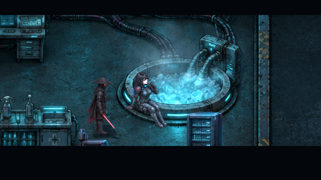
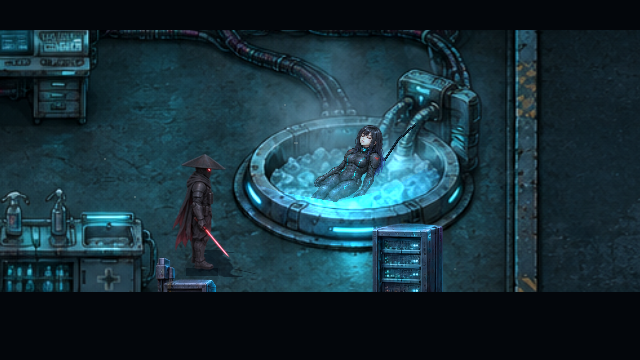
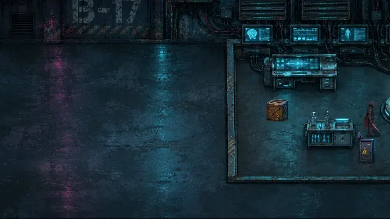
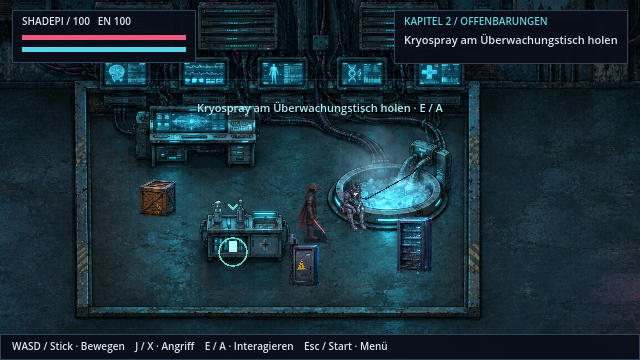
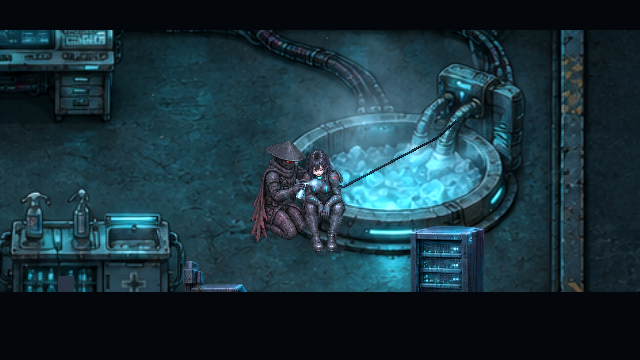
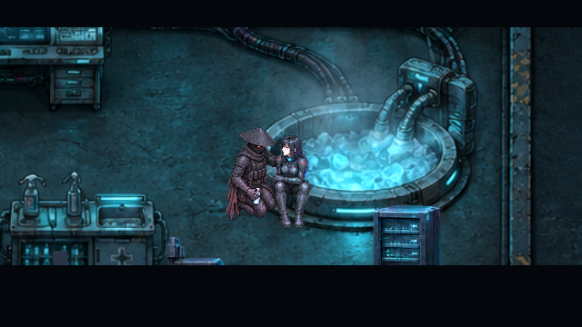
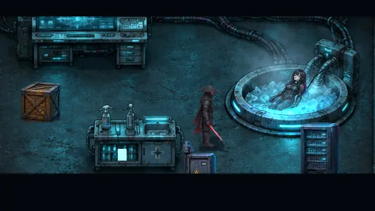

# Eisbad und Rettung · v0.38.0 · CodexAI

Kapitel 2 zeigt nun Ravens körperlichen Einstieg und Shadepis Hilfe im vorhandenen Versteck. Die Szene führt vom Anschluss am Wannenrand über Absenken und Ruhe ins Netz. Nach dem Deep Dive kehrt Raven sichtbar erschöpft zurück. Du holst als Shadepi das Kryospray; erst wenn du damit zu ihr zurückkehrst, stützt und behandelt er sie.

## Einstieg und Verbindung

| Anschluss am Rand | Zurückgelehnt im Eiswasser |
| --- | --- |
|  |  |

Acht neue HQ-Pixelposen ersetzen stehende Figuren und allgemeine Angriffsgesten in diesen Momenten. Wasser und Wannenrand verdecken eingetauchte Körperteile. Das texturierte Anschlusskabel endet an Ravens Kragen; Shadepi bleibt auf freiem Boden neben dem Becken. Bekleidung und Merkmale folgen den aktiven Spielfiguren.

## Rückkehr, Sprayholen und Behandlung

Das Sprayholen bleibt ein spielbarer Abschnitt mit klarem Ziel. Raven verschwindet währenddessen nicht und steht auch nicht doppelt als normale Begleitfigur daneben. Shadepi stützt sie bei der Anwendung; der sichtbare Sprühstrahl beginnt an der Dose in seiner Hand. Anschließend sitzen beide kurz ruhig, bevor die vorhandenen Informationen zu Kenzō und den Minotauren folgen. Kenzōs Verantwortung wird an dieser Stelle noch nicht als bewiesen vorweggenommen.

| Kryospray anwenden | Stabilisiert |
| --- | --- |
|  |  |

Die beiden Filme zeigen tatsächliche Renderer-Frames mit Aufnahmezeitpunkten als Wiedergabedauer. Die dazwischenliegende Netzmission ist für die Galerie mit einem QA-Aufruf abgeschlossen und bewusst nicht Teil der Clips. Das Holen und Zurückbringen des Sprays im zweiten Clip erfolgt über sichtbare Laufwege und die tatsächlichen Interaktionen; es ist weiterhin im Spiel vom Spieler zu erledigen. Die Technik spielt keine Filmdateien oder Comicseiten als Ersatz für die Szene ab.

## Bedienung und Spielstände

- **E / Enter / Controller-A:** Anschluss beginnen, Dialog weiter, Spray aufnehmen beziehungsweise bei Raven Behandlung beginnen.
- **Leertaste / Controller-B:** aktuelle Szene überspringen; Anschlüsse, Figuren und Folgezustand werden vollständig gesetzt.
- **Esc / Start:** Pause, einschließlich Posenwechsel, Atembewegung und Sprüh-FX.
- Aufgenommenes Spray wird mitgespeichert. Laden während Anschluss, Rückkehr oder Behandlung beginnt die betroffene Szene erneut. Nach Abschluss folgt der normale Kapitel-Kontrollpunkt; alte Spielstände bleiben kompatibel.

Unterbrochene ältere Kapitel-2-Szenen besitzen jetzt ebenfalls Abbruchprüfungen. Sie können beim Laden oder Wechseln nicht mehr nachträglich Titel, Kamera oder Figuren der folgenden Szene verändern.

792 gezielte Prüfungen und neun zusätzliche Exportprüfungen bestanden ohne Fehler. Einstieg, Wasserverdeckung, Rückkehr, Laufwege und Behandlung wurden zusätzlich im tatsächlichen Renderer gesichtet.

[Aktive Bildquelle und Kontaktanker](../assets/story/ice-bath/README.md) · [Arbeitsnachweis und gezielte Abnahme](arbeiten/eisbad-v038.md) · [Weitere Cinema-Roadmap](cinema-roadmap.md).
