# Mehr Voraussicht und der Flug zum Mond · v0.65.0 · CodexAI

**16. November 2026.** [Spieleranleitung](../Spiel-README.md) · [Bildgalerie](README.md) · [Versionshinweise](../CHANGELOG.md). Ausgangspunkt: aktueller GitHub-Stand `6853378`, alle Remote-Branches abgerufen und verglichen. [Verbindliches Nutzerbriefing](universum/teil-8/README.md) · [Arbeitsnachweis](arbeiten/cinema-v065.md).

## Größeres Sichtfeld beim Fahren und Fliegen

| Engere Projektion zum Vergleich | Neue Voraussicht |
| --- | --- |
| 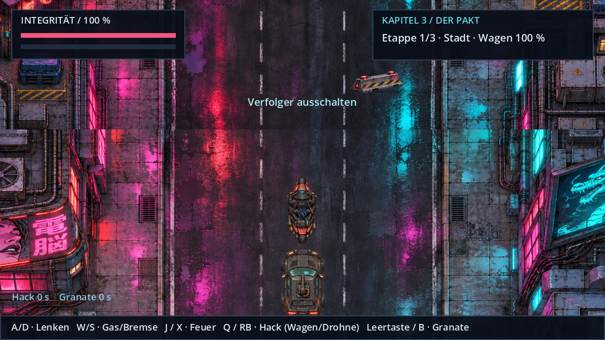 | 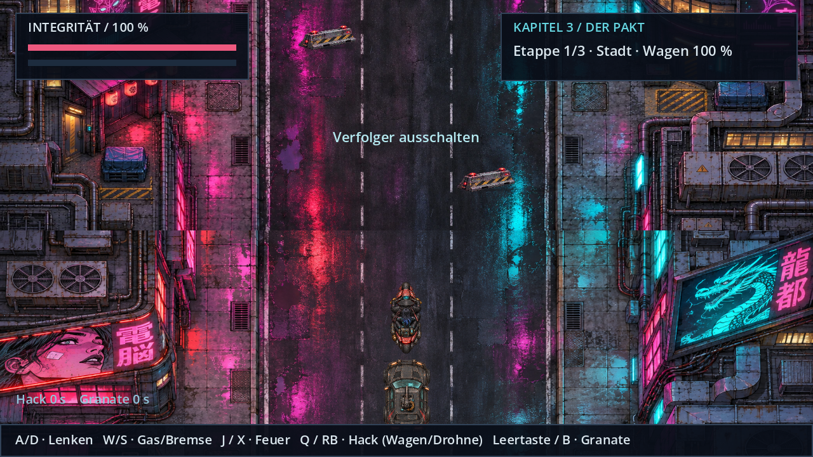 |
| 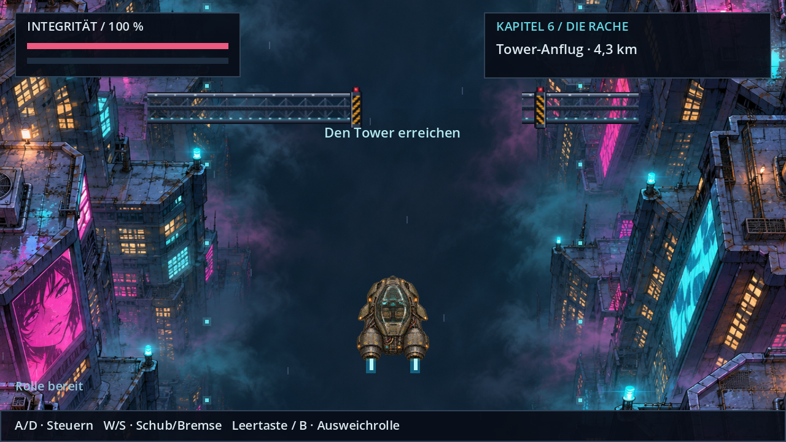 | 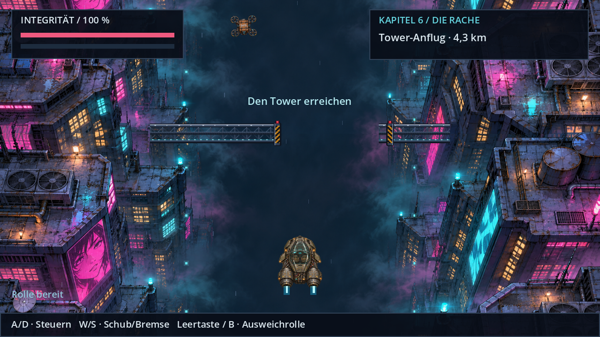 |

Die Fahrzeugansicht zeigt **800×450 statt 640×360 Weltkoordinaten**: 25 % mehr Breite und Höhe, bei unverändertem 16:9-Ausgabebild. Der vordere Rand reicht 90 Welteinheiten weiter voraus. Hindernisse beginnen außerhalb dieses erweiterten Randes bei Y = −130; ihre Geschwindigkeit und tatsächlichen Kollisionsregeln bleiben im bisherigen Koordinatensystem. Das entspricht bei normalem Tempo grob 0,4 s zusätzlicher Sichtstrecke auf der Straße beziehungsweise 0,5 s im Flug, vor möglicher HUD-Verdeckung.

Fahrzeuge, Hindernisse, Projektilursprünge und ihre FX verwenden dieselbe Projektion. Der Straßenkorridor bleibt registriert. Seitliche Landschaftsteile der vorhandenen HQ-Quellen werden kontinuierlich breiter dargestellt; keine gespiegelten Schriftzüge, doppelten Figuren oder Lücken zur darunterliegenden Welt. HUD und Touchflächen bleiben auf dem normalen Bildschirmraster. Die Scanneranzeigen bleiben unskaliert; beim eigentlichen Landeanflug gilt wieder die bestehende präzise Dach-/Kameraprojektion. HQ-/Fensterauflösung werden dadurch nicht geändert.

Die Vergleichsbilder zeigen beide Projektionen im selben neuen QA-Aufbau; sie sind keine unveränderten Aufnahmen der alten Release-Version. Normale Helden und Fahrzeugatlanten bleiben identisch.

## Überschlag, Explosion und sichtbares Herausfahren

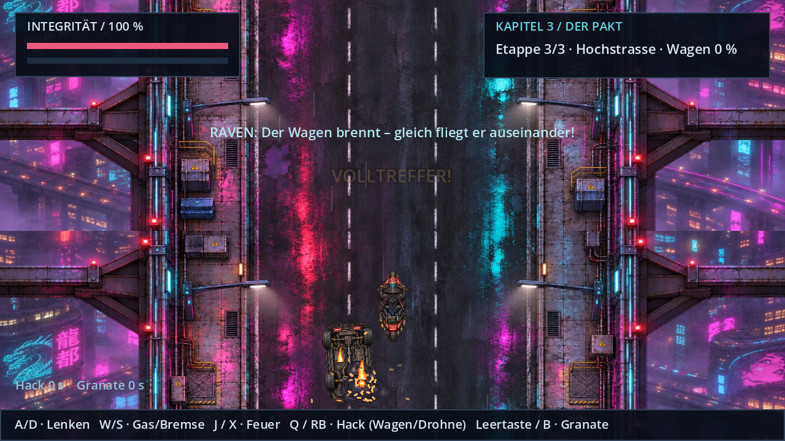

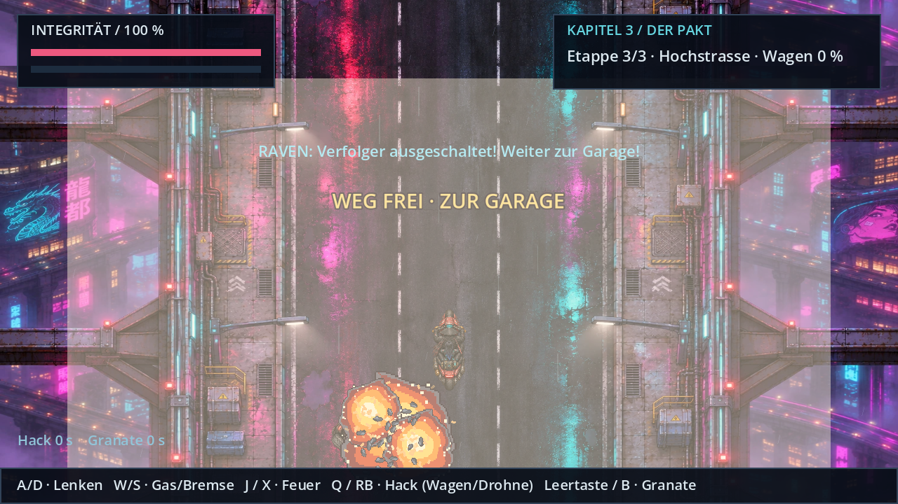

[Film des Fahrzeugabgangs](previews/roll-v065.webp).

Der letzte Verfolger erhält **sechs echte Körperphasen** aus [rollover.png](../assets/vehicles/pursuit/rollover.png): Ankippen, Seite/Räder, Seitenlage, weiterer Überschlag, Unterboden und zerstörte Dachlage. Die Identität stammt aus dem aktiven schwarzen Panzerwagen; kein gedrehtes Standbild als Ersatz. Kontaktanker und Weltgröße sind registriert, die Posen besitzen transparente Zellränder. Kleine Flammen lassen den Überschlag lesbar; erst anschließend folgt die große Explosion mit vorhandenen Pixeltrümmern, Rauch und Kamerastoß.

| Zeit nach dem letzten Treffer | Ablauf |
| --- | --- |
| 0–1,6 s | Führerloses Schlingern und Überschlag; Seiten-/Unterbodenphasen bleiben sichtbar. |
| ca. 1,6 s | Hauptexplosion, Lichtblitz und Trümmer; das Wrack verliert Tempo. |
| ab 3,3 s | Shadepi und Raven fahren kontrolliert nach vorn aus dem Bild. |
| bis 5,5 s | Das Motorrad ist vollständig außerhalb des sichtbaren Feldes. |
| ca. 6 s | Erst jetzt folgen Abblende und Garageneinfahrt. |

Der filmische Abgang steuert selbst; gehaltene Richtungstasten ziehen das Motorrad nicht aus der geplanten Ausfahrt. Gefährliche Geschosse/Minen werden beendet. Die ersten beiden Etappen behalten ihren bisherigen Wechsel zum nächsten Verfolger, nur das letzte Kampffahrzeug erhält diesen Abgang. Das alte einzelne `wreck.png` bleibt als gekennzeichnete, nicht exportierte Referenz erhalten.

## Garagentor: Außenansicht bleibt fest

| Teilweise geöffnet | Weiter geöffnet |
| --- | --- |
| 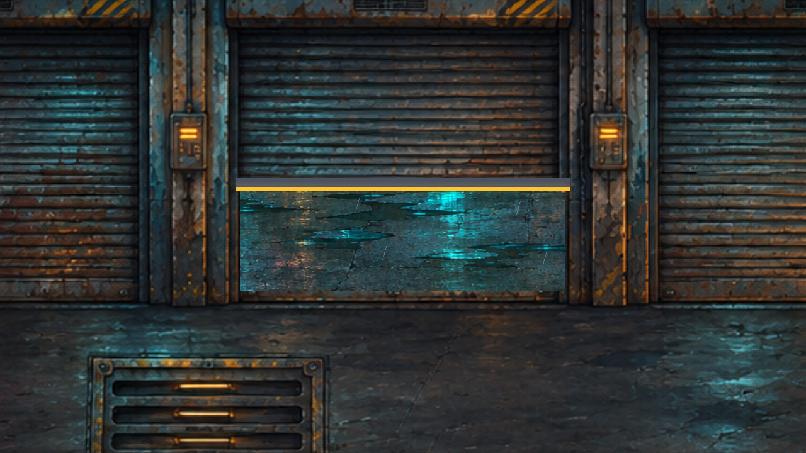 | 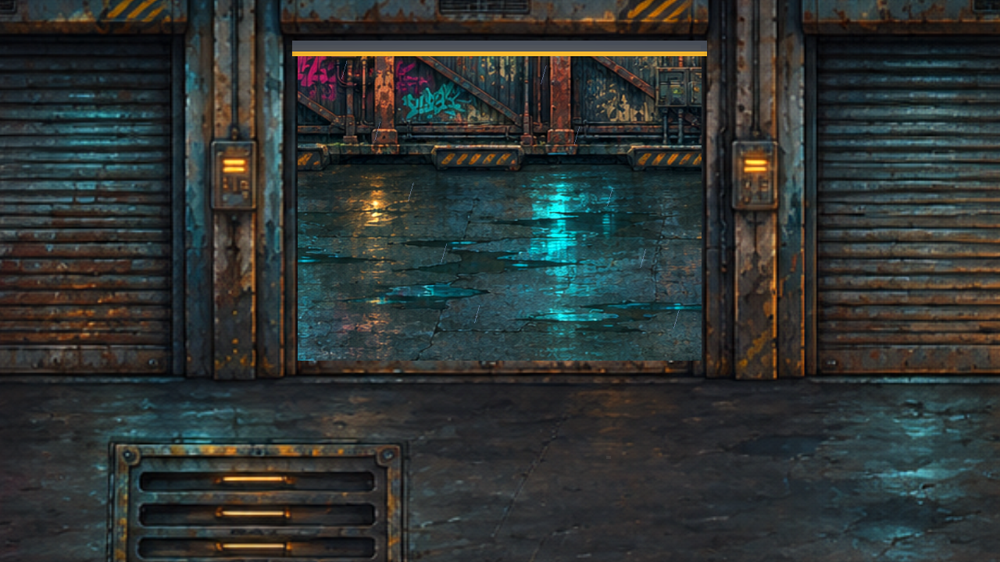 |

Früher änderte sich der Straßenausschnitt mit der Öffnungshöhe und sah aus, als werde der Weg hochgezogen. Jetzt besitzt die Außenansicht eine feste vollständige Projektion mit Hafenwand und nassem Asphalt. Das Tor gibt lediglich einen größeren Ausschnitt frei. Der gewählte Quellbereich vermeidet eine zuvor störende Rohr-/Schienenkante. Regen hat feste Ortskoordinaten; die vorhandenen Asphaltreflexe ersetzen den alten flachen wandernden Farbstreifen. Die Torunterkante bewegt sich weiterhin sichtbar, die Landschaft dahinter nicht.

## Vom Tower über die Nomaden zum See

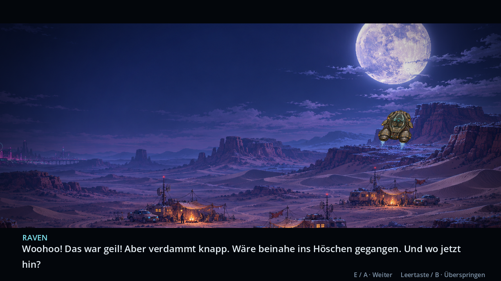

[Film: Wüste, Gespräch und Einflug in Kapitel 7](previews/outbound-v065.webp).

Die bestehende Flucht beginnt weiterhin am Tower-Landeplatz: Einsteigen, Schubverlust, Fallen an der Fassade vorbei, Auffangen und Penthouse-Explosion. Danach führt sie mit **demselben animierten Aerodyne** aus der Stadt über eine neue HQ-Pixelkulisse. Mondlicht, langsame Kamerafahrt und Flugbewegung begleiten die kleinen Nomadenlager; vorhandene Feuer-/Lichtpixel flackern an den tatsächlichen Feuerstellen. Es werden keine neuen Fraktionen oder Hauptfiguren erfunden.

**Raven:** „Woohoo! Das war geil! Aber verdammt knapp. Wäre beinahe ins Höschen gegangen. Und wo jetzt hin?“

**Shadepi:** „Wir sollten für ein paar Stunden untertauchen. Ich möchte dir etwas zeigen.“

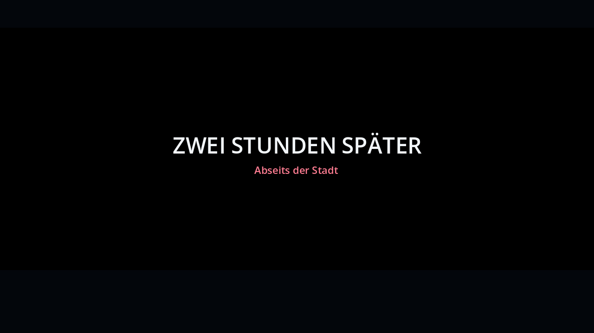

Danach erscheint **„ZWEI STUNDEN SPÄTER“** und der vorhandene Landeanflug am See beginnt. Aussteigen, Romantik, Maskenabnahme, Kuss und Drachenschatten bleiben erhalten. Die bisherige Musikzuordnung bleibt ebenfalls bestehen; Kapitel 7 nutzt weiterhin `menu.mp3`.

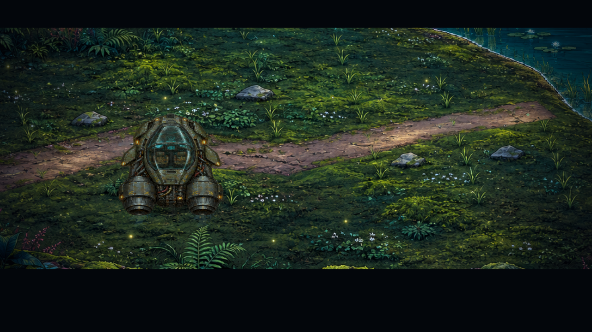

Die gesamte Flucht kann pausiert und per B / Leertaste übersprungen werden. Alte asynchrone Schritte prüfen ihre Szenengeneration; Kapitel-/Kontrollpunktwechsel dürfen die neue Szene nicht mehr beeinflussen. Ein Kontrollpunkt während des Abflugs wiederholt die sichere zusammenhängende Abflugsequenz ab dem Tower-Landeplatz, nicht die Datenextraktion oder den Bosskampf. Es gibt keinen neuen Kapitel-Enum-Wert und keinen eigenständigen Wüsten-Spielstand.

## Prüfung und Grenzen

[Maschinenlesbarer Prüfnachweis](pruefungen/v065/ergebnisse.json): **52 headless Prüfreihen, 4.907 erfolgreiche Prüfungen**, dazu native Pixelprüfung des erweiterten Bildrands und der sichtbaren Zeitsprung-Schrift. **50 Atlanten, 3.278 Ausschnitte, keine sichtbaren Schnittfehler.** Die älteren Tests wurden an den längeren Fahrzeugabgang und den zusätzlichen Fluchtabschnitt angepasst; der komplette Tower-Walkthrough bleibt mit unveränderten Spielzielen erhalten. Szenenpause, Abbruch/Ersetzung, tatsächliches Herausfahren vor dem Übergang, Überschlag vor Explosion und feste Straßenabtastung sind gezielt geprüft.

**Plattformpakete:** Android-Test-APK (Versionscode 6500), Linux und Windows erfolgreich mit Godot 4.7.2 exportiert. Das exportierte Linux-Spiel startet ohne Scriptfehler. Quellcommit, Paketgrößen und SHA-256 stehen im Prüfnachweis; Binärpakete liegen lokal unter `build/` und gehören nicht ins Git. Es wurde kein Release veröffentlicht.

Die PNGs und Filme sind native Linux-/X11-Spielaufnahmen mit isolierten Spielständen. Die QA bestätigt Dialoge automatisch und rafft Teile des Flugs; die Zeitsprung-PNG ist für die Sichtprüfung angehalten. Kein physischer Handy-/Windows-Durchlauf und kein vollständiger manueller Durchgang aller sieben Kapitel behauptet. Die bestehenden wechselnden Straßenkacheln sind weiterhin der vorhandene Bestand; nahtlosere Übergänge dieser Quellbilder bleiben eine separate Grafikpolitur. Signaturarbeit bleibt wie gewünscht beim Nutzer.
