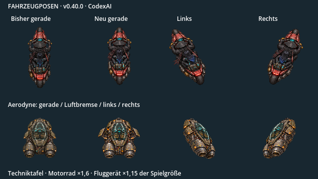
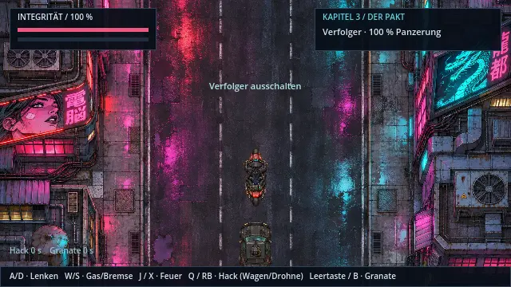
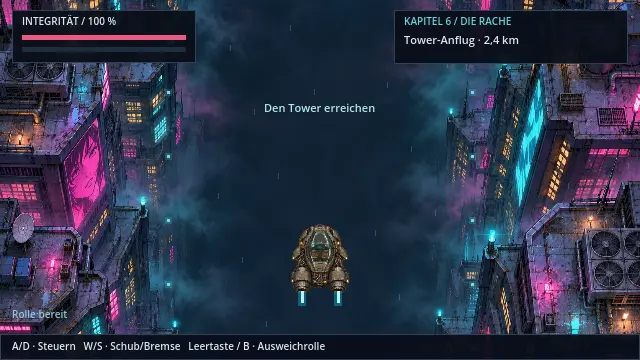
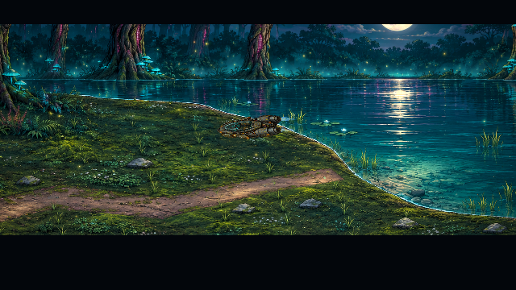
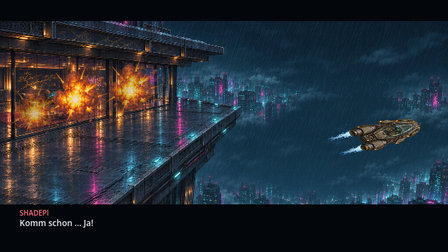

# Fahrzeuge mit eigener Körperbewegung · v0.40.0 · CodexAI

Der Aerodyne erhält eigene leichte und starke Links-/Rechtslagen und eine Luftbremsansicht. Am Motorrad lehnen sich Fahrer und Maschine gemeinsam; Bremsen und Federung besitzen eigene Körper-/Gabelbilder. Die bisherige Steuerung bleibt erhalten. Die Bewegung folgt Geschwindigkeit, Lenkung, Bremse und Szenenverlauf.

Die Tafel vergleicht vorhandene und neue Quellpixel bei gleichem Bezug zur Spielgröße. Sie ist eine Technikansicht. Die folgenden Filme zeigen dagegen die tatsächliche Verfolgung und den Flugrenderer:

| Motorrad: Lenken und Bremsen | Aerodyne: Kurven und Ausweichen |
| --- | --- |
|  |  |

Die kurzen QA-Aufnahmen lenken über die bestehenden Aktionen. Gottmodus verhindert Schaden während der Bildabnahme; Verfolgerpanzerung wird erhalten und der Flug startet mit bereits repariertem Motor. Die Ausweichphase wird gezielt ausgelöst. Das ist kein vollständiger erspielter Sieg über Verfolger oder Tower. Tatsächliche Aufnahmezeitpunkte bestimmen die Wiedergabe.

| Kurve im tatsächlichen See-Anflug | Abfangen und Flucht am Tower |
| --- | --- |
|  |  |

Die bestehenden Flugwege bleiben erhalten. Kurvenlage wird zusätzlich zur Ausrichtung des Fahrzeugs geführt. Im See-Anflug und nach dem Abfangen am Tower greift die neue Darstellung ebenfalls; beim Landen richtet sich das Schiff wieder aus. Die Kabine öffnet weiterhin mit ihren vorhandenen mechanischen Bildern. Flammen beginnen an den für jede Ansicht dokumentierten Düsen, das Motorrad bleibt am gleichen hinteren Reifenkontakt auf der Straße.

**Bedienung:** A/D beziehungsweise linker Stick lenkt; W/S beziehungsweise Stick nach vorn/hinten beschleunigt und bremst. Im Flug löst Leertaste/B die Ausweichrolle aus; beim Motorrad bleibt diese Taste für die Granate. Pause hält auch die Bildphasen an. Beim Laden wird die kurzzeitige Lenk-/Kurvenlage sauber neu aufgebaut.

Aktiv sind vier Aerodyne-Kurvenlagen plus Luftbremse und acht Motorradposen. Das ist kein vollständiger 360°-Rollen-/Unterseitenatlas. Verfolgerwagen, Frachtdrohnenrotoren, zusätzliches Fahrwerk und gezielte Cockpit-Zwischenbilder bleiben nächste Arbeiten der [Cinema-Roadmap](cinema-roadmap.md).

[Quellen und Anker: Aerodyne](../assets/vehicles/aerodyne/README.md) · [Motorrad](../assets/vehicles/motorcycle/README.md) · [Abnahme und Export](arbeiten/fahrzeugbewegung-v040.md).
