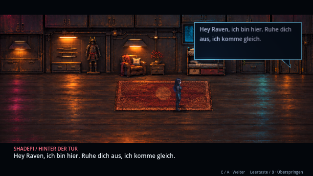
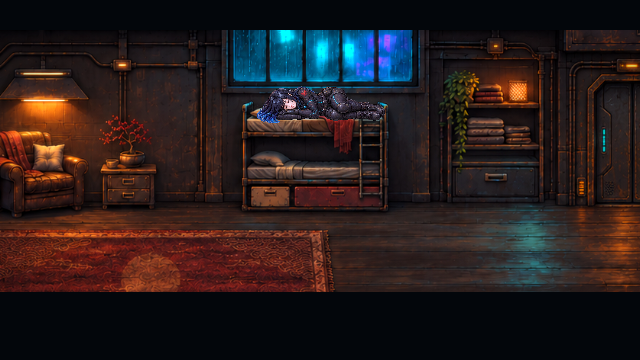
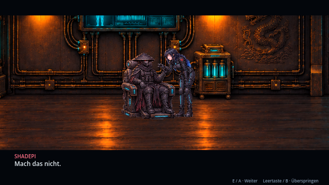
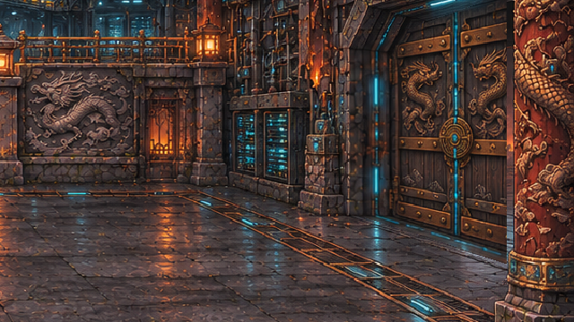
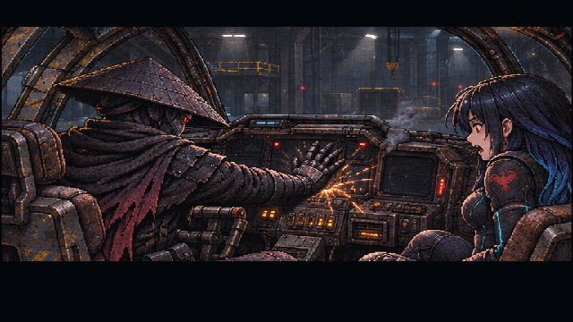
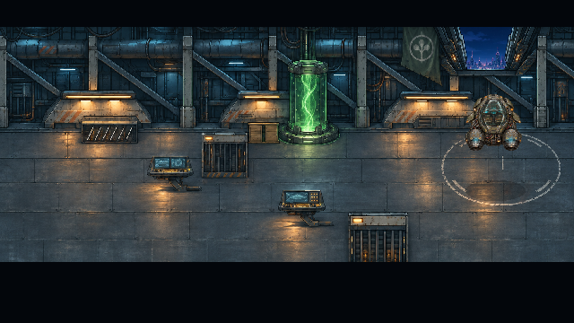
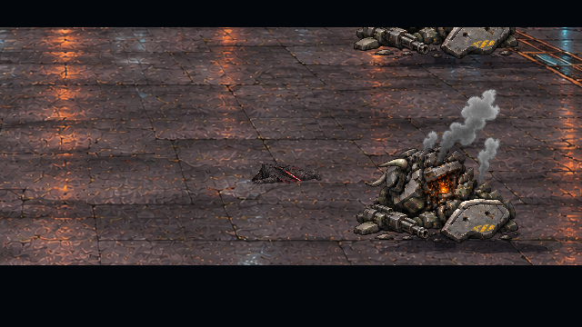

# Fehlerbericht 8 – Korrekturen · v0.30.0 · CodexAI

Grundlage: [Original-PDF vom 8. November 2026](fehlerberichte/Fehlerbericht-2026-11-08.pdf), zusätzlich als [unveränderte Textextraktion](fehlerberichte/Fehlerbericht-2026-11-08.txt) gesichert. Die Bilder und Fehlerbeschreibungen sind die Grundlage dieses Auftrags; weitergehende Änderungen außerhalb der beschriebenen Spielabläufe werden daraus nicht abgeleitet.

## Alle gemeldeten Punkte

| Seite | Meldung | Korrektur |
| --- | --- | --- |
| 1 | Durch Hangarkonsolen laufen | Drei feste Geräte-Standflächen, passende Verdeckungen aus der jeweiligen Originaltextur und davor liegende Bedienpunkte. Kein Abschneiden der Wege zu den drei Konsolen und Transponder-Anschlüssen. |
| 1 | Wohnraumtür passt nicht | Tür in die Wandgrafik eingearbeitet: passende Größe, Bodenanschluss, Rahmen und Leitungen. Das vorher lose Türfragment entfällt; der störende Elektrokasten vor dem Durchgang ist entfernt. |
| 1 | Shadepis Ruf kommt aus keiner sichtbaren Richtung | Eine UI-Sprechblase mit Zeiger zur Tür begleitet genau den gesprochenen Satz „Hey Raven, ich bin hier …“. Sie verschwindet danach wieder. |
| 1 | Raven geht nicht richtig schlafen | Automatischer Anschluss an die Ankunft, sichtbares Aufsteigen zum Bett, Hinsetzen, Hinlegen und längere Nahaufnahme. Nach zwei Stunden wird das Aufwachen gezeigt. Kein zusätzlicher unklarer Tastendruck am Bett mehr nötig. |
| 2 | Shadepi sitzt nicht richtig | Stuhl und Figur werden jetzt gemeinsam aus passenden Quellposen gezeichnet. Sitz, Lehne, Armlehnen und Fußstütze passen zum Körper. Der leere Hintergrundstuhl ist entfernt; auch bei Griff und abgefangener Hand bleibt derselbe Stuhl stehen. |
| 3 | Tempeltür ist schlecht eingefügt | Geschlossene Flügel übernehmen die tatsächliche schräge Portalfläche im Tempel. Keine zusätzlich auf den Boden gesetzte frontale Tür. Beim Durchbruch verschwinden die Flügel aus genau dieser Öffnung; die physische Schwelle wird erst dann frei. |
| 3 | Zusammenbruch zu schnell und wenig dramatisch | Nach dem Kampf folgen Erschöpfung, langsame letzte Schritte aus der Nähe der Wracks, aufrechtes Wanken, Einknicken und schrittweises Erlöschen der Aura. Vier Sekunden Stille am reglosen Körper und eine langsame Abblende geben dem Moment Zeit. Shadepis Tod wird weiterhin nicht festgelegt. |
| 3 | Sofortiger Sprung ins fliegende Aerodyne | Beide gehen im Hangar zum Fluggerät und steigen ein. ARTOS bootet schlecht; Shadepi schlägt sichtbar auf die Armatur, die Anzeigen kommen zurück. Danach folgen das Abheben und der Weg durch die offene Dachschleuse. Erst draußen übernimmt der Spieler. |

## Bilder aus Godot

Die Bilder entstehen durch Rendern des Spiels; die PNG-Quellen wurden mit dem Bildwerkzeug erstellt beziehungsweise bearbeitet. Vorhandene Spielfiguren, Fahrzeuge, Kampfabläufe, Energie-, Staub- und Soundquellen werden weiterverwendet.

## Bedienung und Speicherstände

Dialoge: **E / Controller A** weiter, **Leertaste / B** überspringen, **Esc / Start** pausieren. Das Einschlafen folgt direkt nach Ravens Ankunft; nach dem Aufwachen steuerst du sie zur Tür. In den spielbaren Erinnerungen bleibt B das Ausweichen.

Alte Erinnerungsstände bleiben kompatibel. Ein neuer optionaler Wert `campaign/flight_intro_pending` merkt einen noch laufenden Hangar-Abflug. Wer währenddessen speichert, beginnt beim Laden sicher vor dem Einsteigen. Alte Flugstände ohne diesen Wert bleiben im bisherigen Flug. Der Schlag beim Start setzt **nicht** Ravens späteres Triebwerks-Reparaturrätsel auf erledigt.

Bei der Prüfung fiel zusätzlich auf: Ein abgebrochener alter Kampagnendialog konnte nach einem Kapitelwechsel noch weiterlaufen und eine neue Szene beenden. Nach wartenden Schritten prüfen die Kampagnenszenen nun ihre Generation, ebenso wie die neuen Sequenzen. Das sichert insbesondere den vollständigen Schlafablauf auch nach direktem Kapitelstart.

## Prüfungen

`tests/report8.gd` prüft tatsächliche Konsolenkollisionen, freie Bedienpunkte, den vollständigen Schlafablauf, Sprechblase, alle sieben Abflugphasen, Pause, Controller-B, Speicherwiederaufnahme und Kapitelabbruch. `tests/sanctuary_story.gd` prüft weiterhin Erinnerungsübergang und Gegenwarts-Speicherstände. Der dritte Erinnerungstest prüft zusätzlich die Reihenfolge von Erschöpfung, Einknicken und Liegen auf freiem Boden.

Prüfergebnis: **2.143 Prüfungen ohne Fehler in 16 Prüfreihen**, einschließlich der bisherigen Kampagnen-, Kampf-, Hack-, Controller-, Flug- und Erinnerungsprüfungen. Der Export wird zusätzlich mit den neuen Raum-/Sitz-/Cockpit-Ressourcen und einem vollständigen übersprungenen Startlauf geprüft.
