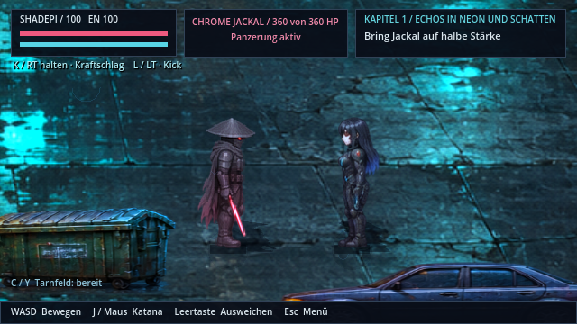
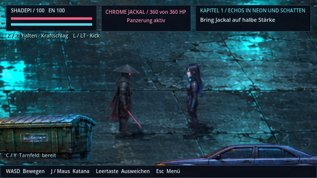
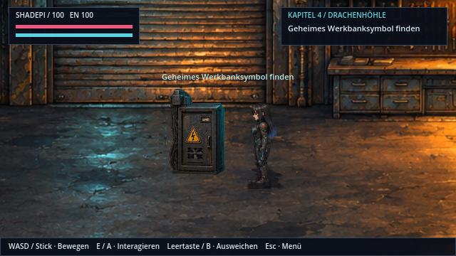
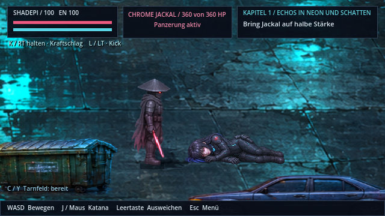
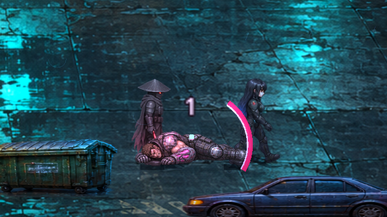
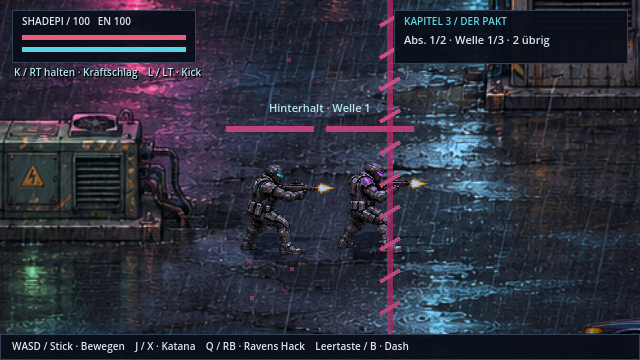
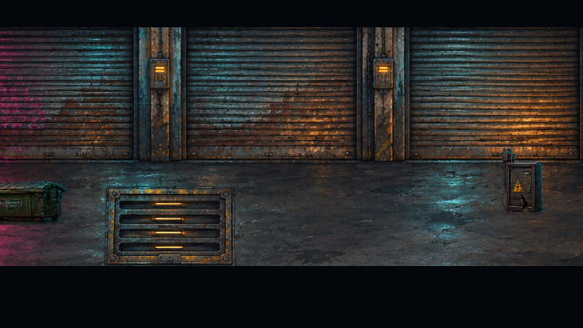
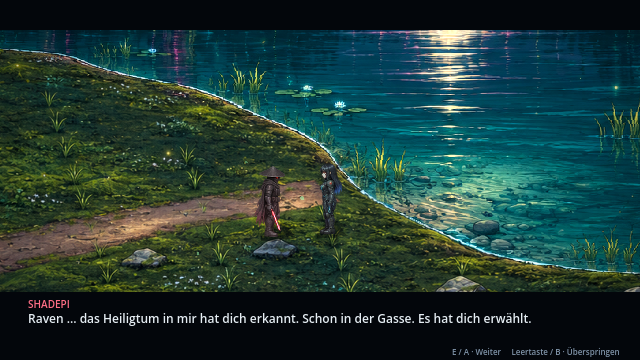

# Fehlerbericht: Gameplay-Figuren und Szenen

**Hinweis zum aktuellen Stand v0.46.1 · CodexAI:** Die hier gezeigte neue Heldenvariante wurde auf Nutzerwunsch zurückgenommen. [Raven und Shadepi verwenden wieder ihre Original-Sprites](original-helden.md). Die übrigen Fehlerkorrekturen bleiben erhalten. Dieser Bericht und seine Bilder dokumentieren den damaligen Stand v0.45.0.

**v0.45.0 · CodexAI · 9. November 2026.** [Bildgalerie](README.md) · [Arbeits-/Prüfnachweis](arbeiten/fehlerbericht-v045.md) · [Stilbibel](stilbibel/README.md).

Die Punkte aus dem Nutzerbericht sind umgesetzt. Der Schwerpunkt liegt auf stabilen Bildgrößen und Kontaktpunkten sowie nachvollziehbaren Szenenübergängen.

## Neue Gameplay-Helden und gesicherte Originale

| Neue Standardgrafiken | Unveränderte bisherige Sprites als Vergleich |
| --- | --- |
|  |  |

Raven und Shadepi besitzen je 64 neue detaillierte Pixelposen: acht Richtungen, Bereitschaft, vier Gehphasen, Ausholen, Auslösen und Trefferreaktion. Körper, Stoff, Rüstung und Ausrüstung sind an den vorhandenen Szenenreferenzen ausgerichtet. Neue Gameplaybilder werden durchgehend mit Nearest dargestellt; der vorherige Wechsel zwischen weicherer und schärferer Abtastung nach Sonderaktionen entfällt.

Die Quelle hat ungleichmäßige Zellabstände. Deshalb werden tatsächliche vollständige Figurenregionen und Sohlenanker einzeln registriert. Das verhindert abgeschnittene Silhouetten und Größensprünge; insbesondere Ravens Ostbewegung behält über alle Gehbilder dieselbe sichtbare Höhe. Aufgeladene Angriffe, Kick und Handblitze behalten ihre zusätzlichen bestehenden Aktionsbilder. Pistoleneffekte verwenden die registrierten Austrittspunkte der neuen Quelle.

Die Originale sind unverändert erhalten und zusätzlich unter [backup-v0441](../assets/sprites/heroes/backup-v0441/README.md) gesichert. Dort steht auch der Rückweg über den vorhandenen Custom-Ordner. [Aktive Quellen, Formate und Metadaten](../assets/sprites/heroes/gameplay/README.md).

Die [beiden Figurenkarten und die vollständige Übersicht aller 23 Figuren](stilbibel/figuren.md) wurden aus tatsächlichen Quellpixeln erneuert; es bleibt eine Vorlage für das gesamte Spiel.

## Änderungen nach Berichtspunkt

| Bereich | Korrektur |
| --- | --- |
| Elektroverteiler | Beim Wechsel auf das beschädigte Bild werden dessen sichtbares Gehäuse und Bodenanker an die Betriebsanimation angeglichen. Auch der Serverschrank behält seine sichtbare Höhe. Kollisionsflächen bleiben gleich; zerstörte Geräte behalten ihre flache Wrackdarstellung. |
| Kapitel 1 · Raven | Eigene Folge aus Einknicken, seitlichem Fall und tatsächlicher Bodenpose. Beim Laden des Rettungs-/Teamabschnitts liegt sie weiterhin; bei ihrer Rückkehr wird die normale Figur wiederhergestellt. |
| Kapitel 1 · Jackal | Taumeln, Knien, seitlicher Fall und reglose Todespose statt gedrehter Standfigur. Die Kamera zeigt den Fall, bevor das Abschlussgespräch beginnt. |
| Kapitel 2 · Wagen | Ravens Annäherung verwendet einen geprüften Weg um Wagen und den danebenstehenden Elektroverteiler. Der geskriptete Lauf schneidet nicht mehr durch die Hindernisse. |
| Kapitel 3 · Schützen | Blauer und violetter Schütze erhalten kalibrierte Kontaktgrößen. Jeder Wechsel stellt Bildraster, Textur und Maßstab vollständig wieder her; Schussbilder bleiben im normalen Figurenmaßstab. |
| Kapitel 3 · Verfolgung | Kapitelwechsel akzeptiert nur die aktuelle Fahrzeuginstanz mit tatsächlich besiegtem Verfolger und intaktem Motorrad. Sieg zeigt einen längeren Auslauf mit anschließendem Übergang. Ein Ausfall wird sichtbar dargestellt und erklärt, bevor der Kontrollpunkt neu geladen wird. |
| Kapitel 4 · Einfahrt | Das offene Garagentor zeigt vorhandene HQ-Straßen-/Industriekulisse anstelle des schwarzen Platzhalters. |
| Kapitel 4 · Werkbank | Ein Decoder an derselben Konsole ersetzt den Bestätigungs-/Plattform-/Rücklauf. Danach folgen Schalterbetätigung und gemeinsames Betreten der Plattform. Alte Kontrollpunkte an der zweiten Aufgabe bleiben nutzbar. |
| Kapitel 5 · Osten | Die neue Registrierung hält Ravens Körperhöhe und Fußkontakt bei jedem Gehbild stabil. |
| Kapitel 5 · Erinnerung | Raven hält sich sichtbar benommen den Kopf, sammelt sich und tritt erst danach langsamer zurück. Bei Abbruch verschwindet die Ersatzpose sauber. |
| Kapitel 7 · See | Raven richtet sich während des Gesprächs und Rituals zu Shadepi aus. |

## Technische Geräte

| Intaktes Gehäuse | Beschädigt bei gleicher Kamera |
| --- | --- |
|  |  |

## Reaktionen und Schützen

| Raven bleibt am Boden | Jackals Todespose |
| --- | --- |
|  |  |

[Quellen und Kontaktpunkte der Reaktionen](../assets/story/reactions/README.md).

## Einfahrt und Blickkontakt

| Hinter dem geöffneten Tor liegt eine Kulisse | Raven blickt im Gespräch zu Shadepi |
| --- | --- |
|  |  |

## Szenenfilm und Prüfung

[Film der betroffenen Abläufe öffnen](previews/fehlerbericht-szenen-v045.webp)

Die Aufnahmen stammen aus Godot 4.7.2 mit dem nativen OpenGL-Renderer. Standbilder vergleichen dieselbe Kamera; der Film zeigt Fall-/Todesreaktionen, den Weg im Versteck, die Garageneinfahrt und Plattformfahrt sowie Ravens Rückkehr aus den Erinnerungen. Für die Aufnahme werden der vorherige Kampf beziehungsweise Kapitelabschnitt per QA vorbereitet; es ist kein vollständig manuell erspielter Durchlauf. Die Garagenrätsellösung verwendet im Aufnahmeprogramm den Testlöser. Dummy-Audio, keine neue akustische Abnahme.

[Regression, Export und bekannte Umsetzungsgrenzen](arbeiten/fehlerbericht-v045.md). Die neuen Standardbanken besitzen vier echte Gehphasen je Richtung; die bisherigen achtphasigen Quellen bleiben vollständig als Backup vorhanden. Alle Figurenquellen behalten ihre eigenständigen Anker und Maßstäbe.
