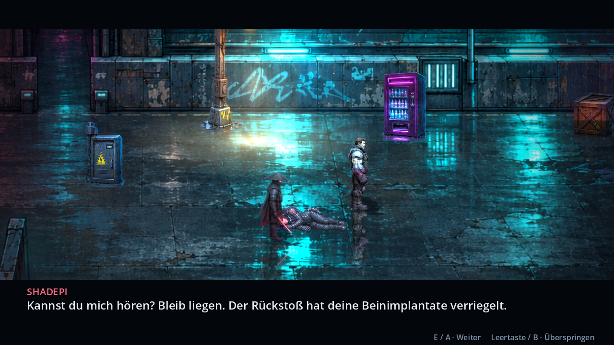
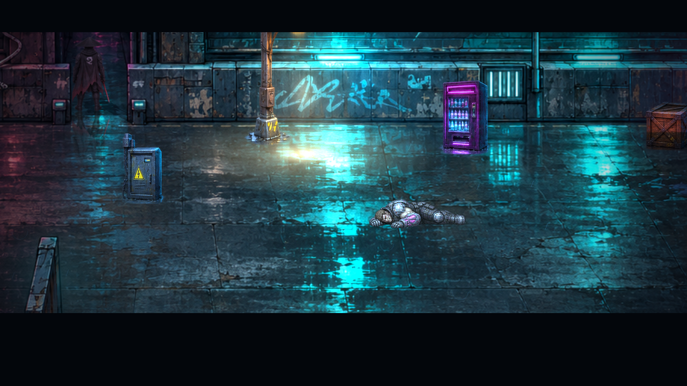
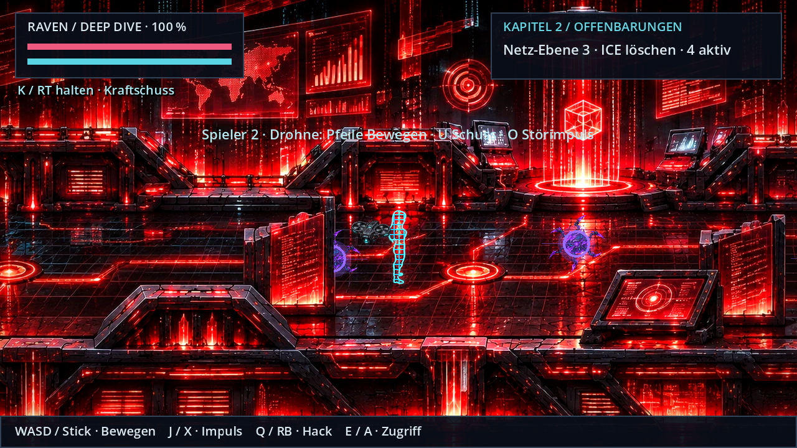
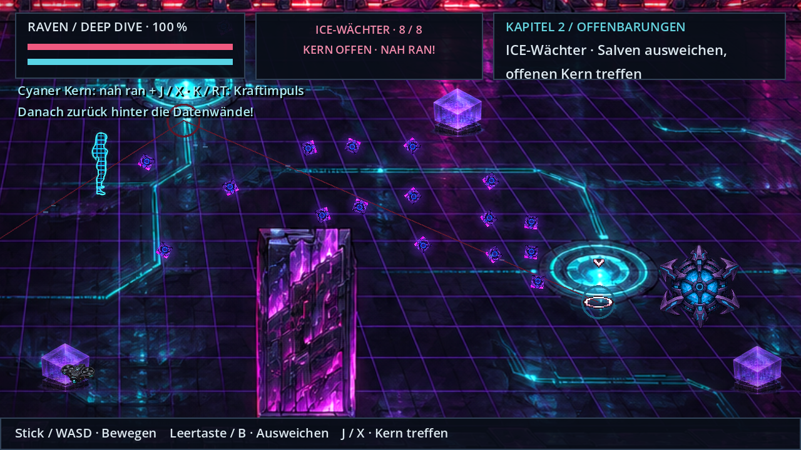
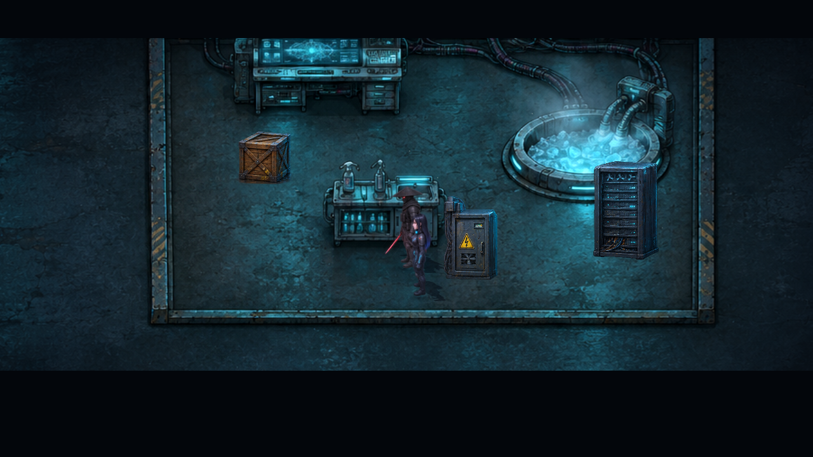
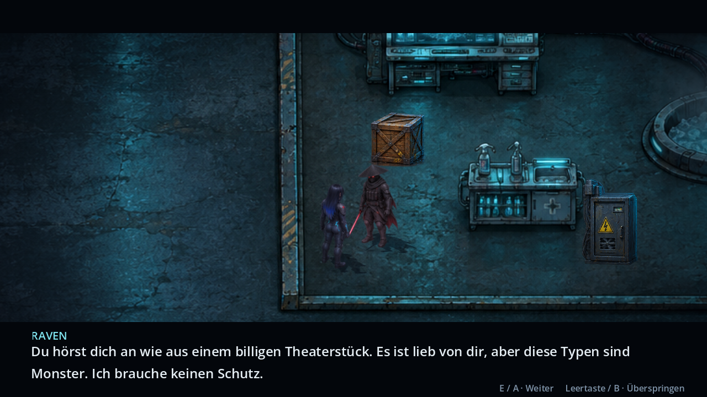
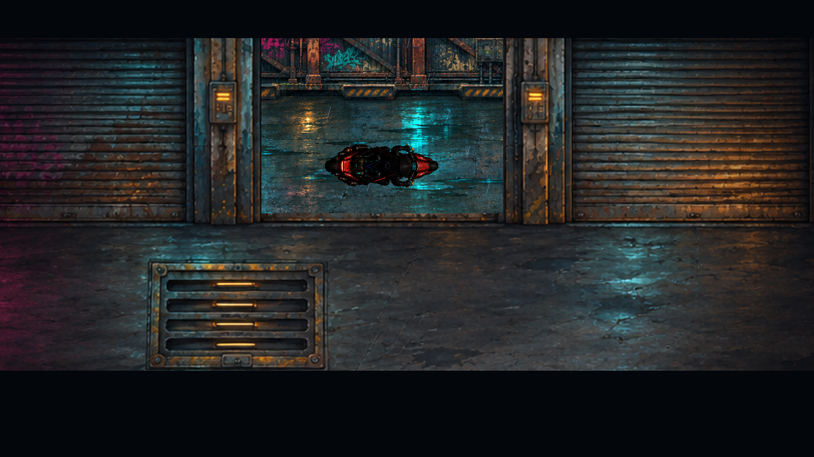
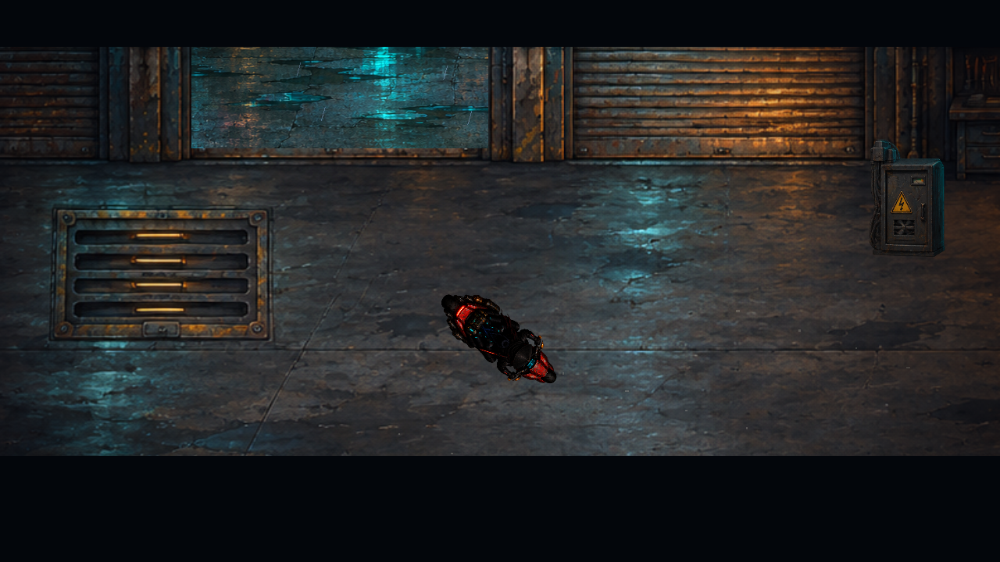
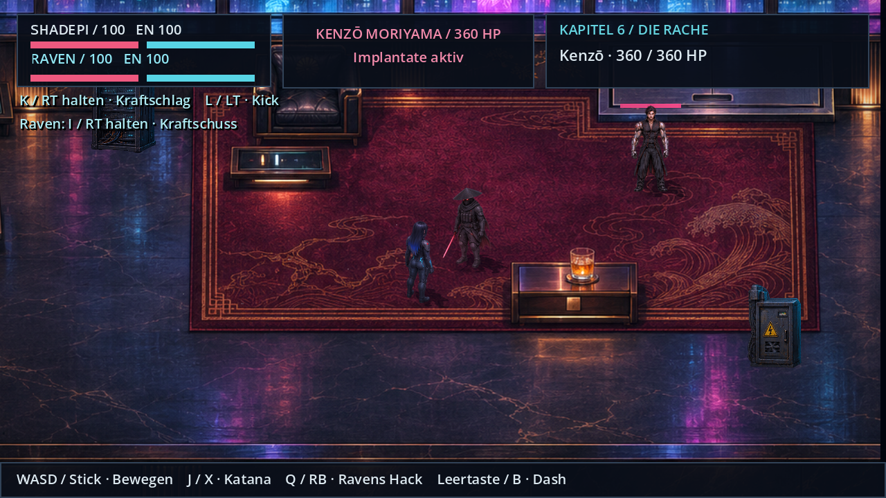
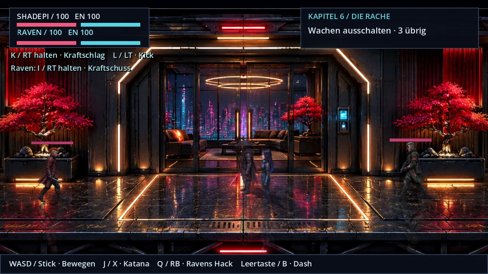

# Szenen und digitale Kämpfe · v0.66.0 · CodexAI

**17. November 2026.** Ausgangspunkt `353936e` (v0.65.1). Alle GitHub-Branches abgerufen und verglichen; main enthält den aktuellen gemeinsamen Stand, keine fremden Änderungen überschrieben. [Arbeitsnachweis](arbeiten/fehlerkorrekturen-v066.md) · [Galerie](README.md) · [Versionshinweise](../CHANGELOG.md).

## Jackal und Shadepis Abgang

Vor Shadepis Kampf steht Jackal nahe Raven und wendet ihr den Rücken zu. Erst auf Shadepis Eingreifen dreht er sich zu ihm. Beim Übergang in den Kampf bleibt Jackals Standpunkt erhalten; er erscheint nicht am anderen Hofende.

Nach Jackals Tod verlässt Raven die Szene durch ihre Tür. Shadepi geht anschließend zur **sichtbaren dunklen Gasse zwischen den Häusern** und verschwindet dort im Schatten. Damit entfällt der bisherige Sprung auf eine Stelle der Wand. Diese Variante entspricht der vom Nutzer vorgeschlagenen Gassen-Alternative; kein neues Hausdach oder frei erfundener Storyort.

[Film des Abgangs](previews/shadepi-alley-v066.webp).

## Rote digitale Welt und Spieler 2

Ein Startpunkt der zweiten Welle lag im vergrößerten Kollisionsbereich des zweiten Säulensockels. Er liegt nun frei. Zusätzlich prüft der Raum die Startpunkte und liefert den ICE-Gegnern Wege um die Sockel; sie drücken nicht endlos gegen dieselbe Ecke. Säulen und Verdeckungen bleiben erhalten.

Die Drohne rief bisher direkt `take_damage()` auf. Digitale Gegner besitzen diese Funktion nicht. Begleitertreffer werden jetzt über die Welt an den passenden Gegner weitergereicht: Ein Schuss öffnet die ICE-Hülle, ein weiterer Treffer löscht sie. Der Störimpuls erreicht ebenfalls digitale Gegner. Am Wächter kann die Drohne den offenen Kern aus tatsächlicher Nähe treffen; sie umgeht seine geschlossene Panzerung nicht.

## Beweglicher ICE-Wächter

[Film des beweglichen Bosses](previews/ice-mobile-v066.webp).

| Phase | Verhalten |
| --- | --- |
| Warnung · 1,1 s | Der Wächter fliegt weiter; die Zielrichtung wird vor dem Feuer erkennbar festgelegt. |
| Feuer · 2,1 s | Sieben Dreierfächer, Abstand 0,28 s; Kugeln bleiben ausweichbar und werden von Deckung abgefangen. |
| Kern offen · bis 3,6 s | Der Wächter hält an. Nah heran und den Kern treffen; höchstens zwei Integritätspunkte pro Öffnung. |
| Nach dem Gegenangriff | Rückzug, neue sichtbare Warnung, nächster Flug-/Schussabschnitt. Bei wenig Integrität fliegt und schießt er schneller. |

Der Boss besitzt weiterhin acht Integritätspunkte und seine vorhandenen acht Grafikphasen. Flugroute und Bewegungsgrenzen passen zur vergrößerten Arena. Die Kamera zeigt beide Kämpfer und erweitert bei größerem Abstand den Ausschnitt, damit die neue Flugbewegung den Boss nicht unbemerkt aus dem Bild trägt.

## Kapitel 2 → 3 im selben Raum

| Gemeinsamer Weg zur Konsole | Beginn von Kapitel 3 |
| --- | --- |
|  |  |

Raven bittet Shadepi, mit zur Konsole zu kommen. Beide laufen sichtbar unterhalb des Gerätewagens entlang. Erst an den tatsächlichen Kapitel-3-Startpositionen folgt die kurze Abblende. Das Versteck und die erreichten Positionen bleiben über den Kapitelwechsel gleich. Auch der Fortsetzen-Knopf im Kapitel-2-Menü nutzt diesen Übergang; Laden/Abbrechen kann einen alten Übergang nicht nachträglich auslösen.

[Film des Kapitelübergangs](previews/chapter-bridge-v066.webp).

## Kontinuierliche Garageneinfahrt

| Noch auf der Straße | Durch das Tor in die Garage |
| --- | --- |
|  |  |

Das Motorrad besteht bereits außerhalb des sichtbaren Ausschnitts. Nach Öffnen des Tors nähert es sich seitlich auf dem festen Straßenbild, dreht zur Einfahrt und fährt hinein. Die Garagenfassade verdeckt es korrekt; es wird nicht mehr mitten in der Öffnung eingeschaltet. Die Kamera folgt der Fahrt bis zur bestehenden Park-/Absteigesequenz. Der feste Straßenhintergrund aus v0.65.0 bleibt erhalten.

[Film der Einfahrt](previews/garage-arrival-v066.webp).

## Raven im Tower-Koop

| Kampf gegen Kenzō | Rückweg durch die Lobby |
| --- | --- |
|  |  |

Spieler 2 steuert Raven im Kenzō-Kampf und beim Rückweg durch Lobby und Flur. Der bisher dort irrtümlich gewählte Nanitenschwarm entfällt. **Während der Datenextraktion** bleibt Raven am verletzten Kenzō gebunden; hier übernimmt Spieler 2 weiter die Naniten zur Unterstützung Shadepis. Im Einzelspiel kämpft Shadepi weiterhin allein gegen Kenzō. Die Entnahme-Reihenfolge, drei Treffer als Wiederholungsgrenze und Kenzōs spätere Vernichtung bleiben erhalten.

## Prüfung und Grenzen

[Maschinenlesbarer Prüfnachweis](pruefungen/v066/ergebnisse.json): **53 headless Prüfreihen, 4.938 erfolgreiche Prüfungen, keine verbleibenden Fehler**, dazu **25 native Prüfungen**. Automatisierte Fehlerfälle prüfen unter anderem alle roten Wellenstartpunkte, die Umgehung der zweiten Säule, echte P2-Drohnenangriffe, kontinuierliche Bossbewegung ohne Begrenzungssprung, Salven/Kernfenster, die beiden Tower-Rollen und den unterbrechbaren Kapitelübergang. Native Pixelprüfungen kontrollieren, dass das Motorrad außerhalb der Toröffnung unsichtbar bleibt, innerhalb sichtbar wird und nach der Schwelle weiter sichtbar ist.

Alle Abbildungen und Filme sind echte Linux-/X11-Godot-Aufnahmen mit isolierten QA-Spielständen. Die Vorschau bestätigt Dialoge automatisch, rafft Teile der Szenen und schützt die Testfigur in der Bossaufnahme vor dem Tod. Sie ersetzt keinen physischen Android-/Controller-/Windows-Durchlauf. Keine neuen Figuren oder Bildquellen generiert: vorhandene HQ-Pixelquellen und Originalhelden bleiben unverändert. Signaturarbeit bleibt beim Nutzer; Cloud-Veröffentlichung und Release sind nicht Bestandteil dieser Korrektur.
