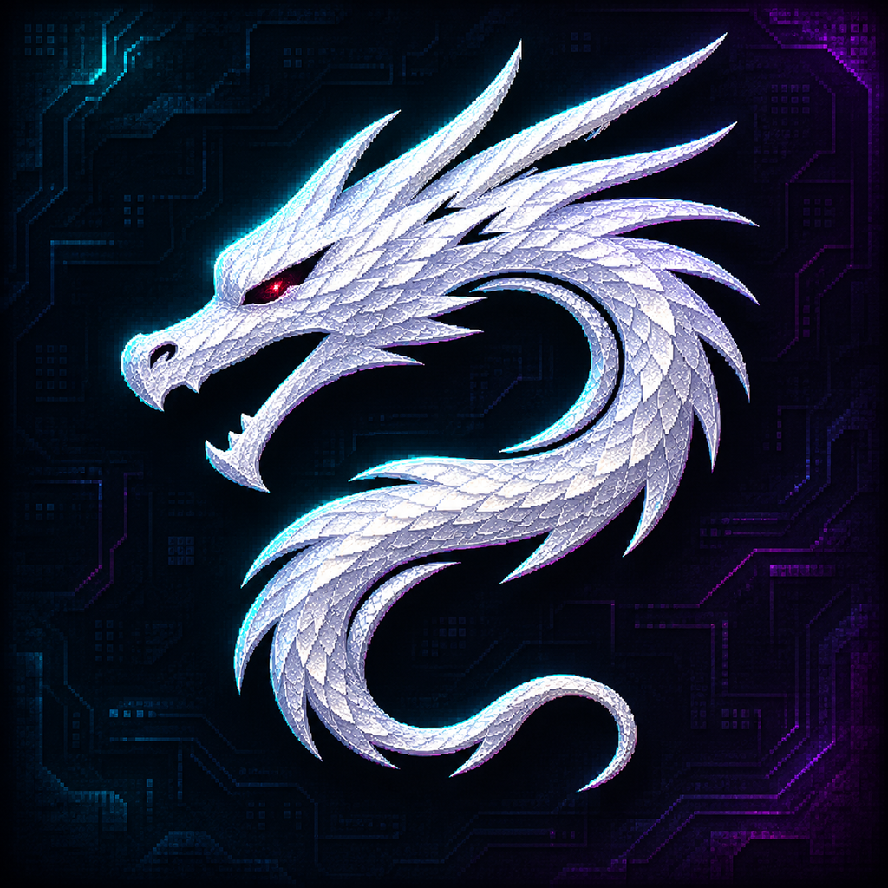
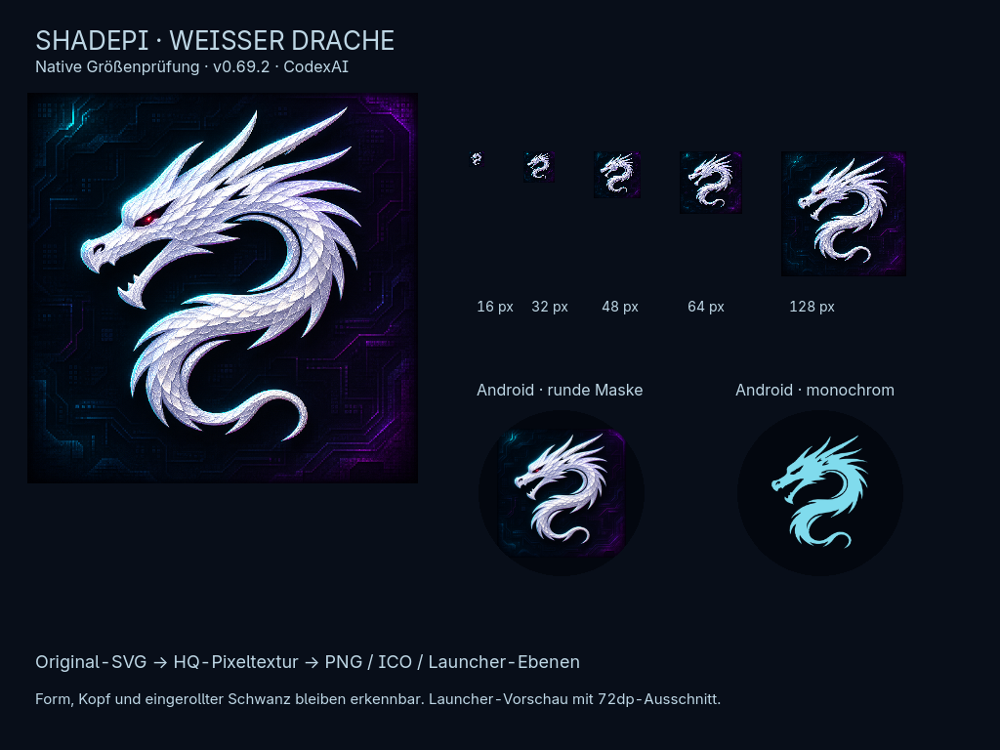

# Weißer Drache als Game-Icon · v0.69.2 · CodexAI

**Release-Abschluss · v0.69.2 · CodexAI:** Die unten dokumentierte ursprüngliche Windows-PE-Grenze wird für die Veröffentlichung durch den [Template-Vorbereitungsschritt](../tools/windows/README.md) behoben. Das fertige Windows-EXE enthält die sechs neuen Icongrößen und Version 0.69.2.0; der eingebettete Godot-PCK wird danach erneut geprüft. Die frühere reine Icon-Abnahme bleibt als datierter Nachweis erhalten. [Release und Downloads](releases/v0.69.2.md).

**23. November 2026.** [PNG herunterladen](../assets/icon.png) · [Windows-ICO herunterladen](../assets/branding/icon/game-icon.ico) · [Original-SVG](branding/game-icon-v0692/Drachensymbol.svg).

Das Nutzer-Symbol bleibt erkennbar: linksgerichteter Drachenkopf, lange nach rechts oben gezogene Hörner/Mähnenspitzen, offene Maulform und S-förmiger Körper mit eingerolltem Schwanz. Die Bildwerkzeugfassung ergänzt eine plastische, perlmuttweiße Pixeltextur, Cyan-/Magenta-Lichtkanten und ein kleines rotes Augenlicht auf dunklem Technikgrund. Keine Beschriftung und keine neue Figurengeschichte.

Das ursprüngliche SVG und die vollständige generierte 1254×1254-PNG sind [unverändert archiviert](branding/game-icon-v0692/sources.json). Das frühere 128px-Spielfiguren-Icon bleibt als [Sicherung](archiv/assets/game-icon-bis-v0691.png). Startbild vor dem Hauptmenü, Charakterbilder, Karten und Kampf bleiben unverändert.

## Dateiformate und Integration

| Verwendung | Datei / Größe |
| --- | --- |
| Projekt, laufendes Fenster und Mac-Preset | [PNG, 1024×1024](../assets/icon.png) |
| Windows-Verknüpfung / PE-Iconquelle | [ICO, 16 bis 256 Pixel](../assets/branding/icon/game-icon.ico) |
| Android Legacy | 192px, volle Farbfläche |
| Android Adaptive | 432px-Vorder-/Hintergrund, zentrierter Sicherheitsbereich |
| Android-Themenicons | Original-SVG als 432px-Monochrommaske |

Android-Exportfelder sind ausdrücklich gesetzt. Die runde Android-Maske sieht nur die mittlere 72dp-Zone der 108dp-Ebene; die Figur bleibt innerhalb des Sicherheitsbereichs. Die Monochrommaske ist eine technische OS-Ableitung des Originalsymbols.

Die bisherige Windows-Pipeline deaktiviert PE-Ressourcenänderungen (`application/modify_resources=false`). Diese Aufgabe liefert das fertige mehrgrößige ICO und das neue Fenster-Icon; sie ändert diese Build-Policy nicht und behauptet kein bereits neu eingebettetes Explorer-Icon in veröffentlichten EXE-Dateien. Das Mac-Preset übernimmt das neue PNG. Es wird kein neues Release veröffentlicht.

## Sichtprüfung und Arbeitsnachweis

Basis `6d3eb9f` / v0.69.1; alle Remote-Branches vor Beginn abgerufen und verglichen, main aktueller als ClaudeHelper v0.60.3. Original-SVG vor der Gestaltung tatsächlich gerastert und betrachtet. Es besteht aus einer weißen Kontur mit ausgesparten Augen-/Maul-/Körperflächen; eingebettete Dokumenttexte werden als Quelldaten behandelt, nicht als Arbeitsanweisungen.

Neue Version v0.69.2 · CodexAI; Windows 0.69.2.0, Android 6902/0.69.2, Mac erbt die Spielversion. PNG, ICO und technische Android-Ebenen sind aus einer einzigen Bildwerkzeugquelle bzw. aus dem Original-SVG abgeleitet. Keine neuen Gameplay-Tests für diesen reinen Grafik-/Metadatenwechsel; Import, Größen, Masken und tatsächliches Android-Paket werden gezielt geprüft. Die Größenprüfung im nativen Godot-Renderer zeigt das echte Icon in 16/32/48/64/128 Pixeln sowie die runde Android- und Themenmaske. Die Bildquelle bleibt unverändert; die rechte Seite zeigt die tatsächlichen Dateipixel und technischen Launcher-Ausschnitte.

[Kurzer nativer Größentest](previews/game-icon-sizes-v0692.webp) mit wechselnder Größenmarkierung; dies ist Dokumentation und keine behauptete Icon-Animation im Spiel. **24 gezielte Prüfungen bestanden:** Quelle/Backup bytegleich, PNG-/ICO-Größen, sichere Maskenradien sowie tatsächlich exportierte Android-Ressourcen. Die vier Icondateien im APK wurden dekodiert und mit den neuen Quellen verglichen; Dimensionen und Alpha stimmen, Farbabweichungen liegen unter dem dokumentierten Grenzwert. Android-Testexport und Signaturprüfung erfolgreich. Native Ansicht mit X11/llvmpipe; keine Laufzeitfehler oder Objektlecks.

[Maschinenlesbarer Nachweis](pruefungen/v0692/ergebnisse.json). Keine physische Handy-Launcher- oder neue native Mac-/Windows-Abnahme. Das Icon ist als Projekt-/Fensterquelle und in den Exportpresets eingetragen; die oben beschriebene Windows-PE-Grenze bleibt ausdrücklich bestehen.
