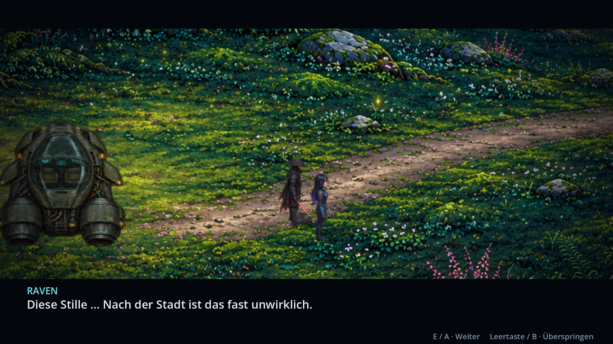
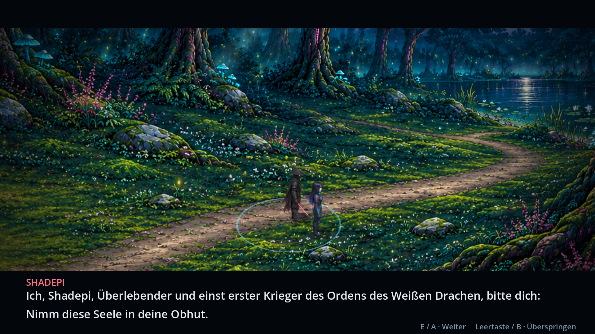
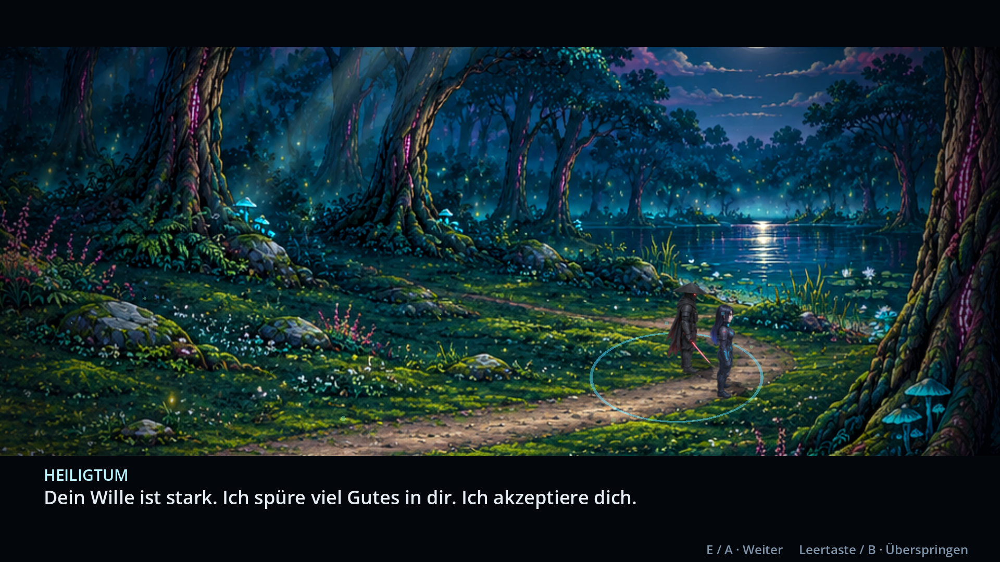
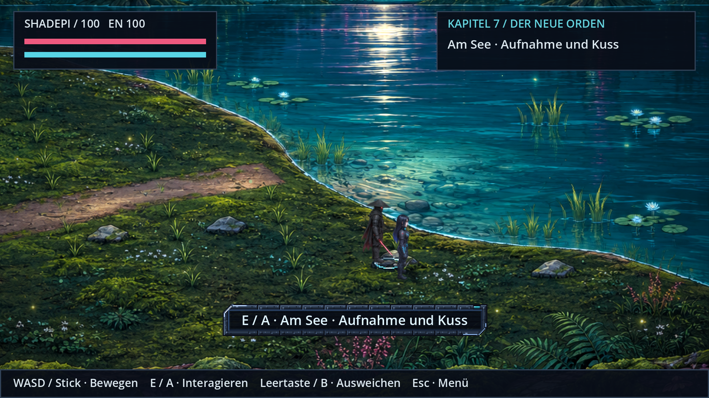

# Die eigentlichen Gesprächspunkte auf dem Waldweg · v0.69.1 · CodexAI

**Korrektur nach Nutzerpräzisierung vom 23. November 2026.** In v0.69.0 lagen zusätzliche Gehgespräche bereits auf dem Weg, die vier eigentlichen Ritualpunkte aber noch am See. Das ist jetzt korrigiert.

| Markierung | Tatsächlicher Ort und Ablauf |
| --- | --- |
| **1** | Auf dem Lichtungsweg: Stille, Zufluchtsort, Prophezeiung und Ravens freiwillige Entscheidung. Jede Zeile begleitet ein Stück gemeinsame Gehbewegung. |
| **2** | Weiter zwischen den alten Bäumen: Shadepi bittet das Heiligtum, Raven aufzunehmen. Beide gehen dabei auf dem Waldweg weiter. |
| **3** | Am Ende des Waldwegs: Das Heiligtum antwortet. Erst danach folgen beide dem Ausgang zum See; hier gibt es keinen weiteren vorgeschalteten Ufer-Gesprächspunkt. |
| **4** | Einziger Punkt direkt am See: Aufnahme in den Orden, Maskenabnahme und Kuss. Drachenschatten/Rosenblätter, Weltraumfahrt und Abspann schließen unverändert an. |

Die Landung endet nun am **Anfang des Waldwegs**. Der Spieler geht zur jeweils nächsten Markierung und startet das Gespräch mit **E/A**. Es werden keine zusätzlichen automatischen Wegdialoge vorangestellt, die dieselben eigentlichen Punkte danach am See wiederholen.

## Bilder und Film

| Punkt 1 · Lichtungsweg | Punkt 2 · Unter den Bäumen | Punkt 3 · Waldweg-Ausgang |
| --- | --- | --- |
|  |  |  |

[**Geraffter Film: tatsächliche drei Waldpunkte bis zum Kuss am See**](previews/trail-points-v0691.webp). Full-HD-Einzelbilder im nativen Godot-Renderer; Film aus ausgewählten realen Frames verkleinert/beschleunigt, Dialoge für die Aufnahme automatisch bestätigt. Die Galerie führt die Figuren zwischen den Markierungen; das Auslösen der Gespräche und deren Gehbewegung verwenden die tatsächlichen Spielfunktionen.

Die bestehenden Kulissen und Figuren werden unverändert verwendet; keine neuen Grafiken erzeugt. [Unveränderte kosmische Schlussfahrt und Abspann](see-epilog-v069.md).

## Kontrollpunkte und Karten

Der bisherige Gesprächsindex 0–3 wird jetzt auch beim Laden von Kapitel 7 erhalten. Zuvor wurde er in diesem Kapitel immer auf 0 gesetzt. Die ersten drei Werte öffnen die Waldkarte mit passender Bodenbegrenzung; der letzte Wert öffnet die Seekarte mit echter Wasserkollision. Der Aerodyne bleibt in der Lichtung. Ein normales Gesprächsende teleportiert niemanden zum See.

Die interne Test-Kontrollpunkt-ID `lake-shore` bleibt bestehen, führt aber nun tatsächlich zum letzten Punkt am See. Ältere Fortschrittswerte bleiben nutzbar, neue Pflichtfelder entstehen nicht. Pause und Überspringen gelten weiterhin für beide Karten und alle Szenen.

## Prüfung und Arbeitsnachweis

Basis `5549296`, GitHub-main v0.69.0, sauber. Alle Remote-Branches vor Beginn abgerufen; jüngster ClaudeHelper-Stand weiterhin v0.60.3. Umfang: tatsächliche Gesprächsmarker, ihre Geh-/Dialogabschnitte, dazu passende Karten-/Ladezustände. Neue Version v0.69.1 · CodexAI, Windows 0.69.1.0, Android 6901/0.69.1; Mac erbt die Projektversion.

Vorhandene See-/Lichtungsquelle, aktuelle Szenen-/Konsistenzregeln und Tests geprüft. Originalhelden, Masken-/Handfolge, Pixeldichte, Drachenanimation, Musik, kosmischer Schwarm und Rollen im Abspann bleiben gleich. Die Änderungen benötigen keine Bildgenerierung. Die native Galerie zeigt echte Markierungsaktionen und dieselben Geh-/Dialogfunktionen wie im Spiel.

**540 gezielte Prüfungen ohne Fehler:** See-/Wegablauf 59, Story und physische Erreichbarkeit 200, Menü/Kontrollpunkte 205, Koop-Kapitel 76. Die ersten drei eigentlichen Gespräche wurden mit aktiven gepaarten Walkern abgespielt; nach jedem Punkt Speichern/Laden und korrekte Karte geprüft. Der letzte Punkt bleibt am See. Pause, Controller-Überspringen, Abbruch und bisheriger Finale-Ablauf bleiben geprüft.

**10 weitere Prüfungen aus einem exportierten Linux-Ressourcenpaket** bestätigen Fortschritt/Kartenwahl, Ankunft vor dem Waldweg, alle vier Markierungen, Kuss-/Abspannabschluss und Kapitelwechsel. **550 Prüfungen insgesamt bestanden.** Native Full-HD-Sichtprüfung aller drei Waldpunkte und der letzten See-Markierung; 121 reale Filmframes, 15,125 Sekunden, 2,68 MB. Bestehende Spielgrafiken bytegleich erhalten. [Maschinenlesbarer Nachweis](pruefungen/v0691/ergebnisse.json).

Kein neues Release und keine physische Geräteabnahme. Für diese plattformneutrale Weg-/Dialogkorrektur wurde gezielt das Ressourcenpaket geprüft; die vier Plattformpakete aus v0.69.0 werden nicht als neue v0.69.1-Builds ausgegeben.
