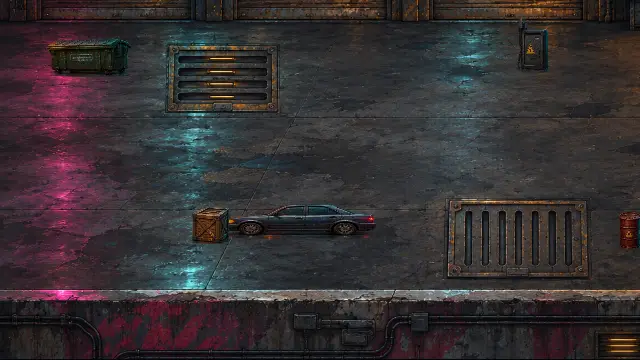
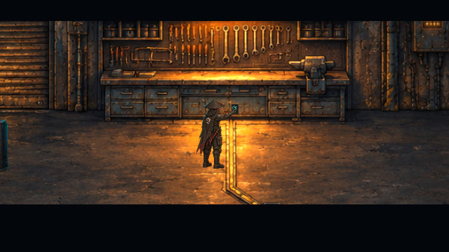
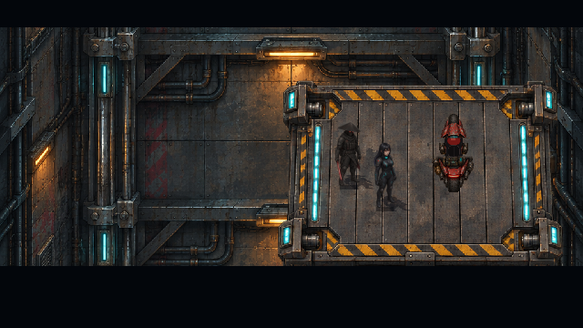
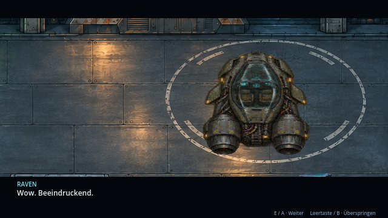
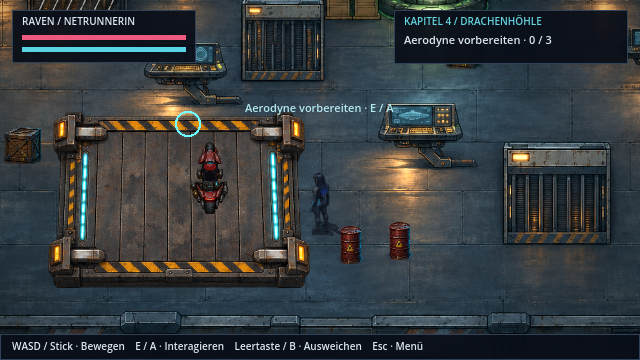
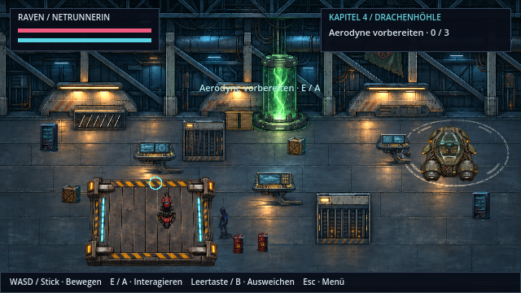

# Die Garage öffnet sich · v0.39.0 · CodexAI

Nach dem Garagen-Decoder betätigt Shadepi das versteckte Werkbanksymbol. Beide gehen mit dem Motorrad auf die Plattform. Sechs echte Verriegelungsbilder führen in die sichtbare Schachtfahrt; unten rastet der Boden wieder ein und die Wand gibt den Hangar frei. Die Kamera zeigt zuerst die Halle und den Aerodyne, bevor Raven mit „Wow. Beeindruckend.“ reagiert.

Die Aufnahme stammt aus Godots tatsächlichem Renderer. Sie beginnt am Ende des regulären Decoder-Callbacks und zeigt anschließend den zusammenhängenden Ablauf, echte Laufwege und die Übergabe der Steuerung. Der Decoder wurde für die Aufnahme per QA-Helfer gelöst; innerhalb der Filmfolge gibt es keine Kapitel- oder Positionssprünge als Abkürzung. Dialoge werden automatisch weitergeschaltet. Die Wiedergabe verwendet die tatsächlichen Aufnahmeabstände.

| Schalter und Verriegelung | Fahrt durch den Schacht |
| --- | --- |
|  |  |

| Das Motiv vor Ravens Reaktion | Danach wieder spielbar |
| --- | --- |
|  |  |

Shadepi geht anschließend zum Kompensator voraus. Raven bleibt für Reparatur und Kennungsübertragung im Hangar. Das zuvor eingemalte andere Fluggerät wurde durch dieselbe Aerodyne-Quelle ersetzt, die auch später im Flug verwendet wird. Das unterirdische Dach bleibt geschlossen; KOBAN-TEC-Kennung, Konsolen und Reparaturstellen bleiben erhalten. Die neue Plattform und das mitgebrachte Motorrad sind anschließend weiterhin sichtbar.

**Bedienung:** E / Enter / Controller-A schaltet Dialoge weiter. Leertaste / Controller-B überspringt die Szene. Esc / Start pausiert auch die Fahrt. Ein während der Entdeckung geladener Spielstand startet diesen Übergang sicher erneut; ein abgeschlossener Hangarstand wiederholt die Fahrt nicht. Alte Hangarstände ohne neues Feld erhalten die aktuelle Umgebung ohne künstlich nachgeholte Szene.

**Abnahme:** [Prüffälle, Export, Quellen und Grenzen](arbeiten/hangar-v039.md). [Pixelquellen, Ausschnitte und Kontaktpunkte](../assets/story/hangar-discovery/README.md). Vier Schalterposen und sechs Entriegelungsphasen sind echte neue Bilder; zusätzliche mechanische Fahrzeugansichten bleiben der nächste separate Roadmap-Block. Keine neue Audio-Abnahme; native Aufnahme mit Dummy-Audio.
