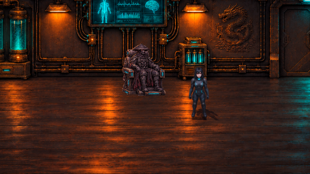
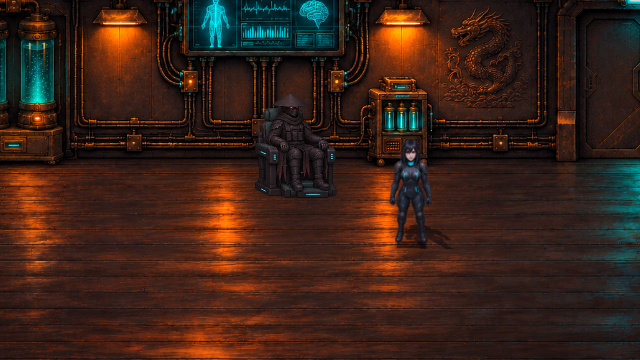
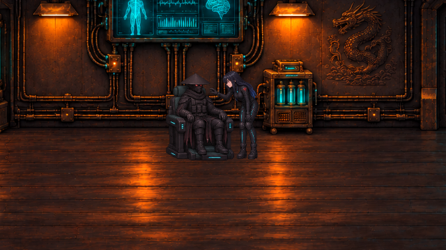
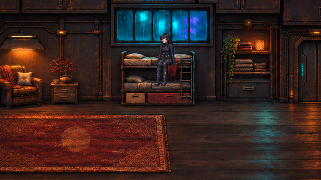

# Heiligtum-Figuren · v0.32.0 · CodexAI

Die Sitz-, Schlaf- und Handkontaktgrafiken wirkten neben den normalen Helden wie ein anderer Figurensatz: stark körnige Oberfläche, rostbraune und helle Kanten, andere Abtastung und stellenweise ein grauer Alpha-Hintergrund. Alle sechs Posen sind nun an den tatsächlichen Spiel-Sprites abgeglichen.

## Vergleich im Spiel

Beide Ansichten wurden in Godot mit derselben Kamera und denselben normalen Raven-Pixeln rechts neben dem Sessel gerendert. Nur der Posenatlas und seine Darstellung unterscheiden sich. „Vorher“ rekonstruiert die Quellgrafik und Abtastung aus v0.30/v0.31.

| Vorher | v0.32.0 · CodexAI |
| --- | --- |
|  |  |

Shadepi behält schwarzen Kasa, geschlossene segmentierte Maske mit roten Linsen, Schal, Weste und dunkle Stoffbahnen. Raven behält schwarze Haare mit blauen Spitzen, schwarze Ausrüstung mit schmalen Cyan-Linien und rote Schulterabzeichen. Die Größenabstimmung folgt den normalen Körper-Sprites; die verbindliche Figurenhöhe von Raven bleibt 160 cm.

## Alle sechs Posen

| Vorgang | Godot-Ansicht |
| --- | --- |
| Shadepi sitzt regungslos im Kompensator |  |
| Raven greift vorsichtig nach der Maske |  |
| Shadepi fängt ihr Handgelenk ab |  |
| Raven setzt sich auf die Bettkante |  |
| Raven schläft seitlich eingerollt |  |
| Raven wacht auf und stützt sich auf |  |

Die Bilder sind unveränderte Godot-Frames, keine nachträglichen Bildmontagen. Die Galerie blendet nur Benutzeroberfläche und Interaktionsmarker aus. Zusätzlich wurden der tatsächliche Ankunfts-/Schlafablauf und die Kontaktsequenz ohne Überspringen gerendert: alle drei Bettposen sichtbar, anschließend Suchkontrollpunkt; Maskengriff, Handkontakt und weißer Lichtübertritt führen weiterhin zu den Erinnerungen.

## Was technisch korrigiert wurde

- **Material und Textur:** Neuer Posenatlas mit den tatsächlichen frontalen und seitlichen Helden-Sprites als Stilreferenz. Weniger körnige Mikrodetails, dunkle matte Rüstung und zurückhaltende Lichtkanten. Das alte Blatt diente als Posen-/Layoutreferenz. Generierte PNG unverändert eingebunden.
- **Freistellung und Abtastung:** Echter transparenter Außenraum statt grauem Alpha-Matte. Der bisherige harte Freistellshader entfällt. Die Verkleinerung nutzt dieselbe lineare Abtastung wie die normalen Helden, damit nebeneinander gezeigte Figuren nicht unterschiedlich scharf wirken.
- **Größe und Verankerung:** Körperhöhe beziehungsweise liegende Körperlänge gegen die normalen Sprites geprüft. Stuhlanker über die Kontaktposen abgestimmt. Der erweiterte Schlafausschnitt erhält Ravens Haar vollständig; die benachbarte Sitzpose schneidet keine Teile der Schlafenden mit aus.
- **Standposition:** Ravens Annäherungspunkt liegt jetzt auf der Fußlinie ihrer Kontaktpose. Damit entfällt der vorherige Sprung um etwa 20 Weltpixel nach vorne beim Ausblenden des normalen Lauf-Sprites.
- **Lichtübertritt:** Das kurze Augenschimmern sitzt auf Ravens Auge der neuen Handkontaktpose. Ein Posenwechsel setzt jetzt auch die weiße Sprite-Aufhellung zurück; vorher wurden lediglich Lichtstrom und Leistungswert gelöscht.

Aktive Quelle: [Posenblatt](../assets/story/sanctuary/poses-game.png). Herkunft und historische Blätter: [Asset-Notizen](../assets/story/sanctuary/README.md). Laufzeit und Anker: [sanctuary_tableau.gd](../scripts/sanctuary_tableau.gd).

## Prüfung

**789 Prüfungen, keine Fehler**, gezielt für diese Korrektur:

| Prüfreihe | Anzahl |
| --- | ---: |
| Neue Posenprüfung: Bildinhalt, Alpha, Abtastung, vollständige Ausschnitte, Größen, Stuhlanker, Standposition und Lichtrücksetzung | 18 |
| Heiligtum-Ablauf, Controller und Speicher-/Abbruchfälle | 27 |
| Fehlerbericht 8: Schlafablauf, Räume und Hangar-Abflug | 21 |
| Ortsatmosphäre, Transformationen und Pausen | 134 |
| Storyprüfung | 206 |
| Gameplay und Speicherstände | 383 |

Die neue Prüfreihe läuft auch im GitHub-Workflow. Die Stilbewertung wurde zusätzlich anhand der gerenderten Ansichten vorgenommen; automatisierte Geometrieprüfungen allein bewerten keinen Grafikstil. Die Galeriewerkzeuge `tools/sanctuary_pose_gallery.gd`, `tools/sanctuary_gallery.gd` und `tools/report8_gallery.gd -- --sleep-only` machen die Sichtkontrolle wiederholbar.

Das exportierte Spielpaket wurde separat gestartet und enthält den aktiven neuen Atlas mit allen sechs Posen und passender Helden-Abtastung.
