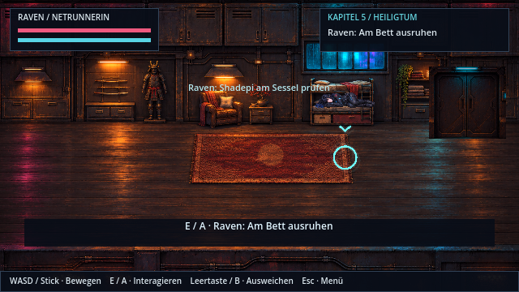
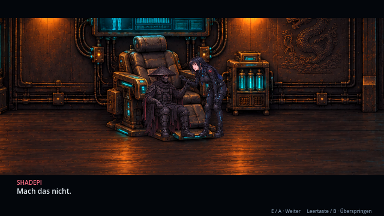
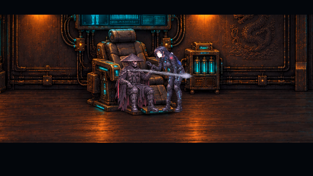

# Heiligtum: Gegenwart und Kompensator · v0.30.0 · CodexAI

Die drei Rückblenden haben jetzt den bestätigten Gegenwartsrahmen. Shadepi geht bereits im Hangar vor, weil er zur Eindämmung muss. Raven macht den Aerodyne gangbar und kommt erst danach in seine Wohnräume.

## Ablauf und Bedienung

1. Raven kommt allein an. Shadepi ruft hinter der geschlossenen Tür, sie solle sich ausruhen. Raven schaut sich die alte Rüstung an und geht zum Bett.
2. **Automatisch nach der Ankunft:** Raven steigt aufs Bett, setzt sich und legt sich sichtbar schlafen. Die Nahaufnahme bleibt länger bestehen; nach „Zwei Stunden später“ wacht sie auf. Shadepi ist immer noch nicht zurück.
3. **E / A an der beleuchteten Tür:** Raven betritt den separaten Kompensatorraum. Shadepi sitzt regungslos im Sessel; kein zweites stehendes Shadepi-Modell.
4. **E / A am Sessel:** „Schläfst du?“ – Raven greift neugierig nach seiner Maske. Er fängt ihr Handgelenk ab. Nach dem kurzen Wortwechsel geht weißes Licht auf sie über und ihre Augen schimmern.
5. In der Erinnerungswelt bleiben die drei bekannten Anker: Angriff, Lys Opfer und Vermächtnis. Die historischen Schauplätze und Kämpfe sind erhalten. Das bisher vorgeschaltete Timing-Minispiel entfällt.
6. Danach steht Raven wieder am selben Sessel und torkelt zurück. Shadepi entschuldigt sich und erklärt: Der Kompensator ist **alle sechs Tage** nötig, sonst zerstören die Naniten seinen Körper. Er bestätigt das Gesehene, wahrt aber interne Ordensgeheimnisse. Danach folgt seit v0.30.0 die sichtbare Hangar-Abflugszene vor der bisherigen Flugsteuerung.

Zwischensequenzen: **E / A** blättert weiter, **Leertaste / B** überspringt; **Esc / Start** pausiert. In den spielbaren Erinnerungskämpfen bleibt B das Ausweichen; dort erfolgt bewusstes Überspringen über das Pausenmenü.

Aktuelle Figurenkorrekturen und Bilder stehen unter [Heiligtum-Posen · v0.32.0 · CodexAI](heiligtum-figuren-v032.md). Passungs- und Szenenkorrekturen stehen unter [Fehlerbericht 8 · v0.30.0 · CodexAI](fehlerbericht-8.md). Die unten erhaltenen Bilder zeigen den früheren v0.29.0-Stand.

## Tatsächliche Godot-Vorschau v0.29.0

## Gestaltung und Quellen

Der Wohnraum mit Bett und Rüstungsständer bleibt erhalten. Dazu kommt eine eigene HQ-Pixelgrafik für den Kompensatorraum mit medizinischem Sessel, Nanitenbehältern, Diagnostik, Kabeln und separater Tür. Vier neue transparente Quellposen zeigen den sitzenden Shadepi, Ravens Griff, die abgefangene Hand und Raven schlafend. Die Maske bleibt geschlossen; Raven behält ihre Originalmerkmale und die verbindliche Größe von 160 cm. Körperposen werden als echte Quellgrafiken angezeigt, ohne stehende Figuren über Rotation auf Möbel zu legen.

**Noch fehlende Referenz:** Das im Nutzertext erwähnte neue Raumbild wurde nicht angehängt. Die Raumgestaltung wurde deshalb aus der vorhandenen HQ-Versteckgrafik und den tatsächlichen Spielfiguren abgeleitet. Sie ist kein behaupteter exakter Nachbau des fehlenden Bildes. Nach dessen Bereitstellung kann der Raum gezielt abgeglichen werden.

Die bestätigte Handlung und der Sechs-Tage-Rhythmus stehen auch im [Archiv Teil 5](universum/teil-5/README.md). Originalquellen bleiben unverändert.

## Speichern und Prüfung

Das optionale Feld `campaign/sanctuary_stage` hält Ausruhen, Suche nach dem Schlafen und den Kompensatorraum auseinander. Fehlende/ungültige Werte führen sicher zum Ankunftsablauf. Alte Erinnerungsstände verwenden weiterhin ihre vorhandenen drei Abschlussfelder. Speichern während der Rückkehr nach allen Erinnerungen führt beim Laden direkt wieder zum Rückkehrgespräch, ohne Kampf oder Ankunft zu wiederholen. Abgebrochene asynchrone Schritte prüfen ihre Szenengeneration, bevor sie Figuren oder Karten verändern.

`tests/sanctuary_story.gd` prüft den Ablauf über Controller-A-Ereignisse, die Raumkollisionen, Speicherstände zwischen den Phasen, die Rückkehr und das Abbrechen bei Kapitelwechseln. Die Kampagnen- und Storyprüfungen verwenden den neuen Einstieg; historische Erinnerungstests prüfen weiterhin ihre vorhandenen Inhalte.
