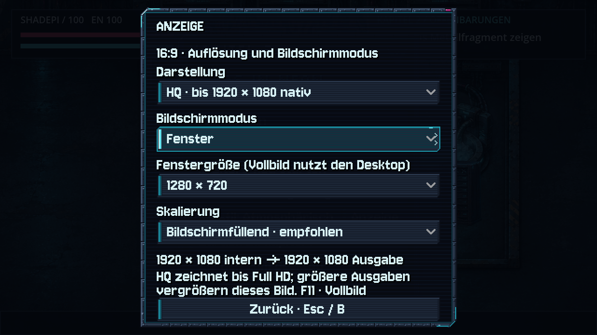
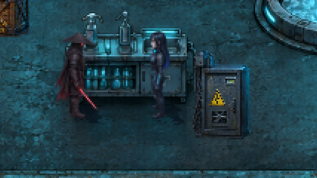
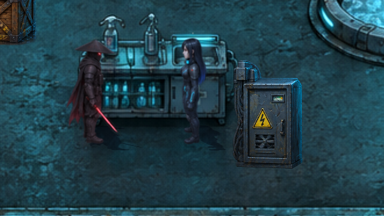
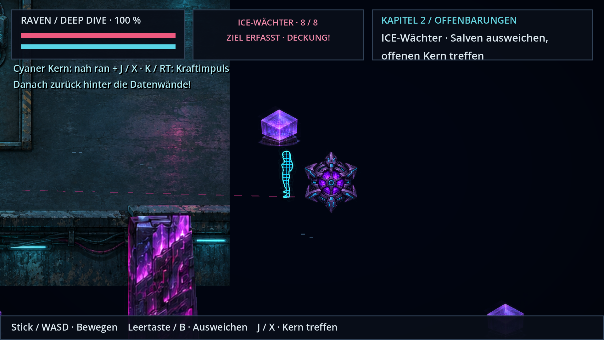

# HQ-Anzeige: nativ bis Full HD, größere Ausgabe hochskaliert

**v0.51.0 · CodexAI · 10. November 2026.** [Spieleranleitung](../Spiel-README.md) · [Anzeigeoptionen](bildschirm.md) · [Arbeitsnachweis](arbeiten/hq-anzeige-v051.md).

**Dropdown-Korrektur v0.51.1 · CodexAI:** [Listen in Anzeige, Kapitel-/Kontrollpunktauswahl und Hacks wieder sichtbar](dropdowns-v0511.md). Die Full-HD-Grenze bleibt erhalten.

**Der HQ-Modus ist eingebaut und standardmäßig aktiv.** Das Spielbild wird bis zu **1920×1080** direkt mit den vorhandenen Originaltexturen gezeichnet. Bei größeren Ausgaben bleibt das interne Spielbild auf Full HD begrenzt und wird nur vergrößert. Der bisherige klassische Modus bleibt auswählbar.

## Einschalten und wechseln

**Haupt- oder Pausenmenü → Anzeige → Darstellung**:

- **HQ · bis 1920 × 1080 nativ**: mehr vorhandene Texturdetails, begrenztes Full-HD-Spielbild.
- **Klassisch · 640 × 360**: bisheriger sparsamer Pixelmodus.

Die Auswahl wirkt sofort und bleibt getrennt von Spielständen gespeichert. Im Anzeige-Menü stehen interne Auflösung und physische Ausgabe getrennt. Auf dem Controller erreicht man „Darstellung“ vom anfänglichen Fokus „Bildschirmmodus“ mit einmal Steuerkreuz/Stick nach oben; A öffnet und bestätigt, B schließt zuerst die Liste und danach das Optionenfenster.

## Tatsächlicher Detailgewinn

Unveränderte Ausschnitte der echten Full-HD-Fensteraufnahmen, ohne nachträgliches Vergrößern oder Schärfen:

| Klassisch: intern 640×360 | HQ: intern 1920×1080 |
| --- | --- |
|  |  |

Die vorhandenen Originalhelden, Weltbilder und Requisiten liefern mehr Details, sobald die frühe Reduzierung auf 640×360 entfällt. Eine künstliche Vergrößerung oder neue Generierung der PNG-Dateien war dafür nicht nötig. Kamerabereich, Körpergrößen, Fuß-/Handanker und Kollisionen behalten ihre bisherigen Weltwerte.

[**HQ-Animationsfilm öffnen**](previews/hq-netz-v051.webp) · 48 native Aufnahmen der Gehphasen in der ICE-Szene, unter 5 MB. Das Netzgitter bleibt an Ravens Originalkontur und Fußposition gebunden.

## Full-HD-Grenze auf größeren Bildschirmen

| Ausgabe | Internes HQ-Spielbild | Darstellung |
| --- | --- | --- |
| 1280×720 | 1280×720 | direkt |
| 1600×900 | 1600×900 | direkt |
| 1920×1080 | 1920×1080 | nativ Full HD |
| 2560×1440 | 1920×1080 | Full-HD-Bild vergrößert |
| 3840×2160 | 1920×1080 | dasselbe Full-HD-Bild zweifach vergrößert |

Andere Seitenverhältnisse behalten die 16:9-Komposition mit passenden Rändern. Bei ungeraden Fenstermaßen wird das interne Bild auf eine passende ganzzahlige 16:9-Größe begrenzt; die bestehende Wahl „Bildschirmfüllend / Pixelgenau“ bleibt wirksam.

Der 4K-Nachweis stammt von einem tatsächlich auf **3840×2160** eingestellten X11-Testdesktop. Die physische Aufnahme ist 3840×2160, das gleichzeitig ausgelesene Spielbild 1920×1080. Die Prüfung der 4K-Ausgabe gegen jeden zweiten Ausgabepixel ergab vollständige Übereinstimmung mit dem Full-HD-Spielbild: reine zweifache Vergrößerung, keine zusätzliche 4K-Rasterung der Szene.

[**Echte 4K-Fensteraufnahme**](previews/hq-4k-ausgabe-v051.png) · [**zugehöriges internes Full-HD-Spielbild**](previews/hq-4k-spielbild-v051.png) · [Messdaten](analysen/hq-v051.json).

## Effekte, Schatten und Bedienung

- **Bloom** behält seinen Radius in Weltkoordinaten. Die höhere Renderauflösung verkleinert den Lichtschein nicht ungewollt.
- **Fußkontakt** nutzt die bereits vorhandene weiche Lichttextur dunkel eingefärbt, statt eines harten Rechteckanteils. Projizierte Figurenschatten und bestehende Posen bleiben erhalten.
- **Maus, Controller und GUI-Fokus** bleiben im ursprünglichen logischen 640×360-System. Es wird weder ein zweiter Spielablauf gestartet noch die Szene in einen anderen Eingabe-Viewport verschoben.
- **Menüs, Terminals, Kino und Kapitelwechsel** behalten ihre jeweiligen Ebenen. Neue oder entfernte UI-Canvases werden beim Rendern berücksichtigt; ausgeblendete Filme erzeugen keine stehen gebliebenen Balken.
- **Leistung:** Die Full-HD-Grenze verhindert zusätzliche 4K-Rasterung der eigentlichen Welt-/Effekt-/HUD-Szene. Die Ausgabe muss weiterhin ein passendes Präsentationsbild zeichnen; der HQ-Modus benötigt mehr Grafikleistung als 640×360. Bei Bedarf „Klassisch“ wählen. Die native Sichtprüfung auf Mesa llvmpipe ist keine FPS-Zusage für Spielerhardware.

## Technischer und grafischer Umfang

[Anzeigeverwaltung](../scripts/display_settings.gd), [HQ-Renderer](../scripts/hq_renderer.gd), [Optionenfenster](../scripts/display_panel.gd). Derselbe Weltcanvas und die sichtbaren UI-Canvases werden in ein in der Größe begrenztes Spielbild gezeichnet. Ein unbeleuchteter Präsentationspass zeigt dieses Bild auf der Ausgabe; er wird niemals in sein eigenes Quellbild aufgenommen. Die Gameplay-Nodes behalten ihren ursprünglichen Viewport für Kameras, Physik und GUI.

2.255 Headless-Prüfungen, 73 native HQ-Prüfungen und 23 zusätzliche Exportprüfungen bestanden.

Die Original-PNGs, ihre Atlasmaße und individuellen Filter bleiben erhalten. Die weicheren Stellen innerhalb einer Quelldatei werden dadurch nicht neu gezeichnet. [Ursprüngliche Analyse](anzeigequalitaet-v0502.md) und [aktueller Arbeits-/Prüfnachweis](arbeiten/hq-anzeige-v051.md).
