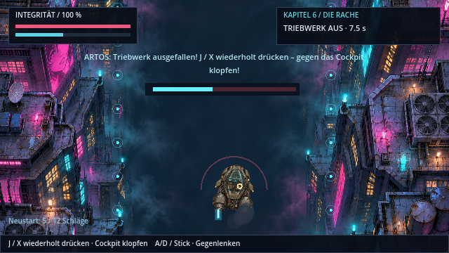
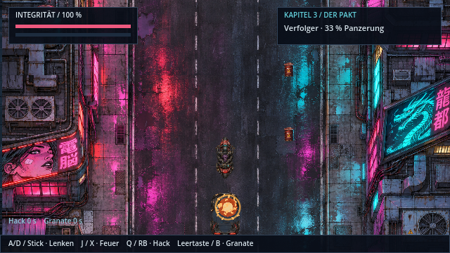
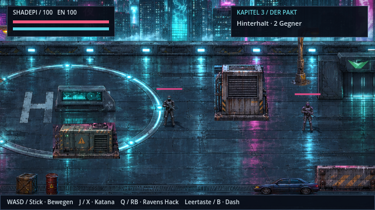

# HQ-Welt und Fahrzeug-Action · v0.15.0

**Statushinweis v0.46.2 · CodexAI:** Historischer Grafikbericht. Einzelne Quellen bleiben aktiv, Fahrzeugdarstellung und neue Bewegungsatlanten wurden später ergänzt; keine allgemeine aktuelle Ausbauanleitung. [Aktuelle Einordnung](repository-status.md).

## Grafiken

Die integrierten Atlanten wurden mit dem Bildgenerator erstellt. Sie sind lokal im Projekt enthalten; das Spiel benötigt keinen Onlinezugang. Die bereits gemalten Levelkulissen bleiben die Grundlage der Welt.

| Datei | Inhalt | Integration |
| --- | --- | --- |
| `assets/world/hq/props.png` | Kiste, Fass, Laterne, Wagen, Container, Schaltkasten, Automat, Server, Datenkristall; je drei Schadenszustände | `scripts/prop_art.gd`, `world_prop.gd`, `main.gd` |
| `assets/world/hq/vehicles.png` | Aerodyne, Verfolger, Motorrad mit Shadepi/Raven, Frachtdrohne | `scripts/campaign_drive.gd` |

Grafikauftrag Requisiten: vorhandenen 9×3-Pixelatlas durch detaillierte gemalte Cyberpunk-Requisiten ersetzen; rostiges Metall, Glasreflexe, Cyan-/Amberlicht, drei Schadenszustände, transparente Hintergründe; Reihenfolge und relative Größen erhalten. Der Generator liefert ungleich breite Spalten; `PropArt.EDGES` und `ROWS` bilden die tatsächlichen Regionen ab. Die Spiel-Kollisionsflächen und Objekt-IDs bleiben in `WorldProp.TYPES`, damit alte Spielstände funktionieren.

Grafikauftrag Fahrzeuge: transparenter 2×2-Atlas, orthografische Draufsicht mit Nase nach oben, verwitterter olivgrauer Aerodyne mit zwei Hecktriebwerken, gepanzerter schwarzer Verfolger, rotes Motorrad mit zwei Figuren, rostige orange Frachtdrohne; detaillierter gemalter Stil mit Cyan-/Amberreflexen. Flammen, Rauch und Treffereffekte werden zur Laufzeit animiert.

Die kleinen alten Pixelatlanten wurden entfernt. `npm run assets` überschreibt die neuen Grafiken nicht. Die HQ-Dateien lassen sich direkt ersetzen; bei geänderter Atlasaufteilung auch die Regionen anpassen.

## Verhalten

Der Flugnotfall startet einmal pro Anflug ab 3,2 Sekunden. Die Anflugzeit pausiert dabei. Die ursprüngliche Klopf-Reparatur wurde durch [Ravens Jumper-Wartungsdeck](ravens-terminals.md) ersetzt: Pins und Widerstände korrekt verbinden, prüfen und übernehmen. Nach Abbruch bleiben separat 45 Sekunden zum erneuten Öffnen mit J/X. Das offene Deck und die Pause halten die Reparaturfrist an. Nach der Wiederzündung läuft das Scannerfenster von Sekunde 9 bis 15 weiter. Ohne Reparatur oder ohne Kennung ist die Landung nicht erfolgreich.

Die Verfolgung verwendet federnde Spurwechsel mit kleinen Integrationsschritten, seitlichen Trefferimpulsen, angekündigten Rammangriffen und zunehmend kürzeren Hindernisintervallen. Geschosse und Hindernisse prüfen das Überqueren der Trefferlinie. Granaten erzeugen Explosionen auch dann, wenn sie den Wagen verfehlen. Die finale Explosion verzögert den Szenenwechsel um 1,1 Sekunden. Trümmer erhalten Geschwindigkeit, Schwerkraft, Dämpfung und Rotation; maximal 150 Trümmer, 45 Rauchwolken und acht Explosionen, bei reduzierter Qualität maximal 50 Trümmer und 14 Rauchwolken. Das ist eine Arcade-Fahrzeugphysik, keine starre 3D-Fahrzeugsimulation.

`tools/generate_drive_audio.py` erzeugt fünf originale Sounds: Klopfen, Ausfall, Wiederzündung, Schuss und Explosion. Alle laufen über den vorhandenen begrenzten Mixer und respektieren den Ton-Schalter.

## Prüfen

```sh
godot --headless --editor --import --quit
godot --headless --script res://tests/drive_action.gd
godot --headless --script res://tests/run.gd
godot --headless --script res://tests/story_audit.gd
godot --headless --script res://tests/npc_dive_visuals.gd
```

Manuell: Kapitel 6 im versteckten Testmenü öffnen, Dialog beenden, Jumper-Rätsel lösen und übernehmen, anschließend durch Schluchten und Turmabwehr fliegen, am Scanner die Sequenzkalibrierung lösen und landen (seit v0.21.3, siehe [Aerodyne-Flug](aerodyne-flug.md)). Zweiter Durchlauf mit abgebrochenem Deck und abgelaufener Frist prüft den Kontrollpunkt. In Kapitel 3 über den Hinterhalt zur Verfolgung gehen; Spurwechsel, Schüsse, Hack, Granate, Rammwarnung und Abschluss prüfen. Bei beiden Sequenzen Pause und Ton-Schalter testen.

## Spielaufnahmen






