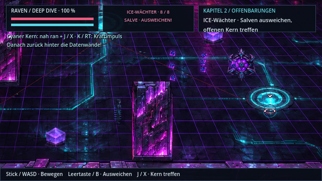
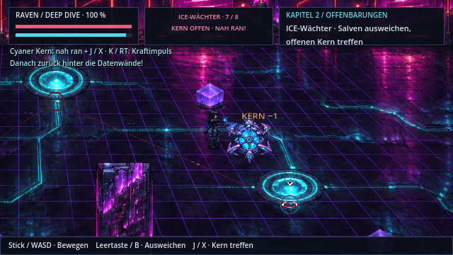
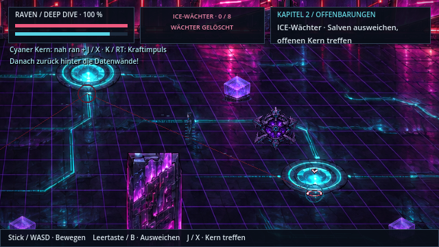

# ICE-Wächter: Deckung, Salven und Vorstoß

**v0.50.0 · CodexAI · 10. November 2026.** [Spieleranleitung](../Spiel-README.md) · [Galerie](README.md) · [Arbeitsnachweis](arbeiten/ice-v050.md).

Der dritte Datenknoten in Kapitel 2 hat einen eigenen Bosskampf. Der bisherige sofort berechnete Querstrahl und die schnelle Zwei-Schuss-Löschung sind ersetzt durch einen wiederholbaren Kampf mit bewegten Energiekugeln, lesbaren Angriffen und einem Kern, den Raven aus kurzer Distanz treffen muss.

| Salve abwarten oder seitlich ausweichen | Beim offenen Kern vorstoßen |
| --- | --- |
|  |  |

[**Kampffilm öffnen**](previews/ice-kampf-v050.webp) · native Godot-Aufnahme mit automatisch gesteuerten Spielaktionen, im Film zeitlich verdichtet. Die Aufnahme zeigt einen vollständigen Sieg ohne Schaden; sie ist keine vollständige manuelle Abnahme des Spiels. Datei unter 5 MB.

## So funktioniert der Kampf

1. **Zielwarnung:** Der Wächter lädt seinen violetten Kern 1,35 Sekunden lang auf. Die markierte Schussrichtung steht fest; er verfolgt Raven während der folgenden Salve nicht unsichtbar weiter.
2. **Salve:** Fünf Dreierfächer aus sichtbaren Kugeln. Bleibe hinter den festen Datenwänden oder weiche seitlich aus. Die Kugeln werden durch echte Kollisionen gestoppt, auch bei größeren Frameabständen. Sie treffen Raven höchstens einmal pro Kugel; Ausweichen nutzt ihre vorhandene Unverwundbarkeit.
3. **Kühlen:** Der Kern leuchtet cyan und bleibt bis zu 6,2 Sekunden offen. Laufe um die Deckung herum zu ihm. **J / X** trifft mit Ravens Handimpuls innerhalb von 66 Weltpixeln. Ein Treffer zieht einen Integritätspunkt ab; ein aufgeladener Treffer zwei. Fernangriffe aus sicherer Deckung zählen nicht.
4. **Rückzug:** Nach zwei Punkten schließt der Kern sichtbar. Es bleiben zwei Sekunden Rückzug, dann folgt die nächste Zielwarnung. Nach vier erfolgreichen Öffnungen ist die Integrität von acht auf null gesunken. Ab halber Integrität fliegen die Kugeln etwas schneller; die Warnzeiten bleiben erhalten.
5. **Daten sichern:** Nach der Zerstörungsanimation wird das letzte Relais freigegeben. Mit **E / A** zugreifen und die Verbindung kurz halten. Danach folgt die bestehende Rückkehr aus dem Eisbad.

Der optionale Hack **Q / RB** verlängert nur eine bereits offene Kühlphase, höchstens einmal je Runde und innerhalb von 180 Weltpixeln mit freier Sicht. Er schaltet die Schussphase nicht aus.

| Aktion | Tastatur / Maus | Controller |
| --- | --- | --- |
| Bewegen | WASD / Pfeile | linker Stick / Steuerkreuz |
| Ausweichen | Leertaste / Umschalt | B |
| Naher Handimpuls | J / linke Maustaste, zum Kern ausrichten | X, mit Bewegung oder rechtem Stick ausrichten |
| Kraftimpuls | K halten, nach Bereitschaft loslassen | RT halten und loslassen |
| Kühlphase verlängern | Q | RB |
| Zugriff nach dem Sieg | E | A |

Zum Testen: Cheat-/Kontrollpunktmenü → **Kapitel 2 → Deep Dive · ICE-Bossarena**. Bestehende Spielstände mit Relaisindex 2 funktionieren weiter. Eine Niederlage startet den Bosskampf mit vollen Lebenswerten und freier Startposition neu.

## Raum, Figuren und Quellen

Die bestehende HQ-Netzkulisse wird für diesen Kampf gemeinsam mit ihren Masken, festen Hindernissen, Requisiten und Relais auf **1536×960** erweitert. Der begehbare Boden erhält damit die **2,25-fache Fläche**. Die Kamera zeigt mehr Kampfraum und hält den Wächter beim Vorstoß im Blick. Beim Verlassen gelten wieder die ursprünglichen Raum-/Kameramaße. Die ersten beiden Datenknoten behalten ihren bisherigen Maßstab und ihre Virenwellen.

- **Neue Bossgrafik:** [ice-guardian-combat.png](../assets/sprites/npcs/ice-guardian-combat.png), unveränderte ImageGen-Ausgabe, 1774×887, vier Spalten und zwei Reihen. Geschlossene Panzerung, Aufbau, aufgeladener Kern, Schuss, Rückstoß, offener Kühlkern, Treffer und Zerstörung. Zellenhöhe im Spiel etwa 88 Weltpixel, sichtbarer Körper etwa 75–79. Atlasränder enthalten transparente Freiräume; keine opaken Körperteile liegen auf den Zellkanten.
- **Identität:** [ursprünglicher Wächter](../assets/sprites/npcs/ice-guardian.png): schwere segmentierte Kugel, sechs Spitzen, violetter Kristall, Cyan-Schaltlinien. Diese Quelle wurde zusammen mit [dive.png](../assets/world/painted/dive.png) tatsächlich als Bildreferenz verwendet. Der cyanfarbene Iris-Ausschnitt wird für die Kugelgrafik mit vorhandenem Lichtschein wiederverwendet.
- **Raven:** unveränderte Originalquelle und bestehende Handzauberposen. Der Netzavatar ist weniger durchsichtig, damit Haltung und Laufwege auf dem dunklen Boden lesbar bleiben. Keine neue Standard-Heldenvariante.
- **Ton:** `Boss.mp3` für den Wächter, `Fight.mp3` für die bisherigen Viren. Vorhandene Energie-/Trefferklänge begleiten Warnwechsel, Schüsse und Kernkontakt.
- **Code:** [Bossphasen](../scripts/ice_guardian.gd), [bewegte Kugeln](../scripts/ice_orb.gd), [Arena und Kapitelablauf](../scripts/chapter_two.gd). Der alte ungenutzte Querstrahl wurde aus dem Virenskript entfernt.

## Prüfung

Gezielte Regressionen und Exportnachweis stehen im [Arbeitsnachweis](arbeiten/ice-v050.md). Geprüft werden unter anderem Deckung bis an die Rückkante, Ausweichschutz, reale B-/X-Controllerereignisse, geschlossene Panzerung, Nahdistanz, Trefferbegrenzung, vier Runden, Pause, Neustart/Laden, Geschossbereinigung und die Rückkehr zur ursprünglichen Raumgeometrie.
