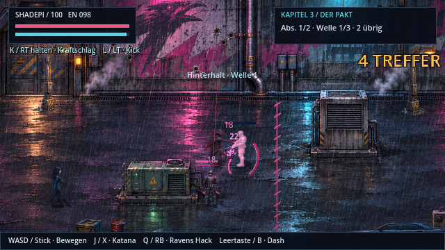

# Kampfgefühl und Trefferrückmeldung (v0.19.0)

| Element | Wirkung |
| --- | --- |
| Trefferstopp | Jeder Treffer friert das Bild kurz ein (45 ms, schwere Treffer 75 ms, K.O. 110 ms). |
| Rückstoß und Zucken | Normale Gegner werden zurückgestoßen und zucken kurz (Angriff verzögert sich). Bosse geben bei leichten Treffern nur etwas nach und zucken nur bei schweren Treffern (≥ 30). |
| Kamera | Schütteln je nach Trefferstärke plus ein kurzer Kamerastoß in Schlagrichtung. |
| Funken und Schnitt | Gerichteter Schnittbogen, farbige Funken; bei K.O. ein zusätzlicher Ausbruch. |
| Schadenszahlen | Springen auf, weichen leicht zur Seite aus; schwere Treffer gold und größer. |
| Kombozähler | „x TREFFER“ rechts oben, Farbe steigert sich ab 6 und 10 Treffern; erlischt nach 1,4 s ohne Treffer. |
| K.O.-Animation | Gegner werden zurückgeworfen und kippen mit kleinem Aufprall um. |
| Shadepis Schläge | Kleiner Ausfallschritt pro Hieb (stärker beim dritten Schlag) und Zielhilfe zum nächsten Gegner im Sichtbereich. |
| Ravens Pistole | Zielhilfe: ein sich mit der Entfernung öffnender Kegel statt einer 8-Pixel-Linie. |
| Eigener Treffer | Roter Bildschirmblitz, stärkeres Schütteln, kurzer Trefferstopp. |
| Töne | Leichte Tonhöhenvariation, damit Serien nicht monoton klingen. |

## Deep Dive

- ICE-Viren gleiten an den Datenwänden entlang, statt hindurchzufliegen; ein Sturmangriff endet an der Wand.
- Ravens Schüsse rasten auf das nächste ICE in einem großzügigen Kegel ein.
- **Schale knacken:** Ein Schuss auf geschütztes ICE bricht die Schale („RISS“), stößt es zurück und macht es 1,6 s verwundbar; der nächste Treffer löscht es. Das Warten auf das Angriffsfenster ist damit keine Pflicht mehr.

## Technik

`main.gd`: `register_hit`, `hitstop` (in Headless-Läufen deaktiviert, beim Szenenwechsel zurückgesetzt), `melee_assist`, `damage_number(text, big)`, `sound(kind, pitch_variance)`. `enemy.gd`: `take_damage(base, source)`, `knock_velocity`, `_fall`. `hud.gd`: Kombozähler und Treffer-Overlay. `dive_threat.gd`: `_move`, `crack`. Vorschau: `xvfb-run godot --rendering-driver opengl3 --script res://tools/feedback_gallery.gd`.
