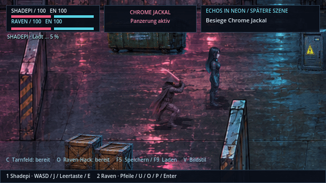

# Aufgeladene Angriffe und Kick

Die Vorschau zeigt die tatsächlichen Spielposen und Effekte in einer kontrollierten Testszene. Die normale Spielkamera bleibt unverändert.

| Aktion | Tastatur | Controller | Verhalten |
| --- | --- | --- | --- |
| Shadepis Kraftschlag | K halten, loslassen | RT halten, loslassen | Katana aufladen und rote Energiewelle aussenden |
| Shadepis Kick | L | LT | Ausholen, treten und zurück in die Grundhaltung |
| Ravens Kraftschuss als Hauptfigur | K halten, loslassen | RT halten, loslassen | Pistole aufladen und cyanfarbenen Impuls abfeuern |
| Ravens Kraftschuss im Koop | I halten, loslassen | RT am Raven-Controller | Gleicher Angriff mit unabhängiger Steuerung |

Nach **1,1 Sekunden** zeigt ein einmaliger kurzer Wellenring die volle Ladung an. Die Anzeige wechselt auf „BEREIT – loslassen!“. Weiteres Halten bewahrt die Ladung; erst Loslassen sendet den Angriff aus. Ein früheres Loslassen löst den normalen Angriff aus. J/X und die bisherigen Maustasten bleiben die normalen Angriffe.

Treffer, Ausweichen, Pausen, Dialoge, Controllerwechsel und Kontrollpunkt-Neustarts brechen das Aufladen ab. Beim Fortsetzen wird keine aufbewahrte Ladung unbeabsichtigt abgefeuert. Während des Ladens bewegt sich die Figur langsamer und kann keine zweite Attacke oder Tarnung starten.

| Angriff | Energie | Basisschaden | Reichweite |
| --- | --- | --- | --- |
| Katana-Welle | 30 | 76 | 240 Spielpixel, mehrere Gegner jeweils einmal |
| Kraftschuss | 25 | 62 | 300 Spielpixel, erster getroffener Gegner |
| Kick | 12 | 28 | 46 Spielpixel, nach vorne |

Die vorhandene Schadensberechnung für Panzerung und Hackfenster gilt weiter. Der Kick unterbricht einen erfolgreich getroffenen, überlebenden Gegner für 0,5 Sekunden und stößt ihn mit Kollisionsprüfung zurück. Er umgeht keine Panzerung oder Schilde. Wellen und Schüsse stoppen an Wänden, Requisiten und Abschnittssperren. Ravens Kraftschuss respektiert im Deep Dive die Verwundbarkeitsfenster und die vorhandene ICE-Wellenfolge.

## Grafik und Technik

`assets/sprites/heroes/combat-poses.png` ergänzt die vorhandenen HQ-Atlanten. Die einzige neue Bildtafel wurde anhand von `tools/hero_sources/shadepi-keyframes.png` und `raven-keyframes.png` sowie den archivierten Figurenmerkmalen erzeugt. Die vorhandenen Originale wurden nicht verändert. Raven bleibt in ihrer Rolle und ihren bestätigten Größenproportionen erhalten.

Die transparente Tafel misst 1536 × 1024 Pixel, mit acht Spalten und vier Zeilen. Die Richtungsfolge entspricht den bestehenden Figuren: unten, links, rechts, oben, oben-links, oben-rechts, unten-links, unten-rechts. Die Zeilen enthalten Shadepis Ladehaltung, angehobenes Knie, ausgestrecktes Trittbein und Ravens Ladehaltung. Das Spiel schaltet zwischen diesen Schlüsselposen, zeigt bei Freigabe sofort die bestehende Schnitt-/Schusspose und kehrt zur Grundhaltung zurück. Die neuen Zellen werden mit Faktor 0,25 und gemeinsamem Fußpunkt gerendert; Schatten verwenden dieselbe Pose. Eigene Figuren aus `assets/custom/` behalten ihre Grafiken und erhalten die Fähigkeiten samt Effekten ohne Austausch durch die Standardfiguren.

`scripts/player.gd` verwaltet Eingaben, Aufladen und Posen. `scripts/power_projectile.gd` berechnet Treffer entlang der gesamten Flugstrecke eines Frames und verhindert Mehrfachtreffer. Ein Kontrollpunktwechsel macht alte Projektile ungültig. Die Kapitel liefern ihre aktiven Ziele über `special_targets()`; der Deep Dive behandelt seine ICE-Ziele gesondert.

`tests/combat_moves.gd` prüft Ladezeit, Bereitschaftssignal, Loslassen, Abbruch, Energie, Trefferreihenfolge, Sperren, Kick-Timing, acht Blickrichtungen, Koop-Eingaben und ICE-Regeln. `tools/combat_gallery.gd` erzeugt Renderer-Aufnahmen unter `/tmp/shadepi-move-*.png`; mit `-- --record` schreibt es zusätzlich die Einzelbilder der Vorschau nach `/tmp/shadepi-move-frames/`.

Geprüft mit Godot 4.7.2: 68 Kampfbewegungs-, 303 Gameplay-, 237 Wellen-, 240 Story-, 46 Fahrzeug- und 20 NPC-Prüfungen, insgesamt 914 ohne Fehler. Die Pose- und Effektvorschau wurde mit OpenGL Compatibility unter Xvfb/Mesa aufgezeichnet. Ein vollständiger manueller Spieldurchlauf zur Balancebewertung steht noch aus.
