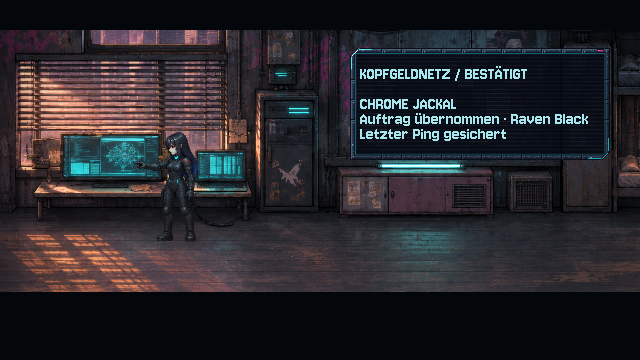
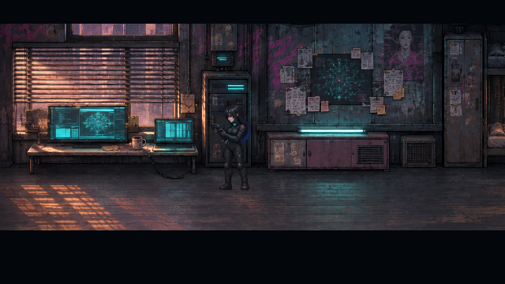
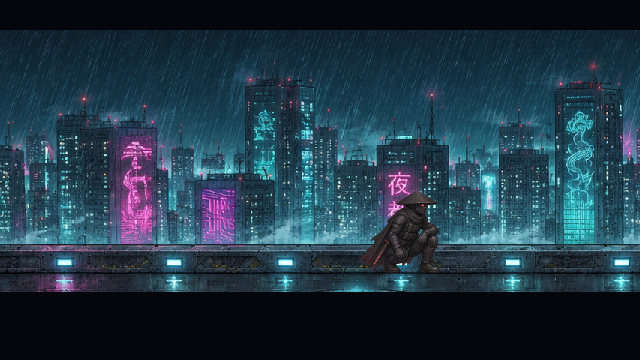
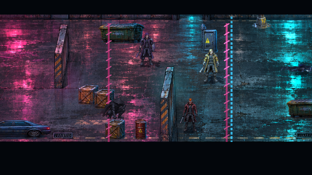
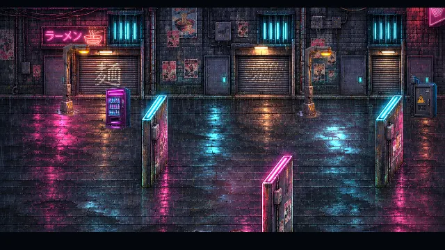

# Kapitel 1: Auftrag, Ausrüstung und Dachauftritt

**v0.43.0 · CodexAI · 9. November 2026.** [Bildgalerie](README.md) · [Cinema-Roadmap](cinema-roadmap.md) · [Spieleranleitung](../Spiel-README.md).

Raven geht jetzt zum Monitor und bestätigt Chrome Jackals Auftrag sichtbar. Danach prüft sie ihre Pistole, führt sie zurück zum Holster und geht zur Tür. Shadepi wird währenddessen auf einem regennassen Sims über der Stadt gezeigt. Später erkennt er Ravens Notlage von dort aus; seine Landung in der Wartungsgasse besitzt eine eigene Kniebeuge, Wasserspritzer und ein Aufrichten, bevor der Rettungskampf beginnt.

## Auftragsannahme und Vorbereitung

| Bestätigter Auftrag am Monitor | Pistolenprüfung vor dem Aufbruch |
| --- | --- |
|  |  |

[Film: vollständiger Auftakt, ohne Überspringen](previews/kapitel1-auftrag-v043.webp)

Die Monitoransicht zeigt Ziel, letzten Ping und Bestätigung. Die erhöhten Prämien bleiben ohne neu erfundenen Geldbetrag. Es gibt keine zusätzliche Rätselsperre. Die kurzen Dialoge greifen den vorhandenen Kameraloop und die Route durch die Gassen auf; Motiv und Hintermänner werden dadurch nicht vorweggenommen.

## Beobachtung und Eingreifen

| Shadepi beobachtet die Stadt | Tiefe Landepose im Wartungsweg |
| --- | --- |
|  |  |

[Film: Jackals Bedrohung, Gegenschnitt und Landung](previews/kapitel1-rettung-v043.webp)

Die Dachansicht verwendet die vorhandene linke Skyline mit einem eigenen Bildausschnitt. Sie ist ein Zwischenschnitt über der Stadt; der Tower-Landeplatz in Kapitel 6 bleibt ein anderer Schauplatz. Die beiden Dachposen zeigen Blickwechsel und Stofflage. Es sind gezielte Schlüsselbilder, keine neue vollständige Wind- oder Sprung-Spritebank.

## Bedienung und Speicherstand

- **E / Enter / A** blättert Dialoge weiter; **Leertaste / B** überspringt die laufende Szene; **Esc / Start** pausiert wie bisher.
- Nach dem Auftakt übernimmt Raven die erste unveränderte Arcade-Welle. Nach der Landung übernimmt Shadepi den bestehenden Rettungsweg.
- Laden während der Wohnungsszene beginnt deren Kontrollpunkt erneut. Bestehende Jagd-/Rettungsstände bleiben kompatibel; kein neues Pflichtfeld im Speicherformat.
- Ersatzposen verstecken auch die normalen Schatten und Lichtblocker. Abbruch und Laden räumen Figurenersatz, Monitor und Dachansicht auf. Generationstickets verhindern späte Aktionen; der Regisseur weckt abgebrochene wartende Schritte auch ohne nachfolgenden Film.

## Quellen und Prüfung

Acht neue Kontakt-/Bewegungsbilder aus [diesem Atlas mit Maßstab und Ankern](../assets/story/chapter-one/README.md). Charakterkarten, aktives Apartment und Dachbild dienten als tatsächliche Referenzen. Raven bleibt 160 cm; Shadepis geschlossene Maske und Kleidung bleiben erhalten. Keine neue Gesichtsenthüllung.

Aufnahmen stammen aus Godot 4.7.2 mit dem nativen OpenGL-Renderer, Spielbasis 640 × 360 und regulärem Szenentakt. WebP-Clips verwenden die tatsächlichen Zeitabstände der aufgenommenen Bilder. Die Galerie führt den Auftakt vollständig aus; für den zweiten Film setzt sie den vorherigen Jackal-Kampf per QA auf die Bedrohung. Der Kampf selbst wird in diesem Film nicht erspielt. Dummy-Audio: keine neue akustische Abnahme behauptet.

[Automatisierte Prüfungen, Sichtabnahme und Exportnachweis](arbeiten/kapitel1-v043.md) · Aufnahmeprogramm: `tools/chapter_one_gallery.gd` · Regression: `tests/chapter_one_intro.gd` und GitHub-CI.
