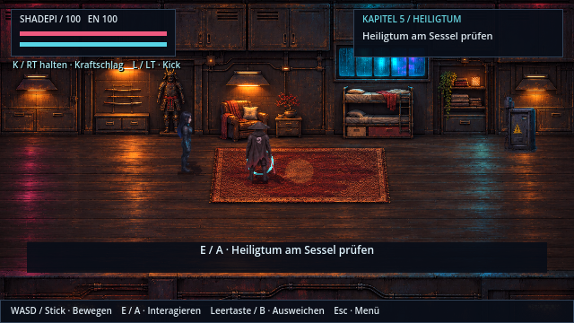
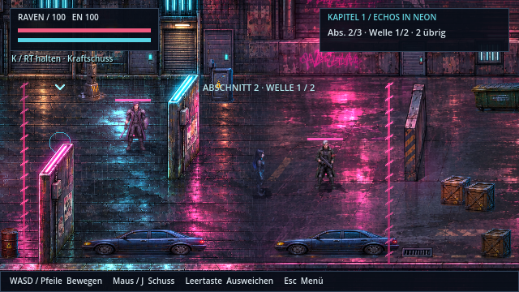

# Versteck und Straßenübergang

Das Versteck in Kapitel 5 verwendet einen kompakteren Raummaßstab. Der Sessel, das Bett und die vollständige Samurai-Rüstung orientieren sich an der Höhe der vorhandenen HQ-Figuren. Die überarbeitete Raumgrafik behält Materialstil, Beleuchtung und Ausstattung des bisherigen Verstecks bei. Shadepi und Raven behalten ihre normalen Spritegrößen.

`Painted.CHAMBER_RECT` und `CHAMBER_SCALE` legen den Raummaßstab fest. Bodenbegrenzungen, Möbelkollisionen, Einstiegspunkt, Beleuchtung, Wandkasten und Interaktionspunkt wurden gemeinsam angepasst. Die Raumkamera zeigt den Innenraum ohne freie Außenflächen; beim Übergang in die Erinnerungssequenz wird die normale Kameraskalierung wiederhergestellt. Alte Kapitel-Kontrollpunkte laden weiterhin am passenden Einstieg.

In Kapitel 1 lagen die Boden- und Vorderkanten der beiden Hintergrundbilder ungefähr zwölf Spielpixel auseinander. Bingo Street wird nun um diesen Betrag versetzt abgetastet. Die Hinderniskollisionen und die Masken, die vorbeilaufende Figuren verdecken, folgen demselben Versatz. `shaders/street_join.gdshader` verbindet beide vorhandenen HQ-Bilder über einen schmalen Überlappungsbereich; die Gassengrafik bleibt unverändert. Das beseitigt den harten Bildschnitt, ohne den Levelverlauf zu verkürzen.

`tools/map_gallery.gd` erzeugt mit einem echten Display drei Aufnahmen entlang des Übergangs sowie einen Größenvergleich im Versteck unter `/tmp/shadepi-map-*.png`. Gameplay-, Story- und Wellentests prüfen zusätzlich den Kapitelablauf, die tatsächlichen Laufwege und alle Gegnerpositionen. Die Storyprüfung kontrolliert die kleineren Möbelkollisionen, freie ehemalige Möbelflächen und den Wechsel zur Erinnerungskamera.

Geprüft mit Godot 4.7.2: 303 Gameplay-, 247 Story- und 237 Wellenprüfungen, insgesamt 787 ohne Fehler. Die Raumansicht und drei Positionen am Straßenübergang wurden mit OpenGL Compatibility unter Xvfb/Mesa gerendert und visuell geprüft.
