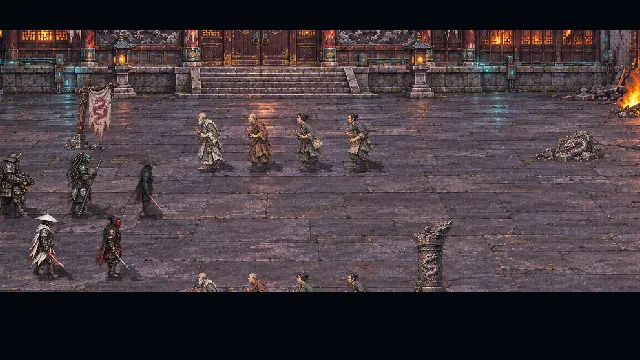
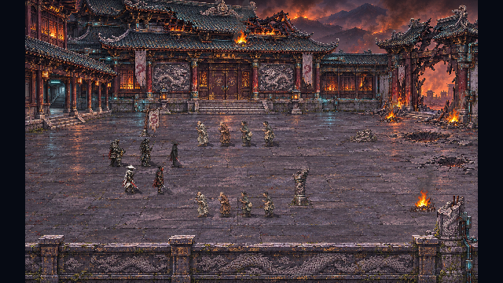
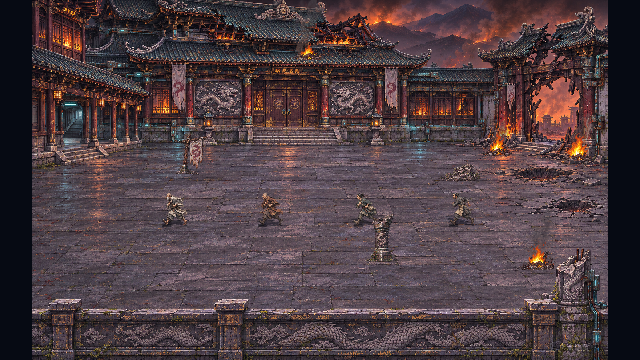
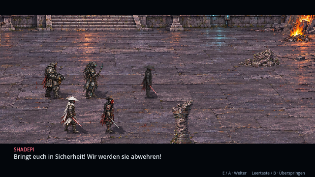
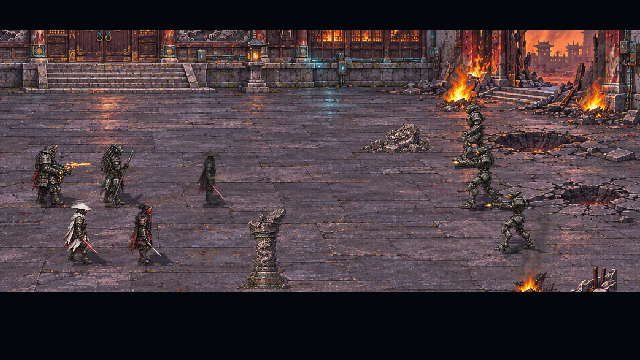

# Erinnerung I: Der Angriff · v0.22.0 · CodexAI

Die ersten fünf Produktionspakete sind umgesetzt: Klosterkulissen, die vier Ordenskrieger, Mönche und Bewohner, eine begehbare Map und der inszenierte Auftakt. Am **ersten Erinnerungsknoten in Kapitel 5** sieht Raven nun Shadepis Vergangenheit als eigene Spielszenenfolge. Sie bleibt Empfängerin der Erinnerung und erscheint nicht im historischen Hof.

Die Vorschau stammt aus dem tatsächlichen Godot-Spielablauf mit automatisch weitergeschalteten Dialogen. Sie zeigt keinen spielbaren Bot-Kampf.

## Ablauf und Bedienung

Die Kamera zeigt das beschädigte Kloster. Ein Einschlag trifft die Torseite, acht unbewaffnete Bewohner fliehen zum geschützten Seitengang. Shadepi zieht mit Oni, dem Roboterkopf-Krieger, Ly und dem MG-Krieger vor und ruft: **„Bringt euch in Sicherheit! Wir werden sie abwehren!“** Drei Bots dringen durch die Bresche ein. Ein erster kurzer Schusswechsel leitet die Auseinandersetzung ein; danach kehrt die Ansicht zu Raven zurück.

| Eingabe | Wirkung |
| --- | --- |
| E / Enter / Controller A | Nächste Dialogseite. |
| Leertaste / Controller B | Rückblende bewusst überspringen und Knoten abschließen. |
| Esc / Controller Start | Pause öffnen oder fortsetzen. Feuer und Szene halten an. |
| Pfeiltasten, Steuerkreuz, linker Stick; Tab | Zwischen den drei Pausenknöpfen wechseln. |
| Enter / E / A | Gewählten Pausenknopf ausführen. |
| B im Pausenmenü | Fortsetzen. |
| Maus | Pausenknöpfe anklicken. |

**Erinnerung abbrechen** führt ohne Abschluss zum ersten Knoten zurück, sodass die Szene erneut gestartet werden kann. **Szene überspringen** und das reguläre Ende speichern den ersten Anker als abgeschlossen. Die Gegenwartsfiguren, Ravens Position und Lebenswerte werden nicht durch historische Figuren ersetzt. Die Musik der Erinnerungskammer kehrt nach der Szene zurück. Ältere Speicherstände ohne die neuen Felder bleiben ladbar.

## Kulisse und Figuren

Der 1024×640 große Hof hat eine geschlossene Gebäudefront mit Seitentür links, Torbresche rechts und Vordergrundbrüstung. Steinplatten, beschädigte Dachziegel, Metall, Holz und Glut geben der Pixelgrafik Materialtiefe. Requisiten und animierte Feuer liegen als separate Elemente über dem Kulissenmaster. Schatten, Fußanker und y-Sortierung verankern die Figuren; Säulen und Brüstung verdecken sie passend. Kollisionen sperren Mauern und Requisiten, während Flucht- und Formationswege frei bleiben.

Von links: **Shadepi mit seinem vorhandenen Original-Sprite**, Oni-Krieger mit Katana, Roboterkopf-Krieger mit Kabel-Dreadlocks und Stab, Ly in weißer Gewandung und der schwere Samurai-Krieger mit MG. Neue Krieger haben acht Blickrichtungen und zwei Laufschritte pro Richtung. Die neuen Bilder sind transparente Pixel-PNGs mit vermessenen Fußpunkten; sie werden mit dem Nearest-Filter dargestellt.

Vier unbewaffnete Identitäten werden für die acht Fluchtfiguren genutzt: älterer Mönch, junger Mönch, Bewohnerin und Klosterhelfer. Ihre getrennten Laufbewegungen bleiben im Hof sichtbare Figuren, statt Teil des Hintergrundbildes zu sein.

## Dateien und Wiederverwendung

| Quelle unter `assets/memories/attack/` | Inhalt |
| --- | --- |
| `courtyard.png` · 1585×992 | Klosterkulisse ohne eingebrannte Bewohner oder Krieger. |
| `props-fx.png` · 1536×1024 | 4×4-Atlas: Trümmer, Säule, Balken, Banner; vier Feuer-, Rauch- und Einschlagphasen. |
| `warriors-ready.png` · 1536×1024 | Vier Krieger, jeweils acht Blickrichtungen. |
| `warriors-run.png` · 1254×1254 | Vier Krieger, je zwei Laufschritte in acht Richtungen. |
| `residents.png` · 1536×1024 | Vier Bewohneridentitäten mit Richtungs-/Laufbildern. |
| `bots.png` · 1536×1024 | Mechanischer Angreifer mit Richtungs-, Lauf- und Feuerbildern. |
| `actors.json` | 160 vermessene Bildregionen, Fußanker und Skalierungen. |
| `manifest.json` | Versionsstand, Zuordnung und ausdrücklich noch offene Kampfproduktion. |

Die sechs neuen PNG-Quellen wurden für dieses Paket mit dem Bildwerkzeug erstellt. Shadepis Originalgrafik wird unverändert weiterverwendet. `tools/measure_memory_art.py` liest die Transparenz der Atlanten und erzeugt die Ankerdaten; es verändert keine Bildpixel.

Die Szene liegt unter `scenes/memories/attack.tscn`, ihre Laufzeitbausteine unter `scripts/memories/`. Die Kampagne öffnet sie im 640×360-Spielraster mit eigenem `World2D`. Der vorhandene Szenendirektor übernimmt Kamerafahrten, Dialoge und Figurenwege. Der Bildstil „Reduziert“ hält die Feuerbilder statisch und verringert Rauch. Einschlagseffekte sind zeitlich begrenzt.

Für eine direkte Hofvorschau in Godot `attack.tscn` öffnen, `autoplay` ausschalten und `preview` einschalten: Pfeiltasten bewegen Shadepi, E startet die Szene. `tools/memory_gallery.gd` rendert die Übersicht; mit `-- --record` zeichnet es den echten Kampagneneinstieg auf. Die animierte Dokumentationsvorschau liegt im vom Spielimport ausgenommenen Verzeichnis `docs/previews/`.

## Geprüfter Stand und nächster Ausbau

**Elf Prüfreihen mit 1.716 Prüfungen ohne Fehler**, darunter 143 gezielte Erinnerungsprüfungen. Geprüft wurden freie Laufwege, Fußanker bei Richtungswechseln, echte Säulenkollisionen, Pause, Controller-Abbruch/-Überspringen, unveränderte Gegenwartsfiguren, genau einmaliger Fortschritt, Speichern/Laden und verspätete Rückmeldungen nach Kapitelwechsel. Der vollständige Kampagnen-Ablauftest erreicht nach der Erinnerung weiterhin Aerodyne-Flug und Tower. Die parallelen Flugänderungen aus v0.21.3 sind enthalten.

Die Szene wurde im Godot-OpenGL-Renderer bis zur bestätigten Rückkehr zu Raven kontrolliert. Ein Linux-PCK wurde erstellt; neue Szene, Anker-JSON, 16 Figuren und importierte Texturen ließen sich direkt aus diesem Exportpaket laden. Die gezielten Erinnerungsprüfungen laufen auch im GitHub-Workflow.

**Als Nächstes folgt Paket 6:** vollständige Bot-Wellen, Kampfbewegungen und die festgelegten Schutzopfer von **Oni und MG-Krieger**. Im jetzigen Auftakt stirbt niemand; Ly und der Roboterkopf-Krieger bleiben erhalten. Erinnerung 2 mit Lys Opfer und Erinnerung 3 mit Meister, Heiligtumsübergabe und zwei Minotauren sind noch nicht umgesetzt. Der genaue Plan und offene Festlegungen stehen in der [Roadmap](erinnerungen-roadmap.md); die verbindlichen Storyvorgaben in [Archiv Teil 5](universum/teil-5/README.md).
