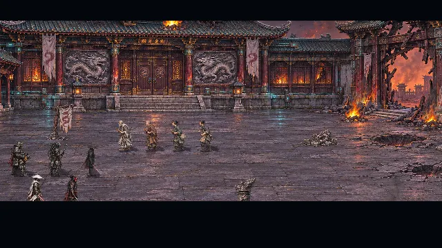
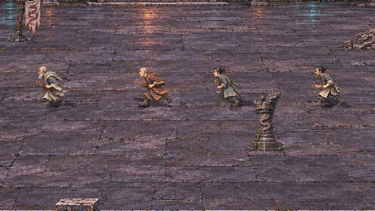
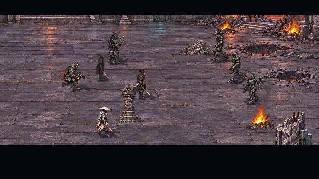
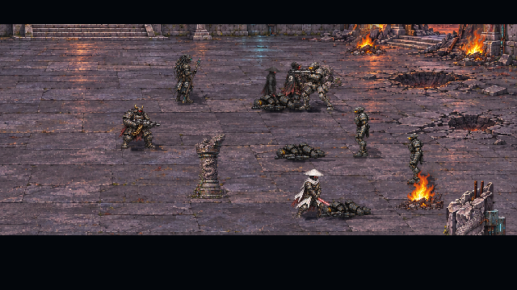
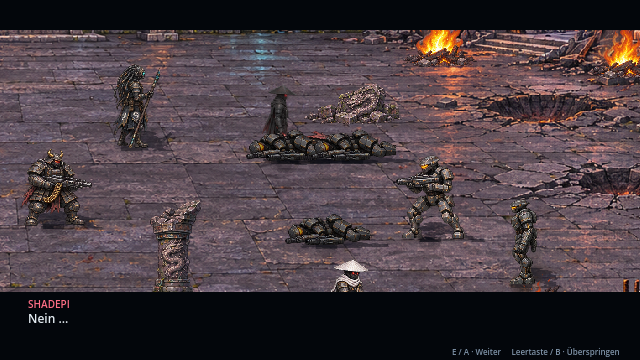
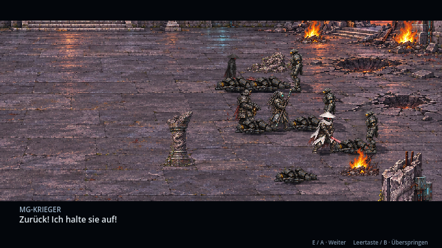
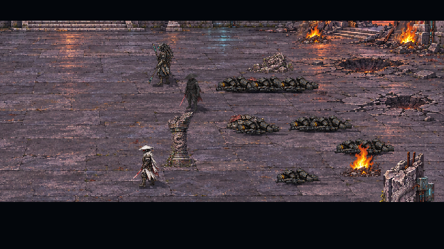

# Klosterkampf und Gehbewegungen · v0.23.0 · CodexAI

**Aktualisierung v0.24.0 · CodexAI:** [Erinnerung II – Lys Opfer](lys-opfer.md) ist inzwischen am zweiten Knoten eingebunden. Die folgende Seite dokumentiert Erinnerung I in v0.23.0.

**Erinnerung I ist als inszenierte Rückblende ausgebaut:** drei Bot-Wellen, der gemeinsame Abwehrkampf, die Schutzopfer von Oni und MG-Krieger und der Rückzug der drei Überlebenden. Die Mönche und übrigen Bewohner haben zusätzlich vier Gehbilder in jeder der vier Laufrichtungen. Erinnerung 2 und 3 sind weiterhin eigene, spätere Pakete.

Die Vorschau enthält kurze Ausschnitte der aufgezeichneten Godot-Szene; zwischen den gezeigten Momenten liegen weitere Bewegungen, Kämpfe und Dialoge. Die Rückblende ist vollständig inszeniert, ohne freie Spielersteuerung im Kampf.

## Die fliehenden Mönche

Der ältere und der junge Mönch sowie Bewohnerin und Klosterhelfer besitzen jeweils **16 neue Gehbilder**: vier Schritte nach unten, links, rechts und oben. Die Füße wechseln zwischen Bodenkontakt und Durchschwingen, Arme und Gewänder folgen der Bewegung. Versetzte Startphasen verhindern, dass alle Fluchtfiguren gleichzeitig denselben Schritt machen. Beim Abbiegen zum Seitengang wechselt die Ansicht in den Rückenzyklus. Pro Figur bleibt die Skalierung über den ganzen Gehzyklus gleich; die Bodenkontakte sind aus den transparenten Originalbildern vermessen.

Die Animation im Spiel läuft mit neun Einzelbildern pro Sekunde; ein kompletter Schrittzyklus umfasst vier Bilder. Die Nahaufnahme oben zeigt diese tatsächlichen Sprites im Godot-Renderer. Die acht Fluchtfiguren bleiben eigenständige Figuren mit getrennten Laufwegen und verlassen den Hof, bevor die Schutzmomente stattfinden.

## Drei Wellen und feste Schutzmomente

| Abschnitt | Geschehen |
| --- | --- |
| Welle 1 | Drei Bots durchbrechen den Zugang. Shadepi, Oni und Ly gehen in den Nahkampf; der Roboterkopf-Krieger sichert die linke Seite, der MG-Krieger unterstützt mit Feuer. |
| Welle 2 | Weitere drei Bots rücken nach. Ly warnt Shadepi. Oni stellt sich dazwischen, wehrt den ersten Angreifer ab und wird von einem zweiten Bot getroffen. Roboterkopf-Krieger und Ly schlagen die verbleibenden Angreifer zurück. |
| Welle 3 | Der MG-Krieger geht nach vorn und deckt den Rückzug. Er wird getroffen, hält seine Stellung bis zur letzten Salve und fällt. |
| Rückzug | Shadepi, Ly und der Roboterkopf-Krieger ziehen sich zum inneren Hof zurück. Danach kehrt Raven in die Erinnerungskammer zurück. |

Die Schutzopfer sind feste Erzählmomente, keine zufälligen KI-Tode. Gefallene Krieger bleiben in ihrer Liegepose; spätere Standbefehle können sie nicht wieder aufrichten. Für jede neue Welle entstehen neue Bots – besiegte Angreifer werden nicht wiederbelebt. Insgesamt sind neun Bots beteiligt, ihre deaktivierten Körper bleiben gedämpft sichtbar. Ly bleibt für sein späteres Opfer in Erinnerung 2 am Leben; auch der Roboterkopf-Krieger überlebt Erinnerung 1.

## Grafik, Bewegung und Ton

Zwei zusätzliche HQ-Pixel-PNG-Atlanten ergänzen die vorhandenen Kulissen und Figuren:

| Datei unter `assets/memories/attack/` | Inhalt |
| --- | --- |
| `residents-walk.png` · 1254×1254 | 8×8-Zellen, vier Bewohneridentitäten mit vier Gehbildern in vier Richtungen: 64 neue Bilder. |
| `combat.png` · 1536×1024 | 8×5-Zellen, je eine Reihe für Oni, Roboterkopf-Krieger, Ly, MG-Krieger und Bot: Bereitschaft, Ausholen, Kontakt, Rücknahme, Treffer, Knien, Fallen, Liegen. 40 neue Bilder. |
| `actors.json` | Insgesamt 264 vermessene Quellbilder aus alten und neuen Atlanten, mit Regionen, Bodenkontakten und Skalierungen. |

Die beiden PNG-Quellen wurden mit dem Bildwerkzeug nach den vorhandenen Figuren erstellt. `tools/measure_memory_art.py` liest die Transparenz und erzeugt Metadaten; Bildpixel werden nicht bearbeitet. Eine gemeinsame Skalierung verhindert, dass gebeugte oder liegende Körper auf die Höhe einer stehenden Figur vergrößert werden. Shadepi verwendet weiterhin seine vorhandenen Spiel-Sprites.

Angriffe haben Ausholen, Kontakt und Rücknahme. Katana und Stab erhalten Trefferfunken und passende Bewegung; Schussfolgen verwenden kurze Mündungsfeuer-/Rückstoßphasen, die zwischen Schüssen enden. Vorhandene Schuss-, Klingen-, Treffer-, Explosions- und Sterbelaute werden wiederverwendet und beachten die Tonoption. Die Umsetzung liegt in `scripts/memories/memory_battle.gd` und nutzt denselben Szenendirektor wie der Auftakt.

## Bedienung und Spielstände

**E / Enter / A** schaltet Dialoge weiter. **Leertaste / B** überspringt die ganze restliche Rückblende auch mitten im Kampf. **Esc / Start** öffnet die Pause. Dort lassen sich Fortsetzen, Überspringen und Verlassen per Maus, Pfeiltasten, Steuerkreuz oder linkem Stick auswählen; A / Enter bestätigt, B setzt fort.

Pause hält Figuren, Effekte und den Wellenfortschritt an. Verlassen führt ohne Abschluss zum ersten Knoten zurück. Ende und bewusstes Überspringen speichern den Knoten wie bisher genau einmal. Ravens Gegenwartsposition und Lebenswerte bleiben erhalten. Bereits abgeschlossene erste Erinnerungsknoten bleiben in bestehenden Speicherständen abgeschlossen; für die erweiterte Szene Kapitel 5 neu beginnen oder einen Stand vor Knoten 1 laden.

## Prüfung und weiterer Ablauf

**Vier Prüfreihen mit insgesamt 953 Prüfungen ohne Fehler:** Klosterkampf 226, Erinnerungseinbindung 143, vollständiger Kampagnen-/Speicherablauf 378 und Story-Audit 206.

Die gezielten Prüfungen umfassen alle vier Gehbilder jeder Richtung, konstante Körpergrößen, Fußanker, begrenztes Mündungsfeuer, den tatsächlich abgespielten Kampf mit allen drei Wellen, freie Kampfwege, Reihenfolge der Schutzopfer und das Überleben von Ly und Roboterkopf. Pause, Abbruch und Controller-Überspringen werden mitten in einer Welle geprüft. Die neuen Prüfungen laufen im GitHub-Workflow.

Ein Linux-Exportpaket wurde erstellt. Neue Geh-/Kampf-Atlanten und Ankerdaten wurden direkt daraus geladen; auch alle neun Bots und der korrekte Abschlusszustand nach Überspringen wurden im Paket geprüft.

Der vollständige Szenenlauf wurde im Godot-OpenGL-Renderer bis zur Rückkehr zu Raven kontrolliert. Die Galerie `tools/memory_gallery.gd` erzeugt auch die Geh-Nahaufnahme; `-- --record` zeichnet die tatsächliche Kampagnenszene auf. Die animierten Dokumentationsbilder liegen im vom Spielimport ausgenommenen Ordner `docs/previews/`.

Als Nächstes folgt **Erinnerung 2: Lys Opfer gegen den Minotaurus**, danach **Erinnerung 3: Das Vermächtnis**. Minotaurus-Bauform und technische Durchführung von Lys Opfer bleiben vor der jeweiligen Produktion festzulegen. [Aktuelle Roadmap](erinnerungen-roadmap.md) · [Verbindliches Nutzerbriefing](universum/teil-5/README.md) · [Ursprünglicher Auftakt v0.22.0](kloster-angriff.md).
