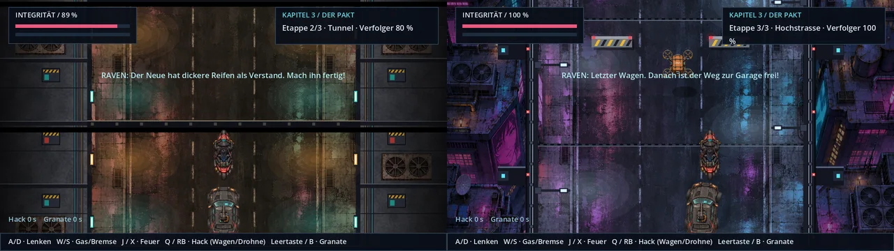

# Level strecken: Muster Hinterhalt und Verfolgung · v0.58.0 · ClaudeHelper

**11. November 2026.** [Bildgalerie](README.md) · [Spieleranleitung](../Spiel-README.md) · [Versionshinweise](../CHANGELOG.md).

Nutzerauftrag vom 11. November 2026: Das Spiel soll länger werden, die Story bleibt, die Level werden gestreckt. Dieses Muster zeigt den Weg an zwei Stellen; die übrigen Kapitel können genauso folgen.

## Verfolgung: drei Etappen

| Etappe | Kulisse | Verfolger | Besonderheit |
| --- | --- | --- | --- |
| 1 · Stadt | `highway.png`, `highway-b.webp`, `highway-c.webp` im Wechsel; ab und zu die Fußgängerbrücke `overpass.webp` | 100 % | wie bisher |
| 2 · Tunnel | `tunnel.webp` | 80 % | keine Drohnen, Hindernisse dichter |
| 3 · Hochstraße | `skyway.webp` | 100 % | zwei Drohnen von Anfang an, Seitenwind |

- Ist ein Wagen der Etappen 1 und 2 besiegt, fällt er qualmend zurück; das Bild taucht kurz ins Dunkel einer Einfahrt, dann schließt der nächste von hinten auf.
- Beim Wechsel repariert sich das Motorrad um 25 %. Nach einem Sturz beginnt die Fahrt an der erreichten Etappe.
- Erst der dritte Wagen brennt, explodiert und bleibt als Wrack zurück ([Finale v0.56.0](verfolgung-finale-v056.md)).

## Hinterhalt: mehr Wellen, ein Truppführer

Beide Abschnitte haben eine vierte Welle. Die letzte bringt einen Truppführer: Schild nach vorn, 150 Leben, zwei Schützen als Deckung. Treffer von hinten oder Ravens Hack öffnen ihn.

## Kulissen

Seit v0.58.1 stammen die Kulissen der Verfolgung vom Nutzer (fünf Bilder vom 11. November 2026, im Stil von `highway.png` erzeugt): zwei weitere Straßenzüge der Stadt, der Tunnel, die Hochstraße und eine Fußgängerbrücke. Die Behelfskulissen aus v0.58.0 und ihr Werkzeug sind entfernt.

- Fahrbahn, Spuren und Gehwege liegen in allen Bildern an derselben Stelle wie in `highway.png`; Hindernisse und Fahrzeuge passen ohne Anpassung.
- Tunnel und Hochstraße kacheln senkrecht mit sich selbst. In der Stadt folgen die Straßenzüge in der Reihe A · B · A · C.
- Die Brücke ist aus dem fünften Bild freigestellt und zieht in der Stadt alle 13 bis 19 Sekunden über die Fahrbahn; Fahrzeuge fahren darunter hindurch.
- Abgelegt als WebP (Qualität 92), zusammen rund 2,3 MB.

## Weitere gestreckte Level · v0.59.0 · ClaudeHelper

| Stelle | vorher | jetzt |
| --- | --- | --- |
| Kapitel 1 · Jagd | 3 Abschnitte × 2 Wellen, 12 Gegner | 3 × 3 Wellen, 21 Gegner |
| Kapitel 1 · Rettung | 3 Wellen, 8 Gegner | 4 Wellen, 11 Gegner |
| Kapitel 6 · Flug, Häuserschlucht | 23 s | 34 s |
| Kapitel 6 · Flug, Turmabwehr | 7 s, zwei Laser-Drohnen | 20 s, dritte Drohne nach der Hälfte |
| Kapitel 7 · Aufzugwachen | 3 Wellen, 8 Gegner | 4 Wellen, 11 Gegner, zwei Schildträger |

Noch nicht gestreckt: Deep Dive (Kapitel 2), Tower-Etagen zwischen Dach und Kenzō, Wege zwischen den Schauplätzen. Dafür werden neue Kulissen im Stil der vorhandenen gebraucht.

## So lässt sich ein weiteres Level strecken

- Fahrszenen: `drive.stages` setzen, Kulisse je Etappe in `_draw_highway()` ergänzen, Regeln in `_spawn_road_object()` und den Etappenfunktionen von `scripts/campaign_drive.gd`.
- Kampfräume: Wellen in `scripts/arcade_waves.gd` ergänzen; Sondergegner als eigene Variante in `_spawn_arcade_foe()`.
- Prüfungen: `tests/drive_action.gd`, `tests/bug_report_v045.gd`, `tests/arcade_waves.gd`.
