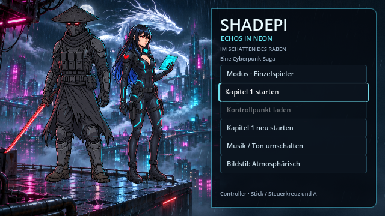

# Interaktives Startmenü

Das Menü verwendet zwei getrennte Bildquellen: `assets/menu/start-city.png` für Skyline und weißen Drachen sowie `assets/menu/start-heroes.png` für die freigestellten Figuren. Die früher im Stadtbild eingebrannten Personen sind entfernt.

Die aktuelle Figurenebene folgt den beiden am 7. November 2026 im Chat beigefügten Vorlagen: Shadepis Referenzblatt in Bereitschaftshaltung und Raven mit Tablet im Netrunner-Raum. Der gezeichnete Stil, Shadepis flacher schwarzer Kasa, die segmentierte Maske mit roten Augenlinsen, taktische Weste und das gesenkte Laser-Katana sind übernommen. Raven trägt den schwarzen Anzug mit Cyan-Linien, roten Schulteremblemen, rechteckigen Kragenmodulen und Holstern. Schwarz-blaue Haare, rote Augen, goldfarbenes Septum und das leuchtende Tablet entsprechen der neuen Vorlage. Ihre verbindliche Größe bleibt 160 cm.

Die beiden neuen Referenzen wurden als Chatbilder verwendet; diese Seite behauptet keine zusätzliche Archivierung ihrer Originaldateien. Gameplay-Sprites, Tower und Zwischensequenzen bleiben bei dieser Menüänderung unverändert.

## Bewegung und Bedienung

- Figuren und Dach bleiben an festen Positionen. Weder Mausbewegungen noch Klicks oder Menüfokus verschieben sie.
- Die Figurenebene ist eine unverformte Illustration; das frühere Figurenmesh mit Windverformung wird nicht mehr verwendet. Beide Fußpaare bleiben innerhalb der Dachkante.
- Regen in mehreren Geschwindigkeiten, Flugverkehr und kleine Wasserringe beleben das Dach. Ein separater Shader ergänzt Nebel, Neonlicht und eine dezente Vignette unterhalb der Menüschrift.
- Fokus und Hover erhalten eine sichtbare Kontur und eine kurze Skalierungsanimation. Klicks erzeugen einen kleinen Lichtimpuls.
- `Reduziert` deaktiviert den zusätzlichen Bildschirmfilter und reduziert Regen und Bewegung. Verdeckte Startmenüs stoppen ihre Animations- und Eingabeverarbeitung vollständig.
- Kapitel 1 nutzt denselben Menürahmen wie die anderen Szenen. Seine vorgemerkte Koop-Auswahl bleibt beim Pausieren erhalten; die Startgrafik erscheint nur vor Spielbeginn.
- Im Hauptmenü läuft `Level.mp3`, dieselbe Datei wie am See und im Finale. Der bisherige Titel `menu.mp3` bleibt im Musikordner erhalten.

## Visuell prüfen

`godot --audio-driver Dummy --script res://tools/menu_gallery.gd` benötigt ein Display mit echtem Renderer (auch Xvfb/Mesa ist geeignet). Das Werkzeug schreibt neutrale, Wetter-, Fokus-, reduzierte und Pause-Aufnahmen sowie Ansichten mit Mausbewegungen zu allen vier Ecken nach `/tmp/shadepi-menu-*.png`. Die Darstellung wurde mit Godot 4.7.2 im OpenGL-Renderer kontrolliert. Die bestehenden Gameplay-Prüfungen kontrollieren zusätzlich unveränderte Figuren-/Dachpositionen in allen drei Qualitätsstufen, den gestoppten Hintergrund, den Kapitel-1-Menüablauf und die identische Musikzuordnung für Menü und See-Finale.

Die neuen Menüillustrationen wurden aus den vorhandenen Quellen erstellt; die unveränderten Nutzerquellen bleiben im Universum-Archiv dokumentiert. Gameplay-Sprites werden von dieser Menüüberarbeitung nicht ersetzt.
