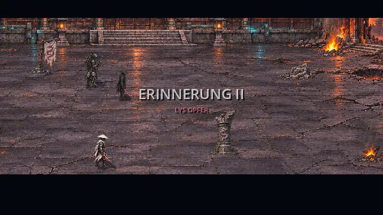
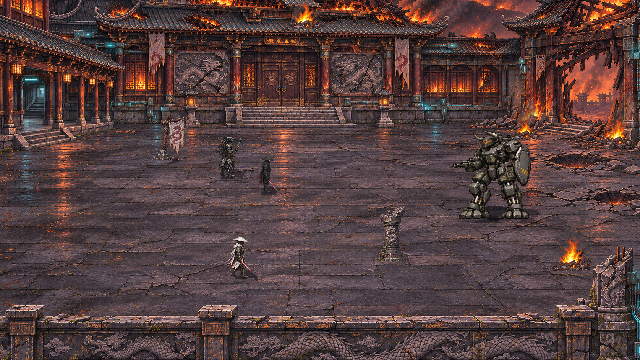
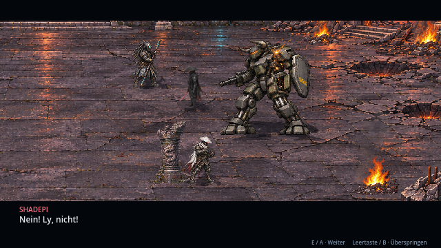
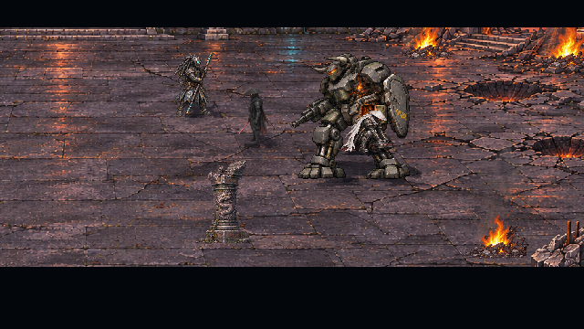
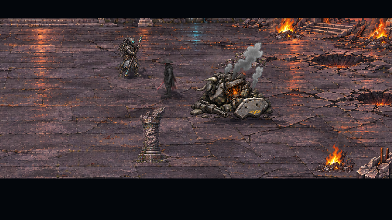

# Erinnerung II: Lys Opfer · v0.25.0 · CodexAI

Am **zweiten Erinnerungsknoten in Kapitel 5** erlebt Raven jetzt den Kampf gegen den Minotaurus und Lys Opfer als eigene Szene mit spielbarem Überlebenskampf. Shadepi, Ly und der Roboterkopf-Krieger sind die drei Überlebenden aus Erinnerung I; Oni und MG-Krieger kehren nicht zurück. Raven bleibt die Empfängerin der Erinnerung und steht nicht im historischen Kloster.

Die bisherige Vorschau zeigt die Inszenierung aus v0.24.0. Seit v0.25.0 · CodexAI steuert der Spieler Shadepi im Abwehrkampf selbst. Der neue Countdown läuft 45 Sekunden; danach setzt die bestehende Opferszene ein.

## Der Ablauf

| Abschnitt | Sichtbares Geschehen |
| --- | --- |
| Ankunft | Dieselbe Klosterarchitektur ist stärker beschädigt. Der Minotaurus rückt mit wechselnden Schrittbildern in den Hof. |
| Abwehrkampf | 45 Sekunden spielbares Durchhalten als Shadepi. Drei Stufen mit einem, drei und fünf markierten Einschlagzielen, kürzeren Warnungen und zunehmendem Schaden. Ly und Roboterkopf halten im Hintergrund die Linie. |
| Schwachstelle | Der Roboterkopf-Krieger erkennt den freigelegten Servoschacht unter dem Schild. Ly nimmt seine Ladung hervor. |
| Entscheidung | Shadepi ruft **„Nein! Ly, nicht!“**. Ly antwortet **„Verzeih mir, Bruder. FÜR DEN ORDEN!“**. |
| Opfer | Ly läuft mit der Ladung vor, springt an das Fahrgestell und befestigt sie am Servoschacht. Er bleibt bei der Zündung am Panzer. |
| Nachwirkung | Die Detonation kostet Ly das Leben und zerstört den Minotaurus. Sein Wrack bleibt liegen. Shadepi und der Roboterkopf-Krieger überleben; danach kehrt die Ansicht zu Raven zurück. |

Die Kamera hält Ly und den größeren Gegner während der Entscheidung und beim Anbringen der Ladung vollständig im Bild. Der Sprung endet am Chassis oberhalb seines Bodenkolliders; Ly läuft nicht durch die Füße des Panzers. Sein Opfer ist ein fester Storymoment. Er entkommt der Detonation nicht und wird anschließend nicht wieder eingeblendet. Der Roboterkopf-Krieger erhält hier keinen zusätzlichen Tod. Die spätere Kenzō-Enthüllung und die Übertragung des Heiligtums gehören weiterhin zu späteren Szenen.

## Gestaltung und Quellen

Der Minotaurus ist im Originaldossier, Teil 1, Abschnitt 9, als schwer gepanzerter Cyborg-/Mech-Hybrid mit Servoschächten, Anti-Material-MG und Kollisionsschild beschrieben. Für diese Szene ist er als **zweibeiniger Mech** umgesetzt. **Lys Sprengladung am Servoschacht** konkretisiert den zuvor noch offenen technischen Ablauf des Opfers. Diese beiden Ausführungen sind Umsetzungsentscheidungen; sie werden nicht als zusätzliche Nutzerbestätigung oder neue Fähigkeit des Heiligtums ausgegeben.

| Quelle unter `assets/memories/sacrifice/` | Inhalt |
| --- | --- |
| `courtyard.png` · 1586×992 | Neue beschädigte Variante des vorhandenen Hofs mit gleicher Raumaufteilung und wiedererkennbarer Architektur. |
| `minotaur.png` · 1536×1024 | Freigestellter 4×2-Atlas: Bereitschaft, zwei Schritte, Schuss, Schaden, kritischer Zustand, Zusammenbruch und dauerhaftes Wrack. |
| `ly-charge.png` · 1536×1024 | Freigestellter 4×2-Atlas: zwei Ladungslaufschritte, Hervorholen, Scharfschalten, Sprung, Anbringen, Festhalten und separate Ladung. |
| `actors.json` | 16 vermessene Quellregionen, Kontakte und Skalierungen. |
| `manifest.json` | Umfang, Figurenkontinuität und dokumentierte Umsetzungsentscheidungen. |

Die PNG-Quellen wurden mit dem Bildwerkzeug nach der vorhandenen Kloster- und Figurenreferenz erstellt. Der Minotaurus wurde zusätzlich freigestellt; sein tatsächlicher Alphakanal wird geprüft. `tools/measure_sacrifice_art.py` liest die Bilddaten, ohne Pixel umzuschreiben. Gemeinsame Skalierungen verhindern, dass gekrümmte oder zerstörte Figuren auf ihre stehende Höhe aufgeblasen werden. Der Minotaurus ist mit 136 Welteinheiten sichtbar größer als die etwa 64 Einheiten hohen Krieger.

Shadepis Originalgrafik sowie die bestehenden Bewegungen von Ly und Roboterkopf werden wiederverwendet. Weiße Gewandung, Kasa, segmentierte Maske, rote Augenlinsen und Ausrüstung bleiben bei Lys neuen Posen erhalten. Vorhandene Feuer-, Rauch-, Einschlag- und Kampfeffekte ergänzen die Szene; Darstellung mit Nearest-Filter und Pixeltexturen. Während des Minotaurus-Kampfs läuft **Boss.mp3**. Die Tonoption gilt auch für die wiederverwendeten Kampfgeräusche.

## Spielbarer Kampf · v0.25.0 · CodexAI

Überleben ist das Ziel. Die Minotaurus-Panzerung kann durch normale Angriffe nicht zerstört werden. Vier Katana-Treffer in Reichweite und Blickrichtung erzeugen 1,3 Sekunden Taumeln und unterbrechen eine vorbereitete Salve. Das schafft Luft, hält aber den Countdown nicht an. Die Stufen wechseln nach 15 und 30 Sekunden. Rote Pixel-Einschlagmarkierungen zeigen fixierte Ziele; Bewegung und rechtzeitiges Ausweichen verhindern Schaden. Ausweichen hält 0,24 Sekunden an, schützt kurz und hat 0,85 Sekunden Abklingzeit. Normale Treffer verursachen 18 / 23 / 29 lokale Lebenspunkte Schaden.

Bei Niederlage stoppt der Countdown. E / Enter / A wiederholt nur den Kampf mit 100 Leben, vollem Timer und gelöschten Angriffen. Ly opfert sich erst nach Ablauf der 45 Sekunden oder beim bewussten Überspringen der Erinnerung. Die historische Gesundheit verändert Ravens Gegenwartswerte nicht. Pause friert Timer, Warnungen, Ausweichen und Figuren ein. Fensterfokusverlust öffnet ebenfalls die Pause. Ein kurzer Übergang sammelt die Figuren nach dem freien Kampf für die vorhandene Inszenierung; die Kamera läuft dabei nicht durch beliebige Spielerpositionen.

## Bedienung, Rückkehr und Spielstände

| Eingabe | Wirkung |
| --- | --- |
| WASD / Pfeile / linker Stick / Steuerkreuz | Shadepi im Überlebenskampf bewegen. |
| J / linke Maustaste / X | Katana-Schlag; Treffer bauen Taumeln auf. |
| Leertaste / B im Kampf | In Bewegungs- oder Blickrichtung ausweichen. |
| E / Enter / A bei Niederlage | Den Kampf wiederholen. |
| E / Enter / A außerhalb des Kampfs | Dialog weiter. |
| Leertaste / B außerhalb des Kampfs | Restliche Rückblende bewusst überspringen und Knoten abschließen. |
| „Erinnerung überspringen“ im Pausenmenü | Auch während des Kampfs die komplette Erinnerung bewusst abschließen. |
| Esc / Start | Pause öffnen oder schließen. |
| Pfeiltasten, Steuerkreuz, linker Stick, Tab | Pausenknopf auswählen. |
| Enter / E / A | Auswahl bestätigen. |
| B im Pausenmenü | Fortsetzen. |

**Erinnerung verlassen** kehrt ohne Abschluss zum zweiten Knoten zurück. Pause hält Figuren, Effekte und Szenenfortschritt an. Ende und bewusstes Überspringen schließen genau diesen Knoten einmal ab. Die historische Szene läuft in einer eigenen Physikwelt; Ravens Gegenwartsposition und Lebenswerte bleiben erhalten. Nach der Rückkehr läuft wieder die Musik der Erinnerungskammer.

Das neue Speicherfeld `memory_sacrifice_complete` ist optional und typgeprüft. Ein älterer Spielstand in der Erinnerungskammer, der den früheren Textknoten schon passiert hatte, aber dieses Feld noch nicht besitzt, setzt jetzt am **zweiten Knoten** fort. Der Abschluss von Erinnerung I bleibt erhalten. Neue abgeschlossene Spielstände setzen am dritten Knoten fort. Kapitel außerhalb der Erinnerungskammer werden nicht zurückgesetzt.

## Prüfung v0.25.0 · CodexAI

Fünf Prüfreihen mit **1.024 Prüfungen ohne Fehler**: Erinnerung II 69, Erinnerung I/Einbindung 143, Klosterkampf 226, Kampagnen-/Speicherablauf 380, Story-Audit 206. Die neuen Prüfungen bedienen Tastatur und Controller, kontrollieren wirkliche Bewegung, Ausweichschutz und Schaden, vier Treffer bis zum Taumeln, die drei Warnmuster, Pause, Niederlage mit angehaltenem Timer, Wiederholung, vollständigen 45-Sekunden-Ablauf und Überspringen aus dem Kampf. Die bestehende Opferszene läuft danach mit beiden Überlebenden und sicherer Rückkehr durch. Alle drei Kampfphasen sowie Pause und Niederlage wurden zusätzlich im tatsächlichen Godot-OpenGL-Renderer kontrolliert.

## Vorherige Prüfung und weitere Produktion

**Vorheriger Prüfstand v0.24.0: Fünf Prüfreihen mit insgesamt 1.003 Prüfungen ohne Fehler:** Erinnerung II 48, Erinnerung I/Einbindung 143, erster Klosterkampf 226, Kampagnen-/Speicherablauf 380 und Story-Audit 206.

Die gezielten Prüfungen spielen die Szene vollständig durch und kontrollieren die bestätigten Dialoge, Reihenfolge von Anlauf/Ladung/Detonation, Lys Tod, die beiden Überlebenden und den dauerhaften Wrackzustand. Gemessene Quellkontakte, konstante Größen, Transparenz und die Laufwege gegen Map und Mech-Fußabdruck werden geprüft. Pause, Abbruch und Controller-Überspringen werden auch mitten im Sprung getestet. Die Kampagneneinbindung prüft getrennte Knoten, Bossmusik, alte und neue Speicherstände sowie veraltete Rückmeldungen nach Kapitelwechsel. Der Gesamtablauf erreicht nach beiden Rückblenden weiterhin den Aerodyne-Flug.

Ein Linux-PCK wurde erzeugt. Neue Ankerdaten, PNG-Atlanten, die drei Figuren zu Szenenbeginn und der vollständige Opfer-/Wrackzustand nach Überspringen wurden direkt aus dem Exportpaket geladen und geprüft.

Die Szene wurde im tatsächlichen Godot-OpenGL-Renderer bis zur Rückkehr zu Raven kontrolliert. `tools/sacrifice_gallery.gd` zeichnet diesen Kampagneneinstieg auf. Die animierte Dokumentationsvorschau liegt im vom Spielimport ausgenommenen Verzeichnis `docs/previews/`.

**Als Nächstes folgt Erinnerung III: Das Vermächtnis** mit Meister, Heiligtumsübergabe und dem Kampf gegen zwei Minotauren. Diese dritte Szene ist noch nicht umgesetzt. Die Minotaurus- und Ruinengrafiken sind dafür wiederverwendbar. [Roadmap](erinnerungen-roadmap.md) · [Verbindliches Briefing](universum/teil-5/README.md) · [Erinnerung I](kloster-kampf.md).
