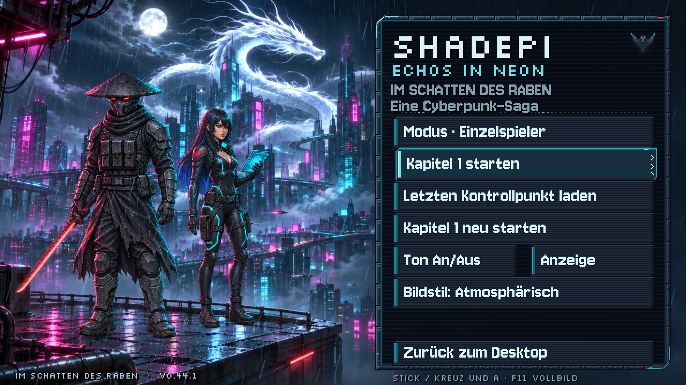
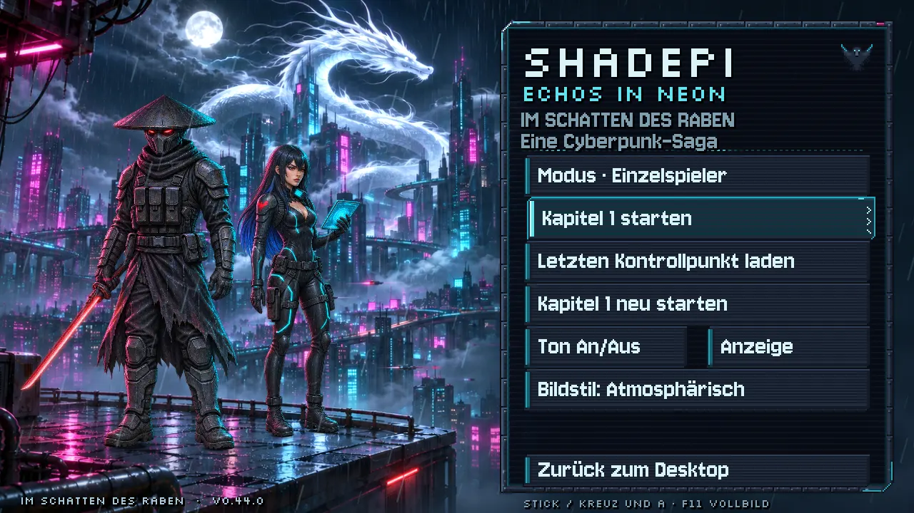
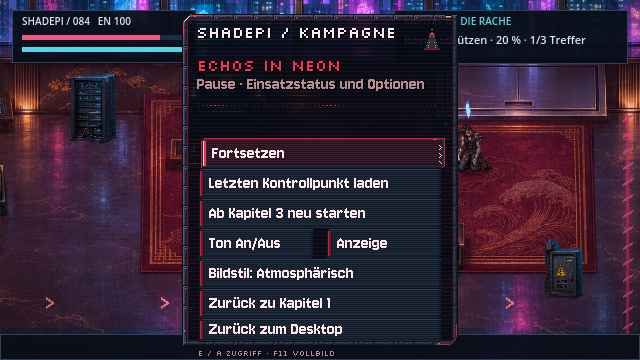
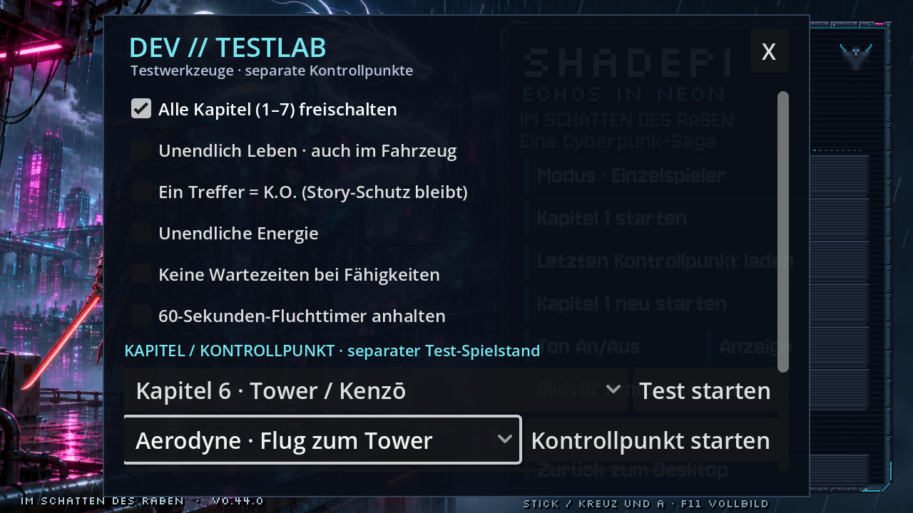
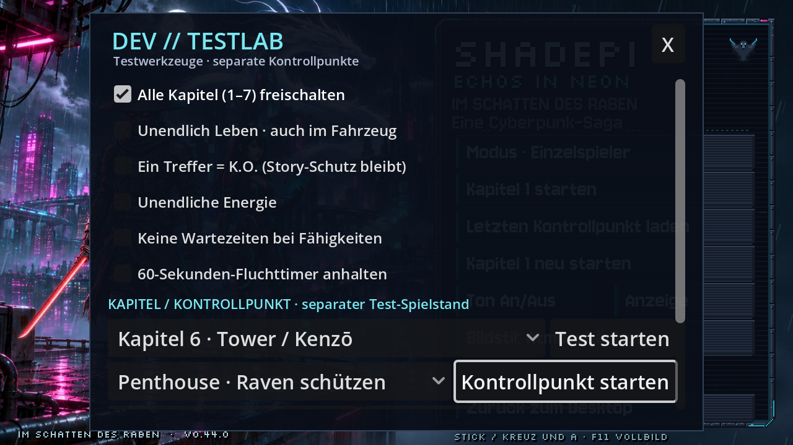
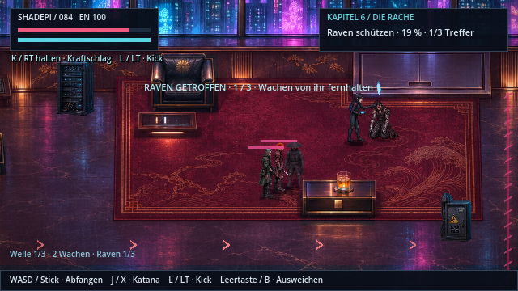
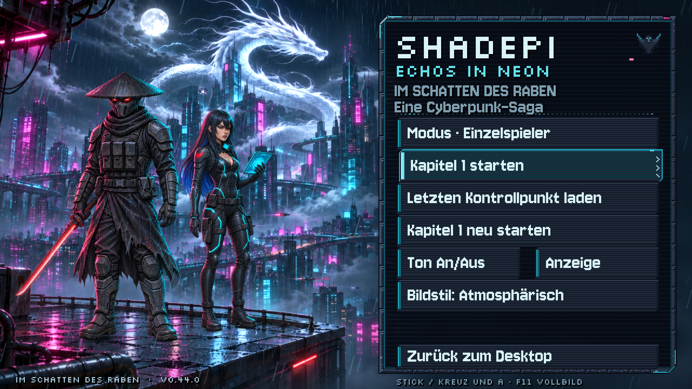

# Menü: Bodenkontakt und gezielte Test-Kontrollpunkte

**v0.44.1 · CodexAI · 9. November 2026.** [Bildgalerie](README.md) · [Spieleranleitung](../Spiel-README.md) · [Testmenü](admin-testmodus.md).

**Lichtkorrektur v0.44.1 · CodexAI:** Die helle, in die Stadttextur eingemalte Nässe-Spur wird nun in den Standbereichen der vier Stiefel gedämpft. Der Stadtshader verwendet dieselben Sohlenanker wie der Kontaktschatten und rechnet die vergrößerte/versetzte Stadttextur korrekt in Menükoordinaten um. Dunkle Materialdetails bleiben erhalten; die Korrektur bleibt auch bei „Reduziert“ aktiv.

| Lichtspur vor der Korrektur | Lichtspur im Standbereich gedämpft |
| --- | --- |
|  |  |

Die neuen Vergleichsbilder sind tatsächliche Aufnahmen aus dem exportierten v0.44.1-Paket. Links ist nur die neue Reflexionskorrektur abgeschaltet, die Kontaktschatten bleiben in beiden Bildern aktiv. [Abnahme und Prüfnachweis](arbeiten/menue-reflexion-v0441.md). Der folgende Bedienfilm und die Testmenübilder stammen weiterhin aus v0.44.0; die Menüfunktionen bleiben erhalten.

Die vier Stiefel erhalten jetzt einen kräftigen engen Kontaktschatten mit weichem Auslauf auf der nassen Plattform. Die Anker liegen an den tatsächlichen Sohlen und berücksichtigen Ravens vorhandenen eigenen Maßstab. Figuren, Füße und Plattform reagieren weiterhin nicht auf die Maus. Der Bodeneffekt bleibt auch im reduzierten Bildstil sichtbar und endet vor der Vorderkante.

[Menü- und Testauswahl als Film öffnen](previews/menue-testpunkte-v044.webp)

## Die beiden Menüaktionen

**Letzten Kontrollpunkt laden** lädt den zuletzt gespeicherten gültigen Stand des gewählten Modus, auch aus einem anderen Kapitel. Neue Dateien speichern dafür eine genaue Speicherzeit. Alte Dateien funktionieren über ihr Änderungsdatum weiter. Ungültige Zustände werden übergangen; ohne passenden Stand ist die Schaltfläche deaktiviert. Kapitel 1 unterscheidet Einzelspieler und Lokal-Koop, Kapitel 2–7 verwenden wie bisher ihren Einzelspielerstand.

**Zurück zum Desktop** schließt das Spiel direkt. Die Schaltfläche ist sowohl im Hauptmenü als auch in allen Pausenmenüs vorhanden. Die vorhandenen automatischen Kontrollpunkte bleiben die Speichergrundlage; Beenden erzeugt keinen neuen freien Spielstand mitten in einer Szene.

## Direkt einen Abschnitt testen

1. Im Haupt- oder Pausenmenü **Strg + Umschalt + F10** drücken oder fünfmal auf die Überschrift klicken.
2. **Alle Kapitel (1–7) freischalten** aktivieren.
3. Das gewünschte **Kapitel** und darunter den **Kontrollpunkt** auswählen.
4. **Kontrollpunkt starten** drücken. **Test starten** bleibt der Einstieg am Kapitelanfang.

Mit Controller: Steuerkreuz/Stick zum Fokus, **A** zum Öffnen und Bestätigen. **B** schließt zuerst eine offene Liste und danach das Testmenü. **Start** schließt das Testfenster zurück ins weiterhin pausierte Menü. Fokussierte Einträge scrollen automatisch ins Sichtfeld. Zum erstmaligen Öffnen bleibt der vorhandene Tastatur-/Mauszugang erhalten.

| Auswahl im Testmenü | Direkter Einstieg |
| --- | --- |
|  |  |

**40 vorgegebene Einstiege** stehen zur Verfügung:

| Kapitel | Einstiege |
| --- | --- |
| 1 | Wohnung; Jagd West/Mitte/Ost; Shadepis Rettungsweg; Jackal-Teamkampf; Ausgang. |
| 2 | Industriehof; Versteck; Eisbad-Anschluss; alle drei Deep-Dive-Relais; Rückkehr; Abschluss. |
| 3 | Pakt; beide Hinterhalt-Abschnitte; Motorradverfolgung. |
| 4 | Werkbanksymbol; Garagenverriegelung; Hangar-Vorbereitung; Energiebus; Kennung. |
| 5 | Ankunft; nach zwei Stunden; alle drei Erinnerungsknoten mit passenden Vorbedingungen. |
| 6 | Flug; Dach-Landeplatz; Tower-Tür; Kenzō-Kampf; Raven schützen; Bombe; Ausgang hacken; Weg zum Aerodyne. |
| 7 | Landeanflug samt Finale; Ufererkundung; Abschluss. |

Beim direkten Einstieg in die Extraktion lebt der besiegte Kenzō noch, Raven arbeitet an seinem Deck und Shadepi schützt sie. Spätere Fluchtpunkte setzen die abgeschlossene Extraktion voraus. Erinnerung 2 beziehungsweise 3 kennt jeweils nur die vorherigen abgeschlossenen Erinnerungen. Die Auswahl setzt bestehende Spielzustände, statt Figuren beliebig in halbfertige Szenen zu teleportieren.

Schon das Öffnen des Testmenüs aktiviert wie bisher separate Testdateien. **Normale Spielstände werden nicht überschrieben.** Auch „Letzten Kontrollpunkt laden“ bleibt während dieser Testsitzung im Test-Dateiraum. Ein Neustart des Programms beendet die Testsitzung; persistente Cheats lassen sich über „Alle Cheats AUS“ zurücksetzen.

## Bildvergleich und technische Nachweise

| Enger Bodenkontakt aktiv | Gleicher eingefrorener Bildtakt, Schattenebene ausgeschaltet |
| --- | --- |
|  |  |

Der rechte Vergleich ist eine Diagnoseaufnahme der neuen Version, kein behauptetes Bild einer alten Veröffentlichung. Im Full-HD-Vergleich ändern sich auf der linken Bildhälfte ausschließlich Bodenpixel im Bereich x189–737 / y895–958. Körper, Köpfe und Architektur bleiben gleich. Keine neuen Figurenbilder oder Bildwerkzeug-Generierungen erforderlich.

Quellen: `start_menu_backdrop.gd`, `menu_contacts.gdshader`, `checkpoint_resume.gd`, `test_checkpoints.gd` sowie die bestehenden HUDs und Speicherfunktionen. [Prüfungen und Exportnachweis](arbeiten/menue-v044.md). Alle Aufnahmen stammen aus Godot mit nativem OpenGL-Renderer; Film mit realen Zeitabständen. Der Aufnahmeablauf startet den Tower über die tatsächliche neue Schaltfläche, nicht durch einen nachträglichen Bildschnitt. Dummy-Audio; keine neue akustische Abnahme.
