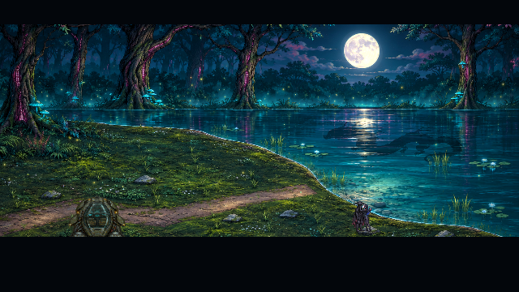
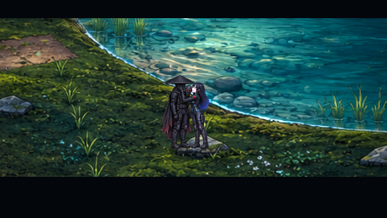
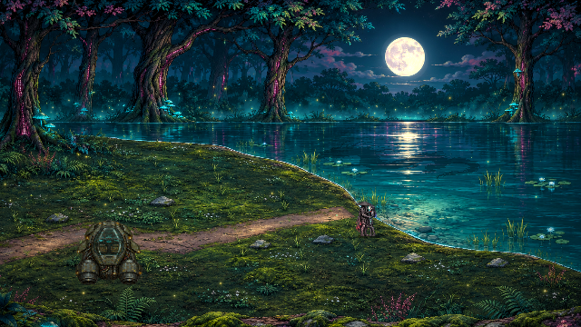
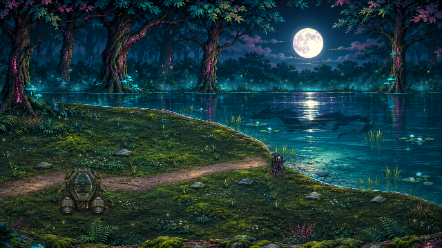
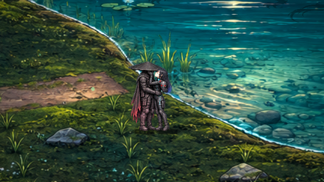
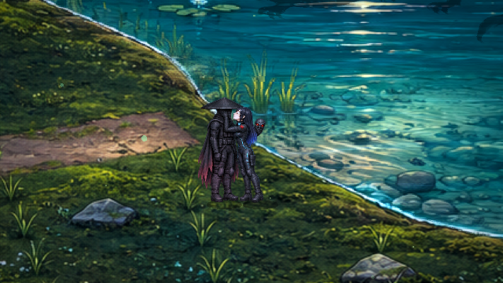
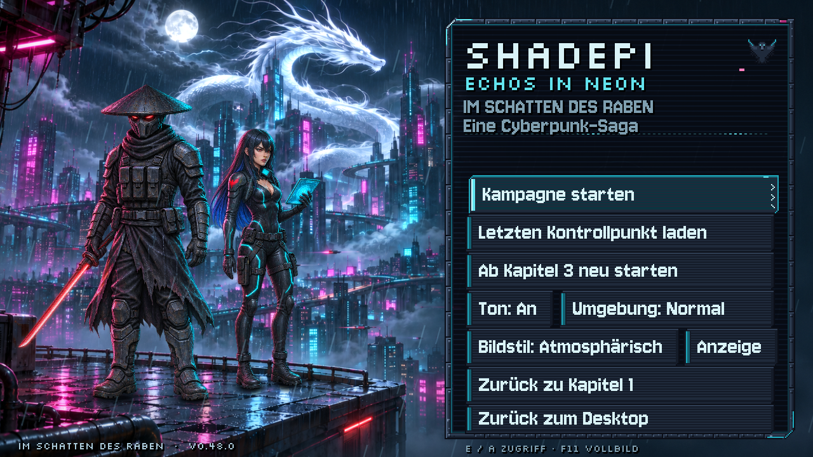
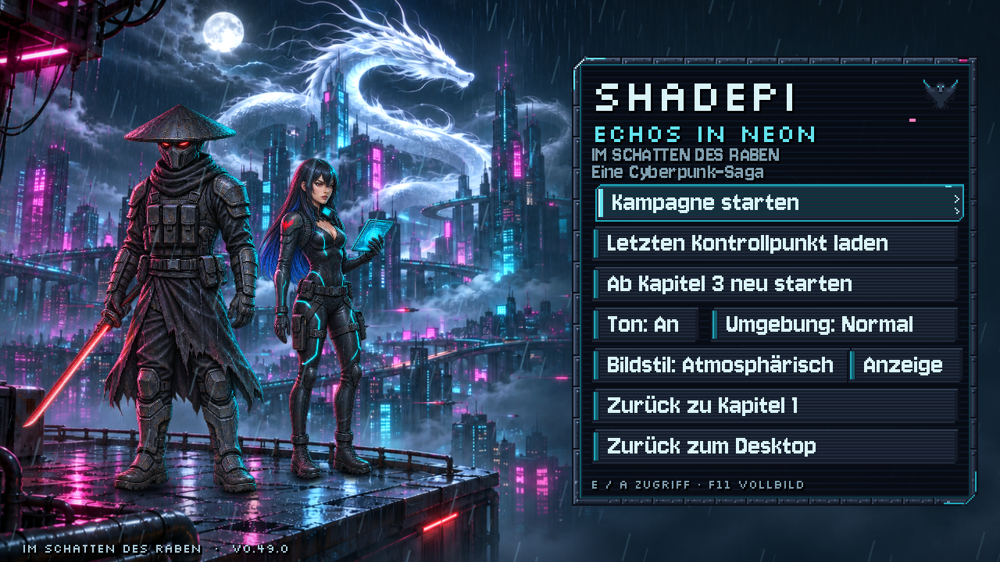

# Kapitel 7 im Mondlicht und passende Menügrößen

**v0.49.0 · CodexAI · 9. November 2026.** [Bildgalerie](README.md) · [Quellen und Anker](../assets/story/lake/README.md) · [Arbeits-/Prüfnachweis](arbeiten/mondsee-v049.md).

Ausgangspunkt ist der aktuelle GitHub-Stand **v0.48.0** mit Storydurchsicht, Towerplan, Pixelmarkern, Alarmlicht und Umgebungsgeräuschen. Diese Änderungen bleiben erhalten. Normale Raven-/Shadepi-Sprites und das separate Menübild wurden nicht ersetzt.

## Mondschein und Wasser

Die vorhandene Mondposition bestimmt den silberblauen Glanzpfad. Feine gestaffelte Wellen versetzen die Reflexe, während die Oberfläche vorhandene Bildpixel bewegt. Kühles Mondlicht, leichter Dunst und begrenzte Glühwürmchen ergänzen den Ort. Die Effekte bleiben über den tatsächlichen Wasserpolygonen; Gras, Stiefel und die Landestelle erhalten keine Wasserreflexe.

Der Drachenschatten besitzt **sechs echte Flugphasen** mit Körper-, Schweif- und Mähnenbewegung. Die Silhouette gleitet kurz über den See und bricht sich in den Wellen. Der weitere Kamerablick hält den vorhandenen Mond unterhalb der Kinobalken im Bild. Der Drache bleibt ein flüchtiger Schatten, keine zusätzliche benannte Figur oder neue Lore.

[**Film der tatsächlich laufenden Kuss-/Drachenszene öffnen**](previews/mondsee-v049.webp)

## Kontaktanimation bei den Originalhelden

Acht registrierte Bilder ersetzen die bisherige Überblendung von vier Standposen: Hände, Maskengriff, Anheben, Annäherung, Kuss, gehaltener Kuss, Rücksetzen der Maske und Umarmung. Die Figuren wechseln ohne durchsichtige Doppelkonturen. Boots-/Quellanker bleiben fest; normaler Körper, normale Schatten und Lichtverdeckung sind während der Ersatzpose aus. Die Originale werden beim Kapitelwechsel wiederhergestellt.

**Ravens eigene rechte Hand hebt/hält die Maske; ihre linke berührt und verdeckt Shadepis Gesicht.** Der Kasa und ihre Kopfhaltung ergänzen die Verdeckung. Es gibt kein lesbares unmaskiertes Porträt. Beim ruhigen Abschluss trägt Shadepi die Maske wieder. Die normalen Helden bleiben vollständig unverändert; die neuen Bilder sind nur eine zusätzliche Szenenquelle.

Während Anflug und Finale verdecken Lebens-/Missionsanzeigen den Mond nicht. Untertitel und Pausenmenü bleiben bedienbar. Normale Anzeigen kehren nach Szene beziehungsweise Abbruch zurück. Musikzuordnung bleibt: Kapitel 7 verwendet `menu.mp3`; die neuen leisen See-Umgebungsgeräusche aus v0.48.0 bleiben erhalten.

## Vergleich bei derselben Kamera

| v0.48.0 | v0.49.0 |
| --- | --- |
|  |  |
|  |  |

Der Vergleich wurde aus dem echten Baseline-Commit `c31a634` und dem neuen Stand bei gleicher Kamera erstellt. QA platziert die Figuren und setzt Pose/Lichtzustand; die Spielanzeigen sind in beiden Vergleichsbildern ausgeblendet. Die Szenenaufnahmen und der Film darüber stammen dagegen aus dem tatsächlich laufenden Finale.

## Menüs innerhalb ihres Rahmens

| Vorher · v0.48.0 | Nachher · v0.49.0 |
| --- | --- |
|  |  |

Die Breite beträgt jetzt 260 logische Pixel. Die Höhe folgt den tatsächlich sichtbaren Aktionen: Haupt-/Pausenmenüs der drei Kapiteloberflächen erhalten passende Zeilen für Kapitelwechsel, Ton/Umgebung und Anzeige. Beschreibung, Hilfe und Schaltflächen bleiben ohne Überlappung im Rahmen. Der Rahmen sitzt im Hauptmenü rechts und im Pausenmenü mittig. Versteckte Aktionen lassen keine Leerzeilen zurück; Tastatur-Tab folgt der sichtbaren Reihenfolge. Controllerwahl, Test-Kontrollpunkte und Desktop-Ausgang bleiben erhalten.

[640×360](previews/menue-640-v049.png) · [1920×1080](previews/menue-1920-v049.png). Geprüft sind 640×360, 1280×720 und 1920×1080 sowie Haupt-/Pausenmenü aller drei Kapiteloberflächen. Die Spielbasis bleibt 640×360; die bestehenden Vollbild-/Skalierungsoptionen bleiben erhalten.

## Prüfung und Grenzen

Godot 4.7.2, nativer OpenGL-Renderer und isolierte Spielstände. Der Film zeigt das tatsächliche Finale mit automatisch weitergeschalteten Dialogen, keinen vollständig manuell erspielten Durchlauf. Native Laufzeitbilder und Export wurden geprüft; Dummy-Audio, keine neue akustische Abnahme. Pause/Terminals halten die Effektuhren an, Reduziert verringert Glanz und Drachenfrequenz. [Aktuelle Regression und Exportnachweis](arbeiten/mondsee-v049.md). Der neue Film bleibt unter 5 MB.
