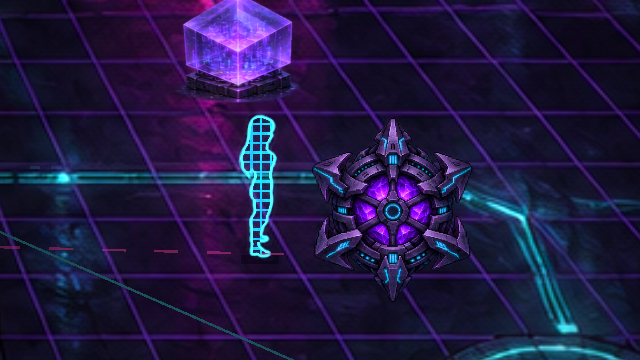
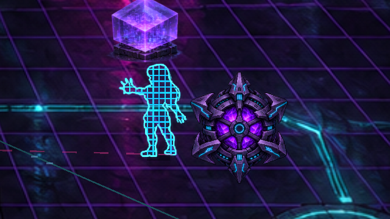
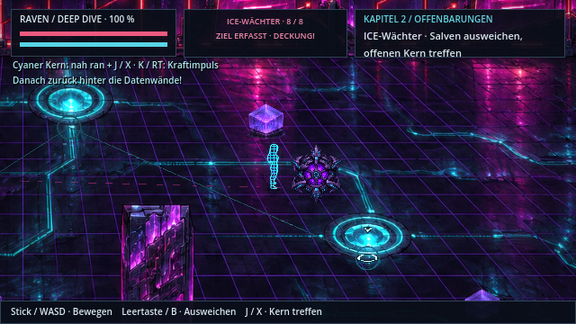

# Raven als Gittersilhouette im Netz

**v0.50.1 · CodexAI · 10. November 2026.** [Galerie](README.md) · [ICE-Kampf](ice-kampf-v050.md) · [Arbeitsnachweis](arbeiten/netzavatar-v0501.md).

Raven erscheint im gesamten Deep Dive als leuchtende cyanfarbene Gittersilhouette. Ihre Originalbilder geben die genaue Form vor: Haare, Körper, Hände und Stiefel bleiben erkennbar, während zwischen den Linien transparente Flächen liegen.

| Detailansicht derselben Spielszene | Handangriff als Netzprojektion |
| --- | --- |
|  |  |

[**Animationsfilm öffnen**](previews/netzavatar-v0501.webp) · 64 native Godot-Aufnahmebilder mit Geh- und Handangriffsposen, unter 5 MB. Der Film zeigt die Darstellung, keinen neuen vollständigen Kampfdurchlauf.

## Verhalten

- Das Gitter folgt der aktuellen Pose und Blickrichtung. Bestehende Lauf-, Lade- und Handzauberbilder werden vollständig wiederverwendet.
- Die Linien liegen im Abstand von vier Weltpixeln innerhalb der tatsächlichen Sprite-Transparenz. Die Kontur bildet einen helleren Rand; ein schmaler Datenimpuls läuft über die Projektion.
- Das Raster bleibt an Ravens Fußposition verankert. Es verschiebt sich beim Laufen zusammen mit ihr und passt sich beim Wechsel zum Handzauber an dessen bestehende Skalierung an.
- Menü und Terminal halten den Datenimpuls an. Treffer sind weiterhin sichtbar. Physische Schlagschatten und Lichtabschattung entfallen im Netz.
- Beim Verlassen des Deep Dive erhält Raven wieder die normale Körperdarstellung. Eisbad, Originalhelden, Handanker, Kämpfe und Spielstände bleiben erhalten.

## Quellen und Umsetzung

Keine neue Heldenfigur und keine bearbeitete Sprite-PNG. Der [Netzshader](../shaders/net_avatar.gdshader) verwendet die Alphaform aus [Ravens Original](../assets/sprites/heroes/raven.png) beziehungsweise ihren bestehenden Handposen. Er liest für die Kontur ausschließlich die aktuelle Atlaszelle. Das bisherige rechteckige Querstreifen-Overlay wurde entfernt.

[Kapitel 2](../scripts/chapter_two.gd) aktiviert den Effekt nur im Deep Dive und stellt danach den vorhandenen Körper-Shader wieder her. Die Bildquellen, Fuß-/Handanker und Animationen bleiben unverändert; das Gitter ist ein gewünschter Darstellungseffekt über diesen Pixelquellen.

905 gezielte Headless-Checks, 56 native Checks mit Pixelbildprüfung und 18 Paketprüfungen ohne Fehler. Einzelheiten und Exportnachweis stehen im [Arbeitsnachweis](arbeiten/netzavatar-v0501.md).
