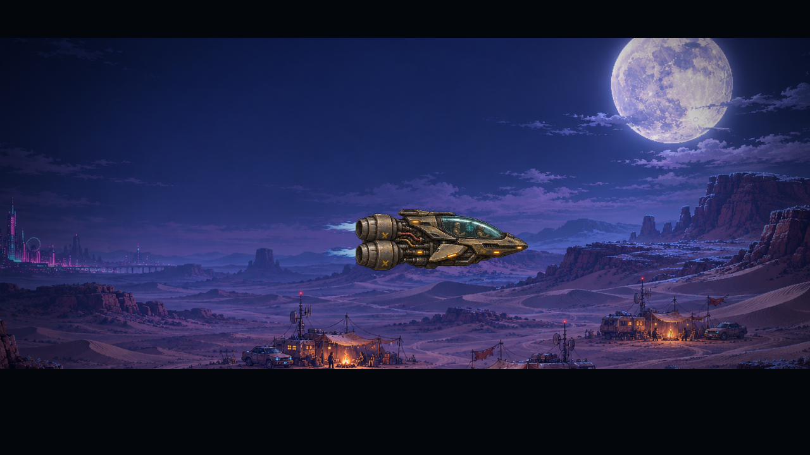
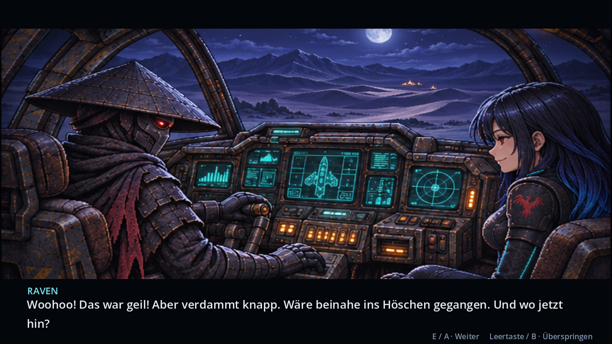
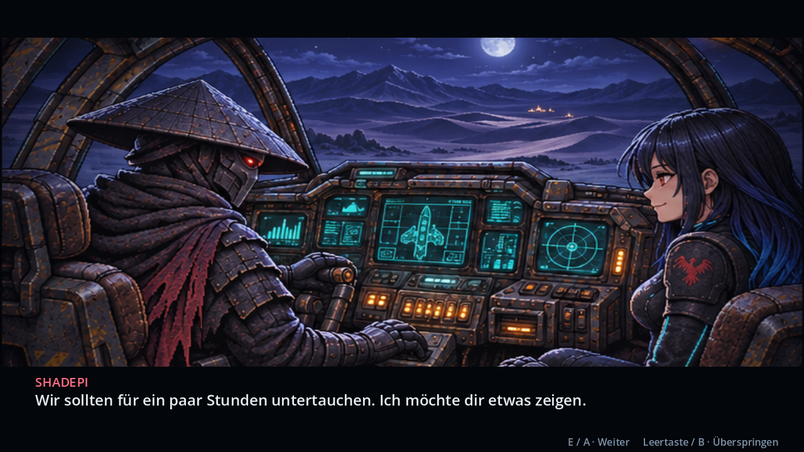

# Nomadenflug: Seitenansicht und Cockpit · v0.65.1 · CodexAI

**17. November 2026.** Ausgangspunkt `c1d60e5` (v0.65.0), alle GitHub-Branches abgerufen und verglichen. [Galerie](README.md) · [Bisheriger Fluchtablauf](fahrt-flug-v065.md) · [Arbeitsnachweis](arbeiten/nomaden-cockpit-v0651.md).

## Echte Seitenansicht über den Lagern

Der Aerodyne besitzt für diesen Flug vier eigene **HQ-Pixel-Seitenbilder**. Die Nase zeigt nach rechts, die beiden hinteren Düsen nach links. Rumpf, Cockpit und Mechanik stammen aus derselben Fahrzeugidentität wie der bisherige Atlas. Der Flug verwendet diese neue Profilquelle in ihren natürlichen Proportionen; die Draufsicht wird nicht mehr gedreht oder flachgedrückt. Die Abgasstrahlen beginnen an den zwei seitlichen Düsenaustritten und zeigen nach hinten.

Das Fahrzeug fliegt weiterhin sichtbar über die Nomadenlager. Stadt, Mondschein-Wüste, Autos, Feuerstellen und Kamerafahrt bleiben erhalten. Nach dem Außenflug leitet eine kurze Abblende ins Cockpit über, **bevor Raven zu sprechen beginnt**.

## Gespräch im Cockpit

| Raven nach der knappen Flucht | Shadepis Antwort |
| --- | --- |
|  |  |

Die Kameraposition und Innenausstattung übernehmen die Cockpit-Komposition vom Hangarstart: Shadepi links am Steuer, Raven rechts. Vor der Scheibe liegt jetzt die nächtliche Wüste statt der Hangarhalle. Vier zurückhaltende Bildphasen zeigen Sprechen, erleichterte Reaktion, Shadepis Antwort und ruhigen Weiterflug. Keine Startstörung oder Schlagbewegung aus der früheren Startsequenz wird hier wiederholt. Während des Gesprächs ist das äußere Fluggerät ausgeblendet.

Ravens erleichterter Ausruf und Shadepis Vorschlag zum Untertauchen bleiben unverändert. Danach folgen **„ZWEI STUNDEN SPÄTER“** und der bestehende See-Anflug. Die Maske bleibt geschlossen; die spätere Maskenabnahme am See bleibt der vorgesehene Moment.

**[Szenenfilm: Außenflug → Cockpitgespräch → Zeitsprung](previews/nomaden-cockpit-v0651.webp).** Native Aufnahme aus Godot, mit automatisch bestätigten Dialogen und für die Vorschau geraffter Szenenzeit.

## Quellen, Rücksetzung und Prüfung

- [Seitenatlas](../assets/vehicles/aerodyne/side-flight.png): 1536×1024 RGBA, vier 768×512-Zellen mit transparentem Außenraum. `aerodyne_side.gd` registriert Rumpf und Düsen.
- [Nachtcockpit](../assets/story/outbound/cockpit-night.png): vier 768×512-Zellen, unmittelbar anhand des aktiven Start-Cockpits erstellt. [Herkunft und Fingerabdrücke](../tools/cinema-v0651/sources.json).
- Es bleibt derselbe Fahrzeug-Node. Der zusätzliche Seitenrenderer wird erst für den Wüstenflug geladen; normale Flug-, Dach-, Hangar- und Seeansichten behalten ihre ursprünglichen Quellen und Kontaktpunkte. Originalhelden bleiben unverändert.
- Pause friert auch die Cockpitposen ein. Abbruch, Überspringen und Kapitelwechsel behalten den bestehenden Generationenschutz; kein neuer Kapitelwert oder Spielstandtyp.

[Prüfnachweis](pruefungen/v0651/ergebnisse.json): sechs gezielte headless Prüfreihen mit **208 erfolgreichen Prüfungen**, dazu **32 native Prüfungen**. Geprüft sind Seitenquelle statt Draufsicht, Düsenursprung und -richtung, Rückkehr zum ursprünglichen Fahrzeugrenderer, Cockpit vor der ersten Zeile, Pause, Szenenabbruch, Überspringen und der Seeanschluss. Die Atlasprüfung meldet für 51 Blätter / 3.282 Ausschnitte keine sichtbaren Schnittfehler.

Die Vorschauen stammen aus dem echten Linux-/X11-Renderer bei 1280×720. Kein physischer Android- oder Windows-Durchlauf und kein kompletter manueller Durchgang aller Kapitel. Versionsstand **0.65.1 · CodexAI**, Android-Code 6501; Plattform-Exporte werden im Prüfnachweis festgehalten. Signaturarbeit bleibt beim Nutzer.
