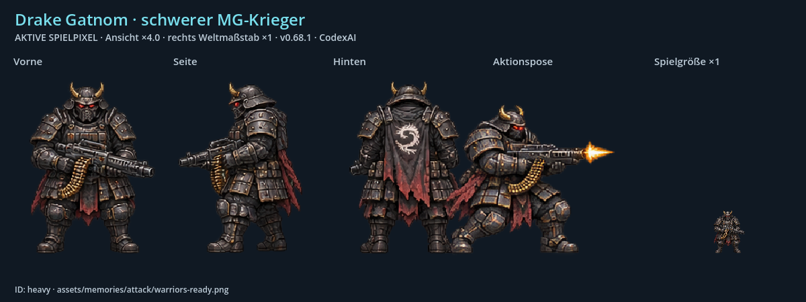
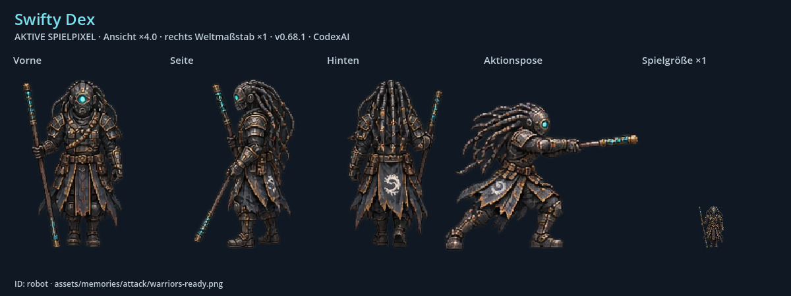
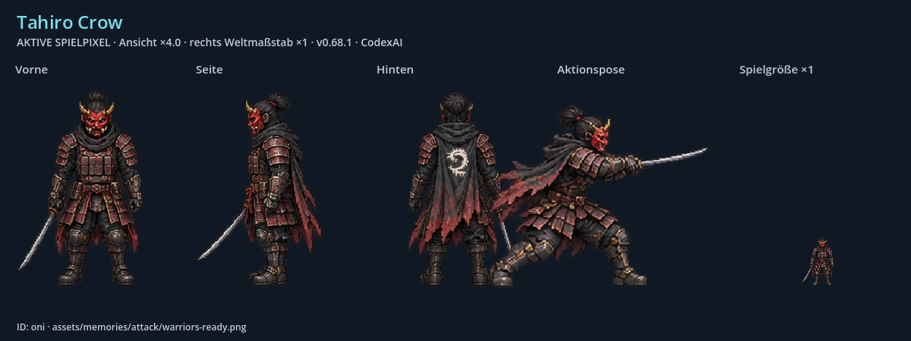
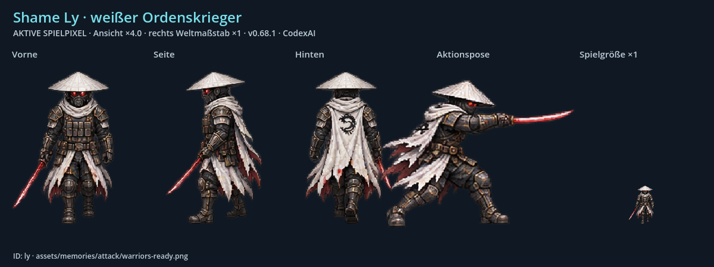

# Vier Ordenskrieger · v0.68.1 · CodexAI

**Nutzerbestätigung vom 22. November 2026.** [Spieleranleitung](../Spiel-README.md) · [Änderungen](../CHANGELOG.md) · [Figurenkarten](stilbibel/figuren.md).

| Bestätigter Name | Erkennungsmerkmale | Bestehende technische ID |
| --- | --- | --- |
| **Drake Gatnom** | Schwer gepanzert, Samurai-Maske, großes Maschinengewehr | `heavy` |
| **Swifty Dex** | Roboterkopf, Kabel-Dreadlocks, Kampfstab | `robot` |
| **Tahiro Crow** | Oni-Maske, Katana | `oni` |
| **Shame Ly** | Weiße Gewandung, Shadepi-ähnliche Maske und Klinge | `ly` |

Die Namen stehen jetzt in den Sprecherzeilen der Erinnerungen. Erinnerung II heißt **„Shame Lys Opfer“**, auch im Kapitelhinweis und in der Kontrollpunktauswahl. Shadepi spricht ihn in der Opferszene mit „Nein! Shame Ly, nicht!“ an. Tahiro Crow und Drake Gatnom fallen weiterhin in Erinnerung I zum Schutz Shadepis; Shame Ly opfert sich erst in Erinnerung II. Swifty Dex überlebt Erinnerung I; sein späteres Schicksal bleibt offen.

## Aktuelle Figurenkarten

Dieselben unveränderten Spielpixel mit aktualisierten Namen; die Karten sind mit Godot gerenderte Dokumentationsansichten. Keine Spielgrafik wurde neu generiert oder ausgetauscht.

[Vorhandener Film der Erinnerung I, aufgenommen in v0.23.0](previews/kloster-kampf.webp). Die ältere Aufnahme zeigt die unveränderten Figuren und ihren Ablauf; ihre alten Sprecherbezeichnungen sind historische Bildbelege. Die aktuellen Namen stehen in den Karten und im Spieltext.

## Arcade und Kompatibilität

Der aktuelle **NEON-KOMBAT-Kader besitzt zehn andere Kämpfer**; keiner dieser vier Ordenskrieger ist dort auswählbar. Deshalb wird kein bestehender Arcade-Kämpfer mit einem unpassenden Namen versehen. Die verbindliche Zuordnung gilt auch für eine spätere Aufnahme der Ordenskrieger in den Automaten. Der Arcade-Kampf und seine eigenen Figurenatlanten bleiben erhalten.

Interne IDs, Spritepfade, Atlasanker und Speicherstandfelder bleiben gleich. So finden Spielstände und bestehende Kampfszenen weiterhin die richtigen Figuren. Aktuelle Lore, Roadmap und Figurenkarten verwenden die neuen Namen; Originalquellen und alte Versionsbelege erhalten eine datierte Präzisierung statt nachträglich veränderter Nutzerzitate.

## Prüfung und Arbeitsnachweis

Basis: `ff1b3b6` / v0.68.0. Vor der Änderung alle Remote-Branches abgerufen; main ist aktuell, jüngster ClaudeHelper-Stand v0.60.3. Reine Namens-/Dokumentationspflege, keine Änderung von Kampfregeln, Grafikquellen oder Szenenfolge. Version v0.68.1, Windows 0.68.1.0, Android 6801/0.68.1; Mac erbt die Projektversion.

**557 Prüfungen ohne Fehler:** Erinnerung-I-Kampf 226, Erinnerung II 69, Arcade 57 und Menü/Kontrollpunkte 205. Godot-Import und Repository-Audit erfolgreich. Fünf native Referenztafeln (vier Krieger und Gesamtübersicht) mit X11/llvmpipe erzeugt und die Namensdarstellung geprüft; Quellsprites bytegleich. Das Galerie-Werkzeug unterstützt dafür `--part=order`; eine bereits vorhandene doppelte lokale Variablendeklaration wurde beim Ausführen bereinigt. Keine neue Geräteabnahme oder neues Release behauptet.
