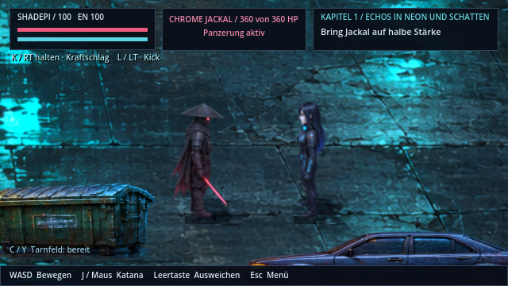

# Raven und Shadepi wieder in Originalgrafik

**v0.46.1 · CodexAI · 9. November 2026.** [Bildgalerie](README.md) · [Arbeits-/Prüfnachweis](arbeiten/original-helden-v0461.md).

Auf ausdrücklichen Nutzerwunsch verwenden beide Helden wieder ihre unveränderten Original-Sprites: `assets/sprites/heroes/raven.png` und `shadepi.png`. Die automatische Ersetzung durch die v0.45.0-Variante ist entfernt. Acht Richtungen, acht Gehphasen, Originalmaßstab und ursprüngliche Abtastung sind wieder aktiv. Nach Sonderangriffen wird diese Abtastung ebenfalls wiederhergestellt.

[**Kurzen Film mit Richtungs- und Gehwechseln öffnen**](previews/original-helden-v0461.webp)

Die aktuelle Aufnahme stammt aus Godot 4.7.2 / OpenGL, mit den echten normalen Spielfiguren und derselben Kamera wie der vorherige Vergleich. QA platziert die Figuren im Straßenraum und spielt ihre vorhandenen Laufphasen ab. Keine neue Grafikgenerierung oder nachgezeichneten Ersatzfiguren.

Die übrigen Fehlerkorrekturen, Sonderangriffe, Szenenreaktionen und Bluteffekte bleiben erhalten. Bestehende Spielstände und eigene Sprite-Ersetzungen funktionieren weiter. Die verworfenen v0.45.0-Dateien bleiben als historische Quelle erhalten und werden nicht automatisch aktiviert. Die beiden Heldenkarten und die vollständige 23-Figuren-Übersicht der [Stilbibel](stilbibel/figuren.md) zeigen wieder die Originale.
